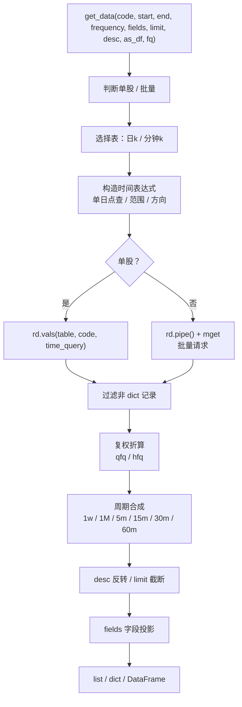

# free-stockdb 源码阅读（五）：Python SDK 的查询编排

> 基于 commit `f352641`，2026-10-05。
> 系列：free-stockdb 源码阅读（5/10）。

## 一句话概括

`pybao/stock_sdk.py` 是 free-stockdb 的"总调度"：它把用户的一句 `get_data(code, start, end, frequency, fields, limit, desc, as_df, fq)` 翻译成底层 `rd` 查询，再把松散的记录整理成统一的 list / dict / DataFrame。

它不实现存储，也不实现指标公式；它的价值在于**把多个底层能力编排成一个稳定的对外契约**。

## 一次 `get_data` 的流水线



这条流水线的顺序很重要：

1. **先取原始记录**；
2. **再复权**（复权要基于原始价格和因子）；
3. **再合成周期**（周 K 的开高低收要基于已复权的日 K）；
4. **再排序/截断/投影**。

如果顺序反过来，比如先 `limit` 再复权，就会只复权一部分数据；先投影再合成，就会缺 open/high/low/close 字段。顺序不是实现细节，是正确性的一部分。

## 同步与异步：两份几乎一样的代码

`get_data`（`stock_sdk.py:425-511`）和 `get_data_async`（`stock_sdk.py:514-593`）几乎是逐行对应的：

```python
# 同步
res = self.rd.vals(table, single_code, time_query)

# 异步
res = await self.rd.vals(table, single_code, time_query)
```

批量路径也一样，只是 `pp.do()` 变成了 `await pp`。剩下 90% 的过滤、复权、合成、截断、投影代码完全重复。

**好在哪**：对外同时提供同步和异步，调用方不用自己包 `asyncio.run` 或线程池；对回测和 Notebook 都友好。

**问题在哪**：两份逻辑迟早会漂移。今天修了同步路径的复权边界，明天可能忘了异步路径。更合理的做法是把"纯变换"抽成一个函数：

```python
def _transform(records, code, frequency, fq, desc, limit, fields):
    records = [r for r in records if isinstance(r, dict)]
    if fq in ("qfq", "hfq"):
        records = self._apply_fq_in_memory(code, records, fq)
    if frequency in ("1w", "1M"):
        records = self._merge_to_period(records, frequency)
    elif frequency in ("5m", "15m", "30m", "60m"):
        records = self._merge_minutes_to_period(records, frequency)
    if desc and frequency in ("5m", "15m", "30m", "60m", "1w", "1M"):
        records = records[::-1]
    if limit is not None:
        records = records[:limit]
    if fields:
        records = self._filter_fields(records, fields)
    return records
```

这样同步和异步只差"怎么取数据"这一行。

## 单股与批量：两种底层协议

单股走 `rd.vals`：

```python
# stock_sdk.py:453-457
if len(codes) == 1:
    single_code = codes[0]
    res = self.rd.vals(table, single_code, time_query)
    data_dict[single_code] = list(res)
```

多股走 pipeline：

```python
# stock_sdk.py:458-470
pp = self.rd.pipe()
for c in codes:
    pp.mget(table, c, time_query)
raw = pp.do()
if not isinstance(raw, list):
    raw = [raw]

for c, items in zip(codes, raw):
    data_dict[c] = [items] if isinstance(items, dict) else (
        [item[1] for item in items if isinstance(item, (list, tuple)) and len(item) > 1]
        if isinstance(items, list) else []
    )
```

这里有一个值得注意的"形状适配"：`mget` 返回的可能是 dict，也可能是 `(key, value)` 对列表，代码用类型判断把两种形状都归一成"记录列表"。这不是优雅的强类型接口，但在一个以 dict/二维数组为核心的数据库里很实用。

批量查询的性能意义很大：一次 pipeline 把 N 个股票的查询打包发出去，避免 N 次往返。对于全市场几千只股票的回测，这是数量级的差别。

## 结果整形：list / dict / DataFrame 三态

`get_data` 的返回形状由三个开关决定：

| 开关 | 结果 |
|------|------|
| 单股 + `as_df=False` | `list[dict]` |
| 多股 + `as_df=False` | `{code: list[dict]}` |
| `fields=...` | 每行变成 list（列投影） |
| `as_df=True` | DataFrame（批量多一列 `code`） |

`_to_dataframe`（`stock_sdk.py:82-126`）对批量模式做了一件事：

```python
for code, records in data.items():
    for r in records:
        record_dict = dict(zip(fields_list, r)) if isinstance(r, list) else r.copy()
        record_dict["code"] = code
        all_records.append(record_dict)
df = pd.DataFrame(all_records)
```

**好在哪**：把"按股票分组"的嵌套结构拍平成一张表，并补上 `code` 列。这是回测/分析最常用的形态。

**代价**：如果数据很大，`all_records` 会在内存里复制一遍；`pandas` 不是必需依赖，代码用延迟 import 保证没装 pandas 也能用核心功能。

## 优秀代码：聚合前强制保持时间升序

```python
# stock_sdk.py:446-449
requires_aggregation = frequency in ('5m', '15m', '30m', '60m', '1w', '1M')
retrieval_desc = desc and not requires_aggregation
time_query = self.build_time_query_for_retrieval(start, end, retrieval_desc, frequency)
```

这段很短，但避免了一个典型 bug：**周 K/月 K 的合成必须按时间升序读**，否则"第一根日 K 的 open"和"最后一根日 K 的 close"会反过来。代码的做法是：

- 需要合成时，强制底层按升序取；
- 合成完成后再按用户要求 `desc` 反转。

**模式**：先满足算法前提，再满足展示顺序。不要把用户的排序偏好直接传进需要顺序保证的算法。

## 代码里可以再改进的地方

1. **同步/异步重复**（见上）。这是最值得重构的一处。
2. **复权因子加载吞异常**（`stock_sdk.py:45-46`）：

   ```python
   except Exception:
       pass
   ```

   如果因子加载失败，后续 `_apply_fq_in_memory` 会因为没有因子直接返回原始价格，用户拿到的是"看起来正常、其实未复权"的数据。应至少记录 warning，或提供一个 `fq_loaded` 状态让调用方判断。

3. **批量结果的形状判断有点脆**。`isinstance(items, dict)` / `isinstance(items, list)` 依赖底层实现的返回习惯；如果底层某天返回 tuple 或生成器，这里会静默变成空列表。
4. **`as_df=True` 与 `fields` 同时使用时的列名**依赖 `_to_dataframe` 的 `fields_list`，如果 `fields` 是字符串含空格，需要先 split/strip；代码已经处理，但值得测试覆盖。
5. **`desc=True` + `limit` 的语义依赖底层方向符**，不能想当然：
   - 没有 `start`/`end` 时，`_build_time_query` 返回 `*`，`desc` 不影响查询；非合成路径也不会反转，`records[:limit]` 取的是底层默认顺序的前 N 根（通常是升序的最早 N 根）。
   - 有 `start`/`end` 时，`retrieval_desc = desc`，方向符随 `desc` 变化；非合成路径按底层方向返回后再取前 N 根。
   - 需要合成时，SDK 强制升序取数，合成后按 `desc` 反转，再 `limit`；这一条语义是清晰的。

   建议为 `desc=True` + `limit` 写测试锁定行为，不要靠注释推断"取最近 N 根"。

## 骨架代码：把"取数"和"变形"分开

```python
class QueryService:
    def _transform(self, records, code, frequency, fq, fields, limit, desc):
        records = [r for r in records if isinstance(r, dict)]
        records = self._adjust(records, code, fq)
        records = self._aggregate(records, frequency)
        if desc and frequency in {"1w", "1M", "5m", "15m", "30m", "60m"}:
            records = records[::-1]
        if limit is not None:
            records = records[:limit]
        if fields:
            records = [[r.get(f) for f in fields] for r in records]
        return records

    async def get_async(self, code, **opts):
        raw = await self._fetch(code, **opts)
        return self._transform(raw, code, **opts)

    def get(self, code, **opts):
        raw = self._fetch_sync(code, **opts)
        return self._transform(raw, code, **opts)
```

**模式**：Pipeline / 纯函数变换。取数有同步/异步之分，变形没有；把变形抽出来，重复自然消失。

## 下一章

SDK 的流水线里，最复杂的两步是**周期合成**和**复权**。下一章先拆周期合成：周 K、月 K 和分钟 K 的时间轴到底怎么对齐。

---

> 系列导航：[（四）C++ 参考服务](04-cpp-server.md) · [（六）周期合成](06-period-aggregation.md)
