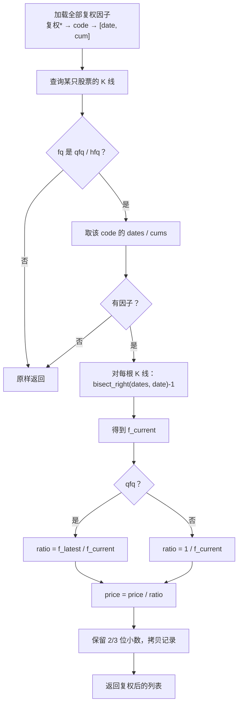

# free-stockdb 源码阅读（七）：复权，全市场因子与二分查找

> 基于 commit `f352641`，2026-10-05。
> 系列：free-stockdb 源码阅读（7/10）。

## 一句话概括

free-stockdb 不在存储时复权，而是**保存不复权价格 + 复权因子**，查询时在内存里折算。

`StockDBClient` 初始化时把全市场复权因子一次性读进两个平行数组：日期和累计因子；查询某只股票时，用 `bisect_right` 找到每根 K 线对应的因子，再按前复权/后复权公式缩放 OHLC。

## 数据结构

`__init__` 里（`stock_sdk.py:28-46`）：

```python
self._fq_dates = {}   # {code: [date_str, ...]}
self._fq_cums = {}    # {code: [cum_float, ...]}

tmp = defaultdict(list)
raw = self.rd.get("复权*").get("cum")
for item in raw:
    key_str, cum_val = item[0], float(item[1])
    parts = key_str.split(":")
    code, date = parts[1], parts[2]
    tmp[code].append((date, cum_val))

for code, pairs in tmp.items():
    self._fq_dates[code] = [p[0] for p in pairs]
    self._fq_cums[code] = [p[1] for p in pairs]
```

这里有一个前提：**LevelDB 的 key 天然有序，所以同一个 code 的因子按日期升序返回，不需要再排序。** 代码注释也明确写了这一点（`stock_sdk.py:41`）。

两个平行数组而不是 `list[dict]`，是为了后面能用 `bisect` 直接对日期数组做二分，不用构造额外的索引结构。

## 折算流程



关键代码（`stock_sdk.py:371-422`）：

```python
dates = self._fq_dates.get(code)
cums = self._fq_cums.get(code)
if not dates:
    return records

if fq_type == 'qfq':
    f_latest = cums[-1]

for r in records:
    r_date_str = str(r.get('date', ''))[:8]
    idx = bisect.bisect_right(dates, r_date_str) - 1
    f_current = cums[idx] if idx >= 0 else 1.0

    ratio = f_latest / f_current if fq_type == 'qfq' else 1.0 / f_current
    if abs(ratio - 1.0) < 1e-6:
        adjusted_records.append(r)
        continue

    r_copy = r.copy()
    for field in ['open', 'high', 'low', 'close', 'pre_close']:
        if field in r_copy and r_copy[field] is not None:
            r_copy[field] = round(float(r_copy[field]) / ratio, decimals)
    adjusted_records.append(r_copy)
```

如果把 `cum` 理解为"从上市到某日的累计乘数"，那么：

- **后复权**：直接乘当前 `cum`（代码里 `price / (1/cum) = price * cum`）；
- **前复权**：乘 `cum_current / cum_latest`（代码里 `price / (cum_latest/cum_current)`），这样最新一根 K 线的价格保持不变。

## 为什么用二分查找

复权因子只会在除权除息日变化。对于任意一根 K 线，需要的是"**小于等于该日期的最后一个因子**"，这是一个典型的 `bisect_right - 1`：

```text
dates:  20240101  20240601  20250101
cums:   1.00      1.20      1.35
query:  20240815
bisect_right(dates, "20240815") = 2
idx = 1 → f_current = 1.20
```

一次 O(log n) 查找，比线性扫因子表快；对全市场几千只股票、每只几百根 K 线，这个差异是数量级的。

**模式**：Sorted Array + Binary Search。前提是数据已经按 key 排序——LevelDB 的顺序在这里被直接复用了。

## 优秀代码：copy-on-write，不污染底层缓存

```python
r_copy = r.copy()
for field in [...]:
    r_copy[field] = ...
```

`r` 是底层 `rd.vals` 返回的 dict，可能来自缓存。如果直接改 `r`，同一份底层的未复权数据会被污染，后续查询不复权时就会拿到错误价格。复制一份再改，是最便宜的正确性保险。

**模式**：Immutable Read Model / Copy-on-Write。查询层不修改存储层返回的对象。

## 精度：为什么是 2 位或 3 位小数

```python
decimals = 3 if code.startswith(('1', '5')) else 2
```

A 股股票价格通常 2 位小数；ETF/可转债（1/5 开头）可能是 3 位。规则就在 `stock_sdk.py:388` 的 `decimals` 里（WPS/HTML 客户端也有同样的前缀判断）。复权后的价格也要遵守同样的展示精度，否则会出现 `10.5000000001` 这种噪声。

## 这套复权实现的边界

| 能做到 | 要注意 |
|--------|--------|
| 前复权 / 后复权 / 不复权 | 只调整 OHLC 和 pre_close，不调整 volume/amount |
| 单只股票按日期二分 | 因子在进程启动时一次性加载，同步新数据后不会自动刷新 |
| 分钟 K 复用日线因子（取前 8 位日期） | 分钟级公司行为（极少数）不单独处理 |
| 缺因子时原样返回 | **静默失败**：用户可能拿到未复权数据却不知道 |

最危险的是最后一条。`__init__` 里的因子加载被一个宽泛的 `except Exception: pass` 包住（`stock_sdk.py:45-46`）：

```python
except Exception:
    pass
```

如果 `rd.get("复权*")` 失败、返回格式变化、或某个 code 没有因子，后续 `_apply_fq_in_memory` 会直接返回原始记录。调用方看到的是"成功返回"，但数据其实是未复权的。

更稳妥的设计是：
- 记录一个 `self._fq_ready` 状态；
- 因子加载失败时抛错或至少 warning；
- 在结果里带一个 `fq_applied` 标志，让调用方能判断。

## 优秀代码：一次算 latest，不要每行重算

```python
if fq_type == 'qfq':
    f_latest = cums[-1]
```

`f_latest` 在循环外只取一次。如果放在循环里，每根 K 线都要访问列表尾；虽然不贵，但这是"把不变量提到循环外"的基本功。

## 骨架代码：查询时复权

```python
import bisect

def adjust(records, dates, cums, mode):
    if mode not in ("qfq", "hfq") or not dates:
        return records
    latest = cums[-1]
    out = []
    for r in records:
        d = str(r["date"])[:8]
        i = bisect.bisect_right(dates, d) - 1
        cur = cums[i] if i >= 0 else 1.0
        factor = cur / latest if mode == "qfq" else cur
        if abs(factor - 1.0) < 1e-9:
            out.append(r)
            continue
        r = r.copy()
        for k in ("open", "high", "low", "close", "pre_close"):
            if r.get(k) is not None:
                r[k] = round(r[k] * factor, 3 if str(r["code"]).startswith(("1", "5")) else 2)
        out.append(r)
    return out
```

注意这里的 `factor` 写法是"乘数"，和原文的 `ratio`（除数）等价：`price / (latest/cur) = price * cur/latest`。读别人的复权代码时，先确认他定义的是乘数还是除数，否则很容易把前后复权写反。

## 下一章

复权解决了价格口径。下一章看指标层：`zhibiao.py` 如何把 38 个普通指标 + zhishu 的名字、参数、字段、金叉模式整理成统一输入，再交给 `zb_core`。

---

> 系列导航：[（六）周期合成](06-period-aggregation.md) · [（八）指标层](08-indicators.md)
