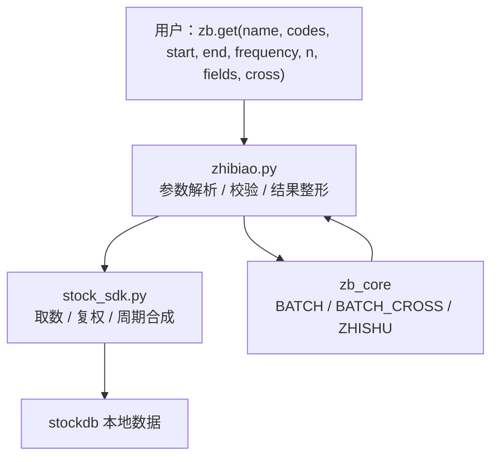

# free-stockdb 源码阅读（八）：指标层，薄适配器与编译核心

> 基于 commit `f352641`，2026-10-05。
> 系列：free-stockdb 源码阅读（8/10）。

## 一句话概括

`pybao/zhibiao.py` 不是指标公式库，而是一个**参数适配器**：它把 `zb.get("ma,kdj,macd", codes, n=..., cross=...)` 这样的用户输入，整理成 `zb_core` 能吃的数组和参数，再把计算结果整理成按股票分组的行记录。

真正算 MACD、KDJ、BOLL 的代码在 `zb_core` 二进制里，不在仓库中。这个分工本身，比任何一个指标公式都值得学。

## 分层



`zhibiao.py` 开头两行就说明了边界（`zhibiao.py:4-11`）：

```python
import zb_core
from zb_core import BATCH, BATCH_CROSS, ZHISHU
```

`zb_core` 提供三个批处理入口：

- `BATCH(names, params, arrays...)`：普通指标；
- `BATCH_CROSS(...)`：金叉/死叉；
- `ZHISHU(...)`：指数计算。

Python 层负责"用什么数据、按什么参数、结果长什么样"；核心层负责"向量化算得多快"。

## 输入：把松散参数收紧

### 指标名

```python
# zhibiao.py:365-377
def _indicator_names(name):
    items = name if isinstance(name, (list, tuple)) else str(name).replace("，", ",").split(",")
    names = [str(item).strip().lower() for item in items if str(item).strip()]
    if not names:
        raise ValueError("indicator name is empty")
    return names
```

支持 `"ma"`、`"ma,kdj,macd"`、`["ma", "kdj"]`，还顺手兼容了中文逗号 `，`。这是面向中文用户的小细节。

### 指标参数

`n` 是最容易出错的部分：单个指标可以传 `5`、`"5,10,20"`；多个指标可以传一个与名字对齐的列表，`n=None` 时每个指标使用空参数（由核心套用自己的默认值）。

```python
# zhibiao.py:413-430
def _indicator_params(names, n):
    if len(names) == 1:
        return [_int_list(n)]

    if n is None:
        return [[] for _ in names]

    if not isinstance(n, (list, tuple)):
        raise ValueError(_format_param_mapping_error(
            "multi indicator n must align with names:", names, n
        ))

    if len(n) != len(names):
        raise ValueError(_format_param_mapping_error(
            "multi indicator n length mismatch:", names, n
        ))

    return [_int_list(item) for item in n]
```

`_format_param_mapping_error` 会**返回**一张对齐表，再由调用方塞进 `ValueError`，告诉你哪个指标对应哪个参数、哪里多了/少了。这种错误信息比 `ValueError("参数错误")` 有用得多。

### 字段投影

```python
DATA_FIELD_INDEX = {
    "open": 2, "high": 3, "low": 4, "close": 5,
    "volume": 6, "amount": 7, "float_mv": 8, "total_mv": 9,
}
```

对于 `ma` / `ema` / `sma` / `wma` / `dma` / `std` / `sum` / `hhv` / `llv` / `ref` 这类基础指标，用户可以让它们作用在 `open`、`high`、`low`、`close`、`volume`、`amount` 上，而不只是收盘价。

实现方式很直接：把选中的字段数组复制到 `close` 的位置，再调 `BATCH`（`zhibiao.py:325-338`）：

```python
def _with_input_as_close(arrays, values):
    return (
        arrays[0], arrays[1], arrays[2], arrays[3], arrays[4],
        values,              # 用选中的字段替换 close
        arrays[6], arrays[7], arrays[8], arrays[9],
    )
```

如果一次选了多个字段，就对每个字段各算一遍，再用 `_merge_field_results` 按 `(code, date)` 合并。

## 金叉：三种输出模式

`cross` 参数控制输出：

| `cross` | 输出 |
|---------|------|
| `False` | 原始指标值 |
| `True` | 只输出金叉/死叉信号 |
| `"with_value"` | 原始指标 + 信号 |

信号含义：`1` 金叉、`-1` 死叉、`0` 无交叉。多指标时，`cross` 字段在所有单项都为 `1` 时为 `True`，否则为 `False`。这个组合规则由 `zb_core` 实现，文档在 `zb_test.py:148-150`；Python 层的 `_cross_indicator_result`（`zhibiao.py:289-304`）只负责把核心返回的 `cross` 值转成 `bool`/`int`。

这是一个很实用的设计：策略代码不用自己比较前后两根 K 线的 DIF/DEA，直接拿信号列即可。

## 指数：5 种加权方式

`zhishu` 是特殊指标，走 `ZHISHU`：

```python
# zhibiao.py:468-474
if names == ["zhishu"]:
    if _freq(frequency) != "1d" and method in (2, 5):
        raise ValueError("分钟K不含 float_mv/total_mv，只支持 method=1/3/4")
    result = _zhishu_result(ZHISHU(*arrays, method=method, base=base))
    if cross:
        raise ValueError("cross does not support zhishu")
    return result[1:]
```

5 种方法（`zhibiao.py:15`）：

1. 等权；
2. 流通市值加权；
3. 成交额加权；
4. 成交量加权；
5. 总市值加权。

这个守卫比注释更宽：条件是 `_freq(frequency) != "1d"`，所以分钟、周、月 K 调用方法 2/5 都会报错，尽管周/月合成后其实带着 `float_mv`/`total_mv`。原因写在错误信息里——分钟 K 没有市值字段；但实现把"非日 K"整体拒了。

`result[1:]` 去掉第一行。结合 `base=1000` 和指数序列的常见做法，可以推测第一行是基准日，但源码没有注释说明，属于合理推断。

## 优秀代码：校验和计算分离

`jisuan` 的前半段几乎全是校验：

```python
# zhibiao.py:476-487
supported = { ... 38 个普通指标（zhishu 单独处理）... }
for key in names:
    if key not in supported:
        raise ValueError(f"unsupported indicator: {key}")

if cross is not False and cross is not True and cross != "with_value":
    raise ValueError('cross only supports False, True, or "with_value"')
```

**好在哪**：在把数组送进二进制核心之前，把所有"用户可能写错"的情况挡掉。核心层不需要处理"name 是不是合法"、"cross 是不是布尔"这种问题，只专注计算。

**模式**：Input Validation Boundary。外部输入在进入高性能/不可控核心前，先归一化、校验、转成固定形状。

## 一个值得警惕的设计：import 时就有副作用

```python
# zhibiao.py:41-43
client = StockDBClient(host="127.0.0.1", port=7899)
rd = client.rd

# zhibiao.py:221
bk = BoardIndex()
```

这两行在模块导入时执行：

1. `StockDBClient` 会 `init()`，并预加载全市场复权因子；
2. `BoardIndex()` 会执行 `rd.get("板块*")`，把全部板块读进内存。

这意味着：

- `import zhibiao` 需要一个正在运行的 stockdb 服务；
- 导入可能很慢（全市场因子 + 板块）；
- 在测试环境里，导入即失败，除非你先 mock 掉 `stockdb` 或启动服务；
- 两个进程各自持有一份全量因子/板块缓存，内存不共享。

更干净的做法是延迟初始化（lazy singleton）或显式 `connect()`。在服务端常驻进程里，import 副作用可能还能接受；在库/测试里，它很讨厌。

## 这套指标层的边界

| 能做到 | 不能做到 |
|--------|----------|
| 38 个普通指标 + zhishu、5 种加权、金叉模式 | 自定义公式 / 插件式指标 |
| 多股票 × 多指标 × 多参数一次算 | 不依赖 `zb_core` 的纯 Python 实现 |
| 字段投影、结果按股票分组 | 指标之间的组合表达式（如 `ma5 > ma20`） |
| 中文逗号、列表/字符串两种输入 | 指标版本管理、公式审计 |

最后一点是这个架构最大的合规/研究风险：**你无法从源码验证指标公式**。如果策略依赖某个指标的精确口径，必须用已知数据做对照测试，不能假设"名字对，公式就对"。

## 骨架代码：一个参数适配器

```python
def run_indicator(names, codes, params, arrays, supported):
    single = isinstance(codes, str)
    names = normalize_names(names)
    for name in names:
        if name not in supported:
            raise ValueError(f"unsupported: {name}")

    params = align_params(names, params)
    result = CORE_BATCH(names, params, *arrays)
    return shape_result(result, single)
```

**模式**：Adapter + Facade。对外暴露一个简单入口，内部把多种输入形态翻译成核心能吃的固定形态。

## 下一章

指标算完了，还剩两个"查询型"能力：板块映射和私有存储。下一章看 `BoardIndex` 如何用几张倒排表把"股票 ↔ 板块"变成 O(1) 查询。

---

> 系列导航：[（七）复权](07-adjustment.md) · [（九）板块索引与私有存储](09-board-and-storage.md)
