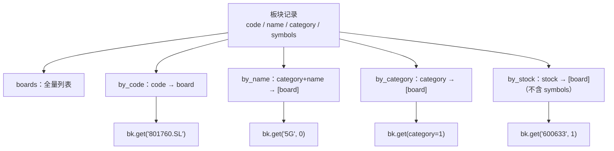

# free-stockdb 源码阅读（九）：板块索引与私有存储

> 基于 commit `f352641`，2026-10-05。
> 系列：free-stockdb 源码阅读（9/10）。

## 一句话概括

板块数据在 LevelDB 里只是 `板块:*` 下的一堆记录；`zhibiao.py` 的 `BoardIndex` 在进程启动时把它们全量读进内存，建了四张倒排表：按代码、按名称、按分类、按股票。

于是"600633 属于哪些概念""5G 板块有哪些股票"这类查询，从扫描数据库变成了内存字典查找。

## 索引结构



构建代码在 `BoardIndex._build`（`zhibiao.py:115-147`）：

```python
for key, board in self.rows:
    code = str(board.get("code", "")).strip()
    name = str(board.get("name", "")).strip()
    category = str(board.get("category", "")).strip()
    if not code or not name or not category:
        continue

    symbols = [self._stock_code(s) for s in board.get("symbols", []) or [] if str(s).strip()]
    item = {**board, "code": code, "name": name, "category": category, "symbols": symbols}

    self.boards.append(item)
    self.by_code[code] = item
    self.by_name[f"{category}_{name}"].append(item)
    self.by_category[category].append(item)

    stock_item = self._board(item, with_symbols=False)
    for stock in symbols:
        self.by_stock[stock].append(stock_item)
```

一次遍历，四张表都建好。`by_stock` 里存的是**不带 symbols 的板块摘要**，避免"每个板块的股票列表"在每只股票下重复一份；`by_code` / `by_name` 需要完整板块时再回到原记录。

## 查询语义

`BoardIndex.get` 的分支很多，但本质上是在回答三个问题：

### 1）查股票 → 板块

```python
bk.get("600633", 1)          # 600633 属于哪些申万一级板块
bk.get("600633", 1, "name")  # 只要板块名
```

`category` 编号映射（`zhibiao.py:53-58`）：

| 编号 | 分类 |
|------|------|
| 0 | 概念 |
| 1 | 申万一级 |
| 2 | 申万二级 |
| 3 | 申万三级 |

### 2）查板块 → 股票

```python
bk.get("5G", 0, "symbols")
bk.get("801170.SL")
```

精确命中 `by_code`，或 `category + name` 精确命中时，返回**单条**（完整板块或投影后的标量，如 `bk.get("5G", 0, "code")` → `'300843.TI'`，见 `zb_test.py:76-78`）；模糊匹配或无分类搜索才返回列表。

### 3）枚举分类

```python
bk.get(category=1, fields="name,code")
```

`x=None` + `category` 走 `by_category`，返回该分类下所有板块。

## 字段投影：一个字段和多个字段的返回形状不同

`_result`（`zhibiao.py:149-173`）有一个容易踩的行为：

```python
if fields:
    selected = fields.split(",")
    if len(selected) == 1:
        values = [item.get(selected[0]) for item in boards]
    else:
        values = [[item.get(key) for key in selected] for item in boards]
    if single:
        return values[0] if values else ([] if selected == ["symbols"] else None)
    return values
```

- 多板块 + `fields="name"` → `["传媒", "通信"]`
- 多板块 + `fields="group,name"` → `[["申万行业指数列表", "传媒"], ...]`
- 单板块 + `fields="symbols"` → 返回股票代码列表
- 单板块 + 其他单字段 → 返回标量
- 找不到 → 公开 `get` 的未命中路径都是 `single=False`，通常返回 `[]`，不是 `None`；`_result` 里的 `None` 分支只在直接调用 `_result(single=True)` 且空列表时可达

这种"单字段扁平、多字段二维、单条再降一维"的返回约定，和 pandas/NumPy 的 squeeze 有点像，但完全靠约定，没有类型系统保证。使用时最好先用 `bk.get(...)` 不带 fields 看完整结构，再加投影。

## 优秀代码：一次构建，多次查询

`BoardIndex` 的价值不在某个函数，而在**把查询模式提前物化**：

- 按股票查 → `by_stock`
- 按代码查 → `by_code`
- 按分类查 → `by_category`
- 按名称查 → `by_name`

如果没有这些索引，每次 `bk.get("600633")` 都要扫描全部板块并检查 `symbols`，复杂度 O(板块数 × 股票数)。建索引后是 O(1) 或 O(k)。

**模式**：Inverted Index / 空间换时间。这是搜索引擎和推荐系统里最基础的结构之一。

## 边界与问题

| 问题 | 说明 |
|------|------|
| 启动时全量加载 | `bk = BoardIndex()` 在 import 时执行（`zhibiao.py:221`），导入即读全量板块 |
| 数据更新后不刷新 | 新板块/新成分股要重启进程才能看到 |
| 无持久化 | 索引只在内存，进程退出即消失；每次启动重建 |
| 内存占用 | 板块数 × 成分股数 + 四张表；全市场概念板块可能很大 |
| 模糊匹配无排序 | `keyword in name` 按原始列表顺序返回，不按相关度 |
| 别名容忍拼写错误 | `symbls` 被当成 `symbols`（`zhibiao.py:47-52`），是兼容还是隐患取决于上下文 |
| 返回形状不统一 | 单条/多条、单字段/多字段的组合需要调用方自己处理 |

尤其注意 import 副作用：`zhibiao.py` 在模块级同时创建了 `client`、`rd` 和 `bk`。这意味着任何 `import zhibiao` 都会连接数据库、加载全市场复权因子、加载全部板块。对交互式研究很方便，对测试和库复用不友好。

## 私有存储：同一个 KV 引擎的另一种用法

README 还介绍了 `mydb` / 私有存储（`rd.set` / `rd.get` / `pipe`）：

```python
# 批量写入
pipeline = rd.pipe()
for i in range(10000000):
    pipeline.mset(table, key, key2, value)
await pipeline

# 单条写入
await rd.set(table, value)
await rd.set(table, key, value)
await rd.set(table, key, key2, value)

# 读取 / 修改
await rd.get(table, key, key2)
await rd.get(table, key, key2).get("sub_key").set("sub_sub_key").val("new_value")
```

它和行情数据共用同一套 `表:key:key2` 命名空间，因此可以：
- 把自定义因子/策略中间结果写进本地；
- 用 `rd.pipe()` 批量写；
- 用 `get/keys/vals` 做前缀、范围、正则、截取查询。

但注意：**这部分实现同样在 `stockdb` 二进制里**。仓库能验证的是调用协议，不是 WAL、并发写、崩溃恢复的实现。README 说"WAL 无丢失"，这是一条需要独立压测验证的产品声明。

## 骨架代码：构建倒排索引

```python
from collections import defaultdict

def build_board_index(rows):
    boards = []
    by_code, by_name, by_category, by_stock = {}, defaultdict(list), defaultdict(list), defaultdict(list)

    for _, b in rows:
        code, name, category = str(b["code"]), str(b["name"]), str(b["category"])
        symbols = [str(s).split(".")[0] for s in b.get("symbols", [])]
        item = {**b, "code": code, "name": name, "category": category, "symbols": symbols}

        boards.append(item)
        by_code[code] = item
        by_name[f"{category}_{name}"].append(item)
        by_category[category].append(item)

        summary = {k: v for k, v in item.items() if k != "symbols"}
        for symbol in symbols:
            by_stock[symbol].append(summary)

    return boards, by_code, by_name, by_category, by_stock
```

**模式**：一次遍历、多表物化。关键不是代码，而是先想清楚"用户会从哪个维度查"，再决定建哪几张表。

## 下一章

最后一个模块，也是这个项目最有意思的工程实现：`native_mcp.py`——用 482 行标准库，自己写一个 MCP 服务器。

---

> 系列导航：[（八）指标层](08-indicators.md) · [（十）自实现 MCP 与五种调用面](10-native-mcp.md)
