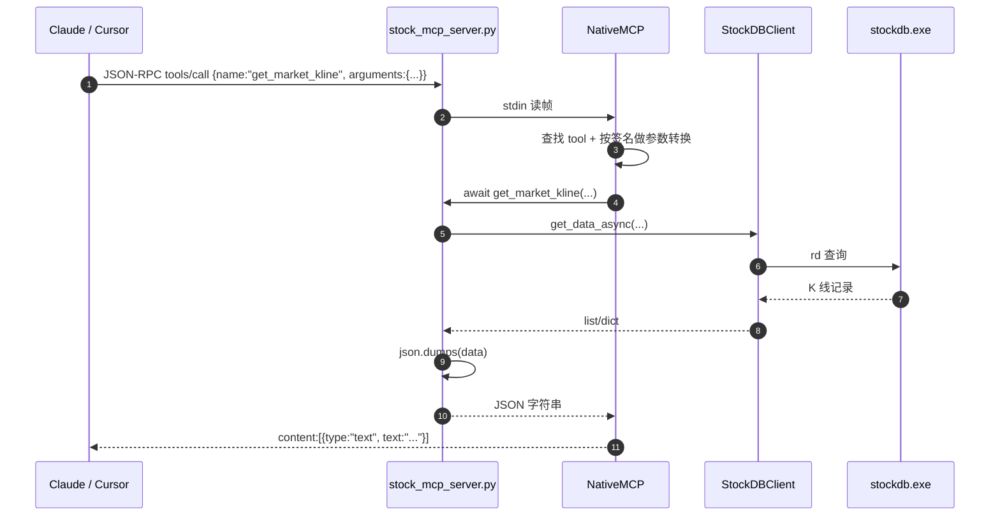

# free-stockdb 源码阅读（十）：自实现 MCP 与五种调用面

> 基于 commit `f352641`，2026-10-05。
> 系列：free-stockdb 源码阅读（10/10）。

## 一句话概括

`pybao/native_mcp.py` 用 **482 行标准库**实现了一个 MCP 服务器：不依赖 `mcp` SDK，不用 FastAPI，直接在 stdin/stdout 上收发 JSON-RPC 2.0，支持 tools、resources、prompts。

`调用方式/ai_mcp/stock_mcp_server.py` 在它上面只注册了一个工具 `get_market_kline`，就把本地行情库接给了 Claude Desktop / Cursor。

## 为什么自己写

市面上的 MCP 实现通常依赖官方 SDK。free-stockdb 的选择是：

- 用户环境可能没有 `pip install mcp`；
- 服务要作为单文件脚本随发行包分发；
- 只需要 tools/resources/prompts 的一个子集；
- stdio + JSON-RPC 的协议本身不复杂。

于是有了 `NativeMCP`：一个 482 行的"够用版"。

## 传输：两种帧格式都兼容

MCP 的 stdio 传输常见两种写法：

1. **换行分隔的 JSON**（一行一个 JSON 对象）；
2. **Content-Length 头 + JSON body**（类似 LSP）。

`_read_headers_and_body`（`native_mcp.py:106-170`）先读第一个非空白字节：

```python
first = stream.read(1)
if first == b"{":
    line = first + stream.readline()
    self._use_content_length = False
    return json.loads(line.decode("utf-8"))

# 否则按 header 解析，必须有 Content-Length
headers = {}
...
size = int(headers["content-length"])
body = stream.read(size)
self._use_content_length = True
return json.loads(body.decode("utf-8"))
```

回包时根据请求的帧格式选择对应写法（`native_mcp.py:88-96`）：

```python
if self._use_content_length:
    header = f"Content-Length: {len(body)}\r\n\r\n".encode("ascii")
    sys.stdout.buffer.write(header + body)
else:
    sys.stdout.buffer.write(body + b"\n")
```

**好在哪**：没有假设客户端用哪种帧格式，两种都吃。写本地 MCP 服务时，这一点能省掉很多"Claude Desktop 能连、Cursor 不能连"的调试。

## 分发：一个方法表

`_handle_request` 本质上是一个大的 if/elif 分发器（`native_mcp.py:179-303`）：

| 方法 | 作用 |
|------|------|
| `initialize` | 返回协议版本、capabilities、serverInfo |
| `ping` | 返回空结果 |
| `shutdown` | 标记退出 |
| `tools/list` | 返回工具名、描述、inputSchema |
| `tools/call` | 调用工具 |
| `resources/list` | 返回固定 URI 资源 |
| `resources/templates/list` | 返回模板 URI |
| `resources/read` | 读取资源 |
| `prompts/list` | 返回 prompt 定义 |
| `prompts/get` | 生成 prompt 消息 |

`initialize` 固定返回 `protocolVersion: "2024-11-05"`（`native_mcp.py:196-209`），没有做版本协商。对本地小服务够用；如果客户端升级到新协议，可能需要跟着改。

## 工具注册：从函数签名生成 schema

```python
# native_mcp.py:29-40
def tool(self, func=None, **kwargs):
    def decorator(f):
        self._tools[f.__name__] = {
            "name": f.__name__,
            "description": inspect.getdoc(f) or "",
            "inputSchema": self._build_input_schema(f, skip_params={"ctx", "self"}),
            "func": f,
            "sig": inspect.signature(f),
        }
        return f
    return decorator(func) if func else decorator
```

`_build_input_schema`（`native_mcp.py:408-428`）把 Python 类型标注映射成 JSON Schema：

```python
properties[param_name] = {"type": self._annotation_to_json_type(param.annotation)}
if param.default is inspect.Parameter.empty:
    required.append(param_name)
```

支持 `int` / `bool` / `float` / `list/tuple` / 默认 `string`。参数默认值决定是否 required；schema 里虽然声明了 `additionalProperties: false`，但**调用路径并没有按 schema 校验**：未知参数会被 `_invoke_callable` 静默忽略，缺失 required 参数则可能在调用函数时抛 `TypeError`。

这个"函数即工具"的方式非常适合本地服务：写一个带 docstring 的普通函数，就多了一个 AI 可调用的工具。

## 调用：类型强制转换 + 同步/异步统一

```python
# native_mcp.py:376-396
def _invoke_callable(self, func, sig, args, lifespan_ctx):
    call_kwargs = {}
    for param_name, param in sig.parameters.items():
        if param_name in {"ctx", "context"}:
            call_kwargs[param_name] = Context(lifespan_ctx)
            continue
        if param_name == "self":
            continue
        if param_name not in args:
            continue
        call_kwargs[param_name] = self._coerce_value(args[param_name], param.annotation)

    if inspect.iscoroutinefunction(func):
        return await func(**call_kwargs)
    return func(**call_kwargs)
```

三个细节：

1. **`ctx` / `context` 参数自动注入** `Context(lifespan_context)`；
2. **按标注做轻量转换**：`"10"` → `int`，`"true"` → `True`（`native_mcp.py:456-469`）；
3. **同步/异步统一**：`inspect.iscoroutinefunction` 判断后 await 或直接调用。

这对工具作者很友好：工具函数可以写成普通函数，也可以写成 async 函数。

## 资源和 prompt：能力齐全，例子没用

`resource` 支持两种 URI：

- 固定 URI，如 `stock://metadata`；
- 模板 URI，如 `stock://kline/{code}`，内部用正则匹配并提取参数（`native_mcp.py:42-61`）。

`prompt` 也实现了 `prompts/list` 和 `prompts/get`。但 `stock_mcp_server.py` 只注册了一个 tool，没有注册 resource 或 prompt：

```python
# stock_mcp_server.py:22-57
@mcp.tool()
async def get_market_kline(code: str, start: str = None, end: str = None,
                           frequency: str = "1d", fields: str = "...",
                           limit: int = 100) -> str:
    """获取A股股票行情K线数据。..."""
    data = await client.get_data_async(...)
    return json.dumps(data, ensure_ascii=False)
```

所以这个仓库**没有 LLM prompt 模板集**需要单独提取。离 prompt 最近的东西，是工具 docstring——它就是给模型看的"什么时候用、参数是什么、支持哪些周期"。这也是 MCP 工具设计的核心：**docstring 不是注释，是模型契约。**

另外，README 说 AI 可以通过 MCP 调用 `get_data()`、`zb.get()`、`bk.get()`；但示例 `stock_mcp_server.py` 只暴露了 `get_market_kline`，没有注册指标或板块工具。**能力在 SDK 里有，MCP 的工具面没有全部铺开。**

## 一次 MCP 工具调用



## 这套实现的局限

| 局限 | 影响 |
|------|------|
| 单线程读循环 | 一个慢工具会阻塞后续请求 |
| 固定协议版本 | 客户端升级后可能需要改代码 |
| 无批量请求 | 多个工具调用要逐个往返 |
| 无取消/进度通知 | 长查询无法中途取消 |
| schema 只有类型，没有描述/枚举 | 模型对参数的理解依赖 docstring |
| schema 不强制校验 | 未知参数被忽略，缺失 required 参数可能在函数调用时抛 `TypeError` |
| 无认证 | stdio 本地进程，通常可接受；但不要暴露到网络 |
| 手写 JSON-RPC | 错误码、通知、边界情况需要自己兜住 |

不过，对于一个"本地行情查询"服务，这些取舍是合理的：**协议够用、依赖为零、部署只需一个 Python 进程。**

## 五种调用面：同一个引擎，五种薄壳

| 调用面 | 实现 | 查询方式 |
|--------|------|----------|
| Python SDK | `stock_sdk.py` | `init(host, port)` + `rd.vals` / `pipe` |
| HTTP | `cpp/src/server.cpp:252-275`（服务端）；`http_api.py` 是调用示例 | `GET /?cmd=get&t=日k:600702:20260623` |
| Excel/WPS | `wps_js_macro.js` | 自定义函数 `GP(...)` + 同步 XHR |
| HTML | `数据网页版.html` | `fetch` + `URLSearchParams` + 表格渲染 |
| MCP | `native_mcp.py` + `stock_mcp_server.py` | stdio JSON-RPC |

它们共享同一套 key 协议和本地引擎，但**各自实现了一部分复权/周期合成逻辑**：

- Python：`stock_sdk.py:128-422`
- WPS：`wps_js_macro.js:155-438`
- HTML：`数据网页版.html:744-827`（复权）、`1015-1099`（日 K 合成）、`1102-1212`（分钟合成）

而且副本并不等价：WPS / `http_js.js` 的分钟合成按自然分钟分组，Python / HTML 按交易时段对齐（见第六篇）。这就是"多端零依赖"的代价：一份计算逻辑，多种语言，多个副本，而且已经分叉。短期看是分发便利，长期看是一致性风险。比较务实的治理方式是：

1. 给所有实现准备同一组黄金样例（固定输入 → 固定输出）；
2. 把复权/合成下沉到服务端作为可选参数；
3. 或者抽一个可被 WPS/HTML 共用的 JS 包。

## 优秀代码：stdout 只走一条路

MCP 走 stdio，最怕业务代码 `print()` 把日志混进协议流。`NativeMCP` 做了两件事：

- 所有协议响应都经过 `send_message`，用 `asyncio.Lock` 串行写 stdout（`native_mcp.py:88-96`）；
- 错误日志明确写 stderr（`native_mcp.py:481-482`）：

```python
def _log_stderr(self, message: str) -> None:
    print(message, file=sys.stderr, flush=True)
```

**模式**：Single Writer / Channel Separation。协议通道和日志通道必须物理分开；否则一个 `print` 就能让客户端解析失败。

## 骨架代码：最小 MCP 工具服务器

```python
import asyncio, inspect, json, sys

class MiniMCP:
    def __init__(self, name):
        self.name = name
        self.tools = {}

    def tool(self, fn):
        self.tools[fn.__name__] = fn
        return fn

    async def handle(self, req):
        method, rid = req.get("method"), req.get("id")
        if method == "initialize":
            return {"jsonrpc": "2.0", "id": rid, "result": {
                "protocolVersion": "2024-11-05",
                "capabilities": {"tools": {}},
                "serverInfo": {"name": self.name, "version": "1.0"},
            }}
        if method == "tools/list":
            return {"jsonrpc": "2.0", "id": rid, "result": {"tools": [
                {"name": n, "description": inspect.getdoc(f) or "", "inputSchema": {"type": "object"}}
                for n, f in self.tools.items()
            ]}}
        if method == "tools/call":
            name = req["params"]["name"]
            args = req["params"].get("arguments", {})
            out = await self.tools[name](**args) if inspect.iscoroutinefunction(self.tools[name]) else self.tools[name](**args)
            return {"jsonrpc": "2.0", "id": rid, "result": {
                "content": [{"type": "text", "text": json.dumps(out, ensure_ascii=False)}]
            }}
        return {"jsonrpc": "2.0", "id": rid, "error": {"code": -32601, "message": "not found"}}

    async def run(self):
        while line := await asyncio.to_thread(sys.stdin.readline):
            req = json.loads(line)
            resp = await self.handle(req)
            sys.stdout.write(json.dumps(resp, ensure_ascii=False) + "\n")
            sys.stdout.flush()
```

这只是最小骨架：真实实现还要处理 Content-Length 帧、通知、异常、资源和 prompt。但它说明了 MCP 的核心并不神秘：**一个读循环 + 一个方法分发 + 一个 JSON 返回。**

## 收尾：这个仓库最值得带走的三件事

1. **同步与查询解耦**：manifest 驱动更新，查询只读本地；数据源换了，研究代码不变。
2. **key 即协议**：把查询模式编码进有序 key，LevelDB 的前缀/范围扫描就是查询引擎。
3. **薄适配器 + 多端分发**：Python/HTTP/Excel/HTML/MCP 共用一套语义；但要警惕多端复制的计算逻辑。

free-stockdb 的源码不是"完整可复刻的数据库"，而是一份**本地数据引擎的接口设计样本**。核心引擎在二进制里，但协议、同步、查询编排、MCP 这些"最后一公里"的工程，已经足够值得读。

---

> 系列导航：[（九）板块索引与私有存储](09-board-and-storage.md) · [返回系列目录](../index.md)
