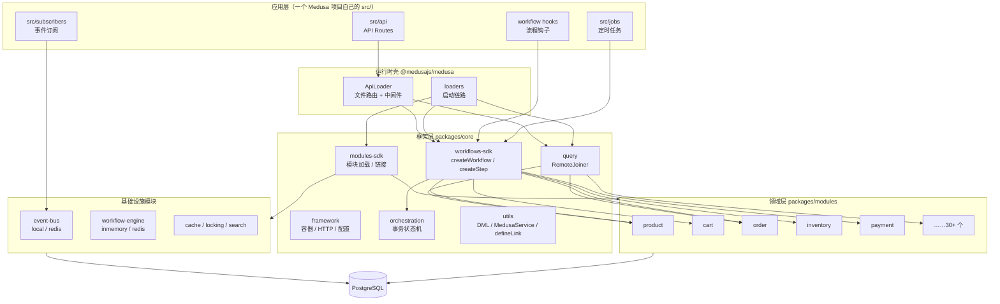
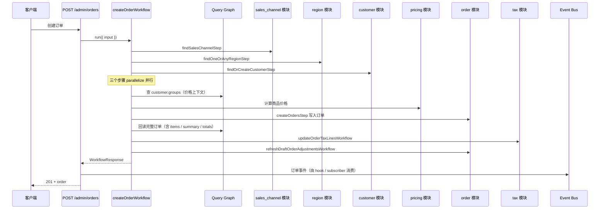

# Medusa 源码阅读（一）：一个电商平台怎么拆成 34 个模块

> 基于 Medusa v2.22.7（`develop` 分支，commit `f9ae213`，2026-11-19）源码分析。仓库 [medusajs/medusa](https://github.com/medusajs/medusa)，除 `ENTERPRISE-LICENSE.md` 标明的企业版材料外为 MIT。
> 系列：Medusa 源码阅读（1/10）。

## 一句话概括

Medusa 是一个开源的电商后端。它没有把商品、购物车、订单、库存、支付写成一个巨型 service，而是把每个能力拆成独立模块（module），再用三层东西把它们拼起来：

- **Module Links**：模块之间的关系表——不建外键，只记录「A 的哪条记录对应 B 的哪条记录」
- **Query Graph**：跨模块读——一次查询可以同时读订单、客户、商品，但每个模块只暴露自己的数据
- **Workflow**：跨模块写——把多个模块的写操作编排成一张可补偿的步骤图，任何一步失败，已经完成的步骤自动回滚

它要解决的核心矛盾是：**模块之间既要完全解耦，业务上又要能跨模块读和写。**

## 目录

- [生活比喻：一座购物中心](#生活比喻一座购物中心)
- [仓库长什么样](#仓库长什么样)
- [分层架构](#分层架构)
- [启动链路：从 `medusa develop` 到接收第一个请求](#启动链路从-medusa-develop-到接收第一个请求)
- [模块加载：配置怎么变成可解析的服务](#模块加载配置怎么变成可解析的服务)
- [三种运行模式](#三种运行模式)
- [一次下单穿过哪些层](#一次下单穿过哪些层)
- [为什么要这么拆](#为什么要这么拆)
- [代价是什么](#代价是什么)
- [本系列的阅读地图](#本系列的阅读地图)
- [动手验证](#动手验证)

## 生活比喻：一座购物中心

把 Medusa 想成一座购物中心：

| 角色 | 对应架构 | 职责 |
|------|---------|------|
| **独立店铺** | `packages/modules/*` | 商品店、购物车店、订单店、库存店……各自有仓库（数据表）和账本（service），互不翻对方账本 |
| **商场走廊** | `defineLink` + link module | 只记录「订单店的 #123 对应购物车店的 #456」，走廊本身不拥有商品 |
| **总服务台** | Query Graph | 顾客问「我的订单里有哪些商品」，服务台分别去订单店和商品店取资料，再拼成一份答案 |
| **购物行程单** | Workflow | 「退货」要跑订单店、库存店、支付店；任何一店失败，前面办过的手续全部撤销 |
| **商场物业** | 依赖注入容器（Awilix） | 提供水电煤（数据库连接、日志、事件总线），但不让 A 店直接拿 B 店的钥匙 |
| **夜班保安** | worker mode | 白天接待顾客的进程不干后台活；发邮件、跑定时任务交给独立的 worker 进程 |

最重要的一句话是：**店铺之间不直接说话，只能走走廊（link）和服务台（query），涉及多家店同时改数据时必须走行程单（workflow）。**

## 仓库长什么样

先看规模。以下数字都可以在克隆下来的仓库里用命令复现：

| 指标 | 数量 | 统计方式 |
|------|------|---------|
| 顶层 workspace | 11 个 | `packages/` 一级目录 |
| 带 `package.json` 的包 | 85 个 | `find packages -name package.json` |
| TypeScript 文件 | 6196 个 | `find packages -name '*.ts'` |
| TypeScript 代码行 | 约 65.3 万行 | 统计所有 `.ts` 文件的行数 |
| 领域模块目录 | 37 个 | `packages/modules/` 下目录数；`providers/` 下另有 17 个 provider 实现 |
| 容器里的模块 key | 34 个 | `Modules` 常量 |
| HTTP 集成测试文件 | 141 个 | `integration-tests/http/__tests__/**/*.spec.ts` |

顶层目录分成四个圈层：

```text
packages/
├── medusa/            # 主应用包：内置 API 路由、加载器、CLI 命令
├── core/              # 框架层：framework / modules-sdk / workflows-sdk / orchestration / query / utils / types
├── modules/           # 领域层：37 个模块目录（商品、购物车、订单、库存、支付、促销……）
│   └── providers/     # 17 个 provider 实现：支付、物流、文件、通知等服务商
├── admin/             # 后台管理面板（React + Vite）
├── cli/               # medusa 命令行
├── plugins/           # 官方插件（如 loyalty）
└── design-system/     # 管理面板的 UI 组件库
integration-tests/
├── http/              # 全栈 HTTP 测试（141 个 spec）
└── modules/           # 模块级集成测试
www/                   # 文档站（docs.medusajs.com 的源码）
```

这里有个容易误解的地方：`packages/medusa` 不是「所有业务逻辑」，它更像一个**运行时壳**——加载 `src/api` 下的路由、`src/subscribers` 下的事件订阅、`src/jobs` 下的定时任务，然后把 `packages/modules/*` 里的模块装配起来。真正的电商能力都在 `modules/`。

## 分层架构



注意箭头方向：**路由不直接调用领域模块**。读操作走 Query，写操作走 Workflow。这是整个代码库最一致的约定，也是后面九篇文章的骨架。

## 启动链路：从 `medusa develop` 到接收第一个请求

入口在 `packages/medusa/src/loaders/index.ts`。这是整个后端最值得先读的文件，不到 250 行，把「一个进程启动时按什么顺序装配什么」交代得很清楚：

```ts
// packages/medusa/src/loaders/index.ts:162-222（有删节）
export default async ({ directory: rootDirectory, expressApp, skipLoadingEntryPoints = false }) => {
  const container = await initializeContainer(rootDirectory)
  const configModule = container.resolve(ContainerRegistrationKeys.CONFIG_MODULE)
  const logger = container.resolve(ContainerRegistrationKeys.LOGGER)

  const plugins = await getResolvedPlugins(rootDirectory, configModule, true)
  mergePluginModules(configModule, plugins, rootDirectory)

  Object.keys(configModule.modules ?? {}).forEach((key) => validateModuleName(key))

  const linksSourcePaths = plugins.map((plugin) => join(plugin.resolve, "links"))
  await new LinkLoader(linksSourcePaths, logger).load()

  await loadSearchIndexes({ plugins, configModule, logger })

  const { onApplicationStart, onApplicationShutdown, modules, gqlSchema } =
    await new MedusaAppLoader().load()

  const workflowsSourcePaths = plugins.map((p) => join(p.resolve, "workflows"))
  await new WorkflowLoader(workflowsSourcePaths, container).load()

  await subscribersLoader(plugins, container)

  if (shouldLoadBackgroundProcessors(configModule)) {
    await jobsLoader(plugins, container)
  }

  const entrypointsShutdown = skipLoadingEntryPoints
    ? () => {}
    : await loadEntrypoints(plugins, container, expressApp, rootDirectory)

  const { createDefaultsWorkflow } = await import("@medusajs/core-flows")
  await createDefaultsWorkflow(container).run()
  await onApplicationStart()

  return { container, app: expressApp, shutdown, modules, gqlSchema }
}
```

按时间顺序画出来：

```mermaid
flowchart LR
    A["feature flags<br/>应用 → 框架"] --> B["configLoader<br/>medusa-config.ts"]
    B --> C["pgConnectionLoader<br/>PostgreSQL"]
    C --> D["LinkLoader<br/>收集 defineLink"]
    D --> E["MedusaAppLoader<br/>加载所有模块 + 链接模块"]
    E --> F["WorkflowLoader<br/>注册项目自定义 workflow"]
    F --> G["SubscriberLoader<br/>注册事件订阅"]
    G --> H{"workerMode?"}
    H -- "worker / shared" --> I["JobLoader<br/>注册定时任务"]
    H -- "server" --> J["跳过 JobLoader"]
    I --> K["expressLoader<br/>session / CORS / 安全头"]
    J --> K
    K --> L["adminLoader + apiLoader<br/>挂载路由"]
    L --> M["createDefaultsWorkflow<br/>建默认数据"]
    M --> N["onApplicationStart<br/>模块启动钩子"]
```



几个关键顺序不是随便排的：

1. **配置必须在所有东西之前**——模块连哪个数据库、开哪些 feature flag，都从 `configModule` 来。
2. **Links 在模块之前加载**——`LinkLoader` 导入 `defineLink` 文件、登记链接定义；模块加载完成后，`link-modules` 才知道要建哪些链接表。
3. **模块在 workflow 之前加载**——workflow 文件里会 `resolve(Modules.ORDER)`，模块服务必须先注册进容器。
4. **subscribers / jobs 在路由之前**——HTTP 层不依赖它们，但它们在 `onApplicationStart` 之前必须就位。
5. **`createDefaultsWorkflow` 在最后**——它依赖 modules 和 workflows 全部就绪。

## 模块加载：配置怎么变成可解析的服务

`MedusaAppLoader.load()` 最终落到 `packages/core/modules-sdk/src/medusa-app.ts` 的 `loadModules()`。这段代码做的事情可以概括为：**读配置 → 补默认值 → 逐个加载 → 注册进容器**。

```ts
// packages/core/modules-sdk/src/medusa-app.ts:250-283（有删节）
const loaded = await MedusaModule.bootstrapAll(modulesToLoad, {
  migrationOnly,
  schemaOnly,
  loaderOnly,
  workerMode,
  cwd,
})

if (loaderOnly) {
  return allModules
}

for (const { moduleKey } of modulesToLoad) {
  const service = loaded.find((loadedModule) => loadedModule[moduleKey])?.[moduleKey]
  if (!service) {
    throw new Error(`Module ${moduleKey} could not be loaded.`)
  }

  sharedContainer.register({
    [service.__definition.key]: asValue(service),
  })

  allModules[moduleKey] = service
}

return allModules
```

配置项有三种写法，最终都被归一化成同一个结构：

```ts
// 1. 布尔值：用默认可替换实现，或禁用
modules: { [Modules.ORDER]: true }

// 2. 简写：只给 resolver
modules: [{ resolve: "@medusajs/medusa/order" }]

// 3. 完整写法：带 options 和 definition
modules: [{
  key: "blog",
  resolve: "./src/modules/blog",
  options: { /* 模块自己的配置 */ },
  definition: { isQueryable: true },
}]
```

`loadModules()` 里还藏着一个很重要的默认行为：**核心模块不需要用户配置**。`defineConfig` 会把 `ModulesDefinition` 里所有带 `defaultPackage` 的模块补进配置，用户写不写 `modules`，订单、购物车、库存这些默认都在。用户配置同 key 的条目只是**替换**默认实现，不能把核心模块「删掉」。

## 三种运行模式

`projectConfig.workerMode` 决定一个进程扮演什么角色：

| 模式 | 加载 API 路由 | 加载定时任务 | 事件订阅 | 典型部署 |
|------|--------------|-------------|---------|---------|
| `server`（默认） | ✅ | ❌ | ✅ 但只注册，不消费 | Web 服务 |
| `worker` | ❌ | ✅ | ✅ 且消费事件 | 后台进程 |
| `shared` | ✅ | ✅ | ✅ 且消费事件 | 单机 / 开发环境 |

对应代码在启动链路里只有几个判断：

```ts
// packages/medusa/src/loaders/index.ts:40-49
const isWorkerMode = (configModule) => configModule.projectConfig.workerMode === "worker"

const shouldLoadBackgroundProcessors = (configModule) =>
  configModule.projectConfig.workerMode === "worker" ||
  configModule.projectConfig.workerMode === "shared"
```

`loadEntrypoints()` 里如果 `isWorkerMode()` 为真，直接返回一个空 shutdown，不挂任何路由。这是 Medusa 部署模型的核心：**同一个镜像，用环境变量切成 Web 进程和后台进程**。

## 一次下单穿过哪些层

用 `createOrderWorkflow` 串一下前面这些概念：



这张图里能看到三种跨模块通信方式，正好对应三个核心设计：

| 通信方式 | 场景 | 底层 |
|---------|------|------|
| 直接调用模块 service | 单一模块内部的读写 | `container.resolve(Modules.X)` |
| 跨模块读 | 需要多模块数据拼装 | Query Graph / `useQueryGraphStep` |
| 跨模块写 | 多个模块要一起成功或一起失败 | Workflow + 补偿 |
| 通知 | 不需要同步结果 | Event Bus |

## 为什么要这么拆

用「购物中心」的比喻继续：

**1. 店铺可以换，商场不用重建。**

支付模块支持 Stripe、PayPal 等多个 provider，文件模块支持 S3、本地存储。`ModuleProvider` 只要求 provider 实现固定接口并带一个 `identifier`，换实现不动业务代码。这是电商系统最现实的诉求——不同商户用不同支付渠道。

**2. 店铺之间不能直接拿钥匙。**

每个模块在加载时会创建一个**隔离容器**（`load-internal.ts:298-318`）：

```ts
const localContainer = createMedusaContainer()

const dependencies = resolution?.dependencies ?? []
dependencies.push(
  ContainerRegistrationKeys.MANAGER,
  ContainerRegistrationKeys.CONFIG_MODULE,
  ContainerRegistrationKeys.LOGGER,
  ContainerRegistrationKeys.PG_CONNECTION,
  Modules.EVENT_BUS,
  Modules.CACHING
)

for (const dependency of dependencies) {
  localContainer.register(
    dependency,
    asFunction(() => container.resolve(dependency, { allowUnregistered: true }))
  )
}
```

在订单模块内部 `container.resolve(Modules.CART)` 会失败——它只能拿到数据库、日志、事件总线这些公共资源。想读购物车？走 Query 或 link；想改购物车？走 workflow。**依赖关系被运行时限死了，不靠代码规约。**

**3. 同一份业务能力，Web 和后台进程都能用。**

模块和 workflow 跟 HTTP 无关。`worker` 进程不挂路由，但照样能跑 `createOrderWorkflow`，因为 workflow 只需要容器，不需要 Express。

**4. 应用是扩展，不是 fork。**

一个 Medusa 项目在自己的 `src/` 下写 `modules/`、`workflows/`、`api/`、`subscribers/`，升级时只升级依赖版本，不改框架源码。`MedusaAppLoader` 加载的是「内置模块 + 插件模块 + 项目模块」的并集。

## 代价是什么

这套架构不是没有成本，读源码时也要看到另一面：

| 代价 | 具体表现 | 缓解方式 |
|------|---------|---------|
| 概念多 | module / service / link / workflow / step / hook / subscriber / job，新手要理解一周 | 文档站就在仓库里，`AGENTS.md` 每个包一份 |
| 没有数据库外键 | 模块之间靠链接表，删除时可能留下孤儿记录 | `deleteCascade`、workflow 补偿、定期清理脚本 |
| 跨模块查询不是免费的 | 部分过滤条件下推不到 SQL，要在内存里做 residual filter | 查询 planner 会尽量下推，剩下的才走内存 |
| 事务不是数据库事务 | 跨模块的一致性靠补偿，不是 2PC | 每个 step 写补偿函数，workflow 引擎持久化状态 |
| 表多 | 每个模块自己的迁移 + 链接表迁移 + workflow 执行表 | `medusa db:migrate` 统一执行 |
| 调试链路长 | 一个请求可能穿过 route → workflow → 3 个模块 → event | 集成测试覆盖到 HTTP 层，workflow 执行记录可查 |

如果业务只有一个模块、团队只有两个人，这套拆分是过度设计。Medusa 的假设是：**电商迟早会长出支付、物流、促销、退货、多店铺，而这些能力的边界一开始就应该画好。**

## 本系列的阅读地图

| 篇目 | 回答的问题 | 关键文件 |
|------|-----------|---------|
| （一）架构全景 | 一个电商平台怎么分层、怎么启动 | `loaders/index.ts`、`medusa-app.ts` |
| （二）模块系统 | 一个类怎么长出整套 CRUD | `medusa-service.ts`、`load-internal.ts` |
| （三）数据层 | `model.define` 到 PostgreSQL 表 | `dml/`、`mikro-orm-repository.ts` |
| （四）Query Graph | 一条查询怎么跨模块拼装 | `query/`、`joiner/` |
| （五）Module Links | 没有外键，模块怎么建立关系 | `define-link.ts`、`link-modules/` |
| （六）Workflow DSL | 为什么构造函数只能写声明式代码 | `workflows-sdk/composer/` |
| （七）编排引擎 | 补偿事务和可恢复状态机 | `orchestration/transaction/` |
| （八）HTTP 层 | 文件即路由，配置即查询契约 | `framework/http/` |
| （九）订单模块 | 版本化数据与 Order Change | `modules/order/` |
| （十）事件与后台任务 | 事件总线、订阅、定时任务、worker | `event-bus-local/`、`subscriber-loader.ts` |

## 动手验证

```bash
# 版本与提交
cd source-read/medusa
git log -1 --format='%H %ad' --date=short   # f9ae213... 2026-11-19
grep '"version"' packages/medusa/package.json  # 2.22.7

# 规模
find packages -name package.json -not -path '*/node_modules/*' | wc -l   # 85
find packages -name '*.ts' -not -path '*/node_modules/*' | wc -l         # 6196
ls packages/modules | wc -l                                              # 37

# 启动链路
sed -n '162,247p' packages/medusa/src/loaders/index.ts

# 模块加载
sed -n '144,286p' packages/core/modules-sdk/src/medusa-app.ts
```

下一篇从最底层的构建块开始：`MedusaService({ Post })` 这一行，怎么生成 `createPosts`、`listPosts`、`softDeletePosts` 一整套方法，以及模块的隔离容器是怎么把内部 service 藏起来的。
