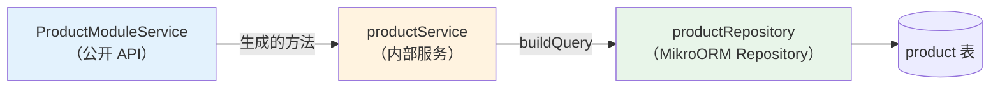

# Medusa 源码阅读（二）：一个类怎么长出整套 CRUD

> 基于 Medusa v2.22.7（`develop` 分支，commit `f9ae213`，2026-11-19）源码分析。
> 系列：Medusa 源码阅读（2/10）。

## 一句话概括

在 Medusa 里定义一个业务模块，通常只需要三个文件：一个数据模型、一个继承 `MedusaService` 的类、一个 `Module()` 包装。`MedusaService({ Product })` 这一行会在类上**动态生成 8 个方法**（`retrieveProduct`、`listProducts`、`createProducts`、`softDeleteProducts`……），每个方法自动套上三件事：注入数据库管理器、收集领域事件、序列化返回值。

这篇拆开这个「一行生成一套 CRUD」的工厂，以及模块的隔离容器是怎么把内部实现藏起来的。

## 目录

- [生活比喻：整店加盟包](#生活比喻整店加盟包)
- [一个最小模块长什么样](#一个最小模块长什么样)
- [MedusaService 工厂：方法名是怎么来的](#medusaservice-工厂方法名是怎么来的)
- [生成的方法体：三行代码 + 三个装饰器](#生成的方法体三行代码--三个装饰器)
- [三个装饰器分别在做什么](#三个装饰器分别在做什么)
- [内部服务与 Repository：真正碰数据库的一层](#内部服务与-repository真正碰数据库的一层)
- [Module() 还顺手做了链接配置](#module-还顺手做了链接配置)
- [隔离容器：模块之间不能互相 resolve](#隔离容器模块之间不能互相-resolve)
- [骨架代码：一个自己的 CRUD 工厂](#骨架代码一个自己的-crud-工厂)
- [这套设计的取舍](#这套设计的取舍)
- [动手验证](#动手验证)

## 生活比喻：整店加盟包

开一家便利店，你需要装修、货架、收银机、进货流程。加盟总部给你一个「整店包」：你只要说「我卖咖啡和面包」，总部就把收银、盘点、补货的标准流程配好，你只写咖啡怎么冲、面包怎么烤。

`MedusaService({ Product, ProductVariant })` 就是这个整店包：

- 你说「我有 Product 和 ProductVariant 两个模型」
- 它给你配好「查一个、查一批、查一批带总数、增、改、删、软删、恢复」八条标准流程
- 你只需要在标准流程不够用时，写自己的方法（比如「按 handle 查商品」「批量改价格」）

好处是**标准动作零代码**，坏处是**看不见的代码最难调试**——所以这篇要把它拆开。

## 一个最小模块长什么样

以 `packages/modules/product` 为例（只保留结构）：

```ts
// 1. 数据模型：packages/modules/product/src/models/product.ts:15-45（有删节）
import { model, ProductUtils } from "@medusajs/framework/utils"

const Product = model.define("Product", {
  id: model.id({ prefix: "prod" }).primaryKey(),
  title: model.text().searchable().translatable(),
  handle: model.text(),
  status: model.enum(ProductUtils.ProductStatus).default(ProductUtils.ProductStatus.DRAFT),
  // ... 几十个字段
})
```

```ts
// 2. 服务：packages/modules/product/src/services/product-module-service.ts（结构示意）
class ProductModuleService extends MedusaService({ Product, ProductVariant, ProductCategory }) {
  // 自定义方法写在这里；标准 CRUD 已经自动生成
}
```

```ts
// 3. 模块导出：packages/modules/product/src/index.ts
import { Module } from "@medusajs/framework/utils"
import ProductModuleService from "./services/product-module-service"

export default Module("product", { service: ProductModuleService })
```

`Module("product", ...)` 返回的对象还带一个 `linkable`：

```ts
import ProductModule from "@medusajs/medusa/product"

ProductModule.linkable.product          // { id: { serviceName: "product", field: "product", ... }, toJSON() }
ProductModule.linkable.productVariant
```

`defineLink(ProductModule.linkable.product, BlogModule.linkable.post)` 里的参数就是从这里来的。**模型定义一次，CRUD、查询入口、链接入口全部自动生成。**

## MedusaService 工厂：方法名是怎么来的

先看命名规则。`buildMethodNamesFromModel()` 负责把模型名变成方法名：

```ts
// packages/core/utils/src/modules-sdk/medusa-service.ts:33-67
const readMethods = ["retrieve", "list", "listAndCount"] as BaseMethods[]
const writeMethods = ["delete", "softDelete", "restore", "create", "update"] as BaseMethods[]
const methods: BaseMethods[] = [...readMethods, ...writeMethods]

function buildMethodNamesFromModel(
  defaultMethodName: string,
  model: ModelEntries[keyof ModelEntries]
): Record<string, string> {
  return methods.reduce((acc, method) => {
    let normalizedModelName: string = ""

    if (method === "retrieve") {
      normalizedModelName =
        model && "singular" in model && model.singular
          ? model.singular
          : defaultMethodName
    } else {
      normalizedModelName =
        model && "plural" in model && model.plural
          ? model.plural
          : pluralize(defaultMethodName)
    }

    const methodName = `${method}${upperCaseFirst(normalizedModelName)}`
    return { ...acc, [method]: methodName }
  }, {})
}
```

生成结果：

| 模型 | retrieve | list | create | update | delete | softDelete | restore |
|------|----------|------|--------|--------|--------|-----------|---------|
| `Product` | `retrieveProduct` | `listProducts` | `createProducts` | `updateProducts` | `deleteProducts` | `softDeleteProducts` | `restoreProducts` |
| `Order` | `retrieveOrder` | `listOrders` | `createOrders` | `updateOrders` | `deleteOrders` | `softDeleteOrders` | `restoreOrders` |

几个细节：

1. **单数/复数用 `pluralize()` 自动处理**，也可以用 `{ Product: { singular: "product", plural: "products" } }` 覆盖。
2. 模型 key 是 `ProductVariant` 时，方法名是 `listProductVariants`——`upperCaseFirst` 保留驼峰。
3. 方法名冲突时，子类自己定义的方法会覆盖生成的版本——这是「标准流程不够用就自己写」的入口。

## 生成的方法体：三行代码 + 三个装饰器

方法体本身很薄，核心是「从容器里拿到内部服务 → 调用 → 序列化」：

```ts
// packages/core/utils/src/modules-sdk/medusa-service.ts:164-183（有删节、简化）
let methodImplementation: any = function () {}

switch (method) {
  case "retrieve":
    methodImplementation = async function <T extends object>(
      this: AbstractModuleService_,
      id: string,
      config?: FindConfig<any>,
      sharedContext: Context = {}
    ): Promise<T> {
      const models = await this.__container__[
        `${lowerCaseFirst(modelName)}Service`
      ].retrieve(id, config, sharedContext)

      return await this.baseRepository_.serialize<T>(models)
    }

    applyMethod(methodImplementation, 2)
    break

  // create / update / list / listAndCount / delete / softDelete / restore 结构类似
}
```

真正有意思的是 `applyMethod()`——它在运行时把装饰器「贴」到动态方法上：

```ts
// packages/core/utils/src/modules-sdk/medusa-service.ts:149-162
const applyMethod = function (impl: Function, contextIndex) {
  klassPrototype[methodName] = impl

  const descriptorMockRef = {
    value: klassPrototype[methodName],
  }

  // The order of the decorators is important, do not change it
  MedusaContext()(klassPrototype, methodName, contextIndex)
  EmitEvents()(klassPrototype, methodName, descriptorMockRef)
  InjectManager()(klassPrototype, methodName, descriptorMockRef)

  klassPrototype[methodName] = descriptorMockRef.value
}
```

平时写 TypeScript 是 `@Decorator` 语法，由编译器展开；这里是**运行时手动调用装饰器函数**，因为方法本身就是运行时生成的，编译期根本不存在。

注释里那句「顺序很重要」不是客套：

- `MedusaContext` 先给参数打上「这是上下文参数」的标记；
- `EmitEvents` 包一层，方法成功后统一发事件；
- `InjectManager` 最外层，负责在调用前把数据库 manager 塞进上下文。

顺序反了，`InjectManager` 找不到 `MedusaContext` 标记会直接抛错（`inject-manager.ts:12-15`）。

## 三个装饰器分别在做什么

### `@MedusaContext()`

把一个普通参数标记成 Medusa 的 `Context`，并在类上记录参数下标：

```ts
// 概念示意
target.MedusaContextIndex_[propertyKey] = parameterIndex
```

后面的 `InjectManager`、`InjectTransactionManager`、`EmitEvents` 都靠这个下标找到「往哪个参数里塞东西」。

### `@InjectManager()`

给上下文注入一个 EntityManager。核心逻辑（`inject-manager.ts:17-68`）是：

```ts
const copiedContext = {} as Context
// 逐个属性代理到原 context，唯独不复制 transactionManager
const resourceWithManager = !managerProperty ? this : this[managerProperty]

copiedContext.manager ??= resourceWithManager.getFreshManager(originalContext)

if (originalContext?.transactionManager) {
  copiedContext.transactionManager = originalContext?.transactionManager
}

copiedContext.__type = MedusaContextType
args[argIndex] = copiedContext
return originalMethod.apply(this, args)
```

它做了一件很细的事：**如果上下文里已经有事务管理器，就复用；否则向 repository 要一个新鲜的 manager。** 这样同一个方法既能在事务里被调用，也能独立调用。

`@InjectTransactionManager()` 则是反过来——确保一定在一个事务里执行，没有就开一个新的。

### `@EmitEvents()`

收集方法执行过程中产生的事件，在方法成功后统一发出去：

```ts
// packages/core/utils/src/modules-sdk/decorators/emit-events.ts:21-48（有删节）
descriptor.value = async function (...args: any[]) {
  const result = await original.apply(this, args)

  const argIndex = target.MedusaContextIndex_[propertyKey]
  const aggregator = args[argIndex].messageAggregator as MessageAggregator

  if (aggregator.count() > 0) {
    await target.emitEvents_.apply(this, [aggregator.getMessages(options)])
    aggregator.clearMessages()
  }

  return result
}
```

关键点是**先执行业务、后发事件**：方法抛错时事件不会发出去。这避免「订单没创建成功，但 `order.created` 已经广播了」的尴尬。事件进入 `MessageAggregator`，再由 `emitEvents_` 交给 Event Bus——这部分在第十篇展开。

## 内部服务与 Repository：真正碰数据库的一层

`MedusaService` 生成的方法并不直接查库，它调用的是**内部服务**，命名规则是 `<modelName>Service`（首字母小写）。这些内部服务不是手写的，而是在模块加载时自动发现并注册的：

```ts
// packages/core/modules-sdk/src/loaders/utils/load-internal.ts:682-700（有删节）
const [moduleService, services, models, repositories] = await Promise.all([
  dynamicImport(modulePath).then((moduleExports) => {
    const mod = moduleExports.default ?? moduleExports
    return mod.service
  }),
  importAllFromDir(resolve(normalizedPath, "services")).catch(defaultOnFail),
  importAllFromDir(resolve(normalizedPath, "models")).catch(defaultOnFail),
  importAllFromDir(resolve(normalizedPath, "repositories")).catch(defaultOnFail),
])
```

`MedusaInternalService(model)` 为每个模型生成一个内部服务（`medusa-internal-service.ts:77-100`）：

```ts
export function MedusaInternalService(rawModel: any): InternalService {
  const model = DmlEntity.isDmlEntity(rawModel)
    ? toMikroORMEntity(rawModel)
    : rawModel

  const injectedRepositoryName = `${lowerCaseFirst(model.name)}Repository`
  // ...
}
```

再往下才是 `MikroOrmBaseRepository`（第三篇细讲）。所以调用链是：



三层各管一件事：

| 层 | 职责 | 谁可以调用 |
|----|------|-----------|
| Module Service | 公开 API、跨模块入口、事件发射 | 其他模块、workflow、API route |
| Internal Service | 单模型的 CRUD、软删除、批量操作 | 只允许本模块内部 |
| Repository | 查询构建、MikroORM 调用、序列化 | 内部服务 |

**跨模块只能看到第一层。** 这是 Medusa 模块边界的实际落点——不是约定，是容器里只有第一层。

## Module() 还顺手做了链接配置

`Module()` 做的事比看起来多（`module.ts:20-80`）：

```ts
service.prototype.__joinerConfig ??= () =>
  defineJoinerConfig(serviceName, {
    models: Object.keys(modelObjects).length
      ? Object.values(modelObjects)
      : undefined,
  })

const linkableKeys = service.prototype.__joinerConfig().linkableKeys
service.prototype.__joinerConfig().idPrefixToEntityName =
  buildIdPrefixToEntityNameFromDmlObjects(dmlObjects.map(([, model]) => model))

if (dmlObjects.length) {
  linkable = buildLinkConfigFromModelObjects(serviceName, modelObjects, linkableKeys)
} else {
  linkable = buildLinkConfigFromLinkableKeys(serviceName, linkableKeys)
}

return { service, loaders, linkable }
```

它自动生成三样东西：

1. **`__joinerConfig`**：告诉 Query Graph「这个模块有哪些实体、主键叫什么、能按什么字段过滤」；
2. **`idPrefixToEntityName`**：`prod_` → `Product`，`ord_` → `Order`，用于从 ID 反推实体类型；
3. **`linkable`**：给 `defineLink` 用的链接入口。

所以链接模块不需要你手写「product 表的主键是 id」这种元数据——只要模型是用 DML 定义的，元数据天然存在。

## 隔离容器：模块之间不能互相 resolve

模块加载时会创建一个只注册了公共依赖的局部容器（`load-internal.ts:298-327`）：

```ts
const localContainer = createMedusaContainer()

const dependencies = resolution?.dependencies ?? []
dependencies.push(
  ContainerRegistrationKeys.MANAGER,
  ContainerRegistrationKeys.CONFIG_MODULE,
  ContainerRegistrationKeys.LOGGER,
  ContainerRegistrationKeys.PG_CONNECTION,
  Modules.EVENT_BUS,
  Modules.CACHING
)

for (const dependency of dependencies) {
  localContainer.register(
    dependency,
    asFunction(() => container.resolve(dependency, { allowUnregistered: true }))
  )
}
```

`resolution.dependencies` 是这个模块显式声明的依赖（比如 payment 模块依赖 locking）。除此之外，只有数据库、配置、日志、事件总线、缓存五样公共资源。

后果很直接：**在订单模块的代码里 `localContainer.resolve(Modules.CART)` 会解析失败。** 必须走：

- 读：`query.graph({ entity: "cart", ... })`
- 写：调用一个编排了 cart 模块的 workflow
- 关系：用 `defineLink`

这条限制让「模块之间是否耦合」变成编译期看不出来、运行期立即暴露的问题。对大型代码库来说，这比 Code Review 可靠。

## 骨架代码：一个自己的 CRUD 工厂

去掉 Medusa 的业务细节，这个模式可以这样复用：

```ts
// 动态生成标准 CRUD + 装饰器
type Model = { name: string; plural: string }

function ServiceFactory<TModels extends Record<string, Model>>(models: TModels) {
  class Base {
    constructor(public db: any, public container: Record<string, any>) {}

    serialize<T>(value: T): T {
      return value
    }
  }

  for (const [key, model] of Object.entries(models)) {
    const singular = model.name
    const plural = model.plural
    const internalName = `${singular[0].toLowerCase()}${singular.slice(1)}Service`

    const methods = {
      [`retrieve${singular}`]: async function (this: any, id: string, ctx: any = {}) {
        return this.serialize(await this.container[internalName].retrieve(id, ctx))
      },
      [`list${plural}`]: async function (this: any, filters: any = {}, ctx: any = {}) {
        return this.serialize(await this.container[internalName].list(filters, ctx))
      },
      [`create${plural}`]: async function (this: any, data: any, ctx: any = {}) {
        return this.serialize(await this.container[internalName].create(data, ctx))
      },
      // update / delete / softDelete / restore 同理
    }

    for (const [name, fn] of Object.entries(methods)) {
      Object.defineProperty(Base.prototype, name, {
        value: withContext(withEvents(withManager(fn))),
        configurable: true,
      })
    }
  }

  return Base
}

// 你的项目：给每个模型免费拿到标准 CRUD
// withContext / withEvents / withManager 是示意用的装饰器包装
class OrderService extends ServiceFactory({ Order: { name: "Order", plural: "Orders" } }) {}
```

用它的场景：内部平台、后台管理系统、多租户 SaaS——只要实体够多、CRUD 足够标准，这层代码能把重复量压到接近零。

## 这套设计的取舍

**好处：**

- 新模块的成本极低：模型 + 空类 + `Module()`，CRUD、链接元数据、查询入口全自动。
- 一致性：所有模块的删除都是软删除，所有方法都发事件，所有返回值都序列化。
- 类型安全：`MedusaService<{ Product: { dto: ProductDTO } }>` 能推导出每个方法的参数和返回值。

**代价：**

- **魔法感强**：IDE 里 `this.listProducts` 不存在于源码，只能靠类型声明和文档；调试时要记得它是运行时贴上去的。
- **覆盖要小心**：自定义方法如果重名，会覆盖生成的版本；如果还想保留注入能力，要自己重新加 `@InjectManager()` 和 `@MedusaContext()`。
- **工厂不是万能的**：复杂聚合（比如订单的版本化写入）必须在子类里手写，生成的标准方法只覆盖简单单表 CRUD。

下一篇往下走一层：`model.define` 定义的字段，怎么变成 MikroORM 实体和 PostgreSQL 表；`filters` 里那些 `$or`、`$in` 又是怎么翻译成 SQL 的。

## 动手验证

```bash
cd source-read/medusa

# 方法名生成
sed -n '33,67p' packages/core/utils/src/modules-sdk/medusa-service.ts

# 装饰器应用顺序
sed -n '141,183p' packages/core/utils/src/modules-sdk/medusa-service.ts

# Module() 自动生成 linkable
cat packages/core/utils/src/modules-sdk/module.ts

# 隔离容器
sed -n '298,327p' packages/core/modules-sdk/src/loaders/utils/load-internal.ts

# 一个真实模块的三件套
cat packages/modules/product/src/index.ts
ls packages/modules/product/src/services/
```
