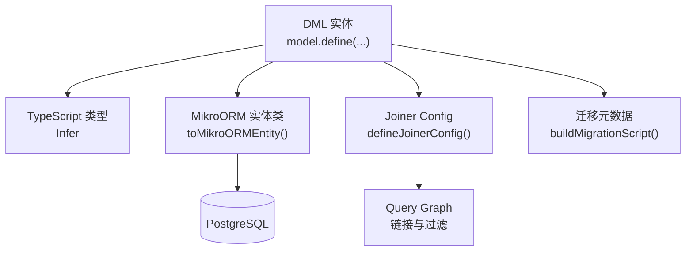

# Medusa 源码阅读（三）：从 `model.define` 到 PostgreSQL 表

> 基于 Medusa v2.22.7（`develop` 分支，commit `f9ae213`，2026-11-19）源码分析。
> 系列：Medusa 源码阅读（3/10）。

## 一句话概括

Medusa 的数据层有三层：**DML（数据模型 DSL）负责描述，MikroORM 负责把描述变成实体和 SQL，Repository 负责把查询参数翻译成 MikroORM 的 `findOptions`。**

开发者只写第一层：

```ts
const Product = model.define("Product", {
  id: model.id({ prefix: "prod" }).primaryKey(),
  title: model.text().searchable().translatable(),
  variants: model.hasMany(() => ProductVariant, { mappedBy: "product" }),
})
```

一次 `model.define` 同时产出四样东西：TypeScript 类型、MikroORM 实体类、建表迁移的元数据、链接/查询用的 joiner 配置。这篇讲清楚这个「一鱼四吃」是怎么做到的，以及查询时 `filters`、`relations`、`select` 怎么落到 SQL。

## 目录

- [生活比喻：图纸、施工队、物业前台](#生活比喻图纸施工队物业前台)
- [DML：一份同时给四种消费者看的图纸](#dml一份同时给四种消费者看的图纸)
- [从 DML 到 MikroORM 实体](#从-dml-到-mikroorm-实体)
- [ID 生成：model.id() 与 BaseEntity](#id-生成modelid-与-baseentity)
- [隐式字段与软删除](#隐式字段与软删除)
- [查询的翻译过程：filters → where → SQL](#查询的翻译过程filters--where--sql)
- [Repository：薄薄一层，但不简单](#repository薄薄一层但不简单)
- [软删除过滤器：为什么默认查不到已删除数据](#软删除过滤器为什么默认查不到已删除数据)
- [三种加载策略](#三种加载策略)
- [骨架代码：一个递归过滤器构造器](#骨架代码一个递归过滤器构造器)
- [这套设计的取舍](#这套设计的取舍)
- [动手验证](#动手验证)

## 生活比喻：图纸、施工队、物业前台

盖一栋楼分三步：

1. **建筑图纸**：画清楚有几层、几个房间、门开在哪。图纸本身不住人，但它同时给施工队、消防审批、物业系统看。
2. **施工队**：按图纸把楼盖出来。图纸改了，施工队重盖。
3. **物业前台**：租户说「我要三居室、朝南、带电梯」，前台把需求翻译成「查 3 号楼 5-8 层、朝向=南、有电梯的房源」。

对应到 Medusa：

| 角色 | 代码 | 产物 |
|------|------|------|
| 图纸 | `model.define()`（DML） | `DmlEntity` 对象 + TS 类型 |
| 施工队 | `toMikroORMEntity()` | MikroORM 实体类 + 建表迁移 |
| 物业前台 | `MikroOrmBaseRepository` | `findOptions` → SQL |

## DML：一份同时给四种消费者看的图纸

DML（Data Model Language）是 Medusa 自己的一层 DSL。一个真实模型长这样（`packages/modules/product/src/models/product.ts:15-175`，有删节）：

```ts
const Product = model
  .define("Product", {
    id: model.id({ prefix: "prod" }).primaryKey(),
    title: model.text().searchable().translatable(),
    handle: model.text(),
    status: model.enum(ProductUtils.ProductStatus).default(ProductUtils.ProductStatus.DRAFT),
    metadata: model.json().nullable(),

    variants: model.hasMany(() => ProductVariant, {
      mappedBy: "product",
    }).searchable(),

    type: model.belongsTo(() => ProductType, {
      mappedBy: "products",
    }).nullable(),

    tags: model.manyToMany(() => ProductTag, {
      mappedBy: "products",
      pivotTable: "product_tags",
    }),
  })
  .cascades({
    delete: ["variants", "images"],
    detach: ["options"],
  })
  .indexes([
    {
      name: "IDX_product_handle_unique",
      on: ["handle"],
      unique: true,
      where: "deleted_at IS NULL",
    },
    {
      name: "IDX_product_status",
      on: ["status"],
      unique: false,
      where: "deleted_at IS NULL",
    },
  ])
```

注意它比普通的 ORM schema 多了什么：

| 声明 | 额外含义 | 谁在用 |
|------|---------|--------|
| `searchable()` | 这个字段可以被全文搜索 | Search 模块、索引构建 |
| `translatable()` | 这个字段有翻译表 | Translation 模块、`query.graph` 的 `locale` 选项 |
| `hasMany/belongsTo/manyToMany` | 关系 + 外键/中间表 | MikroORM + joiner config |
| `.cascades()` | 级联删除/解除关联 | 删除逻辑 |
| `.indexes()` | 索引 + `where` 条件 | 迁移生成 |
| `model.id({ prefix: "prod" })` | ID 生成规则 | `BaseEntity` |

同一个 DML 对象会被三种消费者读取：



这就是为什么 Medusa 能从一个模型定义自动得到「CRUD + 跨模块查询 + 链接 + 迁移」——它没有重复描述四次，只是把同一份描述喂给四个消费者。

## 从 DML 到 MikroORM 实体

转换入口在 `packages/core/utils/src/dml/helpers/create-mikro-orm-entity.ts`。核心逻辑是**生成一个类**，把 DML 的字段、关系、索引、检查约束贴到类上：

```ts
// packages/core/utils/src/dml/helpers/create-mikro-orm-entity.ts:50-80（有删节）
function createEntity<T extends DmlEntity<any, any>>(entity: T): Infer<T> {
  class MikroORMEntity {}

  const { schema, cascades, indexes: entityIndexes = [], checks } = entity.parse()
  const { modelName, tableName } = parseEntityName(entity)

  if (ENTITIES[modelName]) {
    return ENTITIES[modelName] as Infer<T>
  }

  Object.defineProperty(MikroORMEntity, "name", {
    get: function () {
      return modelName
    },
  })

  // 然后：
  // - 对每个字段调 defineProperty()
  // - 对每个关系调 defineRelationship()
  // - 调 applyEntityIndexes() / applyChecks()
  // - 用 @Entity({ tableName }) / @Filter(...) 装饰这个类
}
```

几个实现上的细节值得注意：

1. **同一个模型只生成一次**（`ENTITIES` 缓存），因为 `defineLink`、Query、迁移可能从不同入口触发转换。
2. 类名被 `Object.defineProperty` 改写，保证 MikroORM 的错误信息里看到的是 `Product` 而不是 `MikroORMEntity`。
3. 转换函数同时挂上两个 `@Filter`：软删除过滤器和全文搜索过滤器（`create-mikro-orm-entity.ts:8-12`）。

## ID 生成：model.id() 与 BaseEntity

Medusa 的 ID 不是数据库自增，而是应用层生成 ULID。DML 路径下，`model.id({ prefix })` 声明主键；转换成 MikroORM 实体时，`defineProperty()` 给 ID 属性挂上 `OnInit` / `BeforeCreate` 钩子（`define-property.ts:225-243`）：

```ts
// packages/core/utils/src/dml/helpers/entity-builder/define-property.ts:225-243（有删节）
const generateIdMethodName = `generateId`
MikroORMEntity.prototype[generateIdMethodName] = function () {
  this[field.fieldName] = generateEntityId(
    this[field.fieldName],
    field.dataType.options?.prefix
  )
}

BeforeCreate()(MikroORMEntity.prototype, generateIdMethodName)
OnInit()(MikroORMEntity.prototype, generateIdMethodName)
```

`generateEntityId` 的规则很简单（`common/generate-entity-id.ts:8-16`）：

```ts
export function generateEntityId(idProperty?: string, prefix?: string): string {
  if (idProperty) {
    return idProperty
  }

  const id = ulid()
  prefix = prefix ? `${prefix}_` : ""
  return `${prefix}${id}`
}
```

所以：

| 模型声明 | ID 示例 |
|---------|--------|
| `model.id({ prefix: "prod" })` | `prod_01J...` |
| `model.id({ prefix: "order" })` | `order_01J...` |
| `model.id()`（不传 prefix） | `01J...`（纯 ULID） |

`Module()` 还会用 DML 模型的 prefix 生成 `idPrefixToEntityName` 映射，让 `prod_` 能反推出 `Product`——Query Graph 和调试工具会用到（第二篇）。

仓库里还有一个独立的 `BaseEntity` 抽象类（`dal/mikro-orm/base-entity.ts:11-68`），用于**手写 MikroORM 实体**：没有 ID 时按类名推导前缀：

| 类名 | 拆词 | 前缀 |
|------|------|------|
| `Order` | 1 个词 | `ord`（前三个字母） |
| `OrderItem` | 2 个词 | `ori`（前 2 字母 + 后 1 字母） |
| `ProductVariant` | 2 个词 | `prv` |
| `OrderChangeAction` | 3 个词 | `oca`（每词首字母） |

它和 DML 的 `IdProperty` 是两条路径：`model.define()` 生成的实体不继承 `BaseEntity`，ID 前缀完全由 `model.id({ prefix })` 决定。

## 隐式字段与软删除

DML 会给每个模型自动加三个字段（`entity-builder.ts:29`）：

```ts
const IMPLICIT_PROPERTIES = ["created_at", "updated_at", "deleted_at"]
```

这也是为什么你不能手动声明 `created_at`——会直接抛错。三个字段的含义：

| 字段 | 谁维护 | 用途 |
|------|--------|------|
| `created_at` | MikroORM（onCreate） | 排序、审计 |
| `updated_at` | MikroORM（onUpdate） | 乐观并发、审计 |
| `deleted_at` | Medusa 软删除 | 默认过滤、恢复 |

软删除不是「标记一下就完事」：`deleteProducts()` 走的是 `softDelete`，设置 `deleted_at`；所有查询默认带 `deleted_at IS NULL`；`restoreProducts()` 把它清空；`withDeleted: true` 才能查到已删除数据。第三篇的 Repository 小节会看到过滤器怎么生效。

## 查询的翻译过程：filters → where → SQL

所有模块服务的 `list(filters, config)` 最终都会走到 `buildQuery()`。它负责把两种输入合并成 MikroORM 的 `findOptions`：

```ts
// packages/core/utils/src/modules-sdk/build-query.ts:7-62（有删节）
export function buildQuery<T = any>(
  filters: Record<string, any> = {},
  config: FindConfig<T> & { primaryKeyFields?: string | string[] } = {}
): Required<DAL.FindOptions<T>> {
  const where = {} as DAL.FilterQuery<T>
  buildWhere(filters, where)

  delete config.primaryKeyFields

  const findOptions: DAL.FindOptions<T>["options"] = {
    populate: deduplicate(config.relations ?? []),
    fields: config.select as string[],
    limit: Number.isSafeInteger(config.take) && config.take != null ? config.take : undefined,
    offset: Number.isSafeInteger(config.skip) && config.skip != null ? config.skip : undefined,
  }

  if (config.order) {
    findOptions.orderBy = config.order
  }

  if (config.withDeleted) {
    findOptions.filters ??= {}
    findOptions.filters[SoftDeletableFilterKey] = { withDeleted: true }
  }

  if (config.filters) {
    findOptions.filters ??= {}
    for (const [key, value] of Object.entries(config.filters)) {
      findOptions.filters[key] = value
    }
  }

  return { where, options: findOptions }
}
```

`buildWhere()` 是一个递归函数，处理三种情况：

```ts
// packages/core/utils/src/modules-sdk/build-query.ts:64-96
function buildWhere(filters: Record<string, any> = {}, where = {}) {
  for (let [prop, value] of Object.entries(filters)) {
    if (["$or", "$and"].includes(prop)) {
      if (!Array.isArray(value)) {
        throw new Error(`Expected array for ${prop} but got ${value}`)
      }
      where[prop] = value.map((val) => {
        const deepWhere = {}
        buildWhere(val, deepWhere)
        return deepWhere
      })
      continue
    }

    if (Array.isArray(value)) {
      where[prop] = deduplicate(value)
      continue
    }

    if (isObject(value)) {
      where[prop] = {}
      buildWhere(value, where[prop])
      continue
    }

    where[prop] = value
  }
}
```

它支持的查询语法：

```ts
// 简单等值
{ status: "published" }

// 数组 -> IN
{ id: ["prod_1", "prod_2"] }

// 操作符
{ created_at: { $gte: "2026-01-01" } }

// 逻辑组合
{ $or: [{ status: "published" }, { status: "draft" }] }

// 关联字段（交给 MikroORM 处理）
{ variants: { sku: "ABC" } }
```

这里有一个设计取舍：**Medusa 没有自己发明一套查询语言**，而是把 `filters` 尽量映射到 MikroORM 的 `FilterQuery` 语法（`$eq`、`$in`、`$or` 等）。Query Graph 跨模块时用的也是同一套操作符，所以在模块内和跨模块查询时，过滤条件的写法是一致的。

## Repository：薄薄一层，但不简单

`MikroOrmBaseRepository` 的核心方法只有几行（`mikro-orm-repository.ts:493-520`）：

```ts
async find(
  options: DAL.FindOptions<T> = { where: {} } as DAL.FindOptions<T>,
  context?: Context
): Promise<InferRepositoryReturnType<T>[]> {
  const manager = this.getActiveManager<EntityManager>(context)
  const findOptions_ = this.prepareFindOptions(options, manager)

  return (await manager.find(
    this.entity as EntityName<T>,
    findOptions_.where as MikroFilterQuery<T>,
    findOptions_.options as MikroOptions<T>
  )) as InferRepositoryReturnType<T>[]
}

async findAndCount(
  findOptions: DAL.FindOptions<T> = { where: {} } as DAL.FindOptions<T>,
  context: Context = {}
): Promise<[InferRepositoryReturnType<T>[], number]> {
  const manager = this.getActiveManager<EntityManager>(context)
  const findOptions_ = this.prepareFindOptions(findOptions, manager)

  return (await manager.findAndCount(
    this.entity,
    findOptions_.where,
    findOptions_.options as any
  )) as [InferRepositoryReturnType<T>[], number]
}
```

看起来只是转调 MikroORM，但 `prepareFindOptions()`（`mikro-orm-repository.ts:1515-1570`）做了好几件容易被忽略的事：

1. **关系字段补全**：`select-in` 策略下，MikroORM 默认不会选中被 populate 的关联字段，这里自动补上。
2. **软删除过滤器透传**：关联表也要应用 `deleted_at IS NULL`，否则 join 出来的关联数据可能包含已删除记录。
3. **主键与复合主键处理**：链接模块（第五篇）会用复合主键，`find` 需要把复合键展开成 `$and`。

`create/update/delete/softDelete/restore` 也是同样的思路：薄封装 + 统一处理边界条件（批量、复合主键、级联软删除）。

## 软删除过滤器：为什么默认查不到已删除数据

软删除的实现不是在每个查询里手写 `deleted_at: null`，而是 MikroORM 的 **Filter** 机制：

```ts
// packages/core/utils/src/dal/mikro-orm/mikro-orm-soft-deletable-filter.ts
export const SoftDeletableFilterKey = "softDeletable"

export const mikroOrmSoftDeletableFilterOptions = {
  name: SoftDeletableFilterKey,
  cond: ({ withDeleted }: FilterArguments = {}) => {
    if (withDeleted) {
      return {}
    }
    return {
      deleted_at: null,
    }
  },
  default: true,
  args: false,
}
```

三个配置项很关键：

- `default: true`：这个过滤器**默认开启**，所有查询自动加条件；
- `cond`：支持 `withDeleted` 参数，需要查历史数据时关掉；
- `args: false`：参数不通过 `find` 的第二个参数传，而是通过 `filters` 选项传（`buildQuery` 里那段 `findOptions.filters[SoftDeletableFilterKey]`）。

这比在每个 Repository 方法里手写条件好在：**忘记加条件是不可能的**——默认就是安全的，想查已删除数据必须显式开口子。

## 三种加载策略

MikroORM 支持三种关系加载策略，Medusa 的 `query.graph` 会暴露成 `strategy` 选项：

| 策略 | SQL 形态 | 优点 | 缺点 |
|------|---------|------|------|
| `joined` | 一条 SQL + LEFT JOIN | 快、一次往返 | 笛卡尔积膨胀，分页要小心 |
| `select-in` | 主查询 + 每个关系一条 `IN` 查询 | 结果不膨胀 | 多次往返 |
| `balanced` | 按关系规模动态选择 | 折中 | 行为不如前两者可预测 |

具体用哪种由 `options.strategy` 决定（不传则交给 MikroORM 的默认策略）。跨模块 Query 里会刻意用 `select-in` 强制分两步取数——因为跨模块没法真的 join，只能先取主表再按 ID 批量取从表。这也是第四篇「Query Graph」的核心。

## 骨架代码：一个递归过滤器构造器

把 `buildWhere()` 的思想抽出来，可以直接用于任何 ORM：

```ts
type Filter = Record<string, unknown>

function toWhere(filters: Filter): Record<string, unknown> {
  const where: Record<string, unknown> = {}

  for (const [key, value] of Object.entries(filters)) {
    if (key === "$or" || key === "$and") {
      if (!Array.isArray(value)) throw new Error(`${key} expects an array`)
      where[key] = value.map((item) => toWhere(item as Filter))
      continue
    }

    if (Array.isArray(value)) {
      where[key] = { $in: value }
      continue
    }

    if (value !== null && typeof value === "object") {
      where[key] = toWhere(value as Filter)
      continue
    }

    where[key] = value
  }

  return where
}

// 你的项目：把 HTTP query params 递归翻译成 Prisma / TypeORM / MikroORM 的 where
// GET /orders?status=paid&id[]=1&id[]=2
// -> { status: "paid", id: { $in: ["1", "2"] } }
```

用它的场景：任何「前端传 JSON 过滤条件，后端翻译成 ORM 查询」的系统。要小心的是**必须白名单字段**，否则用户可以按任意列过滤（Medusa 用 query config 的 `allowed` 解决这个问题，第八篇细讲）。

## 这套设计的取舍

**好处：**

- 一份模型定义同时服务类型、ORM、迁移、查询、链接，没有重复描述。
- 默认软删除 + 默认过滤器，漏写条件的概率大幅降低。
- 过滤器语法与 Query Graph 统一，模块内和跨模块查询的心智模型一致。

**代价：**

- DML 是一层自研 DSL，IDE 跳转和类型推导不如直接用 MikroORM 直观。
- `bigNumber` 字段会额外生成一个 `raw_<field>` JSON 列（精度存储），写原生 SQL 时必须知道这个约定。
- 字段级 `searchable` / `translatable` 是跨模块能力，改一个字段可能同时影响搜索、翻译、迁移，影响面比普通 ORM 大。
- 迁移不是「改模型自动生成」，必须跑 `yarn migration:create`，并且不允许手改生成的迁移文件。

下一篇进入 Medusa 最有特色的部分：Query Graph——一条 `query.graph()` 怎么从多个模块取数，并在可能的时候把过滤条件下推到 SQL。

## 动手验证

```bash
cd source-read/medusa

# 一个完整模型
sed -n '15,175p' packages/modules/product/src/models/product.ts

# DML -> MikroORM
sed -n '33,100p' packages/core/utils/src/dml/helpers/create-mikro-orm-entity.ts

# 自动 ID
sed -n '11,70p' packages/core/utils/src/dal/mikro-orm/base-entity.ts

# filters -> findOptions
cat packages/core/utils/src/modules-sdk/build-query.ts

# Repository 的 find / findAndCount
sed -n '493,520p' packages/core/utils/src/dal/mikro-orm/mikro-orm-repository.ts

# 软删除过滤器
cat packages/core/utils/src/dal/mikro-orm/mikro-orm-soft-deletable-filter.ts
```
