# Medusa 源码阅读（四）：一条查询如何跨十个模块

> 基于 Medusa v2.22.7（`develop` 分支，commit `f9ae213`，2026-11-19）源码分析。
> 系列：Medusa 源码阅读（4/10）。

## 一句话概括

订单在 order 模块，客户在 customer 模块，商品在 product 模块，库存数量在 inventory 模块。它们各自有独立的 service 和独立的数据表，模块之间连外键都没有。**数据库层面根本做不了一次 JOIN。**

Medusa 的解法是 Query Graph：你把「我要什么形状的数据」写成声明式查询，它负责拆成多个模块的 `list()` 调用，再把结果按关系拼装回来。如果条件能安全下推到 SQL，它就下推；不能，就在内存里补过滤。

这一篇拆开这条流水线：`query.graph()` → 编译成执行计划 → 分批取数 → 拼装 → 返回。

## 目录

- [生活比喻：跨馆借书](#生活比喻跨馆借书)
- [它要解决什么问题](#它要解决什么问题)
- [公开 API 长什么样](#公开-api-长什么样)
- [流水线全景](#流水线全景)
- [GraphCatalog：把所有模块的说明书收进一个索引](#graphcatalog把所有模块的说明书收进一个索引)
- [compileQuery：把查询编译成计划](#compilequery把查询编译成计划)
- [跨模块过滤：能下推就下推](#跨模块过滤能下推就下推)
- [executePlan：按阶段取数并拼装](#executeplan按阶段取数并拼装)
- [ModuleDataFetcher：批量、并发、可观测](#moduledatafetcher批量并发可观测)
- [为什么要这么复杂](#为什么要这么复杂)
- [骨架代码：一个最小跨表拼装器](#骨架代码一个最小跨表拼装器)
- [这套设计的取舍](#这套设计的取舍)
- [动手验证](#动手验证)

## 生活比喻：跨馆借书

市图书馆有十个分馆，每个分馆只藏自己那类书：历史馆、地理馆、人物馆……你想查「2020 年后出版的、作者是某人的书，以及作者简介和出版社地址」。

单个分馆查不了。总馆的检索系统这样做：

1. **先查主馆**：历史馆按「2020 年后」找出书单；
2. **拿到书单里的作者 ID、出版社 ID**；
3. **分别去人物馆、地理馆批量查**；
4. **把结果按 ID 拼回每本书**。

如果某个筛选条件只在分馆里有（比如「作者国籍=法国」），检索系统有两种选择：

- **下推**：把「国籍=法国」翻译成人物馆的查询条件，先查出符合条件的作者 ID，再用这些 ID 限制历史馆的书单；
- **回填**：先把书都取回来，再在总馆内存里筛掉不符合的作者。

Query Graph 就是这套检索系统。第一种走 SQL（`EXISTS` / 子查询），第二种走内存（residual filter）。

## 它要解决什么问题

看一个真实需求：查一单订单，并带上客户、商品、SKU、商品分类：

```ts
const { data } = await query.graph({
  entity: "order",
  fields: [
    "id",
    "display_id",
    "customer.id",
    "customer.email",
    "items.id",
    "items.product_id",
    "items.variant.sku",
    "items.variant.product.categories.name",
  ],
  filters: { id: orderId },
})
```

这些数据分布在：

| 数据 | 所在模块 | 关系 |
|------|---------|------|
| 订单 | order | 主实体 |
| 客户 | customer | order 只存 `customer_id`，没有外键 |
| 订单行 | order | 同一模块内的 hasMany |
| 商品、SKU | product | `items.product_id` / `items.variant_id` |
| 分类 | product | 同一模块内的 manyToMany |

在单体应用里，这是一条五六层 JOIN 的 SQL。在 Medusa 里，模块之间连外键都没有，只能靠**链接表**（第五篇）和 **joiner config** 描述关系。Query Graph 的工作，就是把这些描述变成一张可执行的取数计划。

## 公开 API 长什么样

Query 是容器里的 `query`，通过 `container.resolve(ContainerRegistrationKeys.QUERY)` 拿到。`query.graph()` 是主入口：

```ts
// packages/core/query/src/query/query.ts:159-193（有删节）
@Cached(queryCacheDecoratorOptions)
async graph<const TEntry extends string>(
  queryOptions: RemoteQueryInput<TEntry>,
  options?: RemoteJoinerOptions
): Promise<GraphResultSet<TEntry>> {
  const normalizedQuery = toRemoteQuery(queryOptions, this.#joinerConfigs)

  let response: any[] | { rows: any[]; metadata: RemoteQueryFunctionReturnPagination }

  if (Query.traceGraphQuery) {
    response = await Query.traceGraphQuery(
      async () => await this.internalQuery(normalizedQuery, undefined, options),
      queryOptions as RemoteQueryInput<any>
    )
  } else {
    response = await this.internalQuery(normalizedQuery, undefined, options)
  }

  if (Array.isArray(response)) {
    return { data: response, metadata: undefined }
  }

  return { data: response.rows, metadata: response.metadata as any }
}
```

输入和输出都很稳定：

```ts
query.graph({
  entity: "product",                    // 入口实体
  fields: ["id", "title", "variants.sku"], // 要哪些字段/关系
  filters: { status: "published" },     // 过滤条件
  pagination: { skip: 0, take: 20, order: { created_at: "DESC" } },
  context: { variants: { calculated_price: QueryContext({ currency_code: "usd" }) } },
})

// => { data: [...], metadata: { count, skip, take } }
```

`fields` 里的点号就是关系路径，语义跟 GraphQL 的 selection set 一样——这也是为什么 `query.gql()` 能直接解析 GraphQL 查询。

## 流水线全景

```mermaid
flowchart LR
    A["query.graph({...})"] --> B["toRemoteQuery<br/>归一化输入"]
    B --> C["RemoteJoiner.query"]
    C --> D["GraphCatalog<br/>索引所有 joiner config"]
    D --> E["compileQuery<br/>查询 → QueryPlan"]
    E --> F["executePlan<br/>按阶段取数 + 拼装"]
    F --> G["ModuleDataFetcher<br/>调用各模块 list/retrieve"]
    G --> H["结果合并<br/>shortcut 展开"]
    H --> I["{ data, metadata }"]

    style E fill:#e3f2fd
    style F fill:#e8f5e9
    style G fill:#fff3e0
```



`RemoteJoiner.query()` 本身非常薄：

```ts
// packages/core/query/src/joiner/remote-joiner.ts:37-90（有删节）
const serviceConfig = this.catalog.getServiceConfig({
  serviceName: queryObj.service,
  serviceAlias: queryObj.alias,
})

if (!serviceConfig) {
  throw new Error(`Service "${queryObj.service}" was not found.`)
}

const plan = compileQuery(
  { query: queryObj, serviceConfig, options, initialData },
  this.catalog
)

const { data, responsePath, rawResponse, wasArray } = await executePlan({
  plan,
  dataFetcher: this.dataFetcher,
  catalog: this.catalog,
})

return rawResponse.data
```

真正的复杂度在 `compileQuery` 和 `executePlan`。

## GraphCatalog：把所有模块的说明书收进一个索引

每个模块在 `Module()` 里自动生成 `__joinerConfig`（第二篇）。Query 初始化时只收集 `isQueryable` 的模块：

```ts
// packages/core/query/src/query/query.ts:425-458（有删节）
export function createQuery({ modulesLoaded, relationMap, indexModule, searchModule, container }) {
  const joinerConfigs: ModuleJoinerConfig[] = []
  const modulesMap: Map<string, LoadedModule> = new Map()

  for (const mod of modulesLoaded) {
    if (!mod.__definition.isQueryable) {
      continue
    }

    const serviceName = mod.__definition.key

    if (modulesMap.has(serviceName)) {
      throw new Error(`Duplicated instance of module ${serviceName} is not allowed.`)
    }

    modulesMap.set(serviceName, mod)
    joinerConfigs.push(mod.__joinerConfig)
  }

  const dataFetcher = new ModuleDataFetcher(modulesMap)
  const remoteJoiner = new RemoteJoiner(joinerConfigs, dataFetcher, {
    autoCreateServiceNameAlias: false,
    relationMap,
  })

  const query = new Query({ remoteJoiner, joinerConfigs, indexModule, searchModule, container })
  // ...
}
```

`GraphCatalog` 把这份配置列表索引成：

- **服务名 → 配置**：快速找到某个模块的实体、主键、关系；
- **实体 → 字段别名**：`price_set` → `price_set_link.price_set` 这类快捷方式；
- **关系 → 目标模块**：从 order 的 `items.variant` 知道下一跳是 product 模块。

这一步没有数据库参与，纯粹是把模块注册时声明的元数据整理成图。

## compileQuery：把查询编译成计划

`compileQuery` 是整个系统的编译器。它的注释里给了一个很好的走查示例（`compile.ts:24-47`）：

```ts
/**
 * Example walkthrough — order with fieldAlias + nested expand:
 *
 *   alias: "order"
 *   fields: ["id"]
 *   expands: [
 *     { property: "product_user_alias", fields: ["id", "email"], args: [...] },
 *     { property: "products.variant" }
 *   ]
 *
 * Compile produces roughly:
 *   expands: {
 *     _root → order service, fields [id], stages [...]
 *     _root.products → still on order (same service hop toward product via nested)
 *     _root.products.product → product service (cross-service boundary)
 *     _root.products.product.user → user service
 *   }
 *   shortcuts: [{ location: [], property: "product_user_alias", path: ["products","product","user"] }]
 *   stages[0] = root; stages[1] = product + variant; stages[2] = user
 */
```

编译结果是一个 **QueryPlan**，核心字段：

| 字段 | 含义 |
|------|------|
| `root` | 根实体怎么查（服务、字段、过滤、分页） |
| `expands` | 每个展开路径对应哪个模块、什么字段、哪一阶段 |
| `stages` | 按深度分阶段：第 0 阶段查根，第 1 阶段查直接关系，以此类推 |
| `shortcuts` | 字段别名（如 `order.cart`）需要展开的真实路径 |
| `residualCrossModuleFilters` | 无法下推、只能取回内存再筛的条件 |

「阶段」是性能关键：**同一深度的关系可以并发批量取数**，不需要按字段顺序一个一个来。

## 跨模块过滤：能下推就下推

这是 Query Graph 里最精细的部分。假设：

```ts
query.graph({
  entity: "product",
  fields: ["id", "title"],
  filters: { categories: { name: "Shoes" } }, // categories 在 product 模块内
})
```

这能直接下推到 SQL（same-module relation）。但如果条件跨模块：

```ts
query.graph({
  entity: "order",
  fields: ["id"],
  filters: { customer: { email: "a@b.com" } }, // customer 是另一个模块
})
```

Medusa 会尝试把 `email` 条件下推成 `EXISTS (SELECT 1 FROM customer ...)` 或子查询。判断逻辑在 `cross-module-joins/build-chain.ts:42-56`：

```ts
export function resolveChain(params, catalog): ChainResolution {
  const hops = resolvePathHops(params, catalog)

  if (!hops || !crossesModules(hops, params.rootConfig)) {
    return { outcome: "native" }
  }

  const levels = buildChainLevels({ hops, rootConfig: params.rootConfig, catalog })

  return levels ? { outcome: "pushable", levels } : { outcome: "residual" }
}
```

三种结果：

| 结果 | 条件 | 执行方式 |
|------|------|---------|
| `native` | 关系在同一模块内 | MikroORM 直接 JOIN |
| `pushable` | 每一跳都是链接表 / 只读链接 / 同库 DML 关系，字段是普通列 | 下推成 SQL `EXISTS` / 子查询 |
| `residual` | 中间有计算字段、跨库、或无法证明等价 | 取回数据后内存过滤 |

下推的判定非常保守，`rewrite-filters.ts:12-25` 只允许 DAL 明确支持的运算符：

```ts
const SUPPORTED_OPERATORS = new Set([
  "$eq", "$ne", "$in", "$nin",
  "$gt", "$gte", "$lt", "$lte",
  "$like", "$ilike", "$is",
])
```

这不是偷懒，而是**正确性优先**：下推错一个条件，返回的就是错误数据；留在内存里筛，至少结果是对的，只是慢一点。

而且 residual 过滤会改变分页语义：如果先按 `take: 20` 取 20 条再在内存里筛，可能只剩 3 条。所以 `executePlan` 会把分页从根查询里摘出来，等 residual 过滤、排序完成后再应用（`execute.ts:61-66`）。

## executePlan：按阶段取数并拼装

`executePlan` 的骨架（`execute.ts:42-120`，有删节）：

```ts
export async function executePlan({ plan, dataFetcher, catalog }) {
  const { options } = plan

  const residuals = plan.residualCrossModuleFilters ?? []
  const residualOrderBy = plan.residualOrderBy ?? []
  const hasResiduals = residuals.length > 0 || residualOrderBy.length > 0

  // residual 在内存里完成，分页必须跟着后移
  const pagination = hasResiduals ? extractRootPagination(plan.root) : undefined

  const response = await fetchData({
    dataFetcher,
    expand: plan.root,
    pkField: plan.pkName,
    ids: plan.primaryKeyArg?.value,
    options,
  })

  let data = response.path ? response.data[response.path] : response.data
  const wasArray = Array.isArray(data)
  data = wasArray ? data : [data]

  // ...按 stages 逐层 fetch + join...

  if (residuals.length) {
    data = applyResidualFilters({ items: data, residuals })
  }

  if (residualOrderBy.length) {
    sortByResidualOrder({ items: data, orderBy: residualOrderBy })
  }

  // ...应用分页、隐藏仅用于过滤的字段、展开 shortcuts...
}
```

每一步都只做一件事：

1. 查根实体（带主键、分页、下推条件）；
2. 按 `stages` 从浅到深，拿上一层的关联 ID 批量查下一层；
3. 把子结果按关系拼回父对象；
4. 如果存在 residual，先过滤/排序，再分页；
5. 展开字段别名，隐藏中间字段，返回。

**这本质上是应用层的 JOIN**：用多次批量查询替代数据库 JOIN。代价是网络往返变多，收益是模块边界不被数据访问破坏（不同模块甚至可以配置不同的数据库连接）。

## ModuleDataFetcher：批量、并发、可观测

真正调用模块的是 `ModuleDataFetcher`（`module-data-fetcher.ts:21-60`）：

```ts
export class ModuleDataFetcher implements IRemoteDataFetcher {
  static traceFetchRemoteData?: (
    fetcher: () => Promise<any>,
    serviceName: string,
    method: string,
    options: { select?: string[]; relations: string[] }
  ) => Promise<any>

  private modulesMap: Map<string, LoadedModule>

  constructor(modulesMap: Map<string, LoadedModule>) {
    this.modulesMap = modulesMap
  }

  async fetch(expand, keyField, ids?, relationship?) {
    return this.executeFetchRequest({ expand, keyField, ids, relationship })
  }

  // ...
}
```

它做了三件工程上很重要的事：

| 机制 | 参数 | 作用 |
|------|------|------|
| 批量查询 | `MAX_BATCH_SIZE = 4000` | 一次 `IN (...)` 太多 ID 会撑爆 SQL，分批 |
| 并发上限 | `MAX_CONCURRENT_REQUESTS = 10` | 避免同时打爆数据库连接池 |
| 追踪钩子 | `traceFetchRemoteData` | 接入 OpenTelemetry，看每次跨模块调用的耗时 |

调用的是模块服务的 `list` / `listAndCount` / `retrieve`——也就是第二篇 `MedusaService` 自动生成的那套方法。**Query Graph 没有绕过模块 API，它只是模块 API 的一个编排者。**

## 为什么要这么复杂

直接让 order 模块写一条多表 SQL 不是更快吗？短期是。但 Medusa 的假设是：

1. **模块可能被替换**：商品模块可以换成外部 PIM，订单模块还按原来的实体名查询；
2. **模块可能被替换成外部实现**：一旦查询 API 依赖具体表结构，替换成本就高了（当前版本的 external module 尚未支持，这是架构方向）；
3. **模块不能知道别人的表结构**：一旦 order 的代码里出现 `product` 表名，模块边界就破了；
4. **权限和过滤要集中管理**：`allowed` 字段、`withDeleted`、locale 翻译都在 Query 层统一处理。

用「应用层 JOIN」换「模块独立」，这是 Medusa 最核心的架构交易。它不追求单次查询最快，追求的是**模块边界不被数据访问破坏**。

## 骨架代码：一个最小跨表拼装器

去掉 Medusa 的元数据，跨模块拼装的骨架大概是：

```ts
type Loader = (entity: string, filters: any, fields: string[]) => Promise<any[]>

async function graphQuery({
  root,
  fields,
  filters,
  loaders,
  relations, // { "order.customer": { target: "customer", pk: "id", fk: "customer_id" } }
}: {
  root: string
  fields: string[]
  filters: any
  loaders: Record<string, Loader>
  relations: Record<string, { target: string; pk: string; fk: string }>
}) {
  const rows = await loaders[root](root, filters, fields)

  // 只处理一层关系，真实实现要按深度分阶段
  for (const path of Object.keys(relations)) {
    const [from, relation] = path.split(".")
    if (from !== root) continue

    const { target, pk, fk } = relations[path]
    const ids = [...new Set(rows.map((row) => row[fk]).filter(Boolean))]

    const related = await loaders[target](target, { [pk]: ids }, [])

    const byId = new Map(related.map((item) => [item[pk], item]))
    for (const row of rows) {
      row[relation] = byId.get(row[fk]) ?? null
    }
  }

  return rows
}

// 你的项目：把多个微服务的 REST 接口拼成一个 BFF 响应
// 关键是批量取 ID，不要在 for 循环里逐条调用
```

## 这套设计的取舍

**好处：**

- 模块完全不知道彼此的表结构，换实现、单独迁移、不同数据库连接都不影响查询 API。
- 过滤、排序、分页、翻译、软删除、字段白名单在一层统一处理。
- 能下推的条件尽量下推，不能下推的明确降级到内存，而不是悄悄返回错误结果。
- 同一份 joiner config 同时被 Query、Link、迁移使用，元数据不重复。

**代价：**

- 层层嵌套的查询比手写 SQL 慢，尤其是深关系 + 大数据量。
- 不能使用数据库的高级能力（窗口函数、复杂聚合、跨模块事务级快照）。
- residual 过滤在内存里做，数据量大时内存和延迟都会上去。
- 调试需要理解「编译后的计划」：`throwIfKeyNotFound`、`throwIfRelationNotFound` 这类选项就是为排错准备的。

下一篇讲 Query Graph 的另一半：**关系是怎么被声明的**。`defineLink` 没有外键，靠一张链接表把两个模块接起来——以及为什么这张表反而让系统更灵活。

## 动手验证

```bash
cd source-read/medusa

# 公开入口
sed -n '159,200p' packages/core/query/src/query/query.ts

# Query 如何收集可查询模块
sed -n '425,470p' packages/core/query/src/query/query.ts

# 编译器的走查示例
sed -n '20,60p' packages/core/query/src/joiner/compile.ts

# 下推还是回填
sed -n '42,70p' packages/core/query/src/joiner/cross-module-joins/build-chain.ts

# 执行计划
sed -n '42,130p' packages/core/query/src/joiner/execute.ts

# 批量取数
sed -n '21,140p' packages/core/query/src/query/module-data-fetcher.ts
```
