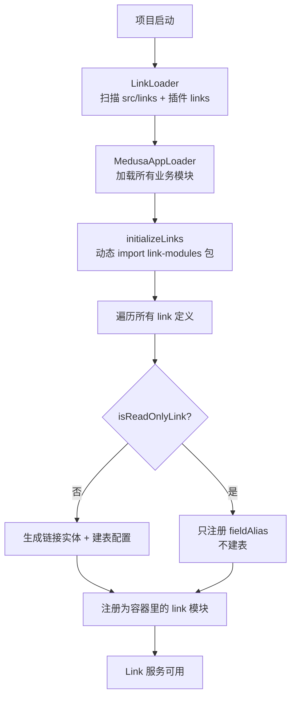
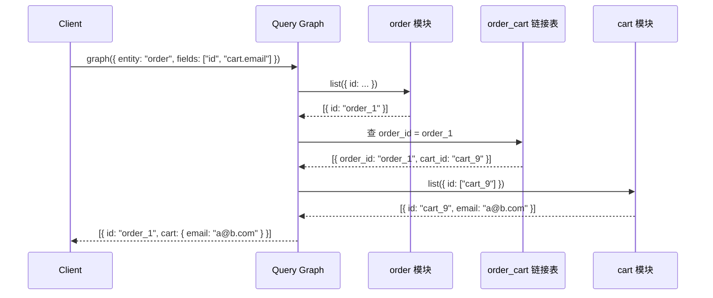

# Medusa 源码阅读（五）：没有外键，模块之间怎么建立关系

> 基于 Medusa v2.22.7（`develop` 分支，commit `f9ae213`，2026-11-19）源码分析。
> 系列：Medusa 源码阅读（5/10）。

## 一句话概括

传统电商系统里，「订单属于哪个购物车」「商品属于哪个销售渠道」都是数据库外键。Medusa 反其道而行：**模块之间不建外键，而是把关系本身当成一条记录，存进一张独立的链接表（link table）**。

`order_cart` 表里只有 `order_id`、`cart_id` 和几个附加字段。它不属于订单模块，也不属于购物车模块，而是一个独立的 **link module**。好处是：两个模块可以各自迁移、各自演进，关系却仍然存在；坏处是：数据库不再帮你保证引用完整性。

这篇讲清楚链接的三层：**声明（`defineLink`）→ 建表（link module）→ 使用（`link.create` / `query.graph`）**。

## 目录

- [生活比喻：馆际互借卡](#生活比喻馆际互借卡)
- [为什么不用外键](#为什么不用外键)
- [链接是一张独立的关系表](#链接是一张独立的关系表)
- [声明：defineLink 生成什么](#声明definelink-生成什么)
- [命名规则：从服务名到表名](#命名规则从服务名到表名)
- [建表：链接模块也是模块](#建表链接模块也是模块)
- [使用一：link.create / dismiss / list](#使用一linkcreate--dismiss--list)
- [使用二：query.graph 自动穿越链接](#使用二querygraph-自动穿越链接)
- [只读链接：连表都不建](#只读链接连表都不建)
- [删除级联：谁来清理孤儿记录](#删除级联谁来清理孤儿记录)
- [骨架代码：一个通用关系表服务](#骨架代码一个通用关系表服务)
- [这套设计的取舍](#这套设计的取舍)
- [动手验证](#动手验证)

## 生活比喻：馆际互借卡

市图书馆和大学图书馆是两家独立机构，各自有借阅系统、各自的读者证，谁也不给谁开数据库权限。

但读者想从大学馆借一本市馆没有的书，怎么办？两馆签一张**馆际互借协议**：协议不复制书名，也不复制读者资料，只记录「市馆读者证号 #A 对应大学馆的借书单 #B」。协议本身单独存档，任何一方都能查：

- 市馆系统问：「#A 读者借过哪些外借单？」→ 查协议 → 拿到 #B → 问大学馆要 #B 的详情；
- 大学馆系统问：「#B 单子是哪个馆的读者？」→ 查协议 → 拿到 #A → 问市馆要 #A 的读者信息。

`defineLink` 就是这份协议模板，`order_cart` 表就是存档柜，`query.graph` 就是那个来回打电话的馆员。

## 为什么不用外键

外键的代价在单体应用里被低估了：

1. **外键要求两个表在同一个数据库**。Medusa 的模块可以配不同的数据库连接，schema 也可以由各自的迁移管理。
2. **外键把两个模块的 schema 绑死**。订单表的 migration 必须知道购物车表存在，模块就不能单独发布。
3. **外键的删除语义只有几种**（CASCADE / SET NULL / RESTRICT），而业务语义有更多：删除订单时应该保留购物车审计记录、删除商品时应该解除与销售渠道的关系但保留渠道本身。
4. **外键是数据库特性**，如果某个模块换成外部 SaaS（比如外部 PIM 提供商品），外键根本不存在。

链接表把这些决定从数据库挪到了应用层：**关系是一条普通记录，怎么写、怎么删由业务代码决定。**

## 链接是一张独立的关系表

以内置的订单 ↔ 购物车链接为例。定义文件很短（`packages/modules/link-modules/src/definitions/order-cart.ts`）：

```ts
// packages/modules/link-modules/src/definitions/order-cart.ts:4-23（有删节）
export const OrderCart: ModuleJoinerConfig = {
  serviceName: LINKS.OrderCart,
  isLink: true,
  databaseConfig: {
    tableName: "order_cart",
    idPrefix: "ordercart",
  },
  alias: [
    {
      name: ["order_cart", "order_carts"],
      entity: "LinkOrderCart",
    },
  ],
  primaryKeys: ["id", "order_id", "cart_id"],
  relationships: [
    {
      serviceName: Modules.ORDER,
      entity: "Order",
      primaryKey: "id",
      foreignKey: "order_id",
      alias: "order",
      args: { methodSuffix: "Orders" },
      hasMany: true,
    },
    {
      serviceName: Modules.CART,
      entity: "Cart",
      primaryKey: "id",
      foreignKey: "cart_id",
      alias: "cart",
      args: { methodSuffix: "Carts" },
    },
  ],
  extends: [
    {
      serviceName: Modules.ORDER,
      entity: "Order",
      fieldAlias: { cart: "cart_link.cart" },
      relationship: {
        serviceName: LINKS.OrderCart,
        primaryKey: "order_id",
        foreignKey: "id",
        alias: "cart_link",
      },
    },
    {
      serviceName: Modules.CART,
      entity: "Cart",
      fieldAlias: { order: "order_link.order" },
      relationship: {
        serviceName: LINKS.OrderCart,
        primaryKey: "cart_id",
        foreignKey: "id",
        alias: "order_link",
      },
    },
  ],
}
```

对应到数据库：

```text
order 表                  order_cart 表                 cart 表
┌────────────────┐       ┌──────────────────────┐      ┌────────────────┐
│ id (PK)        │◄──────│ order_id             │      │ id (PK)        │
│ display_id     │       │ cart_id              │─────►│ email          │
│ version        │       │ id (PK)              │      │ completed_at   │
└────────────────┘       │ created_at           │      └────────────────┘
                         │ deleted_at           │
                         └──────────────────────┘
```

`order_cart` 就是「馆际互借卡」：它不拥有订单，也不拥有购物车，只记录两者的对应关系。想查「订单对应的购物车」：

```ts
const { data } = await query.graph({
  entity: "order",
  fields: ["id", "cart.id", "cart.email"],
  filters: { id: orderId },
})
```

`cart` 这个字段不是 order 表的列，而是链接模块通过 `fieldAlias` **挂到** order 实体上的虚拟关系。

## 声明：defineLink 生成什么

用户项目里通常这样声明一个链接：

```ts
// src/links/product-post.ts
import { defineLink } from "@medusajs/framework/utils"
import ProductModule from "@medusajs/medusa/product"
import BlogModule from "../modules/blog"

export default defineLink(
  ProductModule.linkable.product,
  { linkable: BlogModule.linkable.post, isList: true }
)
```

`defineLink` 本身不建表，它只做两件事：**校验**和**注册配置**。

```ts
// packages/core/utils/src/modules-sdk/define-link.ts:206-243（有删节）
export function defineLink(
  leftService: DefineLinkInputSource | DefineReadOnlyLinkInputSource,
  rightService: DefineLinkInputSource | DefineReadOnlyLinkInputSource,
  linkServiceOptions?: ExtraOptions | ReadOnlyExtraOptions
): DefineLinkExport {
  const callerFilePath = getCallerFilePath()
  if (isFileDisabled(callerFilePath ?? "")) {
    return { [MEDUSA_SKIP_FILE]: true } as any
  }

  const serviceAObj = prepareServiceConfig(leftService)
  const serviceBObj = prepareServiceConfig(rightService)

  const output = {
    [DefineLinkSymbol]: true,
    serviceName: "",
    entity: "",
    entryPoint: "",
  }

  const register = function (modules: ModuleJoinerConfig[]): ModuleJoinerConfig {
    // ...校验、拼装 linkDefinition...
    return linkDefinition
  }

  global.MedusaModule.setCustomLink(register)

  return output
}
```

注意 `global.MedusaModule.setCustomLink(register)`：这行代码在**模块文件被 import 时**就执行了。`LinkLoader` 的职责只是 import 这些文件——import 的副作用就是把链接定义注册进全局表。

真正的配置在 `register()` 里拼出来（`define-link.ts:390-472`）：

```ts
const linkDefinition: ModuleJoinerConfig = {
  serviceName: output.serviceName,
  isLink: true,
  alias: [{ name: [output.entryPoint], args: { entity: output.entity } }],
  primaryKeys: ["id", serviceAObj.key, serviceBObj.key],
  relationships: [
    {
      serviceName: serviceAObj.module,
      entity: serviceAObj.entity,
      primaryKey: serviceAPrimaryKey,
      foreignKey: serviceAObj.key,
      alias: aliasA,
      args: { methodSuffix: serviceAMethodSuffix },
      deleteCascade: serviceAObj.deleteCascade,
      hasMany: serviceAObj.hasMany,
    },
    {
      serviceName: serviceBObj.module,
      entity: serviceBObj.entity,
      primaryKey: serviceBPrimaryKey,
      foreignKey: serviceBObj.key,
      alias: aliasB,
      args: { methodSuffix: serviceBMethodSuffix },
      deleteCascade: serviceBObj.deleteCascade,
      hasMany: serviceBObj.hasMany,
    },
  ],
  extends: [
    {
      serviceName: serviceAObj.module,
      entity: serviceAObj.entity,
      fieldAlias: buildFieldAlias({
        property: serviceBObj.isList ? pluralize(aliasB) : aliasB,
        path: aliasB + "_link." + aliasB,
        isList: serviceBObj.isList,
      }),
      relationship: {
        serviceName: output.serviceName,
        entity: output.entity,
        primaryKey: serviceAObj.key,
        foreignKey: serviceAPrimaryKey,
        alias: aliasB + "_link",
        isList: serviceBObj.isList,
      },
    },
    // 另一侧对称
  ],
}
```

这段配置同时服务三个消费者：

| 字段 | 消费者 | 作用 |
|------|--------|------|
| `databaseConfig` | link module 迁移 | 建 `order_cart` 表 |
| `relationships` / `primaryKeys` | Link 服务 | 知道往哪张表写 `(order_id, cart_id)` |
| `extends.fieldAlias` | Query Graph | 让 `order.cart` 这种虚拟字段可查 |

**一份声明，三个用途**——这和第二篇 `Module()` 自动生成 `linkable`、第三篇一份 DML 喂四个消费者是同一个设计哲学。

## 命名规则：从服务名到表名

链接名和表名都是自动推导的，规则在 `packages/core/utils/src/link/compose-link-name.ts`：

```ts
import { toPascalCase, upperCaseFirst } from "../common"

export const composeLinkName = (...args) => {
  return upperCaseFirst(toPascalCase(composeTableName(...args.concat("link"))))
}

export const composeTableName = (...args) => {
  return args.map((name) => name.replace(/(_id|Service)$/gi, "")).join("_")
}
```

`composeTableName` 会剥掉两样东西：

- 结尾的 `_id`：`variant_id` → `variant`
- 结尾的 `Service`：`ProductService` → `Product`

例如：

```ts
composeLinkName(Modules.PRODUCT, "variant_id", Modules.INVENTORY, "inventory_item_id")
// → "ProductVariantInventoryInventoryItemLink"

composeTableName("order_id", "cart_id", "link")
// → "order_cart_link"
```

内置定义通常会显式覆盖 `databaseConfig.tableName`，让表名更短：`order_cart`、`order_payment_collection`、`product_variant_inventory_item`。

## 建表：链接模块也是模块

链接模块不是「框架里的特殊逻辑」，而是**真正的模块**，有自己的迁移和实体。加载流程：



关键代码在 `packages/modules/link-modules/src/initialize/index.ts:39-100`：

```ts
export const initialize = async (options, pluginLinksDefinitions?, injectedDependencies?, cwd?, migrationOnly?, schemaOnly?) => {
  const allLinks = {}
  const modulesLoadedKeys = MedusaModule.getLoadedModules().map((mod) => Object.keys(mod)[0])

  const allLinksToLoad = Object.values(linkDefinitions)
    .concat(pluginLinksDefinitions ?? [])
    .filter((linkDefinition) => !isFileSkipped(linkDefinition))

  await promiseAll(
    allLinksToLoad.map(async (linkDefinition) => {
      const definition: ModuleJoinerConfig = JSON.parse(JSON.stringify(linkDefinition))
      const [primary, foreign] = definition.relationships ?? []

      if (definition.relationships?.length !== 2 && !definition.isReadOnlyLink) {
        throw new Error(`Link module ${definition.serviceName} can only link 2 modules.`)
      }

      // ...检查重复、跳过只读链接、生成模块和迁移...
    })
  )

  return allLinks
}
```

链接表的迁移记录在一张专门的表里（`packages/modules/link-modules/src/migration/index.ts:54`）：

```ts
protected tableName = "link_module_migrations"
```

它记录「哪个链接表是由哪个定义创建的」。这样：

- 新增链接 → 创建新表；
- 删除链接定义 → 下一次迁移把表删掉；
- 修改链接的 `extraColumns` → 迁移对比字段差异。

**链接表不是手写迁移，而是从定义动态生成的**——这也是为什么 `defineLink` 一改，跑一次 `medusa db:migrate` 就能同步数据库结构。

## 使用一：link.create / dismiss / list

容器里的 `link` 服务负责操作关系表：

```ts
import { ContainerRegistrationKeys, Modules } from "@medusajs/framework/utils"

const link = container.resolve(ContainerRegistrationKeys.LINK)

await link.create({
  [Modules.PRODUCT]: { product_id: "prod_123" },
  blog: { post_id: "post_123" },
})

await link.dismiss({
  [Modules.PRODUCT]: { product_id: "prod_123" },
  blog: { post_id: "post_123" },
})

const links = await link.list({
  [Modules.PRODUCT]: { product_id: "prod_123" },
})
```

`Link.create()` 不只是一条 INSERT，它做了三件校验（`packages/core/modules-sdk/src/link.ts:396-500`）：

1. **只能链接两个模块**：

```ts
// link.ts:357-359
if (moduleKeys.length !== 2) {
  throw new Error(`Only two modules can be linked.`)
}
```

2. **`isList: false` 的唯一性检查**：如果一侧声明了 `isList: false`（比如「一个商品只能属于一个品牌」），写入前会检查该外键是否已经存在关系。同一个批次里的重复也会被拦截：

```ts
// link.ts:469-491（有删节）
const assertUniqueInBatch = (constrainedForeignKey, constrainedValue, pairValue) => {
  const mapKey = `${constrainedForeignKey}:${constrainedValue}`
  const existingPairValue = uniquePairsInBatch.get(mapKey)

  if (existingPairValue !== undefined && existingPairValue !== pairValue) {
    throw new MedusaError(
      MedusaError.Types.INVALID_DATA,
      `Cannot create multiple links between '${serviceA}' and '${serviceB}'`
    )
  }

  uniquePairsInBatch.set(mapKey, pairValue)
}
```

3. **批量写入**：同一个 `create()` 调用里的关系按链接模块分组，统一写库，而不是一条一条插。

`dismiss()` 与 `create()` 相反，删除关系记录；`delete()` / `restore()` 则用于软删除和恢复。

## 使用二：query.graph 自动穿越链接

链接的最终价值是让 Query Graph 能「无感」地跨模块。Query 编译时看到 `order.cart`：

1. 在 order 模块的 joiner config 里找到 `fieldAlias.cart = "cart_link.cart"`；
2. 知道 `cart_link` 是链接模块实体，`order_id` → `order.id`；
3. 先查 `order_cart` 关系表，拿到 `cart_id` 列表；
4. 再批量查 cart 模块；
5. 把结果挂回 `order.cart`。



整个过程对调用方完全透明：它只写了一个 `cart.email`。

## 只读链接：连表都不建

有些关系根本不需要链接表。比如订单表里已经有 `customer_id`，只是 customer 模块在另一个库：

```ts
// 概念示例
defineLink(
  { linkable: OrderModule.linkable.order, field: "customer_id" },
  CustomerModule.linkable.customer,
  { readOnly: true }
)
```

这种链接叫 **read-only link**：不创建表、不提供 `link.create`，只注册一条 `fieldAlias`，让 Query 知道「order.customer_id 指向 customer.id」。校验逻辑在 `define-link.ts:219-236`：

```ts
if (linkServiceOptions?.readOnly) {
  if (!leftService.linkable || !leftService.field) {
    throw new Error(`ReadOnly link requires "linkable" and "field" to be defined for the left service.`)
  } else if (leftService.filterable || rightService.filterable) {
    throw new Error(`ReadOnly link does not support filterable fields.`)
  }

  return defineReadOnlyLink(serviceAObj, serviceBObj, linkServiceOptions)
}
```

什么时候用只读链接？

| 场景 | 用链接表 | 用只读链接 |
|------|---------|-----------|
| 多对多（商品 ↔ 分类） | ✅ | ❌ |
| 一对多且外键不在本表 | ✅ | ❌ |
| 外键已经在本模块表里 | ❌ 冗余 | ✅ |
| 需要额外字段（如库存数量） | ✅ `extraColumns` | ❌ |

## 删除级联：谁来清理孤儿记录

没有数据库外键，删除一个订单后 `order_cart` 里的记录怎么办？Medusa 给了两种机制：

1. **`deleteCascade: true`**：删除一侧记录时，Link 服务会同时删除链接表中的对应关系。内置定义里 `order_payment_collection` 就用了它。
2. **workflow 补偿**：跨模块的删除通常由 workflow 编排，删除订单的 step 会负责解除链接，失败时补偿函数恢复。

但要注意：**这两种机制都不是数据库强制的**。如果绕过 workflow 直接删表数据，链接表就会出现孤儿记录。这是「用应用层一致性换模块独立性」的必然代价。

## 骨架代码：一个通用关系表服务

去掉 Medusa 的元数据，一个通用的链接服务可以这样写：

```ts
type LinkSpec = {
  table: string
  left: { module: string; key: string }
  right: { module: string; key: string }
  unique?: boolean // 右侧是否只允许一条
}

class LinkService {
  constructor(private db: any) {}

  async create(spec: LinkSpec, leftId: string, rightId: string, extra: Record<string, any> = {}) {
    if (spec.unique) {
      const existing = await this.db(spec.table).where(spec.left.key, leftId).first()
      if (existing && existing[spec.right.key] !== rightId) {
        throw new Error("Cannot create multiple links")
      }
    }

    await this.db(spec.table)
      .insert({
        [spec.left.key]: leftId,
        [spec.right.key]: rightId,
        ...extra,
      })
      .onConflict([spec.left.key, spec.right.key])
      .ignore()
  }

  async dismiss(spec: LinkSpec, leftId: string, rightId: string) {
    await this.db(spec.table)
      .where({ [spec.left.key]: leftId, [spec.right.key]: rightId })
      .del()
  }

  async list(spec: LinkSpec, leftId: string) {
    return this.db(spec.table).where(spec.left.key, leftId)
  }
}

// 你的项目：微服务之间的关联表（用户-组织、文章-标签、订单-优惠券）
// 关键点：关系表独立、带唯一约束、软删除字段，不在业务表之间建外键
```

## 这套设计的取舍

**好处：**

- 模块可以各自迁移、各自演进（甚至配置不同数据库连接），关系仍然存在。
- 关系可以携带额外字段（`extraColumns`），比如「商品在某渠道的售价」。
- 链接表从定义自动生成，不需要手写迁移。
- Query 层对调用方透明：查 `order.cart` 和查 `order.items` 的写法一样。

**代价：**

- **没有引用完整性**：数据库不阻止你写一个不存在的 `cart_id`。
- **查询多一跳**：读跨模块关系至少要两次查询（关系表 + 目标表）。
- **删除要显式处理**：`deleteCascade` 不配、workflow 不补偿，就会留下孤儿。
- **表数量增加**：每个多对多关系一张表，大系统可能有几十张链接表。
- **调试要查两张表**：关系不对时，先看链接表有没有记录，再看目标表数据在不在。

下一篇进入写操作的核心：Workflow。看看 `createWorkflow` 的构造函数为什么只能写声明式代码、`transform` / `when` / `parallelize` 到底在记录什么，以及一个 workflow 是如何做到「任意一步失败都能回滚」的。

## 动手验证

```bash
cd source-read/medusa

# 链接定义
cat packages/modules/link-modules/src/definitions/order-cart.ts

# defineLink 实现
sed -n '206,488p' packages/core/utils/src/modules-sdk/define-link.ts

# 命名规则
cat packages/core/utils/src/link/compose-link-name.ts

# 链接模块初始化
sed -n '39,120p' packages/modules/link-modules/src/initialize/index.ts

# Link 服务的写入校验
sed -n '396,500p' packages/core/modules-sdk/src/link.ts

# 链接表迁移记录
sed -n '40,120p' packages/modules/link-modules/src/migration/index.ts
```
