# Medusa 源码阅读（六）：构造函数只跑一次，执行一万次

> 基于 Medusa v2.22.7（`develop` 分支，commit `f9ae213`，2026-11-19）源码分析。
> 系列：Medusa 源码阅读（6/10）。

## 一句话概括

`createWorkflow()` 接收一个构造函数，但**这个函数不是在每次执行时调用的**。它在 `createWorkflow()` 那一刻执行一次，唯一的任务是「记录步骤图」：有哪些 step、谁依赖谁、哪些能并行、哪些有条件。

执行时，引擎拿着这张已经冻结的图去跑，所有 `input.xxx`、`step.xxx` 都是运行时才解析的占位符。这就解释了那条看起来奇怪的规则：

> 不能在 workflow 构造函数里写 `if`、循环、`async/await`，也不能直接读数据。

不是框架任性，而是**构造函数在「剧本创作」阶段运行，那时演员还没上场，所有台词都只是占位符**。这篇拆开这套代理（proxy）机制。

## 目录

- [生活比喻：剧本和演出](#生活比喻剧本和演出)
- [两个时间点](#两个时间点)
- [createWorkflow 到底做了什么](#createworkflow-到底做了什么)
- [输入占位符与 proxify](#输入占位符与-proxify)
- [执行时：resolveValue 才真正取值](#执行时resolvevalue-才真正取值)
- [createStep：往图里加一个节点](#createstep往图里加一个节点)
- [transform：把计算推迟到运行时](#transform把计算推迟到运行时)
- [when 与 parallelize：图的两种边](#when-与-parallelize图的两种边)
- [一个真实 workflow 的构造函数](#一个真实-workflow-的构造函数)
- [哪些代码能写，哪些不能写](#哪些代码能写哪些不能写)
- [为什么要这么设计](#为什么要这么设计)
- [骨架代码：一个迷你声明式 DSL](#骨架代码一个迷你声明式-dsl)
- [这套设计的取舍](#这套设计的取舍)
- [动手验证](#动手验证)

## 生活比喻：剧本和演出

写剧本时，你写的是：

```text
第一幕：主角拿到钥匙
第二幕：主角开门
（如果门是锁着的）第三幕：主角去找管理员
第四幕：主角进屋
```

编剧阶段你不知道演员是谁、钥匙长什么样、门到底锁没锁。你只是在排**场次和先后关系**。真正的演出时，演员才拿到具体的钥匙、才知道门锁没锁。

Medusa 的 workflow 构造函数就是编剧：

- `createStep(...)` = 写一场戏；
- `input.order_id` = 剧本里的「主角拿到的订单号」，演出时才有值；
- `transform(...)` = 「根据第一幕的结果决定第二幕的台词」，编剧时不计算，演出时才算；
- `when(...)` = 「如果门锁着，加演一场找管理员的戏」，编剧时决定**加不加这场戏**，但条件在演出时才知道。

而 `workflow.run({ input })` 是演出：引擎按剧本一场一场演，每场的结果都记下来，哪场失败就倒着撤回前面演过的场次（第七篇）。

## 两个时间点

```mermaid
flowchart LR
    subgraph DEF["定义期（模块加载时，只一次）"]
        A["createWorkflow(name, composer)"] --> B["创建 composer context<br/>flow = 空 TransactionDefinition"]
        B --> C["执行 composer(inputProxy)"]
        C --> D["每次 createStep 调用<br/>→ flow.addAction(step)"]
        D --> E["注册到 WorkflowManager"]
        E --> F["导出 workflow 函数"]
    end

    subgraph RUN["执行期（每次 run，无数次）"]
        G["workflow(container).run({ input })"] --> H["创建 DistributedTransaction"]
        H --> I["按 flow 的拓扑顺序执行 step"]
        I --> J["resolveValue 解析 input / 上一步输出"]
        J --> K["调用 invokeFn"]
        K --> L{"失败?"}
        L -- 是 --> M["逆序执行补偿函数"]
        L -- 否 --> N["保存 checkpoint"]
    end

    F -.->|"共享同一张步骤图"| G
```



理解这两个时间点，后面所有「为什么不能这么写」的问题都能自己回答。

## createWorkflow 到底做了什么

核心代码在 `packages/core/workflows-sdk/src/utils/composer/create-workflow.ts:102-200`（有删节）：

```ts
export function createWorkflow<TData, TResult, THooks extends any[]>(
  nameOrConfig: string | ({ name: string } & TransactionModelOptions),
  composer: (input: WorkflowData<TData>) => void | WorkflowResponse<TResult, THooks>
): ReturnWorkflow<TData, TResult, THooks> {
  const name = isString(nameOrConfig) ? nameOrConfig : nameOrConfig.name
  const options = isString(nameOrConfig) ? {} : nameOrConfig

  const handlers: WorkflowHandler = new Map()

  let newWorkflow = false
  if (!WorkflowManager.getWorkflow(name)) {
    newWorkflow = true
    WorkflowManager.register(name, undefined, handlers, options)
  }

  const context: CreateWorkflowComposerContext = {
    __type: OrchestrationUtils.SymbolMedusaWorkflowComposerContext,
    workflowId: name,
    flow: WorkflowManager.getEmptyTransactionDefinition(),
    isAsync: false,
    handlers,
    overriddenHandler: new Map(),
    // ...
  }

  global[OrchestrationUtils.SymbolMedusaWorkflowComposerContext] = context

  const inputPlaceHolder = proxify<WorkflowData>({
    __type: OrchestrationUtils.SymbolInputReference,
    __step__: "",
    config: () => {
      throw new Error("Config is not available for the input object.")
    },
  })

  const returnedStep = composer.apply(context, [inputPlaceHolder])

  delete global[OrchestrationUtils.SymbolMedusaWorkflowComposerContext]

  if (newWorkflow) {
    WorkflowManager.update(name, context.flow, handlers, options)
  } else {
    WorkflowManager.register(name, context.flow, handlers, options)
  }

  return exportWorkflow<TData, TResult>(name, returnedStep, {
    wrappedInput: true,
    sourcePath: fileSourcePath,
  })
}
```

五个关键动作：

1. **创建空的 `flow`**：`WorkflowManager.getEmptyTransactionDefinition()` 返回一张只有根节点的图；
2. **把 context 挂到 `global`**：因为 `createStep()` 是普通函数调用，没有 `this`，只能通过全局符号找到「当前正在构建哪个 workflow」；
3. **给构造函数传一个 input 代理**：不是真实数据，而是一个「引用标记」；
4. **同步执行构造函数**：注意没有 `await`——构造函数必须同步，否则 `global` 里的 context 可能在异步间隙被别的 workflow 覆盖；
5. **导出可执行函数**：`exportWorkflow` 把 workflow 包装成「传容器、返回带 `run()` 的对象」。

同一个 workflow 名称第二次 `createWorkflow` 会**覆盖**注册——这就是为什么用户项目可以「重新定义」一个内置 workflow 的行为（插件覆盖场景）。

## 输入占位符与 proxify

输入不是普通对象，而是一个 Proxy。`proxy.ts` 只有 18 行：

```ts
// packages/core/workflows-sdk/src/utils/composer/helpers/proxy.ts
import { transform } from "../transform"
import { WorkflowData } from "../type"

export function proxify<T>(obj: WorkflowData<any>): T {
  return new Proxy(obj, {
    get(target: any, prop: string | symbol): any {
      if (prop in target) {
        return target[prop]
      }

      const transformer = transform({ target }, function (data) {
        return data.target?.[prop]
      })

      return transformer
    },
  })
}
```

这段代码是整套 DSL 的「机关」：

- 你访问 `input.order_id`，返回的不是值，而是一个 **transform 节点**；
- 这个 transform 节点知道「运行时先解析 `input`，再取 `.order_id`」；
- 如果你继续访问 `input.order.items[0].id`，会继续套代理——每一层属性访问都变成一个延迟解析。

```ts
// 定义期实际发生的事
const orderId = input.order_id
// orderId = {
//   __type: "workflow-step-transformer",
//   __resolver: (ctx) => resolveValue({ target: inputProxy }, ctx).target.order_id
// }
```

所以构造函数里写 `input.order_id` 完全没问题——它只是**记录了一个取值路径**，没有真的读数据。

## 执行时：resolveValue 才真正取值

执行 step 时，引擎会带着 `transactionContext` 调用 `resolveValue()`（`resolve-value.ts:20-52`）：

```ts
function resolveProperty(property: any, transactionContext: any) {
  const { invoke: invokeRes } = transactionContext
  let res: any

  if (property.__type === OrchestrationUtils.SymbolInputReference) {
    res = transactionContext.payload
  } else if (property.__type === OrchestrationUtils.SymbolMedusaWorkflowResponse) {
    res = resolveValue(property.$result, transactionContext)
  } else if (property.__type === OrchestrationUtils.SymbolWorkflowStepTransformer) {
    res = property.__resolver(transactionContext)
  } else if (property.__type === OrchestrationUtils.SymbolWorkflowStep) {
    const output = invokeRes[property.__step__]?.output ?? invokeRes[property.__step__]
    if (output?.__type === OrchestrationUtils.SymbolWorkflowStepResponse) {
      res = output.output
    } else {
      res = output
    }
  } else if (property.__type === OrchestrationUtils.SymbolWorkflowStepResponse) {
    res = property.output
  } else {
    res = property
  }

  return res
}
```

五种情况对应五种「引用」：

| 标记 | 含义 | 运行时取值 |
|------|------|-----------|
| `SymbolInputReference` | workflow 输入 | `transactionContext.payload` |
| `SymbolWorkflowStep` | 某个 step 的输出 | `invoke[stepName].output` |
| `SymbolWorkflowStepTransformer` | transform 节点 | 调用它的 `__resolver` |
| `SymbolWorkflowStepResponse` | `StepResponse` 包装 | 取 `.output` |
| `SymbolMedusaWorkflowResponse` | workflow 返回值 | 递归解析 `$result` |

`unwrapInput` 会递归处理对象和数组，数组里还做了「有 Promise 就并发等待，否则同步组装」的优化。

但要特别注意：**不能直接在构造函数里对代理数据调数组方法**。`input.items` 返回的是 transform 节点，不是真实数组；`input.items.map(...)` 会直接报错。数组操作必须放进 `transform`：

```ts
// ✅ 正确：数组操作在运行时执行
const itemIds = transform({ input }, ({ input }) =>
  input.items.map((item) => item.variant_id).filter(Boolean)
)

// ❌ 错误：定义期 input.items 不是数组
const itemIds = input.items.map((item) => item.variant_id)
```

这也是为什么 `core-flows` 里几乎所有派生数据都会套一层 `transform`。

## createStep：往图里加一个节点

`createStep()` 返回一个可调用函数，调用它才真正往当前 workflow 的图里加节点（`create-step.ts:434-513`，有删节）：

```ts
export function createStep<TInvokeInput, TInvokeResultOutput, TInvokeResultCompensateInput>(
  nameOrConfig: string | ({ name: string } & Omit<TransactionStepsDefinition, "next" | "uuid" | "action">),
  invokeFn: InvokeFn<TInvokeInput, TInvokeResultOutput, TInvokeResultCompensateInput>,
  compensateFn?: CompensateFn<TInvokeResultCompensateInput>
): StepFunction<TInvokeInput, TInvokeResultOutput> {
  const stepName = (isString(nameOrConfig) ? nameOrConfig : nameOrConfig.name) ?? invokeFn.name
  const config = isString(nameOrConfig) ? {} : nameOrConfig

  const returnFn = function (input): WorkflowData<TInvokeResultOutput> {
    const context = global[OrchestrationUtils.SymbolMedusaWorkflowComposerContext]

    if (!context) {
      throw new Error("createStep must be used inside a createWorkflow definition")
    }

    return context.stepBinder<TInvokeResultOutput>(
      applyStep({ stepName, stepConfig: config, input, invokeFn, compensateFn })
    )
  } as StepFunction<TInvokeInput, TInvokeResultOutput>

  returnFn.__type = OrchestrationUtils.SymbolWorkflowStepBind
  returnFn.__step__ = stepName

  return returnFn
}
```

`applyStep()`（`create-step.ts:142-210`）做的是：

```ts
stepConfig.uuid = ulid()
stepConfig.noCompensation = !compensateFn

this.flow.addAction(stepName, stepConfig)
this.isAsync ||= !!(stepConfig.async || stepConfig.compensateAsync)
this.overriddenHandler.set(stepName, this.handlers.get(stepName)!)
this.handlers.set(stepName, handler)

const ret = {
  __type: OrchestrationUtils.SymbolWorkflowStep,
  __step__: stepName,
}

const refRet = proxify(ret) as WorkflowData<TInvokeResultOutput>
```

每一步都在给图加信息：

- `flow.addAction()`：节点 + 它依赖的上游节点（上游来自 `input` 里引用的 step）；
- `handlers`：step 名 → 真正的 invoke/compensate 函数；
- 返回一个带 `__step__` 的代理：下一步把 `stepResult.xxx` 当输入时，引擎就知道「这一跳依赖上一个 step」。

`noCompensation` 是个重要标记：没有补偿函数的 step 在回滚时会被跳过。框架允许这种 step 存在，但意味着**这一步的副作用无法撤销**——通常只用于纯查询。

## transform：把计算推迟到运行时

`transform` 是构造函数里唯一允许「写逻辑」的地方（`transform.ts:161-229`，有删节）：

```ts
export function transform(values: any | any[], ...functions: Function[]): unknown {
  const uniqId = Math.random().toString(36).substring(2, 20)

  const ret = {
    __id: uniqId,
    __type: OrchestrationUtils.SymbolWorkflowStepTransformer,
  }

  const returnFn = async function (transactionContext): Promise<any> {
    // 同一个事务里同一个 transform 只算一次
    if ("transaction" in transactionContext) {
      const temporaryDataKey = `${transactionContext.transaction.modelId}_${transactionContext.transaction.transactionId}_${uniqId}`
      ret.__temporary_storage_key ??= temporaryDataKey

      if (transactionContext.transaction.hasTemporaryData(ret.__temporary_storage_key)) {
        return transactionContext.transaction.getTemporaryData(ret.__temporary_storage_key)
      }
    }

    let stepValue = resolveValue(values, transactionContext)
    if (stepValue instanceof Promise) {
      stepValue = await stepValue
    }

    let finalResult
    for (let i = 0; i < functions.length; i++) {
      const fn = functions[i]
      const arg = i === 0 ? stepValue : finalResult
      finalResult = fn.apply(fn, [arg, transactionContext])
      if (finalResult instanceof Promise) {
        finalResult = await finalResult
      }
    }

    if ("transaction" in transactionContext) {
      transactionContext.transaction.setTemporaryData(ret.__temporary_storage_key!, finalResult)
    }

    return finalResult
  }

  const proxyfiedRet = proxify(ret)
  proxyfiedRet.__resolver = returnFn
  proxyfiedRet.__temporary_storage_key = null

  return proxyfiedRet
}
```

三个设计点：

1. **结果缓存**：同一个事务里同一个 transform 只计算一次，结果存在 `transaction` 的临时数据里。防止多个下游 step 重复计算。
2. **支持链式函数**：`transform(values, f1, f2, f3)`，前一个的输出是后一个的输入，最多 7 个（类型重载限制）。
3. **返回代理**：所以 transform 的结果可以继续 `.foo`，继续延迟。

## when 与 parallelize：图的两种边

### `when(input, condition).then(fn)`

`when` 不是运行时 `if`，而是**给一段子图加条件**（`when.ts:94-160`，有删节）：

```ts
export function when(...args) {
  let [name, input, condition] = args
  if (args.length === 2) {
    condition = input
    input = name
    name = undefined
  }

  global[OrchestrationUtils.SymbolMedusaWorkflowComposerCondition] = {
    input,
    condition,
    steps: [],
  }

  let thenCalled = false
  process.nextTick(() => {
    if (!thenCalled) {
      throw new Error(`".then" is missing after "when" condition`)
    }
  })

  return {
    then: (fn) => {
      thenCalled = true
      const ret = fn()
      // ...如果 ret 不是 step，就包一个透传 step...
      for (const step of applyCondition) {
        step.if(input, condition)
      }

      delete global[OrchestrationUtils.SymbolMedusaWorkflowComposerCondition]
      return returnStep
    },
  }
}
```

`.then()` 里面调用的所有 `createStep` 都会被收集到 `applyCondition.steps`，然后统一打上 `if` 条件。执行时，条件为假则这些 step 标记为 `SKIPPED`，依赖它们的下游步骤会相应调整。

注意 `process.nextTick` 的检查：只写 `when(...)` 不接 `.then()`，会在下一个 tick 抛错。这个设计把「忘记写 then」从事后的诡异行为变成了即时的错误。

### `parallelize(a, b, c)`

`parallelize` 更简单——它只是告诉图「这几个节点没有顺序依赖，可以同时跑」（`parallelize.ts:39-62`）：

```ts
export function parallelize<TResult extends (WorkflowData | undefined)[]>(
  ...steps: TResult
): TResult {
  if (!global[OrchestrationUtils.SymbolMedusaWorkflowComposerContext]) {
    throw new Error("parallelize must be used inside a createWorkflow definition")
  }

  const parallelizeBinder = global[OrchestrationUtils.SymbolMedusaWorkflowComposerContext].parallelizeBinder
  const resultSteps = steps.map((step) => step)

  return parallelizeBinder<TResult>(function (this: CreateWorkflowComposerContext) {
    const stepOntoMerge = steps.shift()!
    this.flow.mergeActions(
      stepOntoMerge.__step__,
      ...steps.map((step) => step!.__step__)
    )

    return resultSteps as unknown as TResult
  })
}
```

`flow.mergeActions()` 把多个节点合并到同一层——执行器看到同层节点就会并发执行。

## 一个真实 workflow 的构造函数

`createOrderWorkflow` 是一个很好的综合示例（`packages/core/core-flows/src/order/workflows/create-order.ts:190-260`，有删节）：

```ts
export const createOrderWorkflow = createWorkflow(
  createOrdersWorkflowId,
  (input: WorkflowData<CreateOrderWorkflowInput>) => {
    const variantIds = transform({ input }, (data) => {
      return (data.input.items ?? []).map((item) => item.variant_id).filter(Boolean) as string[]
    })

    const [salesChannel, region, customerData] = parallelize(
      findSalesChannelStep({ salesChannelId: input.sales_channel_id }),
      findOneOrAnyRegionStep({ regionId: input.region_id }),
      findOrCreateCustomerStep({ customerId: input.customer_id, email: input.email })
    )

    const setPricingContext = createHook("setPricingContext", {
      variantIds,
      region,
      customerData,
      additional_data: input.additional_data,
    })

    const customerId = transform({ customerData }, (data) => data.customerData.customer?.id)

    const customerForPricing = when(
      "fetch-customer-groups",
      { customerId },
      ({ customerId }) => !!customerId
    ).then(() => {
      const { data: customer } = useQueryGraphStep({
        entity: "customer",
        fields: ["id", "groups.id"],
        filters: { id: customerId },
        options: { isList: false },
      }).config({ name: "customer-groups-query" })

      return customer
    })

    // ...查价格、准备行项目、创建订单...

    const orderCreated = createHook("orderCreated", {
      order: freshOrder,
      additional_data: input.additional_data,
    })

    return new WorkflowResponse(order, {
      hooks: [orderCreated, setPricingContext] as const,
    })
  }
)
```

这段代码在**定义期**执行时，实际发生的只有：

1. 注册 3 个并行 step（销售渠道、区域、客户）；
2. 注册 1 个条件子图（有客户才查客户分组）；
3. 注册若干 transform 节点；
4. 注册 hook 节点；
5. 返回一个指向最终 step 的 `WorkflowResponse`。

真正的查询、创建、回滚，都发生在 `workflow(container).run()` 时。

## 哪些代码能写，哪些不能写

| 写法 | 定义期能跑吗 | 原因 |
|------|-------------|------|
| `const x = someStep(input)` | ✅ | 只是往图里加节点 |
| `const y = transform(input, fn)` | ✅ | 延迟计算 |
| `when(input, cond).then(() => step())` | ✅ | 条件子图 |
| `parallelize(a(), b())` | ✅ | 合并同层节点 |
| `if (input.flag) { ... }` | ❌ 条件永远为真（代理是对象），不是运行时分支 | 定义期没有真实输入 |
| `for (const item of input.items)` | ❌ | 代理不是可迭代数组 |
| `await something()` | ❌ | 构造函数必须同步 |
| `new Date()` / `Math.random()` | ⚠️ 定义期执行一次，所有执行共享同一个值 | 应该在 step 或 transform 里做 |
| 直接 `fetch()` / 查数据库 | ❌ | 构造函数只负责构图 |
| 同一个 step 用两次不加区分 | ❌ | 抛 `Step <name> is already defined`，要 `.config({ name })` |

最后一条的解法：

```ts
const first = stepA(input).config({ name: "step-a-first" })
const second = stepA(input).config({ name: "step-a-second" })
```

## 为什么要这么设计

如果允许在构造函数里随意写逻辑，`workflow.run()` 就只是一次普通的函数调用。但 Medusa 需要 workflow 具备三个能力，这要求图是**静态、可序列化**的：

1. **可持久化**：执行到一半进程挂了，重启后能从 checkpoint 恢复（第七篇）。恢复时不可能重新执行你写过的一段任意 JS 闭包，只能按图重放。
2. **可补偿**：要知道每一步的补偿函数是什么、按什么顺序逆序执行。动态分支会让「已经执行了哪些步骤」变得不可枚举。
3. **可重试/可观测**：每一步有名字、有状态、有输入输出，能单独重试、单独查看。任意 JS 代码做不到这个粒度。

用一句比喻总结：**普通函数是即兴表演，workflow 是固定剧本。即兴表演没法中场休息后从第三幕继续，固定剧本可以。**

## 骨架代码：一个迷你声明式 DSL

把「定义期记录、执行期解析」的模式抽出来：

```ts
type Node = {
  id: string
  run: (ctx: any) => Promise<any>
  compensate?: (value: any, ctx: any) => Promise<void>
  deps: string[]
}

function createFlow() {
  const nodes: Node[] = []

  function step(id: string, run: Node["run"], compensate?: Node["compensate"]) {
    return (input: any) => {
      const deps = collectDeps(input)
      nodes.push({ id, run, compensate, deps })

      // 返回一个引用标记，而不是真实值
      return { __ref: id, __type: "step" }
    }
  }

  function collectDeps(input: any): string[] {
    if (input?.__type === "step") return [input.__ref]
    if (Array.isArray(input)) return input.flatMap(collectDeps)
    if (input && typeof input === "object") {
      return Object.values(input).flatMap(collectDeps)
    }
    return []
  }

  async function run(input: any, ctx: any) {
    const outputs: Record<string, any> = {}
    const done: Node[] = []

    for (const node of nodes) {
      const resolved = resolve(node, input, outputs)
      outputs[node.id] = await node.run({ ...ctx, input: resolved })
      done.push(node)
    }

    return outputs

    // 失败时：for (const node of done.reverse()) await node.compensate?.(outputs[node.id], ctx)
  }

  function resolve(node: Node, input: any, outputs: any) {
    // 把输入里的 { __ref } 替换成 outputs[ref]
    return JSON.parse(JSON.stringify(input), (_, value) =>
      value?.__type === "step" ? outputs[value.__ref] : value
    )
  }

  return { step, run, nodes }
}

// 你的项目：把「多步操作 + 失败回滚」的流程从 promise 链里解放出来
// 好处：步骤可见、可单独重试、可持久化、可生成流程图
```

## 这套设计的取舍

**好处：**

- 一张图同时支持执行、补偿、重试、持久化、可视化，不需要写五套代码。
- `parallelize` / `when` 让并发和条件分支显式可读，比 Promise 链清晰。
- transform 结果缓存，避免重复计算。
- 同一名称的 workflow 可被重新注册，插件覆盖很自然。

**代价：**

- 构造函数的写法限制反直觉，新手很容易写 `if` 或 `for` 后得到诡异结果。
- 类型系统要维护大量重载，报错信息不一定友好。
- step 的返回值必须可序列化（checkpoint 要落库），`Map`、类实例、函数都不能直接返回。
- transform 里不能直接使用外部可变状态，否则重放结果可能不一致（幂等性要自己保证）。

下一篇钻进执行器：这张图是怎么被跑起来的，状态机有哪些状态，补偿为什么是逆序的，以及进程重启后怎么从 PostgreSQL / Redis 里恢复。

## 动手验证

```bash
cd source-read/medusa

# createWorkflow 的一次性执行
sed -n '102,195p' packages/core/workflows-sdk/src/utils/composer/create-workflow.ts

# 18 行代理
cat packages/core/workflows-sdk/src/utils/composer/helpers/proxy.ts

# 运行时解析
sed -n '20,80p' packages/core/workflows-sdk/src/utils/composer/helpers/resolve-value.ts

# createStep
sed -n '434,513p' packages/core/workflows-sdk/src/utils/composer/create-step.ts

# transform 的缓存
sed -n '161,230p' packages/core/workflows-sdk/src/utils/composer/transform.ts

# when / parallelize
sed -n '94,160p' packages/core/workflows-sdk/src/utils/composer/when.ts
cat packages/core/workflows-sdk/src/utils/composer/parallelize.ts

# 一个真实 workflow
sed -n '190,260p' packages/core/core-flows/src/order/workflows/create-order.ts
```
