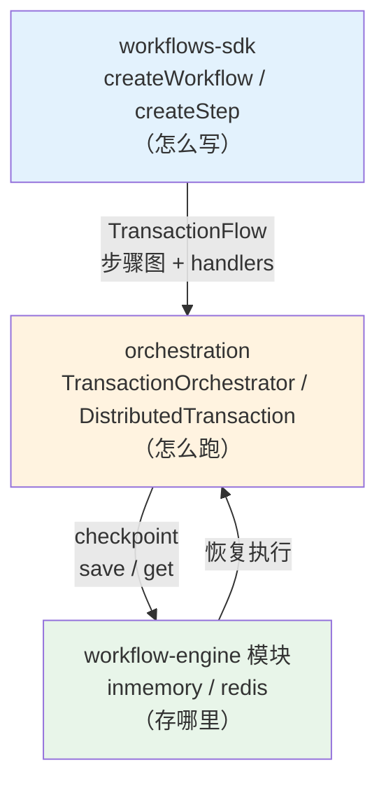
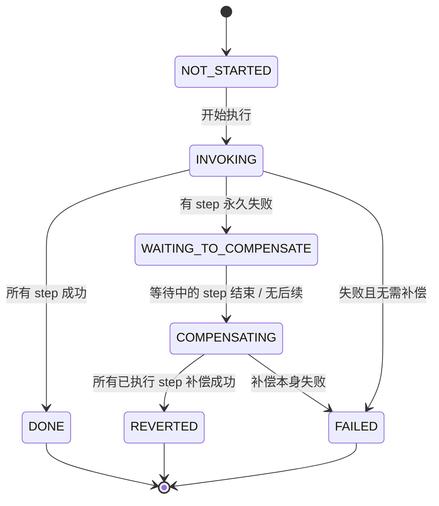

# Medusa 源码阅读（七）：补偿事务与可恢复的执行状态机

> 基于 Medusa v2.22.7（`develop` 分支，commit `f9ae213`，2026-11-19）源码分析。
> 系列：Medusa 源码阅读（7/10）。

## 一句话概括

上一篇讲的是「剧本怎么写」，这一篇讲「演出怎么跑」。

Workflow 执行器本质上是一台**带撤销功能的状态机**：它按拓扑顺序执行步骤，每一步成功后把整个事务的状态存盘；某一步失败时，它按**深度逆序**执行已完成步骤的补偿函数；进程中途崩溃，重启后能从最后一张存盘恢复。

它不追求数据库意义上的 ACID，而是提供**最终一致性 + 可观测的中间状态**。这篇拆开三个东西：状态机、补偿顺序、checkpoint。

## 目录

- [生活比喻：多米诺骨牌与倒带](#生活比喻多米诺骨牌与倒带)
- [三层分工](#三层分工)
- [事务状态机](#事务状态机)
- [步骤状态与状态码](#步骤状态与状态码)
- [主循环：一次 checkAllSteps](#主循环一次-checkallsteps)
- [补偿：为什么按深度逆序](#补偿为什么按深度逆序)
- [重试、超时与长任务](#重试超时与长任务)
- [Checkpoint：每一步之后存盘](#checkpoint每一步之后存盘)
- [并发存盘的合并](#并发存盘的合并)
- [两个引擎：内存与 Redis](#两个引擎内存与-redis)
- [幂等：补偿事务的真正难点](#幂等补偿事务的真正难点)
- [骨架代码：一个可回滚的步骤执行器](#骨架代码一个可回滚的步骤执行器)
- [这套设计的取舍](#这套设计的取舍)
- [动手验证](#动手验证)

## 生活比喻：多米诺骨牌与倒带

Workflow 像一排按顺序倒下的多米诺骨牌：

- 每推倒一张，就在旁边记一笔「第 N 张倒了，倒之前是什么样」；
- 中途有一张推不动，就从最后一张开始，**倒着把已经倒下的牌扶起来**；
- 扶不起来怎么办？（比如某张牌掉下桌子了）记一笔错误，继续扶前面能扶的，最后整排标记为「部分回滚失败」。

「倒着扶」这一点很关键——因为后一步往往依赖前一步的结果。先撤销后一步，再撤销前一步，才不会撤销到一半发现数据已经被后一步改过。

而 checkpoint 是那本记录册：进程崩了，新进程拿起记录册，知道哪些牌倒了、哪些扶了，从断点继续。

## 三层分工



| 层 | 包 | 职责 |
|----|----|------|
| 编排层 | `@medusajs/orchestration` | 状态机、调用 step、补偿、重试、超时 |
| 持久化 | `workflow-engine-inmemory` / `-redis` | checkpoint 存 PostgreSQL / Redis，恢复未完成事务 |
| 接入层 | `@medusajs/medusa` / core-flows | 把 workflow 暴露成 API、订阅事件、定时调度 |

`orchestration` 不知道存储在哪；它只依赖 `IDistributedTransactionStorage` 接口。内存引擎把 checkpoint 同时放内存和 PostgreSQL，Redis 引擎把协调信息放 Redis——执行逻辑完全复用。

## 事务状态机

事务状态定义在 `packages/core/utils/src/orchestration/types.ts:1-17`：

```ts
export enum TransactionState {
  NOT_STARTED = "not_started",
  INVOKING = "invoking",
  WAITING_TO_COMPENSATE = "waiting_to_compensate",
  COMPENSATING = "compensating",
  DONE = "done",
  REVERTED = "reverted",
  FAILED = "failed",
}
```

流转关系：



注意 `WAITING_TO_COMPENSATE` 这个中间态：失败发生时可能还有并行步骤在跑，**必须等它们结束才能开始回滚**，否则会出现「一边执行、一边撤销」的竞态。

这个判断在 `transaction-orchestrator.ts:335-345`：

```ts
const result = await this.computeCurrentTransactionState(transaction)

if (
  flow.state === TransactionState.WAITING_TO_COMPENSATE &&
  result.next.length === 0 &&
  !flow.hasWaitingSteps
) {
  flow.state = TransactionState.COMPENSATING
  this.flagStepsToRevert(flow)

  this.emit(DistributedTransactionEvent.COMPENSATE_BEGIN, { transaction })

  const result = await this.checkAllSteps(transaction)
  return result
}
```

三个条件缺一不可：**已经有失败**、**没有下一步要执行**、**没有等待中的步骤**。

## 步骤状态与状态码

每个 step 有两层状态（`types.ts:19-36`）：

```ts
export enum TransactionStepState {
  NOT_STARTED = "not_started",
  INVOKING = "invoking",
  COMPENSATING = "compensating",
  DONE = "done",
  REVERTED = "reverted",
  FAILED = "failed",
  DORMANT = "dormant",
  SKIPPED = "skipped",
  SKIPPED_FAILURE = "skipped_failure",
  TIMEOUT = "timeout",
}

export enum TransactionStepStatus {
  IDLE = "idle",
  OK = "ok",
  WAITING = "waiting_response",
  TEMPORARY_FAILURE = "temp_failure",
  PERMANENT_FAILURE = "permanent_failure",
}
```

`state` 描述「步骤走到哪」，`status` 描述「最近一次调用的结果」：

| state 组合 | 含义 |
|-----------|------|
| `INVOKING` + `WAITING` | 异步步骤已发出，等待外部回调 |
| `INVOKING` + `TEMPORARY_FAILURE` | 可重试失败，等 `retryInterval` 后重试 |
| `INVOKING` + `PERMANENT_FAILURE` | 不可重试失败，触发事务回滚 |
| `DONE` | 成功，可被补偿 |
| `SKIPPED` / `SKIPPED_FAILURE` | 条件不满足 / 失败但允许跳过 |
| `DORMANT` | 条件未满足，尚未决定是否执行 |
| `REVERTED` | 补偿成功 |

这套拆分让「重试」和「回滚」互不干扰：重试是在同一个 state 里改 status；回滚是换 state 并调用另一个 handler。

## 主循环：一次 checkAllSteps

`TransactionOrchestrator` 的核心是一个循环：**计算当前状态 → 找出下一批可执行步骤 → 执行 → 存盘 → 再计算**。

```ts
// packages/core/orchestration/src/transaction/transaction-orchestrator.ts:379-480（有删节、简化）
private async computeCurrentTransactionState(transaction) {
  const flow = transaction.getFlow()
  const nextSteps: TransactionStep[] = []
  const currentSteps: TransactionStep[] = []

  const allSteps =
    flow.state === TransactionState.COMPENSATING
      ? this.getCompensationSteps(flow)
      : this.getInvokeSteps(flow)

  for (const step of allSteps) {
    if (step === TransactionOrchestrator.ROOT_STEP || !this.canContinue(flow, flow.steps[step])) {
      continue
    }

    const stepDef = flow.steps[step]
    const curState = stepDef.getStates()

    // ...超时检查、WAITING 检查、TEMPORARY_FAILURE 检查...

    if (stepDef.canInvoke(flow.state) || stepDef.canCompensate(flow.state)) {
      nextSteps.push(stepDef)
    } else {
      completedSteps++
      if (curState.state === TransactionStepState.FAILED ||
          curState.state === TransactionStepState.TIMEOUT) {
        if (stepDef.definition.continueOnPermanentFailure ||
            stepDef.definition.skipOnPermanentFailure) {
          hasIgnoredFailure = true
        } else {
          hasFailed = true
        }
      }
    }
  }

  return { current: currentSteps, next: nextSteps, total: allSteps.length - 1, completed: completedSteps, hasFailed, /* ... */ }
}
```

`canContinue()` 负责依赖检查：

- **正向**：所有前置兄弟节点都到达「可继续」状态；
- **反向（补偿）**：所有后继兄弟节点都已完成补偿。

这就是为什么 `parallelize` 的步骤必须等整组完成才能进入下一层——依赖是**按组**判断的，不是按单个节点。

## 补偿：为什么按深度逆序

执行顺序按深度**升序**，补偿顺序按深度**降序**：

```ts
// transaction-orchestrator.ts:178-206
private getInvokeSteps(flow: TransactionFlow): string[] {
  if (this.invokeSteps.length) {
    return this.invokeSteps
  }

  const steps = Object.keys(flow.steps)
  steps.sort((a, b) => flow.steps[a].depth - flow.steps[b].depth)
  this.invokeSteps = steps

  return steps
}

private getCompensationSteps(flow: TransactionFlow): string[] {
  if (this.compensateSteps.length) {
    return this.compensateSteps
  }

  const steps = Object.keys(flow.steps)
  steps.sort((a, b) => (flow.steps[b].depth || 0) - (flow.steps[a].depth || 0))
  this.compensateSteps = steps

  return steps
}
```

`depth` 是步骤在依赖图中的最长路径长度。比如：

```text
A(depth 1) → B(depth 2) → C(depth 3)
```

失败发生在 D（和 C 同层）时：

- 正向执行：A、B、C/D；
- 补偿顺序：C/D（depth 3）→ B（depth 2）→ A（depth 1）。

这样保证**后做的先撤**。如果先撤 A，B 的补偿可能会因为 A 的数据已经没了而失败。

但是「所有 DONE 的步骤都要补偿」吗？看 `flagStepsToRevert()`（`transaction-orchestrator.ts:523-580`）：

```ts
private flagStepsToRevert(flow: TransactionFlow): void {
  for (const step in flow.steps) {
    if (step === TransactionOrchestrator.ROOT_STEP) {
      continue
    }

    const stepDef = flow.steps[step]
    const curState = stepDef.getStates()

    if (stepDef._v) {
      flow._v = 0
      stepDef._v = 0
    }

    if (
      flagStepsToRevertStates.has(curState.state) ||
      curState.status === TransactionStepStatus.PERMANENT_FAILURE
    ) {
      stepDef.beginCompensation()
      stepDef.notStarted()
    }
  }
}
```

它只标记处于「需要回滚」状态的步骤（`DONE` 等），并重置为待补偿状态。`NOT_STARTED` 的步骤不会被补偿——它们本来就没执行。

还有一个容易忽略的规则：**没有补偿函数的 step 会被跳过**。`applyStep()` 里设置 `stepConfig.noCompensation = !compensateFn`。这意味着一个会写数据的 step 如果忘了写补偿函数，回滚时数据就留下了。Medusa 的 core-flows 里，几乎所有写操作都配了补偿函数，只读查询才不配。

## 重试、超时与长任务

### 重试

临时失败（`TEMPORARY_FAILURE`）可以配置重试：

```ts
createStep({
  name: "call-payment-provider",
  maxRetries: 3,
  retryInterval: 2000,
}, async (input) => {
  // 调用外部支付接口
}, async (compensateInput) => {
  // 撤销
})
```

执行器在 `computeCurrentTransactionState` 里判断：

```ts
// transaction-orchestrator.ts:456-470（有删节）
} else if (curState.status === TransactionStepStatus.TEMPORARY_FAILURE) {
  if (!stepDef.temporaryFailedAt && stepDef.definition.autoRetry === false) {
    stepDef.temporaryFailedAt = Date.now()
    continue
  }

  stepDef.temporaryFailedAt = null
  currentSteps.push(stepDef)

  if (!stepDef.canRetry()) {
    if (stepDef.hasRetryInterval() && !stepDef.retryRescheduledAt) {
      stepDef.hasScheduledRetry = true
      stepDef.retryRescheduledAt = Date.now()
      await transaction.scheduleRetry(stepDef, stepDef.definition.retryInterval!)
    }
    continue
  }
}
```

重试不是 `while` 循环里 `sleep`——而是**把事务挂起，安排一个定时任务，之后重新进入主循环**。这样重试期间不占进程，checkpoint 也能落盘。

### 超时

事务和步骤都可以设 `timeout`。`hasExpired()` 同时检查两者（`transaction-orchestrator.ts:260-290`）：

```ts
const hasStepTimedOut =
  step && step.hasTimeout() && !step.isCompensating() &&
  dateNow > step.startedAt! + step.getTimeout()! * 1e3

const hasTransactionTimedOut =
  transaction && transaction.hasTimeout() &&
  transaction.getFlow().state !== TransactionState.COMPENSATING &&
  dateNow > transaction.getFlow().startedAt! + transaction.getTimeout()! * 1e3
```

超时会被转成 `TransactionTimeoutError`，然后走普通失败路径——该补偿就补偿。

### 长任务（异步步骤）

有些操作不可能在请求生命周期内完成：等支付回调、等物流签收、等人工审核。这类步骤标 `async: true`：

```ts
createStep({ name: "wait-payment-webhook", async: true }, async (input) => {
  // 发起支付，不返回 StepResponse
  await paymentService.initiate(input)
})
```

执行后步骤进入 `INVOKING + WAITING`，工作流挂起。外部事件到达后，调用引擎：

```ts
const workflowEngine = container.resolve(Modules.WORKFLOW_ENGINE)

await workflowEngine.setStepSuccess({
  idempotencyKey: { action: "invoke", transactionId, stepId: "wait-payment-webhook", workflowId },
  stepResponse: new StepResponse({ paid: true }),
})
```

`setStepSuccess` / `setStepFailure` 会从 checkpoint 恢复事务，把步骤结果写进去，然后继续主循环。**这就是为什么 workflow 的输入输出必须可序列化**——它们要跨越请求甚至进程边界。

## Checkpoint：每一步之后存盘

`DistributedTransaction.saveCheckpoint()` 在每次状态变化后调用（`distributed-transaction.ts:505-570`，有删节）：

```ts
public async saveCheckpoint({ ttl = 0, parallelSteps = 0, stepId, _v } = {}) {
  const options = { ...(TransactionOrchestrator.getWorkflowOptions(this.modelId) ?? this.getFlow().options) }

  if (!options?.store) {
    return
  }

  const key = TransactionOrchestrator.getKeyName(
    DistributedTransaction.keyPrefix,
    this.modelId,
    this.transactionId
  )

  let checkpoint: TransactionCheckpoint
  let retries = 0
  let backoffMs = 50
  const maxRetries = (options?.parallelSteps || 1) + 2

  while (retries < maxRetries) {
    checkpoint = this.#serializeCheckpointData()

    try {
      const savedCheckpoint = await DistributedTransaction.keyValueStore.save(key, checkpoint, ttl, options)
      return savedCheckpoint
    } catch (error) {
      if (TransactionOrchestrator.isExpectedError(error)) {
        throw error
      } else if (checkpoint.flow.state === TransactionState.NOT_STARTED) {
        throw new SkipExecutionError("Transaction already started for transactionId: " + this.transactionId)
      }

      retries++
      const jitter = Math.random() * backoffMs
      await setTimeoutPromise(backoffMs + jitter)
      backoffMs = Math.min(backoffMs * 2, 500)

      const lastCheckpoint = await DistributedTransaction.loadTransaction(this.modelId, this.transactionId)
      if (!lastCheckpoint) {
        throw new SkipExecutionError("Transaction already finished")
      }
      // ...合并最新 checkpoint，继续重试...
    }
  }
}
```

三个细节很有意思：

1. **只在配置了 `store` 时才存**：短事务可以不落库，纯内存跑完。
2. **乐观并发 + 指数退避**：存盘冲突时不是直接失败，而是拉取最新 checkpoint，合并后重试。
3. **`NOT_STARTED` 冲突直接跳过**：说明另一个进程已经用同一个 `transactionId` 启动了事务。这是**幂等入口**——同一个 idempotency key 并发调用两次，只会执行一次。

存进去的内容包括：

| 字段 | 内容 |
|------|------|
| `flow` | 每个步骤的 state / status / 输出 / 错误 / 时间戳 |
| `context` | 事务上下文（idempotency key、eventGroupId 等） |
| `errors` | 步骤错误列表 |
| `retention_time` | 完成后保留多久 |

`workflow_ execution` 表就是这些 JSON 的落点。

## 并发存盘的合并

并行步骤可能同时 `saveCheckpoint`，后写的会覆盖先写的步骤状态。Medusa 用一张**允许的状态迁移表** + 合并逻辑解决（`distributed-transaction.ts:128-165`）：

```ts
export class TransactionCheckpoint {
  static readonly #ALLOWED_STATE_TRANSITIONS = {
    [TransactionStepState.DORMANT]: [TransactionStepState.NOT_STARTED],
    [TransactionStepState.NOT_STARTED]: [
      TransactionStepState.INVOKING,
      TransactionStepState.COMPENSATING,
      TransactionStepState.FAILED,
      TransactionStepState.SKIPPED,
      TransactionStepState.SKIPPED_FAILURE,
    ],
    [TransactionStepState.INVOKING]: [
      TransactionStepState.FAILED,
      TransactionStepState.DONE,
      TransactionStepState.TIMEOUT,
      TransactionStepState.SKIPPED,
    ],
    [TransactionStepState.COMPENSATING]: [
      TransactionStepState.REVERTED,
      TransactionStepState.FAILED,
    ],
    [TransactionStepState.DONE]: [TransactionStepState.COMPENSATING],
  } as const

  static readonly #ALLOWED_STATUS_TRANSITIONS = {
    [TransactionStepStatus.WAITING]: [
      TransactionStepStatus.OK,
      TransactionStepStatus.TEMPORARY_FAILURE,
      TransactionStepStatus.PERMANENT_FAILURE,
    ],
    [TransactionStepStatus.TEMPORARY_FAILURE]: [
      TransactionStepStatus.IDLE,
      TransactionStepStatus.PERMANENT_FAILURE,
    ],
    [TransactionStepStatus.PERMANENT_FAILURE]: [TransactionStepStatus.IDLE],
  } as const
}
```

合并时只接受合法的迁移，非法迁移被忽略。这比加锁简单，也比「最后写入者赢」安全——它保证**状态不会倒退**（比如已经 DONE 的步骤不会被旧 checkpoint 改回 INVOKING）。

## 两个引擎：内存与 Redis

| 能力 | `workflow-engine-inmemory` | `workflow-engine-redis` |
|------|---------------------------|-------------------------|
| checkpoint 落库 | PostgreSQL | PostgreSQL |
| 调度/重试定时器 | 进程内存 | Redis + BullMQ 风格队列 |
| 多实例协调 | 弱（每实例各自恢复） | 强（同一事务只允许一个 worker） |
| 适用场景 | 单实例、开发、小型部署 | 多副本生产环境 |

内存引擎也会写库——它只是把「协调」放在内存里。启动时 `onApplicationStart()` 每 30 分钟清理过期执行记录（`workflow-orchestrator-storage.ts:129-136`）：

```ts
async onApplicationStart() {
  this.clearTimeout_ = setInterval(async () => {
    try {
      await this.clearExpiredExecutions()
    } catch {}
  }, THIRTY_MINUTES_IN_MS)
}
```

真正让它「恢复」的是 `get()`：从 `workflow_execution` 表按 `workflow_id + transaction_id` 读最后一条记录，重建 `TransactionCheckpoint`。

## 幂等：补偿事务的真正难点

补偿事务最容易踩的坑不是状态机，而是**副作用重复**：

- 存盘失败重试 → 同一个 step 可能被调用两次；
- 进程崩溃后恢复 → 最后一个 step 可能重复执行；
- 长任务回调重复投递 → `setStepSuccess` 可能收到两次。

Medusa 的应对是 `idempotencyKey`：`{ action, transactionId, stepId, workflowId }`。引擎用它定位事务和步骤，重复提交同一个 key 不会重复执行。但**外部副作用本身仍要业务保证幂等**：

- 调用支付网关时带 `Idempotency-Key` 头；
- 发邮件前查「是否已发送」；
- 写数据用 `upsert` 而不是 `insert`。

框架能保证「状态机不会重复推进」，不能保证「你的 HTTP 请求不会发两次」。这是所有补偿事务方案的共同边界。

## 骨架代码：一个可回滚的步骤执行器

```ts
type Step<T = any> = {
  name: string
  run: (input: T) => Promise<any>
  compensate?: (output: any) => Promise<void>
}

async function runWorkflow<T>(steps: Step[], input: T, ctx: any) {
  const completed: { step: Step; output: any }[] = []

  for (const step of steps) {
    try {
      const output = await step.run(input)
      completed.push({ step, output })
      await ctx.checkpoint({ completed: completed.map((c) => c.step.name) })
    } catch (error) {
      for (const { step, output } of completed.reverse()) {
        try {
          await step.compensate?.(output)
        } catch (compensateError) {
          // 补偿失败不能中断后续补偿，但要记录
          ctx.log(error, compensateError)
        }
      }
      throw error
    }
  }

  return completed.at(-1)?.output
}

// 你的项目：跨多个外部服务的注册流程（建账号 → 分配资源 → 发通知）
// 每个动作都写 compensate，失败时逆序撤销；checkpoint 交给数据库
```

真实实现需要加上：并行步骤、重试、超时、持久化、幂等键。但这个 20 行的骨架已经把核心思想表达完了：**记录已完成的步骤，失败时逆序撤销。**

## 这套设计的取舍

**好处：**

- 显式的状态迁移表让「什么状态下能做什么」成为可审查的代码，而不是散落的 if。
- 补偿顺序按依赖深度逆序，不依赖人工维护顺序。
- checkpoint + 幂等键支持进程崩溃恢复和重复调用。
- 引擎可替换：单机用内存，多副本用 Redis，执行逻辑不变。

**代价：**

- 不是 2PC，无法提供跨模块的强一致性快照。
- 每个写步骤都要写补偿函数，开发成本不低；漏写就意味着脏数据。
- 状态机有十几个状态组合，调试需要看 workflow_execution 记录。
- 副作用幂等必须由业务代码保证，框架只能保证状态推进一次。
- 执行记录会持续增长，需要 retention + 清理策略。

下一篇离开写路径，回到 HTTP 层：一个请求从进入 Express 到调用 workflow，中间经过了哪些中间件；文件路由怎么变成 `:param`；以及「查询配置」为什么是安全边界。

## 动手验证

```bash
cd source-read/medusa

# 状态定义
cat packages/core/utils/src/orchestration/types.ts

# 允许的状态迁移
sed -n '128,170p' packages/core/orchestration/src/transaction/distributed-transaction.ts

# 补偿顺序
sed -n '176,206p' packages/core/orchestration/src/transaction/transaction-orchestrator.ts

# 进入补偿状态的条件
sed -n '330,375p' packages/core/orchestration/src/transaction/transaction-orchestrator.ts

# checkpoint 重试与合并
sed -n '505,600p' packages/core/orchestration/src/transaction/distributed-transaction.ts

# 引擎注册与存储
sed -n '100,240p' packages/modules/workflow-engine-inmemory/src/services/workflow-orchestrator.ts
sed -n '94,160p' packages/modules/workflow-engine-inmemory/src/utils/workflow-orchestrator-storage.ts
```
