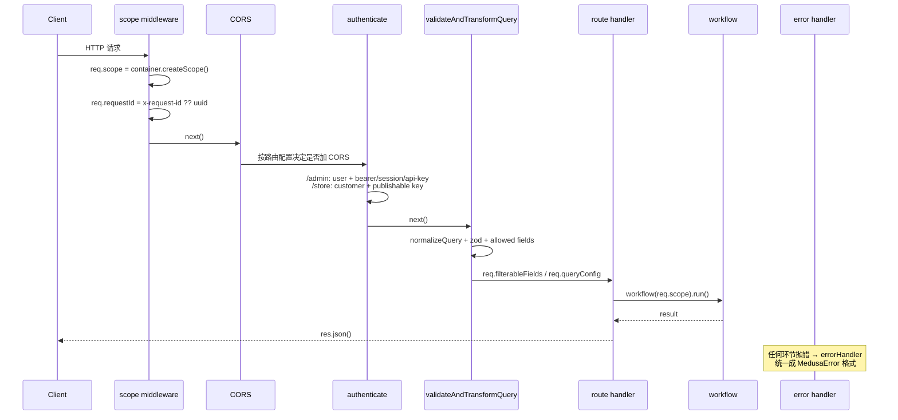

# Medusa 源码阅读（八）：文件即路由，查询配置即安全边界

> 基于 Medusa v2.22.7（`develop` 分支，commit `f9ae213`，2026-11-19）源码分析。
> 系列：Medusa 源码阅读（8/10）。

## 一句话概括

Medusa 的 HTTP 层遵循「约定优于配置」：**目录结构就是 URL，导出的函数名就是 HTTP 方法**。一个 `src/api/admin/orders/[id]/route.ts` 自动变成 `GET/POST /admin/orders/:id`，不需要注册路由表。

但真正决定这个层质量的不是路由，而是**进入 handler 之前的一长串中间件**：身份认证、查询校验、字段白名单、关系数量限制、错误格式化。尤其是字段白名单——在 store 端，没有显式允许的字段全部返回不了，这是防止数据越权的默认拒绝策略。

这篇按「一个请求的旅程」拆开 HTTP 层。

## 目录

- [生活比喻：机场安检](#生活比喻机场安检)
- [文件即路由](#文件即路由)
- [路由描述符：一个文件如何变成多条路由](#路由描述符一个文件如何变成多条路由)
- [路由排序：静态优先，参数其次](#路由排序静态优先参数其次)
- [请求进入后的完整管线](#请求进入后的完整管线)
- [认证：按前缀挂载，按路由跳过](#认证按前缀挂载按路由跳过)
- [查询校验：从 URL 到 FilterableFields](#查询校验从-url-到-filterablefields)
- [字段白名单：默认拒绝的安全边界](#字段白名单默认拒绝的安全边界)
- [一个真实路由的完整链路](#一个真实路由的完整链路)
- [骨架代码：一个迷你文件路由](#骨架代码一个迷你文件路由)
- [这套设计的取舍](#这套设计的取舍)
- [动手验证](#动手验证)

## 生活比喻：机场安检

坐飞机不是「到登机口直接上飞机」，而是一条固定顺序的流水线：

1. **验证件**：你是谁？（认证）
2. **查机票**：你的票能去哪？（路由匹配）
3. **安检**：行李里有没有违禁品？（请求体/查询校验）
4. **登机口复核**：票和人对不对？（RBAC / 字段白名单）
5. **登机**：交给 handler。

Medusa 的每个请求都要走完这条线。顺序不能乱：没有身份就谈不上权限；查询参数没校验就传给 ORM 可能有注入风险；字段没过滤就可能把 `customer.password_hash` 之类的数据返回给公开接口。

## 文件即路由

路由文件必须叫 `route.ts` 或 `route.js`，导出的函数名对应 HTTP 方法：

```text
src/api/
├── admin/
│   └── orders/
│       ├── route.ts              → GET/POST /admin/orders
│       ├── middlewares.ts        → 该资源的中间件配置
│       ├── query-config.ts       → 字段与分页配置
│       └── [id]/
│           └── route.ts          → GET/POST/DELETE /admin/orders/:id
└── store/
    └── products/
        └── route.ts              → GET /store/products
```

转换发生在 `RoutesLoader.createRoutePath()`（`routes-loader.ts:53-85`）：

```ts
const PARAM_SEGMENT_MATCHER = /\[(\w+)\]/

createRoutePath(relativePath: string): string {
  const segments = relativePath.replace(/route(\.js|\.ts)$/, "").split(sep)
  const params: Record<string, boolean> = {}

  return `/${segments
    .filter((segment) => !!segment)
    .map((segment) => {
      if (segment.startsWith("[")) {
        segment = segment.replace(PARAM_SEGMENT_MATCHER, (_, group) => {
          if (params[group]) {
            throw new Error(`Duplicate parameters found in route ${relativePath} (${group}).`)
          }
          params[group] = true
          return `:${group}`
        })
      }
      return segment
    })
    .join("/")}`
}
```

规则很窄，但足够用：

| 文件路径 | 路由 |
|---------|------|
| `admin/orders/route.ts` | `/admin/orders` |
| `admin/orders/[id]/route.ts` | `/admin/orders/:id` |
| `admin/orders/[id]/[line_id]/route.ts` | `/admin/orders/:id/:line_id` |
| `admin/_utils/helper.ts` | 不加载（`_` 开头的目录被忽略） |

`scanDir()` 会递归扫描，只认 `route.ts` / `route.js`，跳过 `_` 开头的路径段（`routes-loader.ts:172-205`）：

```ts
entries.filter((entry) => {
  if (entry.isDirectory()) return false

  const { name, ext } = parse(entry.name)
  if (name === ROUTE_NAME && [".js", ".ts"].includes(ext)) {
    const routeFilePathSegment = join(entry.path, entry.name)
      .replace(sourceDir, "")
      .split(sep)

    return !routeFilePathSegment.some((segment) => segment.startsWith("_"))
  }

  return false
})
```

`_` 前缀是给「工具文件、类型文件、fixtures」留的口子——它们和路由放在一起，但不会被当成路由。

## 路由描述符：一个文件如何变成多条路由

一个路由文件可以导出多个 HTTP 方法：

```ts
export const GET = async (req, res) => { /* ... */ }
export const POST = async (req, res) => { /* ... */ }
export const AUTHENTICATE = false   // 显式关闭认证
export const CORS = false           // 显式关闭 CORS
```

`#getRoutesForFile()` 把每个函数导出变成一个 `RouteDescriptor`（`routes-loader.ts:96-160`，有删节）：

```ts
const shouldAuthenticate =
  AUTHTHENTICATION_FLAG in routeExports ? !!routeExports[AUTHTHENTICATION_FLAG] : true

const shouldApplyCors =
  CORS_FLAG in routeExports ? !!routeExports[CORS_FLAG] : true

return Object.keys(routeExports)
  .filter((key) => {
    if (typeof routeExports[key] !== "function") return false
    if (!HTTP_METHODS.includes(key as RouteVerb)) return false
    return true
  })
  .map((key) => ({
    isRoute: true,
    matcher: routePath,
    method: key as RouteVerb,
    handler: routeExports[key],
    optedOutOfAuth: !shouldAuthenticate,
    shouldAppendAdminCors: shouldApplyCors && routeType === "admin",
    shouldAppendAuthCors: shouldApplyCors && routeType === "auth",
    shouldAppendStoreCors: shouldApplyCors && routeType === "store",
    shouldAppendRbacCors: shouldApplyCors && routeType === "rbac",
  }))
```

路由类型由路径前缀决定（`routes-loader.ts:36-48`）：

```ts
const ADMIN_ROUTE_MATCH = /(\/admin$|\/admin\/)/
const STORE_ROUTE_MATCH = /(\/store$|\/store\/)/
const AUTH_ROUTE_MATCH = /(\/auth$|\/auth\/)/
const RBAC_ROUTE_MATCH = /^\/rbac(\/|$)/
```

这个 `routeType` 不是装饰性的——它决定后面挂哪套 CORS、哪种认证策略。

## 路由排序：静态优先，参数其次

Express 是「先注册先匹配」。如果 `/admin/orders/:id` 先注册，`/admin/orders/export` 就永远不会命中。Medusa 用 `RoutesSorter` 按优先级排序（`routes-sorter.ts:181-235`）：

```ts
#processRoute(route: T) {
  let parent = this.#routesTree["root"]

  if (route.matcher instanceof RegExp) {
    parent.regex.routes.push(route)
    return
  }

  const segments = route.matcher.split("/").filter((s) => s.length)

  if (!segments.length) {
    const bucket = !route.methods && !route.method ? "global" : "static"
    parent[bucket].routes.push(route)
    return
  }

  segments.forEach((segment, index) => {
    let bucket: keyof RoutesBranch<T> = "static"

    if (!route.methods && !route.method) {
      bucket = "global"
    } else if (segment.startsWith("*") || segment.startsWith("{*")) {
      bucket = "wildcard"
    } else if (segment.startsWith(":")) {
      bucket = "params"
    } else if (/[\(\+\*\[\]\)\!]/.test(segment)) {
      bucket = "regex"
    }

    if (index + 1 === segments.length) {
      parent[bucket].routes.push(route)
      return
    }

    // ...继续建树...
  })
}
```

默认排序（`routes-sorter.ts:99-105`）是：

```text
global（全局中间件）
  → wildcard（/admin/orders/*）
    → regex（/admin/orders/(a|b)）
      → static（/admin/orders/export）
        → params（/admin/orders/:id）
```

这是**注册顺序**：global 最先注册，params 最后注册。对路由匹配最关键的一点是 **static 在 params 之前**，所以 `/admin/orders/export` 永远比 `/admin/orders/:id` 先命中；wildcard / regex 提前注册，主要是让覆盖性中间件先生效。`RoutesFinder` 负责在运行时按同样的优先级查找——认证中间件需要知道「这个请求对应的路由文件有没有选择跳过认证」。

## 请求进入后的完整管线



第一环在 `packages/medusa/src/loaders/index.ts:103-116`：

```ts
expressApp.use((req, res, next) => {
  req.scope = container.createScope() as MedusaContainer
  req.requestId = (req.headers["x-request-id"] as string) ?? randomUUID()
  next()
})
```

**每个请求一个作用域**。`req.scope` 从主容器创建一个子作用域，可以在请求级别注册临时服务，不会污染主容器。这是「请求级资源隔离」在容器层的体现。

## 认证：按前缀挂载，按路由跳过

认证不是挂在每个路由上，而是按 URL 前缀整体挂载（`router.ts:619-680`）：

```ts
// /admin：必须是后台用户，支持 bearer / session / api-key
this.#applyAuthMiddleware(routesFinder, "/admin", "user", [
  "bearer", "session", "api-key",
])

// /store：客户身份可选（allowUnauthenticated），并先经过 publishable key 校验
this.#applyAuthMiddleware(routesFinder, "/store", "customer", ["bearer", "session"], {
  allowUnauthenticated: true,
})

// /auth：登录相关路由，不套用户认证
```

`#applyAuthMiddleware()` 每次请求都先问 `RoutesFinder`：「这个路由跳过认证吗？」（`router.ts:365-400`）：

```ts
const originalFn = authenticate(actorType, authType, options)
const authMiddleware: RequestHandler = function authMiddleware(req, res, next) {
  const path = `${namespace}${req.path}`
  const matchingRoute = routesFinder.find(path, req.method as MiddlewareVerb)

  if (matchingRoute && matchingRoute.optedOutOfAuth) {
    logger.debug(`Skipping auth ${req.method} ${path}`)
    return next()
  }

  return originalFn(req, res, next)
}

this.#router.use(namespace, authMiddleware)
```

所以路由文件里的 `export const AUTHENTICATE = false` 不是「不挂认证中间件」，而是「挂了但运行时跳过」。这个设计让「默认安全」成立：**忘记写任何认证代码的路由，默认就是要认证的**。

## 查询校验：从 URL 到 FilterableFields

`validateAndTransformQuery()` 是路由最常用的中间件，做四件事：

1. **归一化 URL 参数**：`?fields[]=id,status` → `{ fields: ["id", "status"] }`；
2. **Zod 校验**：拒绝类型不对、值不合法的参数；
3. **应用字段白名单**：只保留 `allowed` 里的字段；
4. **生成查询配置**：`req.filterableFields`、`req.queryConfig.pagination`、`req.listConfig`。

先是 `normalizeQuery()`（`validate-query.ts:19-63`）：

```ts
const normalizeQuery = (req: MedusaRequest) => {
  return Object.entries(req.query).reduce((acc, [key, val]) => {
    let normalizedValue = val
    if (Array.isArray(val) && val.length === 1 && typeof val[0] === "string") {
      normalizedValue = val[0].split(",")
    }

    if (key.includes(".")) {
      const [parent, child, ...others] = key.split(".")
      if (others.length > 0) {
        throw new MedusaError(
          MedusaError.Types.INVALID_DATA,
          `Key accessor more than 2 levels deep: ${key}`
        )
      }

      if (isUnsafePathSegment(parent) || isUnsafePathSegment(child)) {
        throw new MedusaError(
          MedusaError.Types.INVALID_DATA,
          `Invalid query parameter key: ${key}`
        )
      }

      if (!Object.prototype.hasOwnProperty.call(acc, parent)) {
        acc[parent] = {}
      }
      acc[parent] = { ...acc[parent], [child]: normalizedValue }
    } else {
      acc[key] = normalizedValue
    }

    return acc
  }, {})
}
```

有两个安全设计：

- **最多两级点号参数**：`variants.sku` 可以，`a.b.c` 直接拒绝。避免构造深层对象消耗内存。
- **检查路径段安全性**：`isUnsafePathSegment` 防原型污染（`__proto__`、`constructor`）。

校验通过后，`prepareListQuery()` 负责把 `fields` 变成 `select` + `relations`，并应用白名单（`get-query-config.ts:46-165`，有删节）：

```ts
const parsedFields = FieldParser.parse(fields, defaults as string[])
const { fields: allFields, starFields } = parsedFields
const filters: IFieldFilter[] = []

if (allowed.length) {
  filters.push(new AllowedFieldFilter({ allowed }))
} else if (restricted.length) {
  filters.push(new RestrictedFieldFilter({ restricted }))
}

const notAllowedArrays = await promiseAll(
  filters.map((f) => f.getNotAllowedFields({ entity: entity as string, parsedFields }))
)
const notAllowedFields = [...new Set(notAllowedArrays.flat())]

notAllowedFields.forEach((field) => {
  allFields.delete(field)
  starFields.delete(field)
})

// disallowed 是硬安全边界，始终剔除
if (disallowed.length) {
  const disallowedFields = new DisallowedFieldFilter({ disallowed })
    .getNotAllowedFields({ entity: entity as string, parsedFields })

  disallowedFields.forEach((field) => {
    allFields.delete(field)
    starFields.delete(field)
  })
}
```

注意 `disallowed` 的注释：

```ts
// Disallowed fields are a hard security boundary and are always stripped,
// independent of any feature flag, so sensitive relations (order, customer,
// payment, ...) can never be resolved on the configured endpoint.
```

`allowed` 是「只允许这些」，`disallowed` 是「无论如何都不许」。两者都应用，取交集。

## 字段白名单：默认拒绝的安全边界

这是 Medusa HTTP 层最重要的安全设计。

后台 `/admin` 路由默认可以查所有字段（管理员本来就有全量权限，再叠加 RBAC）。但 `/store` 是公开接口——任何人拿到 publishable key 就能调。如果允许 `?fields=customer.password_hash`，事故就大了。

所以 store 路由**必须**在 `query-config.ts` 里显式声明 `allowed`：

```ts
// packages/medusa/src/api/store/regions/query-config.ts
import { buildAllowedFields, prefixAllowedFields } from "../utils/allowed-fields"

const defaultStoreRegionFields = [
  "id", "name", "currency_code", "created_at", "updated_at", "deleted_at",
  "metadata", "*countries",
]

const nestedStoreRegionCountryFields = [
  "countries.id", "countries.iso_2", "countries.iso_3",
  "countries.num_code", "countries.name", "countries.display_name",
]

const storeRegionPaymentProviderFields = ["id", "is_enabled"]

const nestedStoreRegionPaymentProviderFields = [
  "payment_providers",
  ...prefixAllowedFields("payment_providers", storeRegionPaymentProviderFields),
]

export const retrieveTransformQueryConfig = {
  defaults: defaultStoreRegionFields,
  allowed: buildAllowedFields(
    defaultStoreRegionFields,
    nestedStoreRegionCountryFields,
    nestedStoreRegionPaymentProviderFields
  ),
  isList: false,
}
```

三个关键点：

1. **`defaults` 是「不传 fields 时返回什么」**，也必须是 `allowed` 的子集；
2. **嵌套关系要逐字段列出**：`countries.iso_2`，不能写 `countries` 就放行整个关系；
3. **`buildAllowedFields` 只做归一化**：剥掉字段前的 `*` 和后缀 `.*`，再去重；嵌套字段必须单独列出来（`countries.iso_2`），它不会替你放行整个关系。

如果客户端请求了不在 `allowed` 里的字段，Medusa **不会报错，而是静默丢弃**。这是有意为之：前端可以传一整套字段列表，服务端只返回它有权看到的那些，不会因为多传一个字段就 400。

但 `order` 参数是例外——按不在白名单里的字段排序会直接报错（`get-query-config.ts:150-157`）：

```ts
if (allowed.length && !allowed.includes(orderField)) {
  throw new MedusaError(
    MedusaError.Types.INVALID_DATA,
    `Order field ${orderField} is not valid`
  )
}
```

因为排序字段会泄露「该字段存在」这一信息，而且可能被用来做侧信道推断。

## 一个真实路由的完整链路

以 `GET /admin/orders` 为例。

**路由文件**只做三件事：取配置、跑 workflow、返回结果（`packages/medusa/src/api/admin/orders/route.ts:8-35`）：

```ts
export const GET = async (
  req: AuthenticatedMedusaRequest<HttpTypes.AdminOrderFilters>,
  res: MedusaResponse<HttpTypes.AdminOrderListResponse>
) => {
  const variables = {
    filters: {
      ...req.filterableFields,
      is_draft_order: false,
    },
    ...req.queryConfig.pagination,
  }

  const workflow = getOrdersListWorkflow(req.scope)
  const { result } = await workflow.run({
    input: {
      fields: req.queryConfig.fields,
      variables,
    },
  })

  const { rows, metadata } = result as { rows: OrderDTO[]; metadata: any }

  res.json({
    orders: rows as unknown as HttpTypes.AdminOrder[],
    count: metadata.count,
    offset: metadata.skip,
    limit: metadata.take,
  })
}
```

**中间件文件**负责认证、鉴权、校验（`packages/medusa/src/api/admin/orders/middlewares.ts:27-54`）：

```ts
export const adminOrderRoutesMiddlewares: MiddlewareRoute[] = [
  {
    matcher: "/admin/orders/{*splat}",
    middlewares: [
      authorize([{ resource: Entities.order, operation: PolicyOperation.read }]),
    ],
  },
  {
    method: ["GET"],
    matcher: "/admin/orders",
    middlewares: [
      authorize([{ resource: Entities.order, operation: PolicyOperation.read }]),
      validateAndTransformQuery(
        AdminGetOrdersParams,
        QueryConfig.listTransformQueryConfig
      ),
    ],
  },
]
```

**查询配置**决定字段与分页默认值（省略）。

三者的职责非常清晰：

| 文件 | 只负责 | 不该出现 |
|------|--------|---------|
| `route.ts` | 调 workflow、返回响应 | SQL、字段拼接、业务判断 |
| `middlewares.ts` | 认证、鉴权、校验 | 业务逻辑 |
| `query-config.ts` | 字段白名单、默认分页 | 查询实现 |

## 骨架代码：一个迷你文件路由

用 Node 原生 `fs` + Express 复刻「目录即路由」：

```ts
import { readdirSync, statSync } from "node:fs"
import { join, relative, sep } from "node:path"
import type { Express } from "express"

const METHODS = ["GET", "POST", "PUT", "PATCH", "DELETE"] as const

function toRoutePath(file: string, root: string) {
  return (
    "/" +
    relative(root, file)
      .replace(/route\.(ts|js)$/, "")
      .split(sep)
      .filter(Boolean)
      .map((segment) =>
        segment.startsWith("[")
          ? ":" + segment.replace(/\[(\w+)\]/, "$1")
          : segment
      )
      .join("/")
  )
}

function walk(dir: string): string[] {
  return readdirSync(dir).flatMap((name) => {
    if (name.startsWith("_")) return []
    const full = join(dir, name)
    return statSync(full).isDirectory()
      ? walk(full)
      : /^route\.(ts|js)$/.test(name)
        ? [full]
        : []
  })
}

export async function loadRoutes(app: Express, root: string) {
  const files = walk(root).sort() // 排序保证静态路由先注册

  for (const file of files) {
    const mod = await import(file)
    const path = toRoutePath(file, root)

    for (const method of METHODS) {
      if (typeof mod[method] === "function") {
        app[method.toLowerCase()](path, mod[method])
      }
    }
  }
}

// 你的项目：小型 BFF / 内部工具后端，不想维护一张路由表
// 生产环境还要加：优先排序（静态 > 参数）、认证、schema 校验、错误处理
```

## 这套设计的取舍

**好处：**

- 新增接口只加文件，不改注册表；文件位置就是 API 文档的一部分。
- 中间件、校验、白名单集中在 `middlewares.ts` / `query-config.ts`，路由本身保持很薄。
- 默认认证 + store 端默认拒绝字段，安全基线是「安全」而不是「方便」。
- 同一套路由加载逻辑同时服务核心路由、插件路由、用户路由，覆盖顺序明确。

**代价：**

- 路由发现依赖文件系统扫描，启动时比手写注册表慢一点；HMR 需要单独处理（`reloadRouteFile`）。
- `_` 前缀、`route.ts` 命名、目录即 URL 都是隐式约定，新人容易踩坑。
- 字段白名单维护成本高：新增一个可公开字段要同时改 `defaults` 和 `allowed`。
- 静默丢弃不允许的字段虽然对前端友好，但排错时要去看 query config 才知道为什么字段没返回。
- Express 5 的路径语法变化（`*` 要写成 `{*splat}`）需要兼容处理。

下一篇进入业务模块：订单。看看它如何用「不可变历史 + 版本化行」记录订单的每一次变更，以及 Order Change 的动作注册表为什么比一堆 if 更可维护。

## 动手验证

```bash
cd source-read/medusa

# 文件路由
sed -n '53,160p' packages/core/framework/src/http/routes-loader.ts

# 路由排序
sed -n '181,235p' packages/core/framework/src/http/routes-sorter.ts

# 认证按前缀挂载
sed -n '619,680p' packages/core/framework/src/http/router.ts

# 查询校验
sed -n '19,63p' packages/core/framework/src/http/utils/validate-query.ts
sed -n '46,165p' packages/core/framework/src/http/utils/get-query-config.ts

# store 端字段白名单
cat packages/medusa/src/api/store/regions/query-config.ts

# 一个真实路由
cat packages/medusa/src/api/admin/orders/route.ts
sed -n '27,60p' packages/medusa/src/api/admin/orders/middlewares.ts
```
