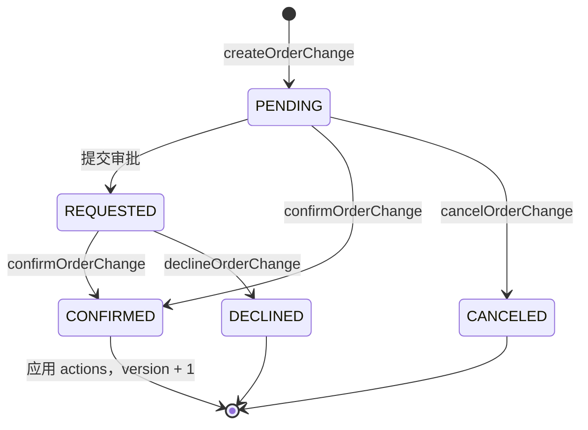

# Medusa 源码阅读（九）：订单为什么不能直接改

> 基于 Medusa v2.22.7（`develop` 分支，commit `f9ae213`，2026-11-19）源码分析。
> 系列：Medusa 源码阅读（9/10）。

## 一句话概括

订单一旦创建，就**不应该被直接修改**。退货、换货、改地址、加优惠、补运费——每一次变更都要留下「谁、在什么时候、改了什么、改之前是什么」。

Medusa 的做法是 **append-only + 版本化**：

- 订单本身有一个 `version`，从 1 开始；
- 所有可变数据（行项目数量、金额、地址、优惠）按版本存多行；
- 变更先写成一条 **OrderChange + 若干 action**，可以预览、可以不确认；
- 确认后，新的 action 被应用到订单，生成 `version + 1` 的一整套行。

这篇拆开这个「订单账本」：数据结构、动作注册表、预览与确认两条路径。

## 目录

- [生活比喻：银行流水与司法卷宗](#生活比喻银行流水与司法卷宗)
- [为什么不能直接 UPDATE](#为什么不能直接-update)
- [数据模型：订单、版本、变更单](#数据模型订单版本变更单)
- [OrderChange 的生命周期](#orderchange-的生命周期)
- [动作注册表：每个业务动作是一张卡片](#动作注册表每个业务动作是一张卡片)
- [以退货为例看一个 action](#以退货为例看一个-action)
- [虚拟订单：在副本上推演](#虚拟订单在副本上推演)
- [预览与确认：两条路径共用一套计算](#预览与确认两条路径共用一套计算)
- [确认之后：写新版本](#确认之后写新版本)
- [版本感知的 Repository](#版本感知的-repository)
- [骨架代码：一个版本化聚合](#骨架代码一个版本化聚合)
- [这套设计的取舍](#这套设计的取舍)
- [动手验证](#动手验证)

## 生活比喻：银行流水与司法卷宗

银行账户的余额不是「改出来的」，是「流水累加出来的」。想改一笔交易，不是把昨天的记录擦掉重写，而是再记一笔冲正。这样任何时刻的余额都能从流水推导出来，审计也有据可查。

订单也是如此：

- **Order** 是账户，**version** 是账期；
- **OrderItem** 是每个账期的持仓快照；
- **OrderChange** 是一张「变更申请单」，**OrderChangeAction** 是申请单上的条目；
- **确认变更** 相当于过账，生成下一个账期。

司法卷宗更贴切：卷宗只能往后加页，不能撕页。要更正，就再写一份更正说明。历史永远保留。

## 为什么不能直接 UPDATE

电商订单的「下单后」才是复杂期的开始：

| 场景 | 需要改什么 | 为什么不能直接改 |
|------|-----------|----------------|
| 退货 | `return_requested_quantity` 增加 | 要保留「退货前数量」，否则客服说不清 |
| 换货 | 加新行、减旧行 | 要能对比换货前后 |
| 改地址 | `shipping_address` | 物流已经发走的订单，历史地址必须可查 |
| 补运费 | 加一条 shipping method + 调整总额 | 财务对账要看到差额来源 |
| 优惠重算 | 替换 adjustments | 旧优惠金额必须能追溯 |

还有两个业务需求直接决定了设计：

1. **预览**：客服要告诉客户「如果同意退货，退款多少」，此时不能真的改订单；
2. **审批**：变更可能是 `requested` 状态，等管理员确认后才生效。

所以 Order 模块需要三件事：**可推演、可审批、可追溯**。版本化 + action 列表正好覆盖这三点。

## 数据模型：订单、版本、变更单

核心模型（`packages/modules/order/src/models/order.ts:9-70`，有删节）：

```ts
const _Order = model.define("Order", {
  id: model.id({ prefix: "order" }).primaryKey(),
  display_id: model.autoincrement().searchable(),
  custom_display_id: model.text().searchable().nullable(),
  region_id: model.text().nullable(),
  customer_id: model.text().nullable(),
  version: model.number().default(1),
  sales_channel_id: model.text().nullable(),
  status: model.enum(OrderStatus).default(OrderStatus.PENDING),
  is_draft_order: model.boolean().default(false),
  email: model.text().searchable().nullable(),
  currency_code: model.text(),
  // ...地址、金额、metadata...
})
```

按版本存的数据（来自订单模块的 `AGENTS.md`，已核对源码）：

| 实体 | 说明 |
|------|------|
| `OrderItem` | 每个版本一行，记录 quantity、fulfilled、shipped、return_requested 等 |
| `OrderShipping` | 版本化的配送方式关联 |
| `OrderSummary` | 每个版本一份 totals JSON |
| `OrderTransaction` | 每个版本的支付/退款流水 |
| `OrderCreditLine` | 每个版本的信用额度行 |
| 行项目/运费调整 | 每个版本独立 |

而「不改历史」的变更单：

```ts
// packages/modules/order/src/models/order-change.ts:5-40（有删节）
const _OrderChange = model.define("OrderChange", {
  id: model.id({ prefix: "ordch" }).primaryKey(),
  return_id: model.text().nullable(),
  claim_id: model.text().nullable(),
  exchange_id: model.text().nullable(),
  version: model.number(),
  change_type: model.text().nullable(),
  status: model.enum(OrderChangeStatus).default(OrderChangeStatus.PENDING).nullable(),
  description: model.text().nullable(),
  created_by: model.text().nullable(),
  requested_by: model.text().nullable(),
  confirmed_by: model.text().nullable(),
  confirmed_at: model.dateTime().nullable(),
  declined_by: model.text().nullable(),
  canceled_at: model.dateTime().nullable(),
  order: model.belongsTo(() => Order, { mappedBy: "changes" }),
  actions: model.hasMany(() => OrderChangeAction),
})
```

`OrderChangeAction` 记录一条原子变更：

```ts
type OrderChangeAction = {
  action: ChangeActionType   // RETURN_ITEM / ITEM_ADD / SHIPPING_ADD ...
  details: {...}             // reference_id、quantity 等
  amount: BigNumber
  ordering: number           // 同一变更单内的执行顺序
  applied: boolean           // 是否已应用到订单
}
```

`ChangeActionType` 有二十多个值（`packages/core/utils/src/order/order-change-action.ts:1-25`）：

```ts
export enum ChangeActionType {
  FULFILL_ITEM = "FULFILL_ITEM",
  DELIVER_ITEM = "DELIVER_ITEM",
  CANCEL_ITEM_FULFILLMENT = "CANCEL_ITEM_FULFILLMENT",
  ITEM_ADD = "ITEM_ADD",
  ITEM_REMOVE = "ITEM_REMOVE",
  ITEM_UPDATE = "ITEM_UPDATE",
  RECEIVE_DAMAGED_RETURN_ITEM = "RECEIVE_DAMAGED_RETURN_ITEM",
  RECEIVE_RETURN_ITEM = "RECEIVE_RETURN_ITEM",
  RETURN_ITEM = "RETURN_ITEM",
  CANCEL_RETURN_ITEM = "CANCEL_RETURN_ITEM",
  SHIPPING_ADD = "SHIPPING_ADD",
  SHIPPING_REMOVE = "SHIPPING_REMOVE",
  SHIPPING_UPDATE = "SHIPPING_UPDATE",
  SHIP_ITEM = "SHIP_ITEM",
  WRITE_OFF_ITEM = "WRITE_OFF_ITEM",
  REINSTATE_ITEM = "REINSTATE_ITEM",
  TRANSFER_CUSTOMER = "TRANSFER_CUSTOMER",
  UPDATE_ORDER_PROPERTIES = "UPDATE_ORDER_PROPERTIES",
  CREDIT_LINE_ADD = "CREDIT_LINE_ADD",
  PROMOTION_ADD = "PROMOTION_ADD",
  PROMOTION_REMOVE = "PROMOTION_REMOVE",
  ITEM_ADJUSTMENTS_REPLACE = "ITEM_ADJUSTMENTS_REPLACE",
  SHIPPING_ADJUSTMENTS_REPLACE = "SHIPPING_ADJUSTMENTS_REPLACE",
}
```

这张枚举是整个模块的「动词表」——订单发生的每一件事，都能归到其中一个动作。

## OrderChange 的生命周期



对应枚举（`packages/core/utils/src/order/order-change.ts:1-22`）：

```ts
export enum OrderChangeStatus {
  CONFIRMED = "confirmed",
  DECLINED = "declined",
  REQUESTED = "requested",
  PENDING = "pending",
  CANCELED = "canceled",
}
```

变更类型（`order-change.ts:24-31`）：

```ts
export enum OrderChangeType {
  RETURN_REQUEST = "return_request",
  RETURN_RECEIVE = "return_receive",
  EXCHANGE = "exchange",
  CLAIM = "claim",
  EDIT = "edit",
  CREDIT_LINE = "credit_line",
}
```

这个状态机的约束很硬：**只有 `pending` / `requested` 的变更单可以确认、取消或拒绝**。已确认的变更不能再改，只能发起下一次变更。

## 动作注册表：每个业务动作是一张卡片

最值得学习的不是版本化本身，而是动作的实现方式。

每个 action 类型是一个**独立文件 + 注册调用**，而不是 `switch` 里的一个分支。

## 以退货为例看一个 action

退货动作定义在 `packages/modules/order/src/utils/actions/return-item.ts:9-65`（有删节）：

```ts
OrderChangeProcessing.registerActionType(ChangeActionType.RETURN_ITEM, {
  isDeduction: true,

  operation({ action, currentOrder, options }) {
    const existing = currentOrder.items.find(
      (item) => item.id === action.details.reference_id
    )!

    existing.detail.return_requested_quantity ??= 0
    existing.detail.return_requested_quantity = MathBN.add(
      existing.detail.return_requested_quantity,
      action.details.quantity
    )

    setActionReference(existing, action, options)

    return MathBN.mult(existing.unit_price, action.details.quantity)
  },

  validate({ action, currentOrder }) {
    const refId = action.details?.reference_id
    if (refId == null) {
      throw new MedusaError(
        MedusaError.Types.INVALID_DATA,
        "Details reference ID is required."
      )
    }

    const existing = currentOrder.items.find((item) => item.id === refId)
    if (!existing) {
      throw new MedusaError(
        MedusaError.Types.INVALID_DATA,
        `Item ID "${refId}" not found.`
      )
    }

    if (!action.details?.quantity) {
      throw new MedusaError(
        MedusaError.Types.INVALID_DATA,
        `Quantity to return of item ${refId} is required.`
      )
    }

    // Units already received or dismissed on an earlier return are no longer with the customer.
    const quantityAvailable = MathBN.sub(
      existing.detail?.fulfilled_quantity ?? 0,
      MathBN.add(
        existing.detail?.return_requested_quantity ?? 0,
        existing.detail?.return_received_quantity ?? 0,
        existing.detail?.return_dismissed_quantity ?? 0
      )
    )

    if (MathBN.gt(action.details.quantity, quantityAvailable)) {
      throw new MedusaError(
        MedusaError.Types.INVALID_DATA,
        `Cannot request to return more items than what was fulfilled for item ${refId}.`
      )
    }
  },
})
```

一个 action 定义包含：

| 字段 | 作用 |
|------|------|
| `validate(params)` | 业务规则校验（不能退未发货的数量、引用的行必须存在） |
| `operation(params)` | 修改虚拟订单的某个字段，返回本动作的金额贡献 |
| `isDeduction` | 金额是加还是减（退货是减） |

优点非常明显：

- **新增动作 = 新增文件 + 注册一行**，不用改订单服务的核心代码；
- **校验和计算绑在一起**，不会出现「算了金额但忘了校验」；
- **每个动作独立可测**，订单模块的单元测试就是按 action 组织的。

注册入口在 `src/utils/actions/index.ts`，一次导出全部（`actions/index.ts:1-24`）。

## 虚拟订单：在副本上推演

`OrderChangeProcessing` 是动作的执行器。它的构造函数第一件事就是**深拷贝订单**（`calculate-order-change.ts:48-70`）：

```ts
export class OrderChangeProcessing {
  private static typeDefinition: { [key: string]: ActionTypeDefinition } = {}
  private static defaultConfig = { isDeduction: false }

  private order: VirtualOrder
  private transactions: OrderTransaction[]
  private actions: InternalOrderChangeEvent[]
  private options: ProcessOptions = {}

  constructor({ order, transactions, actions, options }) {
    this.order = JSON.parse(JSON.stringify(order))
    this.transactions = JSON.parse(JSON.stringify(transactions ?? []))
    this.actions = JSON.parse(JSON.stringify(actions ?? []))
    this.options = options

    let paid = MathBN.convert(0)
    let refunded = MathBN.convert(0)
    let transactionTotal = MathBN.convert(0)
    let creditLineTotal = (this.order.credit_lines || []).reduce(
      (acc, creditLine) => MathBN.add(acc, creditLine.amount),
      MathBN.convert(0)
    )

    for (const tr of transactions) {
      if (MathBN.lt(tr.amount, 0)) {
        refunded = MathBN.add(refunded, MathBN.abs(tr.amount))
      } else {
        paid = MathBN.add(paid, tr.amount)
      }
      transactionTotal = MathBN.add(transactionTotal, tr.amount)
    }

    this.summary = {
      pending_difference: 0,
      current_order_total: this.order.total ?? 0,
      original_order_total: this.order.total ?? 0,
      transaction_total: transactionTotal,
      paid_total: paid,
      refunded_total: refunded,
      credit_line_total: creditLineTotal,
      accounting_total: MathBN.sub(this.order.total ?? 0, creditLineTotal),
    }
  }
```

**所有计算都发生在副本上**，原始订单对象一根手指都没碰。这让「预览」变得非常自然：跑一遍 `applyChangesToOrder`，把结果扔掉即可。

`processActions()` 依次执行每个动作，并累计 summary（`calculate-order-change.ts:103-155`，有删节）：

```ts
public processActions() {
  let newCreditLineTotal = (this.order.credit_lines ?? [])
    .filter((cl) => !("id" in cl))
    .reduce((acc, creditLine) => MathBN.add(acc, creditLine.amount), MathBN.convert(0))

  for (const action of this.actions) {
    this.processAction_(action)
  }

  const summary = this.summary

  for (const action of this.actions) {
    if (!this.isEventActive(action)) {
      continue
    }

    const type = {
      ...OrderChangeProcessing.defaultConfig,
      ...OrderChangeProcessing.typeDefinition[action.action],
    }

    const amount = MathBN.mult(action.amount!, type.isDeduction ? -1 : 1)

    if (action.change_id) {
      this.groupTotal[action.change_id] ??= 0
      this.groupTotal[action.change_id] = MathBN.add(
        this.groupTotal[action.change_id],
        amount
      )
    }

    if (action.action === ChangeActionType.CREDIT_LINE_ADD) {
      newCreditLineTotal = MathBN.add(newCreditLineTotal, amount)
      summary.current_order_total = MathBN.sub(summary.current_order_total, amount)
    } else {
      summary.current_order_total = MathBN.add(summary.current_order_total, amount)
    }
  }

  summary.credit_line_total = newCreditLineTotal
  summary.accounting_total = summary.current_order_total
  summary.transaction_total = MathBN.sum(...this.transactions.map((tr) => tr.amount))
  summary.pending_difference = MathBN.sub(summary.current_order_total, summary.transaction_total)
}
```

`processAction_()` 里先找注册表，找不到直接抛错：

```ts
const definedType = OrderChangeProcessing.typeDefinition[action.action]

if (!isPresent(definedType)) {
  throw new Error(`Action type ${action.action} is not defined`)
}

if (typeof type.validate === "function") {
  type.validate(params)
}

if (typeof type.operation === "function") {
  calculatedAmount = type.operation(params) as BigNumberInput
}
```

**注册表 + 策略模式**，没有一行 `switch (action.action)`。

## 预览与确认：两条路径共用一套计算

### 预览

`previewOrderChange()`（`order-module-service.ts:2542-2600`，有删节）：

```ts
async previewOrderChange(orderId: string, @MedusaContext() sharedContext: Context = {}) {
  const order = await this.retrieveOrder(
    orderId,
    {
      select: ["id", "version", "items.detail", "summary", "total", "email"],
      relations: ["transactions", "credit_lines"],
    },
    sharedContext
  )

  if (!order.order_change) {
    return order
  }

  const orderChange = await super.retrieveOrderChange(
    order.order_change.id,
    { relations: ["actions"] },
    sharedContext
  )

  // We need to apply the latest ordering actions last
  const sortedActions = orderChange.actions.sort((a, b) => a.ordering - b.ordering)

  const {
    itemsToUpsert,
    shippingMethodsToUpsert,
    calculatedOrders,
    lineItemAdjustmentsToCreate,
    shippingMethodAdjustmentsToCreate,
  } = await applyChangesToOrder(
    [order],
    { [order.id]: sortedActions },
    { addActionReferenceToObject: true }
  )

  const calculated = calculatedOrders[order.id]

  await this.includeTaxLinesAndAdjustmentsToPreview(
    calculated.order,
    itemsToUpsert,
    shippingMethodsToUpsert,
    lineItemAdjustmentsToCreate,
    shippingMethodAdjustmentsToCreate,
    sharedContext
  )

  const calcOrder = calculated.order

  const orderWithTotals = decorateCartTotals(calcOrder as DecorateCartLikeInputDTO)
  calcOrder.summary = calculated.getSummaryFromOrder(orderWithTotals)

  // ...返回算好的订单副本，不写库...
}
```

注意 `includeTaxLinesAndAdjustmentsToPreview` 的注释：它会为预览版本计算「虚拟 adjustments」，但**不会写入数据库**。

### 确认

`confirmOrderChange()`（`order-module-service.ts:2790-2848`）分两步：

```ts
@InjectManager()
@EmitEvents()
async confirmOrderChange(orderChangeIdOrData, @MedusaContext() sharedContext: Context = {}) {
  const result = await this.confirmOrderChange_(orderChangeIdOrData, sharedContext)
  return await this.baseRepository_.serialize<OrderTypes.OrderChangeReturn>(result)
}

@InjectTransactionManager()
protected async confirmOrderChange_(orderChangeIdOrData, @MedusaContext() sharedContext: Context = {}) {
  const data = Array.isArray(orderChangeIdOrData) ? orderChangeIdOrData : [orderChangeIdOrData]
  const orderChangeIds = isString(data[0]) ? data : (data as any).map((dt) => dt.id)

  const orderChange = await this.getAndValidateOrderChange_(orderChangeIds, true, sharedContext)

  const updates = data.map((dt) => ({
    ...(isString(dt) ? { id: dt } : dt),
    confirmed_at: new Date(),
    status: OrderChangeStatus.CONFIRMED,
  }))

  await this.orderChangeService_.update(updates as any, sharedContext)

  const orderChanges = orderChange.map((change) => change.actions)

  return await this.applyOrderChanges_(orderChanges.flat(), sharedContext)
}
```

关键点：

1. **`@InjectTransactionManager()`**：确认过程在一个数据库事务里，更新变更单状态和应用变更要么都成功，要么都失败；
2. **先改状态，再应用 actions**：`getAndValidateOrderChange_` 已经校验过状态必须是 pending/requested；
3. **`applyOrderChanges_` 跳过已应用的 action**：支持幂等重试。

```ts
private async applyOrderChanges_(changeActions, @MedusaContext() sharedContext = {}) {
  const actionsMap = {}
  const ordersIds = []
  const usedActions = []

  for (const action of changeActions) {
    if (action.applied) {
      continue
    }

    ordersIds.push(action.order_id)
    actionsMap[action.order_id] ??= []
    actionsMap[action.order_id].push(action)
    usedActions.push({ selector: { id: action.id }, data: { applied: true } })
  }

  if (!ordersIds.length) {
    return { items: [], shipping_methods: [], credit_lines: [] }
  }

  // ...加载订单、应用变更、写新版本...
}
```

## 确认之后：写新版本

真正的落库在 `applyChangesToOrder()`（`src/utils/apply-order-changes.ts:25-210`，有删节）：

```ts
export async function applyChangesToOrder(orders, actionsMap, options?) {
  const itemsToUpsert = []
  const creditLinesToUpsert = []
  const shippingMethodsToUpsert = []
  const lineItemAdjustmentsToCreate = []
  const shippingMethodAdjustmentsToCreate = []
  const summariesToUpsert = []
  const orderToUpdate = []

  const calculatedOrders = {}

  for (const order of orders) {
    const calculated = calculateOrderChange({
      order,
      actions: actionsMap[order.id],
      transactions: order.transactions ?? [],
      options,
    })

    createRawPropertiesFromBigNumber(calculated)

    const version = actionsMap[order.id]?.[0]?.version ?? order.version
    const orderAttributes = {}

    // ...可编辑属性...
    for (const attr of orderEditableAttributes) {
      if (order[attr] !== calculated.order[attr]) {
        orderAttributes[attr] = calculated.order[attr]
      }
    }

    for (const item of calculated.order.items) {
      const isExistingItem = item.id === item.detail?.item_id
      const orderItem = isExistingItem ? item.detail : item
      const itemId = isExistingItem ? orderItem.item_id : item.id

      const itemToUpsert = {
        id: orderItem.version === version ? orderItem.id : undefined,
        item_id: itemId,
        order_id: order.id,
        version,
        quantity: orderItem.quantity,
        fulfilled_quantity: orderItem.fulfilled_quantity ?? 0,
        // ...一整套数量字段...
      }

      itemsToUpsert.push(itemToUpsert)
    }

    if (version > order.version) {
      orderAttributes.version = version
    }
  }

  // ...继续处理 credit lines、shipping methods、summary...
}
```

`id: orderItem.version === version ? orderItem.id : undefined` 这一行是版本化的精髓：

- 如果当前版本的这一行已经存在 → 带 `id` 更新；
- 如果不存在（新版本）→ 不带 `id`，插入新行。

所以每次确认变更，`OrderItem`、`OrderSummary`、`OrderTransaction` 等表都会多出一整套 `version = N+1` 的行。旧版本的数据原封不动。

## 版本感知的 Repository

默认查询只返回当前版本的数据。实现方式不是在每个 service 方法里手写 `version` 条件，而是重写了 Repository 的 `find` / `findAndCount`（`src/utils/base-repository-find.ts:1-20` 的注释说得很清楚）：

```ts
/**
 * The order module replaces MikroORM repository `find`/`findAndCount` with
 * version-aware implementations, so it must apply cross-module join filters
 * itself — the base repository's `prepareFindOptions` is never called.
 */
```

它做的核心事情：

- 读订单时自动带上 `order.version` 作为过滤条件；
- 想查历史版本，显式在 filters 里传 `version`；
- 同时还要补上跨模块 join 的 SQL 过滤（因为基础 Repository 的 `prepareFindOptions` 被绕过了）。

这是「默认安全」的又一个例子：**你不写版本，拿到的就是当前版本**，历史数据只能显式查询。

## 骨架代码：一个版本化聚合

```ts
type VersionedRow = { id: string; version: number }

class VersionedAggregate {
  private version = 1
  private rows: VersionedRow[] = []
  private changes: { actions: any[]; status: "pending" | "confirmed" }[] = []

  constructor(initialRows: Omit<VersionedRow, "version">[]) {
    this.rows = initialRows.map((row) => ({ ...row, version: 1 }))
  }

  // 预览：在副本上算，不落库
  preview(actions: any[]) {
    return this.apply(actions, { dryRun: true })
  }

  // 确认：生成新版本
  confirm(actions: any[]) {
    this.apply(actions, { dryRun: false })
    this.version += 1
  }

  private apply(actions: any[], { dryRun }: { dryRun: boolean }) {
    const copy = structuredClone(this.rows).filter((row) => row.version === this.version)

    for (const action of actions) {
      // 每个 action 有 validate + operation
      action.validate?.(copy)
      action.operation(copy)
    }

    if (!dryRun) {
      // 旧版本保留，新版本整行写入
      this.rows.push(...copy.map((row) => ({ ...row, id: crypto.randomUUID(), version: this.version + 1 })))
    }

    return copy
  }

  current() {
    return this.rows.filter((row) => row.version === this.version)
  }
}

// 你的项目：任何需要「历史可追溯 + 变更可预览」的聚合
// 合同、账单、库存调拨单，都可以套这个模式
```

## 这套设计的取舍

**好处：**

- 任何时间点的订单状态都能重建，退货/对账/审计都有依据。
- 变更可以先预览、再确认，客服和客户看到的是同一套计算。
- 新增动作类型不改核心服务，注册一张「动作卡片」即可。
- 所有金额用 `BigNumber` 计算，避免浮点误差。

**代价：**

- **数据量增长快**：每个版本复制一整套行项目、运费、税额、调整；大订单多次变更后表会很大。
- **查询要带版本条件**：绕过 Repository 直接写 SQL 很容易拿到多版本混合数据。
- **动作必须走注册表**：直接改 `OrderItem.quantity` 会绕过所有校验和版本记录，是模块明令禁止的。
- **预览有成本**：每次预览都要跑完整计算 + 查税额/调整，订单大时接口会慢。
- **状态机严格**：已确认的变更不能修改，业务上想「改一下刚才的退货」只能再发起一次变更。

下一篇是最后一篇：事件与后台任务。订单确认后要发邮件、同步搜索索引、跑定时任务——这些不应该阻塞请求，Medusa 用 Event Bus、Subscribers、Jobs 和 worker 模式把它们拆出去。

## 动手验证

```bash
cd source-read/medusa

# 订单与变更单模型
sed -n '9,80p' packages/modules/order/src/models/order.ts
sed -n '5,93p' packages/modules/order/src/models/order-change.ts

# 状态与动作枚举
cat packages/core/utils/src/order/order-change.ts
cat packages/core/utils/src/order/order-change-action.ts

# 一个动作的完整定义
cat packages/modules/order/src/utils/actions/return-item.ts

# 虚拟订单与计算
sed -n '20,155p' packages/modules/order/src/utils/calculate-order-change.ts

# 预览与确认
sed -n '2542,2600p' packages/modules/order/src/services/order-module-service.ts
sed -n '2790,2848p' packages/modules/order/src/services/order-module-service.ts

# 写入新版本
sed -n '25,130p' packages/modules/order/src/utils/apply-order-changes.ts

# 版本感知的 find
sed -n '1,80p' packages/modules/order/src/utils/base-repository-find.ts
```
