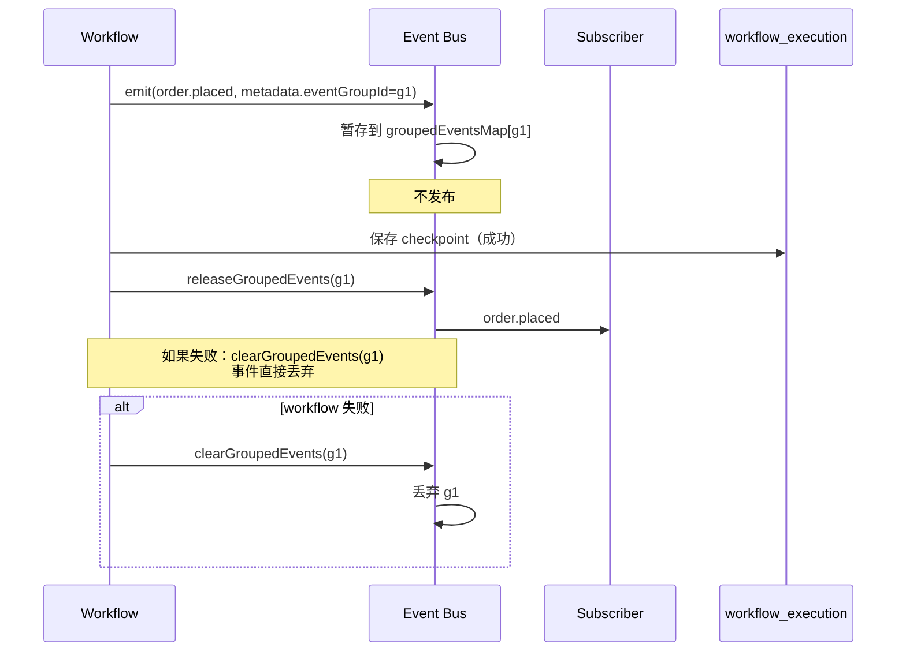
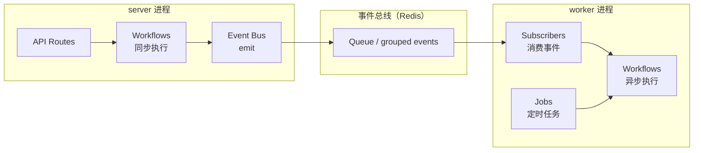
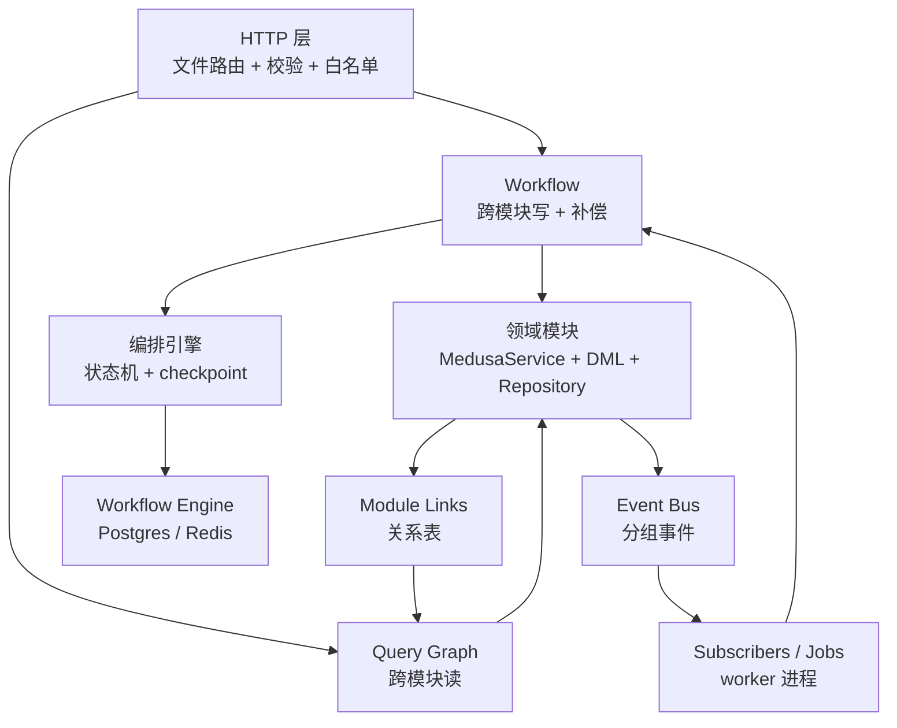

# Medusa 源码阅读（十）：事件、订阅与夜班工人

> 基于 Medusa v2.22.7（`develop` 分支，commit `f9ae213`，2026-11-19）源码分析。
> 系列：Medusa 源码阅读（10/10）。

## 一句话概括

一个订单创建成功后，要做的事远不止写库：发确认邮件、同步搜索索引、通知仓库、更新统计。这些动作**不应该阻塞下单请求**，也不应该因为邮件服务挂了就导致订单创建失败。

Medusa 用三样东西把「主流程」和「副作用」分开：

- **Event Bus**：发布/订阅事件，支持「事务成功后才真正发出」；
- **Subscribers**：监听事件，做异步反应；
- **Jobs**：定时任务，且每个 job 本质是一个 workflow，天然带重试和执行记录；
- 再配合 **worker 模式**，把后台消费从 Web 进程里拆出去。

这篇拆开这条异步链路，也是整个系列的收尾。

## 目录

- [生活比喻：商场广播与夜班保安](#生活比喻商场广播与夜班保安)
- [事件总线接口](#事件总线接口)
- [本地事件总线：一个 EventEmitter 加两个技巧](#本地事件总线一个-eventemitter-加两个技巧)
- [事件分组：成功才发布](#事件分组成功才发布)
- [Subscribers：文件即订阅](#subscribers文件即订阅)
- [Jobs：定时任务就是 workflow](#jobs定时任务就是-workflow)
- [Worker 模式：同一镜像，两种角色](#worker-模式同一镜像两种角色)
- [生产环境：Redis 事件总线](#生产环境redis-事件总线)
- [为什么这样设计](#为什么这样设计)
- [骨架代码：一个事务性事件总线](#骨架代码一个事务性事件总线)
- [这套设计的取舍](#这套设计的取舍)
- [系列回顾](#系列回顾)
- [动手验证](#动手验证)

## 生活比喻：商场广播与夜班保安

白天，商场广播系统播报「三号店铺完成了一笔大额订单」。各个店铺听到广播后各自行动：咖啡店准备赠品、停车场预留车位、安保记录人流。广播员不关心谁在听，也不等他们做完。

但广播有一个规矩：**只有这笔交易真正结算成功，才会播报**。如果收银台正在处理，广播先按下不表；失败则直接作废，绝不播出。

夜班保安负责定时巡逻：每小时检查一次消防通道、每天凌晨盘点库存。他们不在营业时间干活，也不占用前台的资源。

Medusa 的 Event Bus 就是广播，Subscribers 是听到广播的店铺，Jobs 是夜班保安，worker 模式是把他们安排到另一栋楼（另一个进程）。

## 事件总线接口

事件总线的契约在 `packages/core/types/src/event-bus/event-bus-module.ts`，核心方法：

```ts
interface IEventBusModuleService {
  emit<T>(events: Message<T> | Message<T>[], options?: Record<string, unknown>): Promise<void>
  subscribe(event: string | symbol, subscriber: Subscriber, context?: SubscriberContext): this
  unsubscribe(event: string | symbol, subscriber: Subscriber, context?: SubscriberContext): this
  releaseGroupedEvents(eventGroupId: string): Promise<void>
  clearGroupedEvents(eventGroupId: string, options?: { eventNames?: string[] }): Promise<void>
}
```

`Message` 包含：

```ts
type Message<T = unknown> = {
  name: string          // 事件名，如 "order.placed"
  data: T               // 负载
  metadata?: {
    eventGroupId?: string  // 分组 ID，决定「什么时候真正发出」
    [key: string]: unknown
  }
  options?: Record<string, unknown>
}
```

两个内置实现：

| 实现 | 包 | 特点 |
|------|----|------|
| `event-bus-local` | Node `EventEmitter` | 单进程、零依赖、开发友好 |
| `event-bus-redis` | Redis + BullMQ | 跨进程、持久化队列、支持重试 |

## 本地事件总线：一个 EventEmitter 加两个技巧

`LocalEventBusService` 只有 252 行（`packages/modules/event-bus-local/src/services/event-bus-local.ts`）。它继承 `AbstractEventBusModuleService`，内部就是一个模块级 `EventEmitter`：

```ts
const eventEmitter = new EventEmitter()
eventEmitter.setMaxListeners(Infinity)

export default class LocalEventBusService extends AbstractEventBusModuleService {
  protected readonly logger_: Logger
  protected readonly eventEmitter_: EventEmitter
  protected groupedEventsMap_: StagingQueueType

  constructor({ logger }: MedusaContainer & InjectedDependencies, moduleOptions = {}, moduleDeclaration: InternalModuleDeclaration) {
    super(...arguments)
    this.logger_ = logger ?? console
    this.eventEmitter_ = eventEmitter
    this.groupedEventsMap_ = new Map()
  }
```

注意 `eventEmitter` 定义在**模块作用域**，不是实例属性——同一个进程里多个 local bus 实例共享同一个 emitter。这避免了「A 模块 emit、B 模块 subscribe 收不到」的经典问题。

两个技巧让这个小实现足够实用：

### 技巧一：通配符订阅

```ts
// event-bus-local.ts:97-140（有删节）
private async groupOrEmitEvent<T = unknown>(eventData: Message<T>) {
  const { options, ...eventBody } = eventData
  const eventGroupId = eventBody.metadata?.eventGroupId
  const hasStarSubscriber = this.eventEmitter_.listenerCount("*") > 0

  if (eventGroupId) {
    await this.groupEvent(eventGroupId, eventData)
  } else {
    const options_ = eventData.options as { delay: number }
    const delay = (ms?: number) => (ms ? setTimeout(ms) : Promise.resolve())

    delay(options_?.delay).then(async () => {
      void this.callInterceptors(eventData, { isGrouped: false })

      const publishedEventBody = {
        ...eventBody,
        metadata: this.withPublishedAtMetadata(eventBody.metadata),
      }

      if (eventListenersCount) {
        this.eventEmitter_.emit(eventData.name, publishedEventBody)
      }

      if (hasStarSubscriber) {
        this.eventEmitter_.emit("*", publishedEventBody)
      }
    })
  }
}
```

任何订阅了 `"*"` 的监听者能收到所有事件——审计日志、调试工具、事件追踪都靠它。

### 技巧二：订阅者错误隔离

```ts
// event-bus-local.ts:197-230（有删节）
subscribe(event, subscriber, context?) {
  super.subscribe(event, subscriber, context)

  const subscriberId = context?.subscriberId ?? (subscriber as any).subscriberId

  const wrappedSubscriber = async (data: Event) => {
    try {
      await subscriber(data)
    } catch (err) {
      this.logger_.error(`An error occurred while processing ${event.toString()}:`)
      this.logger_.error(err)
    }
  }

  this.eventEmitter_.on(event, wrappedSubscriber)
  return this
}
```

一个订阅者抛错，**不会影响其他订阅者**，也不会把错误抛回 `emit()` 的调用方。这是「副作用不能影响主流程」的直接体现。代价是：错误只进日志，没有自动重试——需要重试就用 Redis 事件总线。

## 事件分组：成功才发布

这是整套异步链路里最重要的设计。

问题：workflow 执行到一半 emit 了 `order.placed`，但后面的步骤失败了，订单回滚——事件却已经发出，订阅者开始发邮件、扣库存，数据就乱了。

Medusa 的解法是 **eventGroupId + 延迟发布**：



### 发送端：emitEventStep 打上分组

`packages/core/core-flows/src/common/steps/emit-event.ts:80-120`（有删节）：

```ts
export const emitEventStep = createStep(
  emitEventStepId,
  async (input: Input, context) => {
    const { container } = context
    const eventBus: IEventBusModuleService = container.resolve(Modules.EVENT_BUS)

    const data_ = typeof input.data === "function" ? await input.data(context) : input.data

    const metadata: EventBusTypes.Event["metadata"] = {
      ...input.metadata,
    }

    if (context.eventGroupId) {
      metadata.eventGroupId = context.eventGroupId
    }

    const dataArray = Array.isArray(data_) ? data_ : [data_]
    const message: EventBusTypes.Message[] = dataArray.map((dt) => ({
      name: input.eventName,
      data: dt,
      options: input.options,
      metadata,
    }))

    await eventBus.emit(message)
    return new StepResponse({
      eventGroupId: context.eventGroupId,
      eventName: input.eventName,
    })
  },

  // 补偿：从分组里移除这个事件
  async (data, context) => {
    if (!data || !data?.eventGroupId) {
      return
    }

    const { container } = context
    const eventBus: IEventBusModuleService = container.resolve(Modules.EVENT_BUS)

    await eventBus.clearGroupedEvents(data!.eventGroupId, {
      eventNames: [data!.eventName],
    })
  }
)
```

`context.eventGroupId` 由 workflow 执行上下文提供。注意**补偿函数**：step 被回滚时，把对应事件从分组里移除——即使 workflow 最终成功，被回滚 step 的事件也不会发出去。

### 接收端：workflow 结束时统一放行

`packages/core/workflows-sdk/src/helper/workflow-export.ts:590-650`（有删节）：

```ts
function attachOnFinishReleaseEvents(events, flow, { logOnError } = {}) {
  const onFinish = events.onFinish

  const wrappedOnFinish = async (args) => {
    const { transaction } = args
    const flowEventGroupId = transaction.getFlow().metadata?.eventGroupId

    const logger =
      (flow.container as MedusaContainer).resolve<Logger>(
        ContainerRegistrationKeys.LOGGER,
        { allowUnregistered: true }
      ) || console

    if (logOnError) {
      const workflowName = transaction.getFlow().modelId
      transaction.getErrors().forEach((err) => {
        logger.error(`${workflowName}:${err?.action}:${err?.handlerType}...`)
      })
    }

    const eventBusService = (flow.container as MedusaContainer).resolve<IEventBusModuleService>(
      Modules.EVENT_BUS,
      { allowUnregistered: true }
    )

    if (!eventBusService || !flowEventGroupId) {
      await onFinish?.(args)
      return
    }

    const failedStatus = [TransactionState.FAILED, TransactionState.REVERTED]

    if (failedStatus.includes(transaction.getState())) {
      return await eventBusService
        .clearGroupedEvents(flowEventGroupId)
        .catch(() => {
          logger.warn(`Failed to clear events for eventGroupId - ${flowEventGroupId}`)
        })
    }

    await eventBusService.releaseGroupedEvents(flowEventGroupId).catch((e) => {
      logger.error(`Failed to release events for eventGroupId - ${flowEventGroupId}`, e)
    })
  }

  events.onFinish = wrappedOnFinish
}
```

逻辑非常清晰：

| workflow 最终状态 | 事件处理 |
|------------------|---------|
| `DONE` | `releaseGroupedEvents` — 全部发出 |
| `FAILED` / `REVERTED` | `clearGroupedEvents` — 全部丢弃 |
| 没有 eventGroupId | 不处理（直接 emit 的普通事件） |

这实际上是一个**内存版 transactional outbox**：先写「待发件箱」，事务成功后才投递。区别是 outbox 通常落在数据库，Medusa 这里落在事件总线的内存/Redis 分组里。

## Subscribers：文件即订阅

订阅者和路由一样，是文件即约定。一个典型的订阅者：

```ts
// src/subscribers/order-placed.ts
import type { SubscriberArgs, SubscriberConfig } from "@medusajs/framework"

export default async function orderPlacedHandler({
  event: { data },
  container,
}: SubscriberArgs<{ id: string }>) {
  const query = container.resolve("query")
  const { data: [order] } = await query.graph({
    entity: "order",
    fields: ["id", "email", "total"],
    filters: { id: data.id },
  })

  // 发邮件、同步索引、通知仓库……
}

export const config: SubscriberConfig = {
  event: "order.placed",
}
```

加载流程在 `SubscriberLoader`（`packages/core/framework/src/subscribers/subscriber-loader.ts`）：

1. 递归扫描 `src/subscribers`，跳过 `_` 前缀、`index.*`、测试文件；
2. 校验每个文件：必须有默认函数 + `config.event`；
3. 生成 `subscriberId`：优先用 `config.context.subscriberId`，其次用函数名，最后用文件名；
4. 对 `config.event` 里的每个事件调用 `eventBus.subscribe()`。

```ts
// subscriber-loader.ts:165-205（有删节）
createSubscriber({ fileName, config, handler }) {
  const eventBusService: IEventBusModuleService = container.resolve(Modules.EVENT_BUS)
  const { event } = config
  const events = Array.isArray(event) ? event : [event]
  const subscriberId = this.inferIdentifier(fileName, config, handler)

  for (const e of events) {
    const subscriber = async (data: T) => {
      return await handler({
        event: { name: e, ...data } as unknown as Event<T>,
        container,
        pluginOptions: this.#pluginOptions,
      })
    }

    eventBusService.subscribe(e, subscriber as Subscriber, {
      ...config.context,
      subscriberId,
    })

    registerDevServerResource({
      type: "subscriber",
      id: subscriberId,
      sourcePath: fileName,
      subscriberId,
      events,
    })
  }
}
```

几个工程细节：

- 生产环境里，缺少 `config.event` 的订阅者会**直接抛错**；开发环境只警告并跳过。
- `subscriberId` 用于去重和热重载——同一个订阅者文件重新加载时，能精确移除旧的监听器。
- 订阅者拿到的是 `container`，可以解析 query、模块服务、workflow，自由度很高，但也被要求「只做轻量触发，重活交给 workflow」。

## Jobs：定时任务就是 workflow

`JobLoader` 不直接把 cron handler 塞进调度器，而是**把 handler 包装成一个 workflow**（`packages/core/framework/src/jobs/job-loader.ts:100-160`，有删节）：

```ts
protected register({ path, config, handler }) {
  const workflowName = `job-${config.name}`

  const step = createStep(
    `${config.name}-as-step`,
    async (input: ScheduledJobWorkflowInput | undefined, stepContext) => {
      const { container } = stepContext
      const context: ScheduledJobContext = {
        scheduledFor: input?.scheduledFor ? new Date(input.scheduledFor) : new Date(),
      }

      try {
        const res = await handler(container, context)
        return new StepResponse(res, res)
      } catch (error) {
        this.logger.error(`Scheduled job ${config.name} failed with error: ${error.message}`)
        throw error
      }
    }
  )

  const workflowConfig = {
    name: workflowName,
    schedule: isObject(config.schedule)
      ? config.schedule
      : {
          cron: config.schedule,
          numberOfExecutions: config.numberOfExecutions,
        },
  }

  createWorkflow(workflowConfig, (input) => {
    return new WorkflowResponse(step(input))
  })

  registerDevServerResource({
    sourcePath: path,
    id: workflowName,
    type: "job",
    config: config,
  })
}
```

好处是把前面六、七篇的能力全部继承过来：

| 能力 | 来源 |
|------|------|
| 执行记录 | workflow_execution 表 |
| 失败可见 | workflow 执行状态、错误日志 |
| 重试/超时 | step 配置 |
| 手动触发 | 通过 workflow API 跑一次 |
| 依赖注入 | step context 里的 container |

调度本身由 `WorkflowScheduler` 完成。`WorkflowManager.register()` 发现 workflow 带 `schedule` 就调用 `scheduler.scheduleWorkflow()`（`workflow-manager.ts:139`）。内存引擎用 `setTimeout` + cron 解析：

```ts
// workflow-orchestrator-storage.ts:645-685（有删节）
async schedule(jobDefinition, schedulerOptions) {
  const jobId = typeof jobDefinition === "string" ? jobDefinition : jobDefinition.jobId

  // 先取消旧任务，保证 schedule 配置总是最新
  await this.remove(jobId)

  let expression: CronExpression | number
  if ("cron" in schedulerOptions) {
    expression = CronExpressionParser.parse(schedulerOptions.cron)
  } else if ("interval" in schedulerOptions) {
    expression = schedulerOptions.interval
  }

  const delay = parseNextExecution(schedulerOptions)
  const scheduledFor = new Date(Date.now() + delay)

  const timer = setTimeout(async () => {
    await this.jobHandler(jobId, scheduledFor)
  }, delay)

  timer.unref()
  this.scheduled.set(jobId, { timer, expression, numberOfExecutions: 0, config: schedulerOptions })
}
```

`timer.unref()` 让定时器不阻止进程退出——这对 CLI 命令和测试很重要。

## Worker 模式：同一镜像，两种角色

`workerMode` 决定进程加载什么（`packages/medusa/src/loaders/index.ts:39-49, 208-218`）：

```ts
const isWorkerMode = (configModule) => configModule.projectConfig.workerMode === "worker"

const shouldLoadBackgroundProcessors = (configModule) =>
  configModule.projectConfig.workerMode === "worker" ||
  configModule.projectConfig.workerMode === "shared"
```

| 模式 | API 路由 | Jobs | Subscribers | 事件消费 |
|------|---------|------|-------------|---------|
| `server` | ✅ | ❌ | ✅ 注册 | Redis 队列下由 worker 消费；local bus 仍在同进程内触发 |
| `worker` | ❌ | ✅ | ✅ 注册 | ✅ |
| `shared` | ✅ | ✅ | ✅ 注册 | ✅ |



这种拆分的意义：

- **Web 进程保持轻**：不被发邮件、同步索引这类慢任务拖住；
- **后台任务可独立扩容**：促销期间加 worker，不影响 API；
- **故障隔离**：邮件服务挂了，worker 队列堆积，API 仍然可用。

## 生产环境：Redis 事件总线

本地 EventEmitter 有三个硬伤：

1. **不跨进程**：server 进程 emit 的事件，worker 进程收不到；
2. **不持久**：进程崩了，暂存的分组事件就没了；
3. **无重试**：订阅者失败只记日志。

`event-bus-redis` 用 BullMQ 解决（`packages/modules/event-bus-redis/src/services/event-bus-redis.ts`）：

```ts
export default class RedisEventBusService extends AbstractEventBusModuleService {
  protected readonly logger_: Logger
  protected readonly eventBusRedisConnection_: Redis

  protected readonly queueName_: string
  protected readonly queueOptions_: Omit<QueueOptions, "connection">
  protected readonly workerOptions_: Omit<WorkerOptions, "connection">
  protected readonly jobOptions_: EmitOptions

  protected queue_: Queue
  protected bullWorker_: Worker

  constructor({ logger, eventBusRedisConnection, eventBusRedisQueueName, ... }) {
    super(...arguments)
    // ...
  }
}
```

分组事件也存在 Redis 的 list 里，带 TTL：

```ts
// event-bus-redis.ts:211-240（有删节）
async emit<T = unknown>(eventsData: Message<T> | Message<T>[], options: Record<string, unknown> = {}) {
  const { groupedEventsTTL = 600 } = options
  delete options.groupedEventsTTL

  const groupEventsMap = new Map<string, Message<T>[]>()

  for (const event of Array.isArray(eventsData) ? eventsData : [eventsData]) {
    const groupId = event.metadata?.eventGroupId!
    const groupEvents = groupEventsMap.get(groupId) ?? []
    groupEvents.push(event)
    groupEventsMap.set(groupId, groupEvents)
  }

  for (const [groupId, events] of groupEventsMap.entries()) {
    promises.push(this.groupEvents(groupId, eventsData, groupedEventsTTL))
  }
}
```

`groupedEventsTTL` 是一个重要的兜底：如果 workflow 进程崩溃，永远没有 `releaseGroupedEvents`，分组事件会在 TTL（默认 600 秒）后自动过期，而不是无限堆积。

## 为什么这样设计

把「写数据」和「通知世界」解耦，是分布式系统的老问题。Medusa 的选择有三个理由：

1. **主流程不能被副作用拖垮**：邮件服务延迟 5 秒，不应该让下单接口延迟 5 秒。
2. **事件必须与事务同成败**：`order.placed` 发出去就代表订单真的成了。eventGroupId 的分组/放行机制，是「事务成功才发事件」的最小实现。
3. **后台任务需要和前台一样的可观测性**：把 job 变成 workflow，就自动有了执行记录、重试、状态查询，不用另造一套调度系统。

## 骨架代码：一个事务性事件总线

```ts
class GroupedEventBus {
  private groups = new Map<string, any[]>()
  private listeners = new Map<string, Set<(event: any) => Promise<void>>>()

  async emit(event: any, groupId?: string) {
    if (groupId) {
      const group = this.groups.get(groupId) ?? []
      group.push(event)
      this.groups.set(groupId, group)
      return
    }

    await this.publish(event)
  }

  async release(groupId: string) {
    const events = this.groups.get(groupId) ?? []
    this.groups.delete(groupId)

    for (const event of events) {
      await this.publish(event)
    }
  }

  clear(groupId: string) {
    this.groups.delete(groupId)
  }

  subscribe(name: string, handler: (event: any) => Promise<void>) {
    const set = this.listeners.get(name) ?? new Set()
    set.add(handler)
    this.listeners.set(name, set)
  }

  private async publish(event: any) {
    const handlers = this.listeners.get(event.name) ?? new Set()

    for (const handler of handlers) {
      try {
        await handler(event)
      } catch (error) {
        // 副作用失败不影响其他订阅者，也不影响 emit 调用方
        console.error(`subscriber failed for ${event.name}`, error)
      }
    }
  }
}

// 你的项目：任何「事务成功才通知外部」的场景
// 订单创建、支付回调、用户注册，都可以用 groupId 包住一组事件
```

## 这套设计的取舍

**好处：**

- 主流程与副作用解耦，接口响应时间可控。
- eventGroupId 保证「失败的事务不产生业务事件」，这是很多系统容易忽略的正确性问题。
- 订阅者文件即约定，新增反应不用改核心代码。
- Job 复用 workflow 的重试、记录、手动触发能力，不需要额外的调度框架。
- worker 模式让 Web 与后台独立扩缩容。

**代价：**

- **最终一致**：事件发出到订阅者处理完之间，数据可能处于中间状态，前端要能容忍。
- **本地总线不跨进程**：多副本部署必须换 Redis 事件总线，多一个基础设施依赖。
- **订阅者失败只记日志**（local）/ 进入重试队列（redis），但业务上仍要保证幂等。
- **事件风暴风险**：一个批量操作可能 emit 上千个事件，需要控制批量事件和分组 TTL。
- **调试链路长**：一个请求可能牵出多个异步 workflow，需要 eventGroupId / transactionId 串起来看。

## 系列回顾

十篇走下来，Medusa 的架构可以压缩成一张图：



五个核心思想：

1. **模块隔离靠容器**：模块只能拿到公共依赖，跨模块只能走 Query / Link / Workflow。
2. **读靠 Query Graph，写靠 Workflow**：一个负责拼数据，一个负责保一致性。
3. **一份声明，多个消费者**：DML 同时喂类型、ORM、迁移、查询；`defineLink` 同时喂建表、链接服务、Query；`Module()` 同时生成 CRUD 和 linkable。
4. **默认安全**：软删除默认过滤、store 字段默认拒绝、路由默认认证、事务失败默认不丢事件。
5. **可恢复性优先于性能**：应用层 JOIN、checkpoint、补偿事务，都是为了模块能独立演进，而不是为了单次查询最快。

如果只抄一个模式，我会选 **eventGroupId + release/clear**：它用很小的代码量解决了「事务失败但事件已发出」这个高频错误。如果抄两个，第二个是 **Query Graph 的「能下推就下推，不能就 residual」**：它把性能优化做成了一个可验证、可降级的策略，而不是散落的特判。

## 动手验证

```bash
cd source-read/medusa

# 事件总线本地实现
cat packages/modules/event-bus-local/src/services/event-bus-local.ts

# 事件分组与放行
sed -n '80,140p' packages/core/core-flows/src/common/steps/emit-event.ts
sed -n '590,660p' packages/core/workflows-sdk/src/helper/workflow-export.ts

# 订阅者加载
cat packages/core/framework/src/subscribers/subscriber-loader.ts

# 定时任务即 workflow
sed -n '100,160p' packages/core/framework/src/jobs/job-loader.ts

# 调度器
sed -n '645,690p' packages/modules/workflow-engine-inmemory/src/utils/workflow-orchestrator-storage.ts

# worker 模式的加载分支
sed -n '39,49p' packages/medusa/src/loaders/index.ts
sed -n '208,218p' packages/medusa/src/loaders/index.ts

# Redis 事件总线
sed -n '40,80p' packages/modules/event-bus-redis/src/services/event-bus-redis.ts
sed -n '211,340p' packages/modules/event-bus-redis/src/services/event-bus-redis.ts
```
