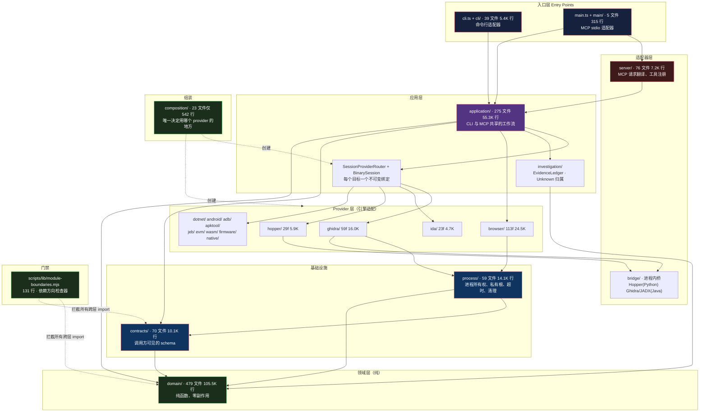

# REA 架构全景：23 万行 TypeScript 如何维持一条依赖规则

> 基于 [REA (morluto/rea)](https://github.com/morluto/rea) 源码分析。v6.4.0，commit `edf4624`，TypeScript / Node.js，MIT。
> 系列：REA 源码阅读（1/15）。

## 一句话概括

REA 是「Reverse Engineer Anything」——一个本地运行的逆向工程工具，对外同时提供 **CLI** 和 **MCP server** 两个入口，内部把 Ghidra、IDA、Hopper、JEB、JADX、Binwalk 等十余个逆向引擎统一到一套契约下。

但这份源码真正值得读的不是「它支持多少种目标」，而是：**23 万行 TypeScript，怎么让一条依赖规则不被腐蚀。**

答案是：**不靠自觉，靠一个 131 行的检查器。**

## 生活比喻：一家逆向工程事务所

把 REA 想成一家事务所：

| 角色 | 对应模块 | 职责 |
|------|---------|------|
| **业务知识** | `domain/` | 「什么是证据」「两个函数算不算等价」——**和设备无关的推理规则** |
| **专业设备** | `ghidra/` `ida/` `hopper/` … | 反编译器、反汇编器。**租来的，会换** |
| **项目经理** | `application/` | 「先在 Ghidra 里看，再跑一次动态捕获」——**编排** |
| **两个前台** | `cli/` `server/` | 一个对命令行，一个对 AI 助手。**只传话，不碰设备** |

**关键在前台**：客户要一份分析报告，前台不会自己去开 Ghidra——它转身找项目经理。**前台换了，业务知识一行不用改。**

这条规矩说起来简单，难的是在 23 万行里守住它。而这家事务所的特别之处在于：**它装了门禁——走错门会报警，不是靠大家记性好。**

## 整体架构



**箭头方向就是规矩**：所有依赖指向中心。`domain/` 在正中央，**它不指向任何东西**。

## 模块规模

第一眼就能看出重心在哪：

| 模块 | 文件 | 行数 | 职责 |
|------|-----:|-----:|------|
| `domain/` | 479 | **105,476** | 纯领域逻辑，零副作用 |
| `application/` | 275 | 55,261 | CLI/MCP 共享工作流 |
| `browser/` | 113 | 24,539 | CDP/Playwright 捕获、source map 归因 |
| `ghidra/` | 59 | 15,954 | Ghidra 发现、分析、传输、生命周期 |
| `process/` | 59 | 14,069 | **进程所有权**、私有根、超时 |
| `artifacts/` | 58 | 13,532 | 制品清单与提取 |
| `native/` | 54 | 12,188 | pwntools / pwndbg 适配 |
| `dotnet/` | 33 | 10,420 | PE/CLI 元数据、IL |
| `contracts/` | 70 | 10,110 | 调用方可见的 JSON Schema |
| `server/` | 76 | 7,166 | MCP 请求翻译 |
| `hopper/` | 29 | 5,918 | Hopper 启动与 Unix socket 协议 |
| `javascript/` | 23 | 5,424 | source map 编解码 |
| `cli/` | 39 | 5,419 | 命令行注册 |
| `ida/` | 23 | 4,669 | IDA 契约适配 |
| `composition/` | 23 | **542** | **组装根** |
| `main/` | 5 | 315 | MCP 启动、传输、关闭 |

两个数字对比很说明问题：**`domain/` 10.5 万行，`composition/` 542 行**——最重的逻辑在最里面，最外层的「决策」被压缩到极小。

而 `domain/` 里最大的子目录是 `domain/javascript/`（41,785 行，占 40%）——JavaScript 逆向重建是这堆领域逻辑的主战场。

## 依赖规则：可 grep 验证

架构文档里写得漂亮不算数。**规则必须能用一条命令验证。**

`AGENTS.md` 里的原话：

> Dependencies flow inward: domain semantics and contracts, provider adapters, shared application workflows, then CLI/MCP adapters.

拿这条命令查 `domain/`：

```bash
grep -rE "^import .*(ghidra|ida|hopper|jeb|binwalk|unblob|jadx|playwright|puppeteer)" src/domain/
```

**结论：真正的引擎依赖是 0。** 唯一的 17 处「命中」全是误报——形如 `import { ... } from "./hopperValues.js"` 的是 `domain/` **自己**的模块（定义了 Hopper 数据的形状），不是 Hopper 引擎包。

那 `domain/` 到底依赖什么？

| 依赖 | 出现次数 | 性质 |
|------|--------:|------|
| `zod` | 145 | 纯 schema 校验，无 I/O |
| `vitest` | 131 | 测试框架 |
| `@babel/types` | 55 | 纯 AST 类型 |
| `node:crypto` | 38 | 摘要（证据哈希） |
| `canonicalize` | 27 | 确定性 JSON 序列化 |
| `node:path` | 16 | 路径 |
| `@babel/parser` | 7 | 纯解析 |
| `plist` | 2 | Apple 格式解析 |

**这里面藏着一个容易搞错的边界**：`domain/` 并不是「零第三方依赖」——`zod`、`@babel/parser`、`plist` 都是第三方。

**真正的判据不是「谁的代码」，而是「有没有副作用」**：

- ✅ 可以进 domain：纯函数、纯解析、纯校验——**给定输入必得同一输出，不碰网络/磁盘/时钟/随机数**
- ❌ 不能进 domain：`node:fs`、`node:http`、任何引擎 SDK、任何会连出去的客户端

`@babel/parser` 看着像个「框架」，但它只把字符串变成 AST，不读文件、不连网络——所以它是合格的领域依赖。**这条线划在「副作用」上，不是划在「著名不著名」上。**

## 两个前台，一个项目经理

架构图好看，但「两个适配器真的共享同一个 application 层吗」需要证。

```bash
# cli/ 引用了多少 application 模块
grep -rho 'from "\.\./application/[^"]*"' src/cli/    | sort -u | wc -l   # → 31
# server/ 引用了多少
grep -rho 'from "\.\./application/[^"]*"' src/server/ | sort -u | wc -l   # → 55

# 两边引用的交集
comm -12 <(cli 的列表) <(server 的列表)
```

交集里是一批共享模块：

```
../application/analysisView/AnalysisViewService.js
../application/android/AndroidAnalysisService.js
../application/adb/AdbDeviceAnalysisService.js
../application/apktool/ApktoolResourceAnalysisService.js
../application/BrowserObservationService.js
../application/EvidenceBundleFiles.js
...
```

**同一个 `AndroidAnalysisService`，CLI 调它，MCP server 也调它。**

更关键的是下面这条：

```bash
grep -rho 'from "\.\./\(ghidra\|ida\|hopper\|jeb\|dotnet\|browser\)/' src/server/
# → 0
```

**MCP 适配器直接 import 引擎的次数是 0。** 它一次都没有绕过 `application/` 去碰 Ghidra 或 IDA。

到这里一切都好——但真正的问题是：**这个 0 是运气，还是有人守着？**

## 规则怎么被强制

我一开始以为这靠自觉。**查了才发现不是。**

`package.json` 里：

```json
"lint": "oxlint && npm run verify:module-boundaries"
```

**依赖方向检查是 lint 的一部分。** 而 `check:fast` → `turbo run typecheck lint`，是 push 前的常规门禁。也就是说：**跨层 import 会让你 lint 不过。**

### 检查器本体

`scripts/lib/module-boundaries.mjs`，**131 行**。核心是这张表：

```javascript
// scripts/lib/module-boundaries.mjs:6-17
const PURE_LAYERS = new Set(["domain", "contracts"]);
const MIGRATED_PROVIDER_ROOTS = new Set([
  "evm", "wasm", "android", "firmware", "ghidra",
  "hopper", "ida", "inspector", "javascript",
]);
```

`PURE_LAYERS` 就是「不许指向任何非纯层」的那条规则。而 `MIGRATED_PROVIDER_ROOTS` 这个名字透露了另一件事——**看下面第五节。**

规则本身：

```javascript
// scripts/lib/module-boundaries.mjs:84-101（简化）
if (PURE_LAYERS.has(layer)) {
  if (/^src\/[^/]+\//u.test(target) && !PURE_LAYERS.has(targetLayer))
    return "pure-layer";
}
if (layer === "application" && targetLayer === "composition")
  return "application-composition";
if (
  (layer === "application" || layer === "server") &&
  (MIGRATED_PROVIDER_ROOTS.has(targetLayer) || /* 若干具体 Provider 文件 */)
)
  return "provider-construction";
```

**五类边界**，每类一个名字，报错时直接告诉你违反了哪条：

| 边界名 | 规则 |
|--------|------|
| `pure-layer` | `domain` / `contracts` 不得 import 任何非纯层 |
| `provider-construction` | `application` / `server` 不得 import 具体 provider |
| `application-composition` | `application` 不得 import `composition` |
| `artifact-acquisition` | 制品获取路径的专有规则 |
| `process-capture` | 进程捕获模块不得依赖上层 |

### 为什么是「解析后」判断

这是整个检查器最关键的设计。看它怎么处理 import 路径：

```javascript
// scripts/lib/module-boundaries.mjs:45-51
const sourceTarget = (file, specifier) => {
  if (specifier.startsWith("file:")) return fileURLToPath(specifier);
  if (isAbsolute(specifier)) return resolve(specifier);
  return specifier.startsWith(".")
    ? fileURLToPath(new URL(specifier, pathToFileURL(file)))
    : undefined;
};
```

**它不比对字符串，而是把 import 解析成真实文件路径再判断。**

这意味着下面这些「绕过手法」全部无效——而且**每一条都有测试**：

```javascript
// tests/evaluation/moduleBoundaries.test.ts 里的用例
'import { value } from "../domain/../android/Provider.js";'      // 路径穿越 → 解析为 src/android/Provider.js
'const loaded = import("../%61ndroid/Provider.js?view=one#frag");' // 百分号编码 + query + fragment
'type Value = import("../android/Provider.js").Value;'            // type-only import
'import provider = require("../android/Provider.js");'            // TS 的 import = require
'import { value } from "../android/Provider.js";'                 // 普通 import
'export * from "../android/Provider.js";'                         // 再导出
```

`../domain/../android/Provider.js` 这种写法，人眼一扫会觉得「在 domain 底下」，**但 `new URL` 一解析就现出原形。** 而 `` import(`../android/Provider.js`) `` 这种模板字符串也被处理了（只接受无插值的模板串）。

反过来，它**不会误报**：

```javascript
it("ignores imports mentioned in comments and analyst fixture strings", () => {
  inspectModuleBoundaries("src/domain/probe.ts",
    '// import("../android/Provider.js");\nconst text = \'import("../android/Provider.js")\';'
  ) // → []
});
```

注释里的 import、字符串常量里的 import，**都不算**。因为它走的是 AST（`@babel/parser` + `traverseFast`），不是在文本上跑正则——**正则做不到这个区分。**

### 覆盖面：连没提交的文件也查

```javascript
// scripts/verify-module-boundaries.mjs:18-31
await execute("git", [
  "ls-files", "-z", "--cached", "--others", "--exclude-standard", "--", "src",
], { cwd: root, maxBuffer: 8 * 1024 * 1024 })
```

`--cached` + `--others --exclude-standard`：**已跟踪的 + 未跟踪但没被忽略的**。

意思是**你新写一个文件、还没 `git add`，它就已经在检查范围里了**。违规在你 commit 之前就被拦下——而不是等 CI 挂了再回头改。

### 第二层：测试通道的纯度

`oxlint` 那边还有一层，用 `no-restricted-imports` 卡测试文件：

```json
// .oxlintrc.json:70-93（composition 测试）
"no-restricted-imports": ["error", {
  "patterns": [{
    "group": ["**/server/**", "**/cli.*", "**/main.*",
              "node:child_process", "node:net", "node:http", "node:https",
              "ws", "playwright"],
    "message": "Composition tests may wire provider-neutral sessions but must not invoke CLI, MCP, process, network, or browser boundaries."
  }]
}]
```

**一个 composition 测试如果打开了 socket，它就不是 composition 测试了。**

这条规则直接写进了 lint 配置——**「这层测试该测什么」也被机械化了**，不只是靠 reviewer 的眼力。

### 门禁的分量

回到开头那个问题——`server/` 零引擎 import 是运气还是有人守着？

**有人守着，而且守得比我想的严**：检查器 + 测试矩阵 + oxlint 规则，接在 `npm run lint` 上，提前到 commit 之前。

**这条规则不是「约定」，是「编译期错误」。**

## 优秀代码：把整个进程边界变成参数

### 源码

MCP 适配器的启动代码。注意 `RuntimeDependencies`：

```typescript
// src/main/types.ts:3-11
export interface RuntimeDependencies {
  readonly env: NodeJS.ProcessEnv;
  readonly serve: typeof import("@modelcontextprotocol/server/stdio").serveStdio;
  readonly writeStderr: (text: string) => void;
  readonly setExitCode: (code: number) => void;
  readonly registerShutdown: (handler: () => void) => () => void;
  readonly createServer?: typeof import("../server/createServer.js").createServer;
  readonly loadOptionalProviders?: () => Promise<OptionalProviderLoadResult>;
}
```

```typescript
// src/main.ts:24-43（默认实现 = 生产行为）
const runtimeDependencies = (): RuntimeDependencies => ({
  env: process.env,
  serve: serveStdio,
  writeStderr: (text) => process.stderr.write(text),
  setExitCode: (code) => {
    process.exitCode = code;
  },
  registerShutdown: (handler) => {
    process.once("SIGINT", handler);
    process.once("SIGTERM", handler);
    process.stdin.once("end", handler);
    process.stdin.once("close", handler);
    return () => {
      process.off("SIGINT", handler);
      process.off("SIGTERM", handler);
      process.stdin.off("end", handler);
      process.stdin.off("close", handler);
    };
  },
});
```

### 好在哪

**进程的每一个不可控面，都变成了一个可替换的参数。**

`env`、stdio 传输、stderr、退出码、信号注册——这些平时直接写 `process.xxx` 的地方，全被提成接口成员，默认值在 `runtimeDependencies()` 里提供。

**好处是测试可以完全不启动子进程。** 想测「启动失败时的行为」，不用真的去 kill 一个进程，传一个会抛错的假实现就行：

```typescript
// 测试可以这样写——不需要真的启动 MCP server
await runEntrypoint(
  async () => { throw new Error("boom"); },   // 假启动
  (text) => logs.push(text),                   // 假 stderr
  (code) => exitCodes.push(code),              // 假退出码
);
```

**注意 `serve` 的类型写法**——`typeof import("...").serveStdio`：

```typescript
readonly serve: typeof import("@modelcontextprotocol/server/stdio").serveStdio;
```

这是 **type-only 的延迟导入**：只在类型层面引用，不产生运行时代码，也就不会让 `main/types.ts` 真的去加载 MCP SDK。类型文件保持零运行时依赖。

### 模式

**依赖注入 + Port/Adapter 的最小形态**——这里没有 DI 容器、没有装饰器，就是一个普通对象参数带默认值。

**架构上的意义**：`main.ts` 作为进程入口，本该是整个系统里最难测的地方（它碰 `process`、碰 stdio、碰信号）。但把它做成参数之后，**最难测的那一层反而变成了最好测的**——因为它的全部外部依赖都被显式列出来了，一个不漏。

这也解释了为什么 `main/` 只有 **5 个文件 315 行**：

```typescript
// src/main/ 全部内容
messages.ts    8 行
shutdown.ts  135 行
startup.ts    33 行
transport.ts 128 行
types.ts      11 行
```

**入口层薄到 315 行，说明逻辑都下沉了。** 入口只做「读配置 → 建会话 → 装传输 → 注册关闭」四件事，每件都是一次委托。

### 骨架代码

```typescript
// 你的项目中：把进程边界参数化
export interface RuntimeDependencies {
  readonly env: NodeJS.ProcessEnv;
  readonly writeStderr: (text: string) => void;
  readonly setExitCode: (code: number) => void;
  readonly registerShutdown: (handler: () => void) => () => void;
  // 按需扩展：时钟、随机数、文件读取、网络客户端……
}

const runtimeDependencies = (): RuntimeDependencies => ({
  env: process.env,
  writeStderr: (text) => process.stderr.write(text),
  setExitCode: (code) => { process.exitCode = code; },
  registerShutdown: (handler) => {
    process.once("SIGINT", handler);
    process.once("SIGTERM", handler);
    return () => {
      process.off("SIGINT", handler);
      process.off("SIGTERM", handler);
    };
  },
});

// 默认参数 = 生产行为；传参 = 测试行为
export const run = async (
  dependencies: RuntimeDependencies = runtimeDependencies(),
): Promise<number> => { /* ... */ };
```

**注意 `registerShutdown` 返回「注销函数」**——注册和注销成对出现，调用方不需要知道具体注册了哪几个信号。这个写法比让调用方自己 `process.off` 更不容易漏。

### 另一处细节：入口判断

```typescript
// src/main.ts:111-117
const entryPath = process.argv[1];
if (
  entryPath !== undefined &&
  pathToFileURL(realpathSync(entryPath)).href === import.meta.url
) {
  void runEntrypoint();
}
```

ESM 里没有 `require.main === module` 了，标准替代是 `import.meta.url === pathToFileURL(process.argv[1]).href`。

但这里多了两步：**`realpathSync` 解软链接，再 `pathToFileURL` 转 URL。**

为什么？因为 npm 全局安装时，`rea` 是一个软链接指向真实文件；`npx` 执行的路径也可能经过符号链接。不解析真实路径，比较就会失败，**入口逻辑在全局安装场景下直接不执行**——而且是静默不执行。

### 还有一处：刻意脱敏

```typescript
// src/main.ts:100-108
try {
  setExitCode(await start());
} catch (cause: unknown) {
  // Intentionally redact the startup cause from caller-visible output;
  // unexpected failures must not leak internal details.
  void cause;
  writeStderr(`${SERVER_START_FAILED}\n`);
  setExitCode(1);
}
```

**启动阶段的意外异常，不往 stderr 打印原因**，只输出一句固定文案。

`void cause;` 这行是显式的：告诉读代码的人「这个变量是故意不用的」，同时让 lint 闭嘴。

这个决策值得琢磨——**为什么不像别处一样把错误打出来？** 因为启动阶段可能已经读入了凭据、路径、环境变量，而这些内容正好是「不该泄漏的内部细节」。**信息越少，泄漏面越小。**

## 优缺点分析

### 这套架构在什么场景下有效

| 场景 | 为什么有效 |
|------|-----------|
| **外部依赖多且会换** | 10 余个逆向引擎，每个都可能换版本、换 API。适配器隔离住 |
| **多种驱动方式** | CLI 给人用、MCP 给 agent 用——**这正是 Cockburn 提出六边形架构的原始动机** |
| **需要大量单测** | `domain/` 零副作用 → 纯函数测试，不需要 mock 任何引擎 |
| **团队协作** | 规则可机械验证，不靠 reviewer 的记忆和眼力 |

### 代价

**① `domain/` 10.5 万行是双刃剑**

最大的模块是纯逻辑，意味着复杂度没有消失，只是被集中了。`domain/javascript/` 单独 41,785 行——**这是整个项目最重的认知负担**。

**② 间接层让调用链变长**

追一个「分析这个 APK」的调用，要从 `cli/` → `application/` → `android/` → `process/` → `contracts/`。**每一跳都是一次「这层在干嘛」的追问。**

**③ 测试比 0.92 的成本**

源码 231,301 行，测试 212,480 行。**近乎 1:1。**

这是质量的保证，但也是巨大的维护成本——测试代码本身要维护、要重构、会过时。这个比例不是每个项目都付得起。

**④ 边界表是硬编码的清单**

回到 `MIGRATED_PROVIDER_ROOTS`——**这个词里藏着一个妥协**：

```javascript
const MIGRATED_PROVIDER_ROOTS = new Set([
  "evm", "wasm", "android", "firmware", "ghidra",
  "hopper", "ida", "inspector", "javascript",
]);
```

**它是「已迁移」的名单，不是「全部」的名单。** `src/` 下实际有 16 个 provider 目录，其中 7 个不在这张表里：

| 在 `MIGRATED_PROVIDER_ROOTS` 里（9 个） | 不在表里（7 个） |
|---|---|
| `evm` `wasm` `android` `firmware` `ghidra` `hopper` `ida` `inspector` `javascript` | `browser` `dotnet` `native` `jeb` `apktool` `adb` `windows` |

而 `browser/`（24,539 行）、`native/`（12,188 行）、`dotnet/`（10,420 行）——**三个最大的 provider 恰恰都不在表里**。检查器对它们的约束靠另外几条更具体的正则（比如 `^src\/browser\/[^/]*Provider\.[^/]+$`）来兜。

**这说明规则的落地是渐进的**：先把最容易迁移的几层卡死，剩下的边做边收。这是一条**正在推进的迁移**，不是一个已经完成的终态。

**这反而是这套设计最真实的地方**——它承认了「在 23 万行存量代码上加约束」不可能一步到位。硬编码一张「已迁移」清单，比写一条覆盖所有情况的完美规则更可行。

## 总结

| 结论 | 说明 |
|------|------|
| **依赖规则** | 全指向内；`domain/` 在中心，不指向任何东西 |
| **可验证** | `grep` 能证明：domain 零引擎依赖，server 零 provider 依赖 |
| **强制机制** | 131 行检查器，接在 `npm run lint` 上，**连未提交文件都查** |
| **判据是解析后路径** | `../domain/../android/X` 这种穿越会被 `new URL` 拆穿 |
| **纯度判据** | 不是「第三方与否」，而是「有无副作用」——`zod` 合格，`fs` 不合格 |
| **两个适配器** | CLI(31) 与 MCP(55) 共享 application 层，交集可枚举 |
| **组装极薄** | `composition/` 542 行，入口层 315 行 |
| **正在迁移** | `MIGRATED_PROVIDER_ROOTS` 是「已迁移」名单，不是全部 |

**一句话**：REA 的架构买的是「引擎可以随便换、逻辑可以脱离引擎测试」，付的是「10 万行纯逻辑的认知负担 + 20 万行测试的维护成本」。

而它最值得学的不是那张分层图——**是「依赖规则必须能被机器验证」这个决定**。

架构规则写在文档里，靠自觉遵守，三年前什么样今天还是什么样的概率很低。**写成 131 行检查器，接进 lint，它就变成了编译期错误。**

---

**下一篇**：[domain 层怎么做到纯的](02-domain-layer.md)——「纯」的边界到底划在哪，以及 10.5 万行纯逻辑到底在算什么。
