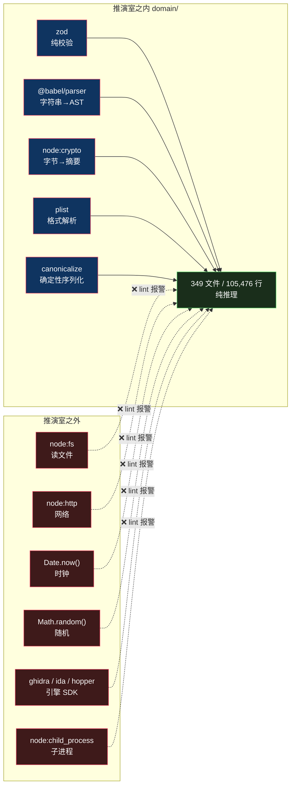

# domain 层怎么做到纯的：「纯」的边界划在哪

> 基于 [REA (morluto/rea)](https://github.com/morluto/rea) 源码分析。v6.4.0，commit `edf4624`。
> 系列：REA 源码阅读（2/15）。

## 一句话概括

REA 的 `domain/` 有 **105,476 行、349 个文件**，却**不 import 任何逆向引擎、不读文件、不开进程、不连网络**。

这篇要回答：**这条线具体划在哪**——哪些依赖算「纯」，哪些不算，以及为什么。

## 生活比喻：推演室和实验台

把逆向分析想成一个研究所：

| | 推演室 | 实验台 |
|---|--------|--------|
| **做什么** | 拿到数据后推理：「这两个函数调用链通不通」「这段代码和上个版本哪里不一样」 | 操作仪器：「打开 Ghidra 反编译这个文件」 |
| **依赖** | 纸、笔、逻辑 | 反编译器、调试器、APK 工具 |
| **能不能重来** | 能——同样的输入必然同样的输出 | 不能——仪器会卡、文件会变、进程会崩 |
| **能不能单独测** | 能——不需要任何仪器 | 不能——得先把仪器跑起来 |

**`domain/` 就是推演室。**

推论是：**推演室里不该有仪器。** 一旦有一台反编译器摆在推演室里，你就再也没法单独验证推理本身对不对了——每次都得先让仪器转起来。

## domain 层里装了什么

先看构成。`domain/` 349 个非测试文件，但分布极不均匀：

| 子目录 | 文件数 | 说明 |
|--------|------:|------|
| `javascript/` | **120** | JavaScript/TypeScript 语义分析——绝对主力 |
| `native/` | 21 | 原生二进制语义 |
| `process/` | 15 | 进程证据模型 |
| `apple/` | 13 | Apple 平台（plist、bundle） |
| `managed/` | 13 | .NET/托管代码 |
| `analysisView/` | 5 | 分析视图 |
| `android/` | 3 | Android |
| `adb` `apktool` `evm` `firmware` `harmony` `jeb` `wasm` | 各 1 | 薄封装 |

**剩下 210 个文件直接躺在 `domain/` 顶层**——证据、比较、调用路径、重建验证、一致性门禁等等，是这个项目自己的核心概念。

最重的几个顶层文件：

| 文件 | 行数 | 内容 |
|------|-----:|------|
| `analysisSnapshot.ts` | 874 | 分析快照 |
| `webCaptureDiff.ts` | 732 | Web 捕获差异 |
| `analysisErrorProjection.ts` | 575 | 错误投影 |
| `evidenceBundle.ts` | 554 | 证据包 |
| `referenceSourceGraph.ts` | 550 | 参考源图谱 |
| `evidence.ts` | 440 | 证据模型 |

**一个关键观察**：`domain/javascript/` 有 120 个文件、41,785 行，且单文件极大——`javascriptSemanticMemberMutations.ts` 一个文件就 **40.4K**。

**这说明 JavaScript 逆向重建是这个项目的核心难题**，而它选择了把这份复杂度全部放进纯逻辑层。后面第 11 篇会专门拆这块。

## 判据不是「第三方与否」，是「有没有副作用」

最常见的误解是「domain 层不能有第三方依赖」。**这是错的。**

看 `domain/` 真实的外部依赖清单：

| 依赖 | 出现次数 | 是什么 |
|------|--------:|--------|
| `zod` | 145 | schema 校验 |
| `@babel/types` | 55 | AST 类型定义 |
| `node:crypto` | 38 | 摘要算法 |
| `canonicalize` | 27 | 确定性 JSON 序列化 |
| `node:path` | 16 | 路径拼接 |
| `@babel/parser` | 7 | JS/TS 解析器 |
| `plist` | 2 | Apple plist 解析 |

**`zod`、`@babel/parser`、`plist` 都是第三方。** 但它们都能进 domain，因为它们满足同一条性质：

> **给定相同输入，必然得到相同输出，且不触碰任何外部状态。**

这条性质排除了什么？

| 类别 | 能进 domain？ | 为什么 |
|------|:---:|------|
| 纯解析（`@babel/parser`、`plist`） | ✅ | 字符串进，结构出 |
| 纯校验（`zod`） | ✅ | 结构进，判定出 |
| 哈希（`node:crypto`） | ✅ | 字节进，摘要出 |
| 文件读写（`node:fs`） | ❌ | 依赖磁盘状态 |
| 网络（`node:http`） | ❌ | 依赖远端状态 |
| 时钟（`Date.now`） | ❌ | 同一输入不同时刻结果不同 |
| 随机数 | ❌ | 同一输入结果不确定 |
| 引擎 SDK（`ghidra`、`ida`…） | ❌ | 依赖外部进程 |

**所以 `@babel/parser` 合格而 `ghidra` 不合格，不是因为「Babell 更小」或者「Ghidra 更重」——是因为一个只把字符串变成树，另一个要把整个反编译器跑起来。**

**边界划在副作用上，不划在包的大小或知名度上。**



**判据只有一条：给定相同输入，是否必然得到相同输出。** 是→可进，否→不可进。

注意 `zod` 和 `ghidra` 在图上分处两侧——**不是因为一个是小库一个是大库，而是因为一个只做判定，另一个要把外部进程跑起来。**

## 强制：写了规则就要能拦

第 1 篇讲过 REA 有个 131 行的依赖检查器。`domain/` 正是它的第一个目标：

```javascript
// scripts/lib/module-boundaries.mjs:6
const PURE_LAYERS = new Set(["domain", "contracts"]);
```

```javascript
// scripts/lib/module-boundaries.mjs:84-90
if (PURE_LAYERS.has(layer)) {
  if (
    (/^src\/[^/]+\//u.test(target) && !PURE_LAYERS.has(targetLayer)) ||
    /^src\/(?:cli|main)\./u.test(target)
  )
    return "pure-layer";
}
```

规则很短：**`src/domain/` 或 `src/contracts/` 里的文件，不许 import 任何 `src/<别的>/` 下的东西**（除非对方也是纯层）。

而且——检查器不比对字符串，它把 import **解析成真实文件路径**再判断。所以 `../domain/../android/Provider.js` 这种伪装写法会被 `new URL` 拆穿。

**这条规则接在 `npm run lint` 上，意味着 `domain/` 一旦伸手去够引擎，lint 直接红。**

## 优秀代码一：把「没找到」拆成两种

### 源码

`buildCallPath` 是一个纯函数：输入调用图数据，输出调用路径。签名极简：

```typescript
// src/domain/callPath.ts:79
export const buildCallPath = (input: CallPathInput): CallPathResult => {
```

它先做 BFS 求最短距离：

```typescript
// src/domain/callPath.ts:49-68
/** Shortest remaining distance for every node that can reach the goal. */
const distancesToGoal = (
  graph: CallGraph,
  goal: string,
): ReadonlyMap<string, number> => {
  if (!graph.hasNode(goal)) return new Map();
  const depth = new Map<string, number>([[goal, 0]]);
  const queue = [goal];
  for (let index = 0; index < queue.length; index += 1) {
    const node = queue[index] ?? "";
    const next = (depth.get(node) ?? 0) + 1;
    for (const neighbor of graph.inNeighbors(node)) {
      if (!depth.has(neighbor)) {
        depth.set(neighbor, next);
        queue.push(neighbor);
      }
    }
  }
  return depth;
};
```

**注意这个循环：`for (let index = 0; index < queue.length; index += 1)`——边遍历边往队列里 push，就是在做 BFS。** 用数组当队列，靠索引游标前进，不需要 shift（`Array.prototype.shift` 是 O(n)，会让 BFS 退化成 O(n²)）。**这是个小而真实的性能意识。**

真正的精华在返回处：

```typescript
// src/domain/callPath.ts:119-125
return callPathResultSchema.parse({
  ...resultContext,
  status: exhaustive ? "not_found" : "unknown",
  shortest_hops: null,
  search_scope: searchScope,
  paths: [],
});
```

### 好在哪

**「没找到路径」被拆成了两种状态：**

| 状态 | 含义 |
|------|------|
| `not_found` | **搜索是穷尽的**——我查遍了所有可能，确实不存在这条路径 |
| `unknown` | **搜索不穷尽**——我只查了一部分，没找到不代表不存在 |

**这个区分是整个项目的价值观的缩影。**

一个天真的实现只会返回「没找到」。但在逆向工程里，这两件事的后果完全不同：

- `not_found` 可以写进结论：「A 不调用 B」
- `unknown` 只能写「目前没有证据表明 A 调用 B」——**这是一个必须如实标注的保留**

如果把 `unknown` 误报成 `not_found`，分析报告里就会出现一条**看起来确定、实际没查完**的结论。**这比说「不知道」危险得多。**

顺带看这个三态设计的普遍程度：`"unknown"` 这个字面量出现在 **146 个 domain 文件**里。**它不是某个函数的特例，是贯穿整个领域层的建模习惯。**

### 模式

**穷尽性标记（exhaustiveness flag）+ 三态结果**。

注意调用方拿到的不是布尔值，而是 `status` + `search_scope: { exhaustive }`——**「我查到了什么」和「我查得多全」是分开的两个字段。** 结论和结论的可信度一起返回。

### 骨架代码

```typescript
// 你的项目中：搜索/查询类函数的返回值设计
type SearchResult<T> =
  | { status: "found"; items: T[]; exhaustive: boolean }
  | { status: "not_found"; exhaustive: true }   // 只有穷尽时才敢说 not_found
  | { status: "unknown"; exhaustive: false; reason: string };

const search = (graph: Graph, start: string, goal: string): SearchResult<Path> => {
  const reached = bfs(graph, start);          // 探到的部分
  const exhaustive = reached.size === graph.nodeCount;  // 探全了吗

  const path = shortestPath(graph, start, goal);
  if (path) return { status: "found", items: [path], exhaustive };

  // 关键：没找到时，先问自己「我查全了吗」
  return exhaustive
    ? { status: "not_found", exhaustive: true }
    : { status: "unknown", exhaustive: false, reason: "搜索空间未覆盖完全" };
};
```

**判断标准**：只要你的函数会「找不到」，就问一句「找不到的前提是查全了吗」。**不是就别返回 `not_found`。**

## 优秀代码二：确定性排序，自己写

### 源码

`domain/unicodeCodePointOrder.ts`，全文不到 20 行：

```typescript
// src/domain/unicodeCodePointOrder.ts:1-17
/** Compare strings lexicographically by Unicode code point, independent of locale. */
export const compareUnicodeCodePoints = (
  left: string,
  right: string,
): number => {
  let leftIndex = 0;
  let rightIndex = 0;
  while (leftIndex < left.length && rightIndex < right.length) {
    const leftPoint = left.codePointAt(leftIndex) ?? 0;
    const rightPoint = right.codePointAt(rightIndex) ?? 0;
    const difference = leftPoint - rightPoint;
    if (difference !== 0) return difference;
    leftIndex += leftPoint > 0xffff ? 2 : 1;
    rightIndex += rightPoint > 0xffff ? 2 : 1;
  }
  if (leftIndex === left.length && rightIndex === right.length) return 0;
  return leftIndex === left.length ? -1 : 1;
};

// 同文件:19-24
/**
 * Collision-free composite key for deduplication/sorting. `\0`-joins
 * collide when any component contains NUL (valid in JS property names);
 * a JSON tuple escapes every component. Single owner for composite keys.
 */
export const compositeKey = (parts: readonly unknown[]): string =>
  JSON.stringify(parts);
```

### 好在哪

**JavaScript 明明有现成的字符串比较，为什么手写一个？**

因为现成的都不满足要求：

| 方案 | 问题 |
|------|------|
| `a < b` | 按 **UTF-16 码元**比较，不是码点。补充平面字符（emoji、部分 CJK）会得到反直觉的顺序 |
| `a.localeCompare(b)` | **依赖 locale**——同一份数据在不同系统上排序结果可能不同 |
| `Intl.Collator` | 同上，且更重 |

`codePointAt` + `leftPoint > 0xffff ? 2 : 1` 这两行是**手动处理代理对**：码点大于 `0xFFFF` 的字符在 UTF-16 里占两个码元，索引要跳 2。

**为什么要这么较真？** 因为**证据的排序必须可复现**。

这份代码的作用域是逆向分析——一个证据列表在你这排出来是这个顺序，在同事机器上排出来是另一个顺序，那「第 3 条证据」这个引用就失去了意义。**确定性不是洁癖，是证据可引用的前提。**

而它出现在 **117 个文件**里——这不是一个边角工具函数，是地基。

### `compositeKey` 的那条注释

第二段更小，但注释里有个细节：

> `\0`-joins collide when any component contains NUL (valid in JS property names); a JSON tuple escapes every component.

**用 `\0` 拼接做复合键，会在某个字段本身含 NUL 时产生碰撞**——而且 JS 的对象属性名里 NUL 是合法的。

换成 `JSON.stringify(parts)`，**每个组件都被转义**，`["a","b"]` 和 `["a\0b"]` 再也撞不到一起。

**两行代码，防的是一个「几乎不会发生，但发生了就静默出错」的边界。** 注释还写明了「Single owner for composite keys」——这个键的生成只有这一个所有者，不允许多处各写一份。

### 模式

**确定性原语（determinism primitive）**——把「可复现」这件事封成不可绕过的少数几个函数，全项目共用。

### 骨架代码

```typescript
// 你的项目中：需要跨机器/跨运行可复现的排序时
/** 按 Unicode 码点比较，与 locale 无关。用于需要可复现顺序的场景。 */
export const compareCodePoints = (left: string, right: string): number => {
  let li = 0, ri = 0;
  while (li < left.length && ri < right.length) {
    const lp = left.codePointAt(li) ?? 0;
    const rp = right.codePointAt(ri) ?? 0;
    if (lp !== rp) return lp - rp;
    li += lp > 0xffff ? 2 : 1;   // 补充平面字符占两个 UTF-16 码元
    ri += rp > 0xffff ? 2 : 1;
  }
  return li === left.length ? (ri === right.length ? 0 : -1) : 1;
};

// 复合键：用 JSON 元组而不是分隔符拼接，避免字段内含分隔符时的碰撞
export const compositeKey = (parts: readonly unknown[]): string =>
  JSON.stringify(parts);
```

**什么时候需要它**：只要排序结果会被持久化、被引用、被跨环境比较，就该用确定性排序。

## 代价

### ① 复杂度没有被消除，只是被搬走了

**105,476 行纯逻辑，是全项目最重的认知负担。**

把 I/O 抽走之后，剩下的全是「难的部分」——而且它们集中在一个不能靠调试器、不能靠打日志（纯函数没有副作用可观察）的地方。`domain/javascript/` 单文件能到 40K，就是这个代价的具体形态。

### ② 纯逻辑也有「假纯度」

`node:crypto` 和 `canonicalize` 在清单里看着无害，但它们的引入意味着**领域层的输出开始依赖具体算法实现**。

改一个哈希算法，领域层的证据 ID 全变。**这不是 I/O 依赖，但是一种隐蔽的耦合**——检查器拦不住它，因为它确实没有「副作用」。

### ③ 规则只覆盖了 `src/` 之内

看检查器那句：

```javascript
// scripts/lib/module-boundaries.mjs:54
if (!file.startsWith("src/") || !target.startsWith("src/")) return undefined;
```

**只检查 `src/` 内部。** `domain/` import 一个包名（比如 `import { something } from "some-heavy-lib"`）不在检查范围内——第三方依赖的纯度靠人和 review 守。

**这是刻意留的口子**（不然 `zod` 也进不来），但也确实是一道只能靠自觉的边界。

### ④ 跨层复用的诱惑一直存在

`domain/` 是纯的，所以它的一切都「好复用」。**正因为它好用，别处会想往里塞东西**：「这个函数被三处调用了，放 domain 吧」——如果它带了 I/O，规则会拦；如果它不带 I/O 但根本不是领域概念（比如一个通用的数组工具），**规则拦不住**。

`domain/` 会膨胀，不是因为违规，而是因为**合规但没有意义的代码更容易悄悄积累**。

## 总结

| 结论 | 说明 |
|------|------|
| **判据** | 不是「第三方与否」，是**有没有副作用**。`@babel/parser` 合格，`node:fs` 不合格 |
| **规模** | 349 文件 105,476 行；`domain/javascript/` 占 120 文件 41,785 行 |
| **强制** | `pure-layer` 边界规则，接在 lint 上；解析真实路径，防路径穿越 |
| **三态返回** | `found` / `not_found` / `unknown`——**「没查到」和「没查完」必须分开**，`"unknown"` 出现在 146 个文件里 |
| **确定性原语** | 手写码点比较器（用了 117 处），因为 `localeCompare` 不可复现 |
| **代价** | 10.5 万行不能调试的推理逻辑；第三方依赖的纯度靠自觉 |

**一句话**：`domain/` 的「纯」不是一个道德要求，是**一个可测试性要求**——

**纯的部分能脱离仪器单独验证，这是「分析结论可信」的前提。** 如果连推理本身都要先让 Ghidra 转起来才能验，那就没有真正独立的验证了。

而 `not_found` 和 `unknown` 的区分，是同一个想法的另一面：**能独立验证的部分，才有资格说「确定」；不能的，就只能说「目前未知」。**

---

**下一篇**：[进程所有权](03-process-ownership.md)——PID 会被复用，那「这是我启动的进程」怎么证。
