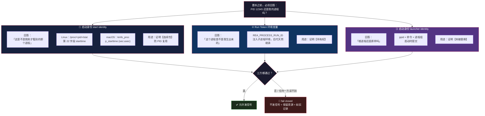

# 进程所有权：PID 会被复用，那「这是我启动的进程」怎么证

> 基于 [REA (morluto/rea)](https://github.com/morluto/rea) 源码分析。v6.4.0，commit `edf4624`。
> 系列：REA 源码阅读（3/15）。

## 一句话概括

REA 要启动 Ghidra、IDA、Flipper、LLDB 这些外部引擎，用完还得负责把它们**干净地杀掉**。

听起来是个 `child.kill()` 的事。但这份代码为它写了 **1000 行实现 + 约 4 万行测试**。

原因是 `AGENTS.md:17` 里的这句话：

> Retain ownership of resources whose cleanup failed. Reuse `src/process/` supervision and identity primitives; **a PID and executable path alone do not establish ownership after exit or reuse.**

**「一个 PID 加一个可执行路径，不足以证明所有权」**——这篇讲的就是它怎么解决这件事。

## 生活比喻：更衣柜的号码牌

你去健身房，把包存进 **37 号柜**，拿了张号码牌，出门吃饭。

一小时后回来，你拿号码牌开柜——**里面是别人的包。**

为什么？因为你走之后，37 号柜可能被清空、又被另一个客人用了。**「37 号」这个编号本身，不能证明柜子里是你的东西。**

**PID 就是这个编号。**

| | 更衣柜 | 进程 |
|---|--------|------|
| **编号** | 37 号柜 | PID 12345 |
| **编号会回收吗** | 会 | **会**——进程退出后 PID 会被操作系统重新分配 |
| **能证明归属吗** | ❌ | ❌ |

所以真正的问题不是「怎么杀 PID 12345」，而是：

> **在我动手之前，怎么确认 PID 12345 现在装着的，还是我当初启动的那个进程？**

## 三层证据，回答三个不同的问题

REA 的答案不是「更可靠的编号」，而是**三层互相独立的证据**，每层回答一个不同的问题：



**关键：谁都不能单独成立。**

- 只有 token？——**不够**。进程可能是同一个 PID 换了个人，环境变量还能被我读到是因为我读得晚。
- 只有 start identity？——**也不够**。它只证明「这个 PID 没换人」，不证明「它是我生的」。别的程序启动的进程也有 starttime。

**「连续性」和「所有权」是两件事，必须分开证。**

## 读不到的时候怎么办

这是整份代码的价值观所在。看这个类型：

```typescript
// src/process/ProcessOwnership.ts:52-55
/** Native process start identity; unavailable identities must never be skipped. */
export type ProcessIdentityObservation =
  | { readonly state: "readable"; readonly identity: string }
  | { readonly state: "unavailable"; readonly reason: string };
```

**没有第三种「大概是吧」。**

注释那句 `unavailable identities must never be skipped` 是硬要求——**读不到不能当成通过，也不能跳过，必须是一个显式的失败态。**

## 难点：macOS 上根本读不到别的进程的环境变量

Linux 很直接：`/proc/<pid>/environ` 是明文，`\0` 分隔，读出来解析就行。

**macOS 没有 `/proc`。** 内核把进程环境放在 `KERN_PROCARGS2` 里，只能通过 `sysctl` 拿——而 Node.js 没有这个 API。

REA 的解法相当硬核：**运行时用 `xcrun swiftc` 现编一个 Swift 小工具。**

```typescript
// src/process/DarwinProcessRunTokenReader.ts:239-312（概述）
// 临时目录 mkdtemp(join(tmpdir(), "rea-process-token-"))
// 编译超时 60s
// TMPDIR 指向自己的根，退出时 hook 里 rmSync 清理
```

编译的源码就在仓库里：`bridge/process/ProcessRunTokenReader.swift`（10.6K）和 `ProcessRunTokenReaderMain.swift`。

**为什么值得这么麻烦？** 因为替代方案是「在 macOS 上放弃所有权证明」——那意味着要么不敢杀进程（泄漏），要么盲杀（可能杀错）。

### 而 C 层解析的坑都在 Swift 里

KERN_PROCARGS2 返回的是一坨裸缓冲区，布局是：

```
argc | executable_path | padding | argv... | env...
```

但这里有个不写出来绝对踩的坑——**XNU 会在环境变量后面追加一段 "Apple vector"**，而 libc 启动后会把开头的 `pfz=` 记录清成连续 NUL。

所以「环境区从哪里结束」这件事**没有明确边界**。代码显式检测这种歧义：

```swift
// bridge/process/ProcessRunTokenReader.swift 内的失败原因
"ambiguous_environment_boundary"   // 环境边界有歧义
"duplicate_run_token"              // 同一个 token 出现多次
"invalid_run_token_encoding"       // token 不是合法 UTF-8
```

还有个更没办法的情况——**Apple 自己的平台二进制，环境被内核扣留**，读不到就是读不到：

```swift
// ProcessRunTokenReader.swift:115-138 用 csops 检测
// csPlatformBinary = 0x0400_0000
// → "platform_binary_environment_withheld"
```

**这种「操作系统不允许你知道」的情况，代码如实返回一个专门的错误码，而不是猜。**

## 优秀代码一：前后夹读

### 源码

`bridge/process/ProcessRunTokenReader.swift:183-202`，全文：

```swift
func readRunTokens(pids: [Int32]) -> [RunTokenObservation] {
  let before = readProcessSnapshot()
  let observations = pids.map { pid -> RunTokenObservation in
    guard let metadata = before.metadata[pid] else {
      return unavailable(pid: pid, reason: before.failure ?? "process_not_in_snapshot")
    }
    return readRunToken(pid: pid, pointerSize: metadata.pointerSize)
  }
  let after = readProcessSnapshot()
  return zip(pids, observations).map { pid, observation in
    guard let initial = before.metadata[pid], let current = after.metadata[pid] else {
      return unavailable(pid: pid, reason: after.failure ?? "process_not_in_snapshot")
    }
    guard initial.identity == current.identity,
          initial.pointerSize == current.pointerSize else {
      return unavailable(pid: pid, reason: "process_identity_changed_during_token_read")
    }
    return observation
  }
}
```

### 好在哪

**这是针对 PID 复用的 TOCTOU 防护。**

读 token 这件事**不是原子的**——`sysctl` 调用期间，目标进程可能退出，PID 可能被复用给一个新进程。等你拿到 token，读的是谁的？

代码用**两次快照夹住中间那次读**：

```
快照 A ──→ 读 token ──→ 快照 B
   └──── 比较 A 和 B 的身份 ────┘
   不同？→ 这次读取作废，返回 identity_changed
```

**身份变了不是猜，是明确返回 `process_identity_changed_during_token_read`。**

注意守卫里还比了 `pointerSize`：

```swift
guard initial.identity == current.identity,
      initial.pointerSize == current.pointerSize else {
```

**为什么连指针宽度都比？** 因为 KERN_PROCARGS2 的缓冲区 padding 计算依赖 32/64 位（`P_LP64` 标志）。如果进程在两次读之间 exec 了一个不同架构的二进制，**缓冲区布局就变了**——此时即使 PID 和 starttime 恰好没变，解析结果也是错的。

**把「解析所依赖的全部隐含前提」都纳入守卫，而不是只比一个显而易见的字段。** 这是这份代码最见功力的地方。

### 模式

**乐观读 + 前后校验**（seqlock 式 double-check / guarded read）。

### 骨架代码

```typescript
// 你的项目中：读外部对象的一个属性，而该对象可能在读期间被替换
async function guardedRead<T>(
  id: number,
  read: () => Promise<T>,
): Promise<{ state: "readable"; value: T } | { state: "unavailable"; reason: string }> {
  const before = await readIdentity(id);
  if (before.state !== "readable")
    return { state: "unavailable", reason: before.reason };

  const value = await read();                    // 中间：可能被替换污染

  const after = await readIdentity(id);
  if (after.state !== "readable" || after.identity !== before.identity)
    return { state: "unavailable", reason: "identity_changed_during_read" };

  return { state: "readable", value };
}
```

**适用场景**：任何「读 A 的一个属性，但 A 可能在读期间变成 B」的地方——进程、文件、连接、租约、会话。

## 优秀代码二：只留一个已知良性的出口

### 源码

`src/process/ProcessOwnership.ts:757-785`：

```typescript
/**
 * Take a fresh liveness snapshot after each ownership-read phase. Only an
 * absent PID resolves an unreadable observation; a readable token mismatch
 * remains a failure. Never reuse this snapshot across identity/token reads.
 */
const recheckOwnershipFailures = async (
  failures: readonly ProcessOwnershipValidationFailure[],
  host: ProcessOwnershipHost,
): Promise<readonly ProcessOwnershipValidationFailure[]> => {
  if (!failures.some(({ reason }) => reason !== "run-token-mismatch"))
    return failures;
  try {
    const live = new Set(
      liveProcesses(await host.listProcesses()).map(({ pid }) => pid),
    );
    return failures.filter(
      ({ pid, reason }) => reason === "run-token-mismatch" || live.has(pid),
    );
  } catch (cause: unknown) {
    return failures.map((failure) =>
      failure.reason === "run-token-mismatch"
        ? failure
        : {
            ...failure,
            diagnostic: `${failure.diagnostic}; process liveness recheck failed: ${errorMessage(cause)}`,
          },
    );
  }
};
```

### 好在哪

**它解决一个很现实的矛盾。**

进程**正在退出**的那一瞬间，读它的环境会失败——这是常态，不是异常。如果把这当成清理失败，正常的 capture 会大量误报。但如果放宽容错，又给 PID 复用开了后门。

这段代码的答案：**用一次新的、有界成本的观测，换取确定性。**

规则写在注释里，非常精确：

> **Only an absent PID resolves an unreadable observation; a readable token mismatch remains a failure.**

翻译成判定表：

| 失败原因 | 能被消解吗 |
|---------|-----------|
| `environment-unreadable` | ✅ 仅当**新快照证明这个 PID 已不存在** |
| `process-identity-unavailable` | ✅ 同上 |
| `run-token-mismatch` | ❌ **永不清除** |

**为什么 token 不匹配永不清除？** 因为它是**确定性的拒绝**——「这个 PID 存在着，而且它不是我的」。这不是「读不到」，是「读到了，不对」。**读到了错误答案，不会被时间治好。**

还有一条纪律值得单拎出来：

> **Never reuse this snapshot across identity/token reads.**

**不在阶段之间复用快照。** 每次消解都重新 `listProcesses()`。因为「上一轮看到它活着」对「这一轮它还在不在」没有证明力。

### 更妙的：重查失败时不降级结论

```typescript
} catch (cause: unknown) {
  return failures.map((failure) =>
    failure.reason === "run-token-mismatch"
      ? failure
      : { ...failure, diagnostic: `${failure.diagnostic}; process liveness recheck failed: ...` },
  );
}
```

**重查本身失败了怎么办？——失败仍然是失败，只是多附一条诊断。**

**没有「查不动就放过」这个选项。** 证据获取的失败，不会被当作证据。

### 模式

**延迟失败裁决 / 有界再观测结算**（bounded re-observation reconciliation）+ fail-closed filter。

### 骨架代码

```typescript
type Failure = { pid: number; reason: "definitive" | "transient"; diagnostic?: string };

async function settleFailures(
  failures: Failure[],
  probe: (pids: number[]) => Promise<Set<number>>,
): Promise<Failure[]> {
  // 全是确定性失败：没有可消解的，直接返回
  if (!failures.some((f) => f.reason !== "definitive")) return failures;

  let live: Set<number>;
  try {
    live = await probe(failures.map((f) => f.pid));   // 全新探测，不复用旧快照
  } catch (cause) {
    // 探测失败也不放宽：失败照旧，追加诊断
    return failures.map((f) =>
      f.reason === "definitive"
        ? f
        : { ...f, diagnostic: `${f.diagnostic ?? ""}; probe failed: ${String(cause)}` },
    );
  }

  // 只有「已证明不存在」才能消解
  return failures.filter((f) => f.reason === "definitive" || live.has(f.pid));
}
```

**适用场景**：任何「读外部世界（进程、容器、租约、锁文件）结果不确定 → 要么证明它已消失，要么必须保持失败」的清理与对账逻辑。

## 清理失败时会怎样：保留，不假装

`AGENTS.md:17` 那句 `Retain ownership of resources whose cleanup failed` 在代码里有四层兑现：

**① 不装作成功**——有未决失败时，拒绝任何额外信号，把每组的失败原因带回。

**② 保留临时目录**。capture 的临时根只在进程组确认清理干净后才删：

```typescript
// src/process/capture/ProcessCaptureLifecycle.ts:1135-1154（概述）
if (owned?.state === "failed" || owned?.state === "unverified") {
  this.#temporaryRoot = {
    state: "unverified",
    reason: `temporary root retained because owned process cleanup is ${owned.state}: ...`,
  };
  return;   // 不删
}
```

**③ 记住 owner，允许重试**——失败的单次清理把 owner 对象放进集合等下次：

```typescript
// ProcessCaptureLifecycle.ts:1160-1202（概述）
const report = await owner.close();
if (cleanupReportFailure(report) !== undefined) this.#pending.add(owner);
```

**④ 对用户表达成「部分成功 + 明确未知」**——抛 `ProcessCaptureError(reason: "cleanup_incomplete")`，同时带上已收集的观测和未清理的资源名。

**注意这里没有「尽力而为」这个选项。** 要么证明清理干净了，要么如实说没干净并保留资源。**中间的模糊态不存在。**

## 测试怎么写

这个模块的测试占比极高，而且直接针对 PID 复用的各种变体。几个测试名字本身就说明了问题：

```
"checks reused and unknown PIDs while skipping unchanged identities"
"revalidates fallback environment owners before signaling after PID reuse"
"refuses to signal when PID identity changes after token validation"
"fails closed for an unrelated unreadable candidate the OS should expose"
```

**这是这类代码唯一可靠的验证方式**——PID 复用是竞态，没法在真实环境里稳定复现。只能把「进程表」抽象成可注入的假实现，然后人为构造「同一个 PID，两次读到的身份不同」。

## 代价

### ① 复杂度极高

1000 行实现 + 4 万行测试，为的是「杀一个进程」。

**如果 REA 只是启动一个自己完全掌控的进程**（不 detach、不跨语言、不涉及外部 GUI 应用），这套东西**完全是过度设计**——`child.kill()` 就够了。

它值得，是因为 REA 面对的是：Ghidra（Java）、Hopper（原生 GUI 应用）、LLDB、adb——**跨进程树、会 detach、会自己 fork 子进程的外部程序**。这些进程不听话，而且杀了不该杀的后果很严重（用户可能正在 GUI 里手动分析）。

### ② macOS 上要现编 Swift

`xcrun swiftc` 运行时编译，意味着：

- **首次有编译延迟**（60s 超时）
- **依赖 Xcode 命令行工具**——没装就是功能不可用
- 多了一层「我的辅助工具本身可信吗」的问题（代码里对辅助进程输出做了严格校验：PID 集合必须与请求**完全一致**、无重复无缺失，否则整体失败）

### ③ fail-closed 的代价

严格是好事，但**严格意味着会拒绝一些本来安全的操作**。

进程刚好在退出、环境刚好读不到——按这套规则就是 `cleaned: false`，资源被保留，用户看到「清理未完成」。

代码承认了这个代价，并且用 `recheckOwnershipFailures` 做了**有界限的**补救（一次新观测，不是无限重试）。

**但代价确实存在**：一个「其实已经关掉了」的进程，可能被报告成「清理未完成」。

### ④ 平台差异吃掉了不少代码

Linux 走 `/proc`、macOS 走 `sysctl` + 现编 Swift、Windows 走 Job Object——**三套完全不同的实现**，而它们的**语义**是同一个。

这 4 万行测试里，相当一部分是在为「三个平台行为一致」付账。

## 总结

| 结论 | 说明 |
|------|------|
| **核心问题** | PID 会被复用，「编号」不能证明归属 |
| **三层证据** | start identity（连续性）+ run token（所有权）+ launcher identity |
| **缺一不可** | 单靠任何一层都不足以授权发信号 |
| **读不到时** | 显式 `unavailable` 状态，**绝不跳过** |
| **夹读** | 快照 A → 读 → 快照 B，身份变了就作废；连 `pointerSize` 都比 |
| **消解规则** | 只有「新快照证明 PID 已不存在」能消解；token 不匹配**永不清除** |
| **清理失败** | 保留资源 + 记住 owner + 如实报告，不假装成功 |

**一句话**：这份代码把「进程所有权」建模成**一个需要被持续重新证明的断言**——

- token 证明「是我的」
- start identity 证明「还是它」
- **两者都必须现读现验**

**证明不了时，唯一允许的动作是：不发信号、保留资源、如实记录。**

这是整个 REA 里最反直觉、也最值得学的一条：**面对不确定，「不做」比「猜一个」更有价值。** 因为猜错杀掉的可能是用户正在用的 GUI 应用，而「没杀掉」至少是可恢复的。

---

**下一篇**：[错误代数](04-error-algebra.md)——TypeScript 里写 Rust 的 `Result`，以及 27 个错误标签怎么投影成 20 个对外 code。
