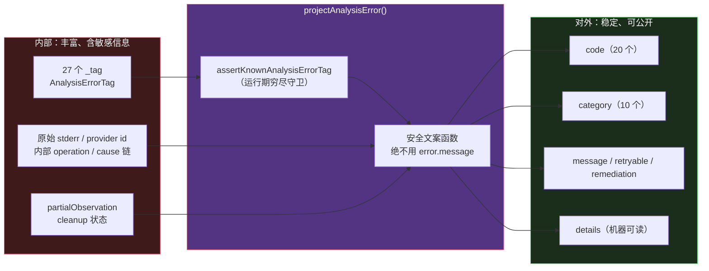
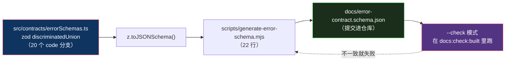

# 错误代数：TypeScript 里写 Rust 的 Result

> 基于 [REA (morluto/rea)](https://github.com/morluto/rea) 源码分析。v6.4.0，commit `edf4624`。
> 系列：REA 源码阅读（4/15）。

## 一句话概括

REA 有 **27 个内部错误标签**，但对外只暴露 **20 个错误码 + 10 个类别**。

中间那层转换叫 **projection（投影）**，它的产物是「**secret-safe**」的——**内部知道的一切，不都能说出去。**

## 生活比喻：医院的分诊台

你去医院，医生在病历上写的东西，和你拿到的**告知单**，不是同一份：

| | 病历（内部） | 告知单（对外） |
|---|---|---|
| **写着** | 具体指标、影像编号、鉴别诊断、**医生的怀疑** | 「您需要做进一步检查」 |
| **为什么不一样** | 医生需要完整信息才能决策 | 你不能拿一份带「疑似 XX」的病历去坐飞机 |

**不是隐瞒，是两种读者需要两种精度的表述。**

而且**告知单必须是稳定的**——医院系统对接保险公司，靠的是「诊断码」这种固定编码，不能今天写「血糖偏高」明天写「血糖异常」。

REA 的错误设计就是这个结构：



**关键在中间那一层**：它不是「降维」，是**重新编码**。有些信息被提升（清理失败会顶掉原 code），有些被下沉（原 code 挪进 `details`），有些被彻底丢弃（原始 stderr）。

## 起点：10 行的 Result

```typescript
// src/domain/result.ts（全文 10 行）
/** A typed channel for expected success or failure. */
export type Result<T, E> =
  | { readonly ok: true; readonly value: T }
  | { readonly ok: false; readonly error: E };

/** Construct a successful result. */
export const ok = <T>(value: T): Result<T, never> => ({ ok: true, value });

/** Construct a failed result. */
export const err = <E>(error: E): Result<never, E> => ({ ok: false, error });
```

**注意两个构造器的返回类型**：

```typescript
ok  <T>(value: T): Result<T, never>    // 成功时，错误类型是 never
err <E>(error: E): Result<never, E>    // 失败时，值类型是 never
```

**`never` 不是随手写的。** 因为 TS 的判别联合收窄：

```typescript
const result = await findOrder(id);
if (result.ok) {
  result.value;    // ✅ 收窄为 T
  result.error;    // ❌ 类型是 never，编译不过
} else {
  result.error;    // ✅ 收窄为 E
  result.value;    // ❌ never
}
```

**用 `never` 堵住另一侧，编译器就能保证你不可能在失败分支里误用成功值。**

整个项目有 **263 个文件** import 这个模块（223 个非测试 + 40 个测试），`ok(` 调用点约 684 处、`err(` 约 1096 处。

**10 行的类型定义，撑起 230K 行代码的错误处理。**

### 为什么不用 `throw`

答案写在 `AGENTS.md:23`：

> Parse unknown boundary values and model expected failures with the tagged error algebra and `Result`. **Preserve partial facts and meaningful failure reasons.**

`throw` 的问题不是「不好看」，是**它会丢掉上下文**：

| | `throw` | `Result` |
|---|---------|----------|
| **类型签名** | 不体现（`throws` 是隐式的） | 显式写进返回类型 |
| **调用方** | 可能忘 catch | 编译器强制处理 |
| **部分结果** | 异常一抛，手里的一切就没了 | 可以和值一起携带 |
| **多重失败** | 只能抛一个 | 结构化表达 |

**`throw` 留给三类**：

1. **程序员错误**——比如投影时遇到一个没登记的 tag，`throw new TypeError(...)`，这是 bug 不是业务分支
2. **无法归一的异常**——`AggregateError` 那种「两个失败同时发生」的场景
3. **真正无恢复路径**

**「预期内的失败」（取消、超时、权限、输入非法、引擎挂了）全部走 `Result`。**

## 27 个标签

```typescript
// src/domain/analysisErrorBase.ts:2-30
const ANALYSIS_ERROR_TAGS = [
  "AnalysisProtocolError",       "AnalysisInputError",
  "AnalysisAccessDeniedError",   "AnalysisArtifactChangedError",
  "AnalysisOutputError",         "AnalysisCapabilityUnavailableError",
  "AnalysisUnsupportedTargetError", "AnalysisCancelledError",
  "AnalysisTimeoutError",        "AnalysisResourceConstraintError",
  "ProviderSelectionError",      "ProviderAdapterError",
  "BrowserObservationError",     "ArtifactOperationError",
  "ProcessCaptureError",         "EvidenceIntegrityError",
  "EvidenceFileError",           "UnknownRegistryError",
  "HopperTimeoutError",          "HopperCancelledError",
  "HopperProtocolError",         "HopperRemoteError",
  "HopperProcessError",          "HopperStartError",
  "ConfigurationError",          "NoBinaryOpenError",
  "BinaryTargetError",
] as const;
```

基类用**抽象属性**强制每个子类认领一个标签：

```typescript
// src/domain/analysisErrorBase.ts:59-76（节选）
export abstract class AnalysisError extends Error {
  abstract readonly _tag: AnalysisErrorTag;   // ← 子类必须实现
  readonly userMessage: string | undefined = undefined;
  readonly cleanupIncomplete: boolean;
  readonly cleanupResources: readonly string[];

  /** Retain a completed observation when a later step fails. */
  retainPartialObservation(observation: AnalysisPartialObservation): this {
    this.partialObservation ??= observation;
    return this;
  }
}
```

子类实现起来只有一行：

```typescript
// src/domain/analysisErrorCore.ts:41-43
class AnalysisProtocolError extends AnalysisError {
  readonly _tag = "AnalysisProtocolError";
}
```

**这套写法来自 Effect / Rust 的 tagged union 传统**：`_tag` 是**运行时可判别的身份**，`instanceof` 做粗分派、`_tag` 做精确分派。

### 注意 `retainPartialObservation` 的 `??=`

```typescript
this.partialObservation ??= observation;
```

**`??=` 而不是 `=`**：**第一次保留的观测不会被后来的覆盖。**

为什么？因为失败往往发生在链条末端——你在「已经收集了一部分数据之后」才出错。**如果后面的失败把前面的观测冲掉了，你就失去了已经付过代价拿到的东西。**

## 投影：两种读者，两种精度

```typescript
// src/domain/analysisErrorProjection.ts:45-51
/** Project expected failures into exhaustive, secret-safe caller fields. */
export const projectAnalysisError = (
  error: AnalysisError,
): AnalysisErrorProjection => {
  assertKnownAnalysisErrorTag(error._tag);
  const underlyingCode = underlyingErrorCode(error);
  const code = error.cleanupIncomplete ? "cleanup_incomplete" : underlyingCode;
```

**`secret-safe` 这个词是认真的。** 投影后的 `message` 绝不直接取 `error.message`，而是走一套文案函数——因为内部 message 可能夹带了路径、provider 内部标识、原始 stderr。

而 `code` 那一行揭示了一个**优先级**：

```typescript
const code = error.cleanupIncomplete ? "cleanup_incomplete" : underlyingCode;
```

**清理未完成，会顶掉原本的错误码。**

原始的 code 没有丢，被挪进 `details.execution_failure`。但**对外的第一眼看到的是「清理未完成」**——因为对调用方来说，「资源可能还挂着」比「这次操作失败了哪种」更需要立刻知道。

## 优秀代码一：编译期 + 运行期双重穷尽

### 源码

```typescript
// src/domain/analysisErrorProjection.ts:174-226（节选）
type SpecializedErrorTag =
  | "ArtifactOperationError" | "BinaryTargetError" | /* ...共 7 个 */ ;

const STATIC_ERROR_CODES = {
  AnalysisProtocolError: "unreadable_output",
  AnalysisInputError: "invalid_request",
  // ... 其余静态标签
  ProviderAdapterError: "execution_failure",
} as const satisfies Readonly<
  Record<Exclude<AnalysisErrorTag, SpecializedErrorTag>, AnalysisErrorProjection["code"]>
>;

const staticErrorCode = (tag: AnalysisErrorTag) => {
  switch (tag) {
    case "ArtifactOperationError":
    // ... 7 个专门化标签
    case "UnknownRegistryError":
      throw new TypeError(`Unhandled specialized analysis error: ${tag}`);
    default:
      return STATIC_ERROR_CODES[tag];
  }
};
```

以及运行期守卫：

```typescript
// src/domain/analysisErrorPresentation.ts:425-458（节选）
const KNOWN_ERROR_TAGS = {
  AnalysisProtocolError: true,
  // ... 全部 27 个
} as const satisfies Readonly<Record<AnalysisErrorTag, true>>;

const assertKnownAnalysisErrorTag = (tag: string): void => {
  if (KNOWN_ERROR_TAGS[tag] !== true)
    throw new TypeError("Unknown analysis error tag");
};
```

### 好在哪

**这两段各管一层，合起来是一个闭环。**

**第一层：`satisfies Record<Exclude<...>, ...>`——编译期穷尽。**

`Exclude<AnalysisErrorTag, SpecializedErrorTag>` 把 7 个专门化标签排掉，剩下的**每一个**都必须在 `STATIC_ERROR_CODES` 里有映射。

**新增一个 tag 却忘了加映射？编译不过。** 而不是运行时静默返回一个默认值。

**第二层：运行期的 `throw`——防类型系统被绕过。**

什么时候类型系统会被绕过？编译产物过期、`as any`、跨版本加载。

**这层的意思很明确：宁可崩溃，不许静默降级。**

看那句 `throw new TypeError(\`Unhandled specialized analysis error: ${tag}\`)`——**错误契约不允许「未知即默认」。**

### 为什么值得这么严

因为这是**对外契约**。

如果投影层遇到不认识的 tag 时返回一个兜底 code，会发生什么？**调用方（尤其 AI agent）会把一个「未知错误」当成一个「已知错误」处理。** 它看到 `execution_failure`，就去重试——但真实原因可能是「权限不足，重试一万次也没用」。

**一个错误码的默认值，会让下游做出错误的决策。**

### 模式

**编译期穷尽表 + 运行期守门**（compile-time exhaustiveness + runtime assertion）。

`as const satisfies Readonly<Record<Tag, ...>>` 这个组合值得记住——**`satisfies` 保留字面量类型，同时强制完整性检查**，是 TS 里实现「穷尽」最干净的手法。

### 骨架代码

```typescript
// 1) 标签全集
const TAGS = ["Timeout", "Cancelled", "InvalidInput", "ExecutionFailure"] as const;
type Tag = (typeof TAGS)[number];

// 2) 编译期穷尽表：少一个映射就编译不过
const CODES = {
  Timeout: "timeout",
  Cancelled: "cancelled",
  InvalidInput: "invalid_request",
  ExecutionFailure: "execution_failure",
} as const satisfies Record<Tag, string>;

// 3) 运行期守门：类型系统被绕过时立刻炸，不静默降级
const KNOWN = {
  Timeout: true, Cancelled: true, InvalidInput: true, ExecutionFailure: true,
} as const satisfies Record<Tag, true>;

const assertKnown = (tag: string): void => {
  if ((KNOWN as Record<string, true | undefined>)[tag] !== true)
    throw new TypeError(`Unknown error tag: ${tag}`);
};

// 4) 投影：安全文案 + 稳定 code，绝不透传原始 message
const project = (err: AppError) => {
  assertKnown(err._tag);
  return {
    code: CODES[err._tag],
    message: safeMessage(err),      // ← 不用 err.message
    details: pickSafeDetails(err),
  };
};
```

**判断标准**：只要你的错误码会被**外部消费者**（另一个服务、一个 agent）用来做分支决策，就值得上这套。**内部日志随便打，对外契约必须穷尽。**

## 优秀代码二：清理失败不覆盖主失败

### 源码

```typescript
// src/domain/analysisErrorCleanup.ts:6-38（节选）
const projected = projectAnalysisError(cleanup);
return new ProviderAdapterError(
  cleanup instanceof ProviderAdapterError ? cleanup.providerId : "rea",
  operation,
  {
    cause: primary,
    userMessage: projectAnalysisError(primary).message,   // ← 对外仍讲主失败
    ...(primary.capturedOutput === undefined ? {} : { capturedOutput: primary.capturedOutput }),
    ...(primary.partialObservation === undefined
      ? {} : { partialObservation: primary.partialObservation }),
    cleanup: {
      reason: projected.message,
      resources: [...new Set([...primary.cleanupResources, ...cleanup.cleanupResources])],
    },
    diagnostics: {
      primary_error: projectAnalysisError(primary),
      cleanup_error: projected,
    },
  },
);
```

### 好在哪

**它解决一个所有写过 `finally` 的人都遇到过的问题。**

```typescript
try {
  await doWork();          // 这里失败了，抛 A
} finally {
  await close();           // 这里也失败了，抛 B → A 被覆盖了
}
```

**B 把 A 冲掉了。** 你拿到的是「关闭失败」，但你真正想知道的是「原本为什么失败」。

REA 的处理：**把清理失败降级为元数据**。

| 信息 | 去哪了 |
|------|--------|
| 主失败 | `cause` + 对外 `message` |
| 清理失败 | `cleanup.reason` |
| 两边涉及的资源 | `cleanup.resources`（**并集去重**） |
| 两份完整诊断 | `diagnostics.primary_error` / `cleanup_error` |

**注意 `new Set([...a, ...b])` 那行**——资源列表取并集并去重。这是个**幂等**操作：「哪些资源还被持有」这个事实，问一次和问两次应该得到同一个答案。

**还注意 `diagnostics` 里放的是两份「投影」而不是两份原始对象**——机器消费者拿到的是同一套稳定 code 语汇。**内部再乱，出口统一。**

### 模式

**失败降级为元数据**（failure demotion）+ 因果链保留。

### 骨架代码

```typescript
const withCleanup = (
  primary: AppError,
  cleanup: AppError,
  operation = "close",
): AppError =>
  new AdapterError(id, operation, {
    cause: primary,                                   // 因果链不断
    userMessage: project(primary).message,            // 对外仍讲主失败
    cleanup: {
      reason: project(cleanup).message,
      resources: [...new Set([...primary.cleanupResources, ...cleanup.cleanupResources])],
    },
    diagnostics: {
      primary_error: project(primary),
      cleanup_error: project(cleanup),
    },
  });
```

**调用起来像个语法**：

```typescript
// src/hopper/HopperClient.ts:437-438
const failure = closed.ok
  ? primary
  : analysisErrorWithCleanupFailure(primary, closed.error, "open_binary");
```

**判断标准**：任何「主操作 + 收尾操作」的组合（写文件+关句柄、发请求+断连接、开事务+提交），收尾失败都**不应该**吃掉主失败。

## 顺带纠正一个误解：那个 CSV 不是生成的

调研时我一开始以为 `docs/user-visible-errors.csv`（31KB，100 行）是错误契约的生成产物。**查证后发现不是。**

| 文件 | 性质 |
|------|------|
| `docs/user-visible-errors.csv` | **手工维护的审计台账**，列是 `harm_rank, location, trigger, current_copy, user_risk, proposed_replacement, implementation_status, verification_result` |
| `docs/error-contract.schema.json` | **生成的**，来自 `src/contracts/errorSchemas.ts` → `z.toJSONSchema()` |
| `src/domain/analysisErrorPresentation.ts` | 用户可见文案的**真正源头**（人工维护） |

而且那个 CSV 的 `location` 列还写着 `src/domain/errors.ts:...`——**这个文件已经不存在了**，错误类早就拆成了四个文件。

**它是一份「整改过程」的留痕**：每条替换文案都标了是否已实现、验证结果如何。

生成链是另一条：



**生成物提交进仓库 + 校验它是最新的**——这个模式在 REA 里反复出现（第 15 篇会专门讲）。好处是：**文档的陈旧会在 CI 里变成失败，而不是等读者发现。**

**这份「三种错误描述并存」的现状本身就很有启发性**：人工台账（历史）、生成 schema（现行契约）、文案函数（现行活源头）。它们会漂移，而 `--check` 是把漂移收敛回来的机制。

## 代价

### ① 样板量大

27 个错误类，每个都要：

- 定义类 + `_tag`
- 在 `ANALYSIS_ERROR_TAGS` 里登记
- 在 `KNOWN_ERROR_TAGS` 里再登记一次
- 在 `STATIC_ERROR_CODES` 里映射（或归入专门化）
- 可能还要在 `underlyingErrorCode` 里加特判

**加一个错误类型要动 4~5 个地方。** 这是穷尽性检查的必然代价——编译器帮你查，但你要喂给它足够的表。

### ② 同一条信息在多个地方重复

`ANALYSIS_ERROR_TAGS` 和 `KNOWN_ERROR_TAGS` 是**同一份清单的两个副本**。

为什么不合成一个？因为它们的**用途不同**：一个导出类型 `AnalysisErrorTag`，一个做运行期查表。**TS 无法从运行期对象反推字面量联合类型而不牺牲别的东西**（可以用 `Object.keys` 但类型会退化成 `string[]`）。

**这是语言能力的边界，不是设计偷懒。**

### ③ `Result` 渗进每个签名

`Promise<Result<T, E>>` 比 `Promise<T>` 啰嗦，而且**必须逐层处理**——`return parsed;` 这种「原样上抛」的写法会反复出现：

```typescript
// src/config/parseConfig.ts:36-48（节选）
if (!parsed.ok) return parsed;
```

省了 `throw` 的隐式性，但换来了显式性。**在 231K 行的规模上，这个交换是划算的；在 2000 行的小脚本里，可能不是。**

### ④ 投影层需要持续维护

每加一个 tag，投影、文案、code、分类都要跟上。**这是「对外稳定的代价」**——稳定性不是免费的，是靠每次改动时补全映射维持的。

而**代码库用编译期检查把这份维护变成强制的**，这已经是最好的结果了——剩下的只能是「确实要写更多代码」。

## 总结

| 结论 | 说明 |
|------|------|
| **Result** | 10 行，`ok<T>(v): Result<T, never>` / `err<E>(e): Result<never, E>`，用 `never` 堵另一侧 |
| **不用 throw** | 预期失败走 Result；throw 只留给程序员错误和无恢复路径 |
| **27 → 20** | 内部标签 27 个，对外 code 20 个 + category 10 个 |
| **投影不是降维** | 是重新编码：清理失败顶掉原 code，原 code 下沉到 details |
| **双重穷尽** | `satisfies Record<...>` 编译期查 + `throw TypeError` 运行期守 |
| **秘密安全** | 对外 message 绝不取 `error.message` |
| **清理失败** | 降级为元数据，不覆盖主失败；资源列表取并集去重 |

**一句话**：这套错误设计的核心不是「分类细致」，是**「两种读者，两种精度」**——

**内部要完整，因为要靠它决策；外部要稳定且安全，因为要靠它对接。**

而中间那层投影，用 **编译期穷尽检查**把「新增错误类型时忘了更新对外契约」变成了编译错误。

**这是把纪律变成机制。** 和第 1 篇那个依赖检查器是同一个思路，只是作用在错误上。

---

**下一篇**：[证据模型](05-evidence-model.md)——为什么「未知」不是一个枚举值，而是一个带生命周期的一等实体。
