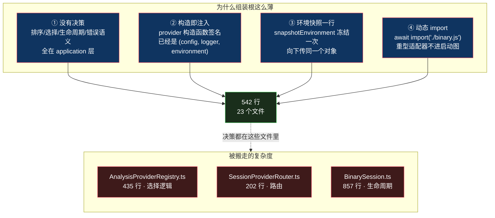

# 组装根：23 个文件，542 行

> 基于 [REA (morluto/rea)](https://github.com/morluto/rea) 源码分析。v6.4.0，commit `edf4624`。
> 系列：REA 源码阅读（6/15）。

## 一句话概括

`src/composition/` 是 REA 的**组装根**——整个项目里**唯一**知道「用哪个具体类」的地方。

它 **23 个文件，总共 542 行**。平均每个文件 23 行。

而它管理的 provider 有 **16 个**，每个动辄上万行。

**为什么能这么薄？**

## 生活比喻：剧组选角

一部戏开拍前有个**选角**环节：

| | 剧本 | 选角 |
|---|------|------|
| **写着什么** | 「需要一个能反编译的角色」 | 「这个角色由 Ghidra 来演」 |
| **关心什么** | 角色要做什么 | 具体请谁 |
| **改的时候** | 剧本不动 | 换个人而已 |

**关键：剧本里永远不写演员的名字。**

如果剧本写「Ghidra 上场说这句台词」，那换演员就要改剧本——**而 REA 的剧本（`application/`）有 55,261 行，改一遍的成本高得离谱。**

组装根就是那个选角导演：**它只决定「谁演谁」，不参与剧情。**

还有个细节：**一旦选定，这场戏拍到结束都不换人。** 就算这个演员中途状态不好（provider 运行时出错），也**不会临时换角**——见下文「no fallback」。

## 为什么能只有 542 行

四个原因，一个比一个关键。



**「组装根薄」不是因为它做的事少，是因为它把「决策」全推给了 application 层。**

组装根只回答一个问题：**「用哪个具体类」**。至于「用哪个 provider」——那是 `AnalysisProviderRegistry` 的事。

**这两件事听起来像一回事，其实差很远：**

- 「用哪个具体类」——编译期就知道，写死就行
- 「用哪个 provider」——运行期才知道（取决于目标文件格式、引擎装没装、用户指没指定）

### ① 唯一的生产接线点

```typescript
// src/composition/binary.ts:14-37（节选）
/**
 * Compose the target-switching runtime shared directly by CLI and MCP adapters.
 * This is the sole production wiring point, so both adapters share identical
 * provider selection, profile, lifecycle, and Evidence semantics.
 */
export const createBinarySession = (config, logger, environment) => {
  const hopper = new HopperProvider(config, logger, environment);
  const ghidra = new GhidraProvider(config, logger, environment);
  const ida = new IdaProvider(config, environment);
  return composeBinarySession(
    new AnalysisProviderRegistry([hopper, ghidra, ida], config.analysisProvider),
    auxiliaryAnalysisProviderDeclarations(environment).map(
      (declaration) => new LazyAnalysisProvider(declaration),
    ),
  );
};
```

**注释里那句 `sole production wiring point` 是整个设计的关键**：

> **CLI 和 MCP 两个适配器共用这一个接线点，因此它们拥有完全一致的 provider 选择、profile、生命周期和 Evidence 语义。**

**如果 CLI 和 MCP 各接各的线，两边迟早会不一致**——MCP 那边换了个 provider 顺序，CLI 这边没换，同一个文件两个入口给出不同结果。

### ② 18 个「一行工厂」

23 个文件里，18 个是这种形状：

```typescript
// src/composition/browserObservation.ts（全文 6 行）
/** Construct a fresh provider without opening a target or acquiring an engine. */
export const createBrowserObservationProvider = (): BrowserObservationPort =>
  new CdpBrowserProvider();
```

```typescript
// src/composition/evm.ts:4
/** Compose offline interface analysis without import-time I/O or dependency acquisition. */
```

**每个文件 6~22 行，零分支。** 注释里反复出现的两个短语值得注意：

- `without opening a target or acquiring an engine`
- `without import-time I/O or dependency acquisition`

**这是在说：构造 provider 不产生副作用。** 构造 `CdpBrowserProvider` 不会去启动浏览器，构造 `GhidraProvider` 不会去连 Ghidra。

**这个约束是组装根能这么薄的前提**——如果构造带副作用，组装根就得管「什么时候构造、失败了怎么回滚、要不要复用」，代码量立刻上去。

### ③ 环境快照，只做一次

```typescript
// src/process/snapshotEnvironment.ts（全文 16 行，概述）
/** 冻结当前环境的一份快照 */
export const snapshotEnvironment = (environment) =>
  Object.freeze({ ...environment });
```

**在边界处调一次，然后往下传同一个冻结对象。**

为什么要冻结？因为 `process.env` 是**活的**——任何代码都能改它。如果 provider A 改了环境变量，provider B 读到的就不是启动时的值了。

**冻结之后，整个进程生命周期里「环境」这个概念只有一个值。**

（第 3 篇提过，`main.ts` 里 `env` 也是 `RuntimeDependencies` 的一个字段——**测试可以注入假环境，生产用真环境，同一套代码。**）

### ④ 动态 import 让启动变轻

```typescript
// src/composition/directAnalysis.ts:16-31（节选）
createBinarySession: async (config, logger) => {
  const { createBinarySession } = await import("./binary.js");
  return createBinarySession(config, logger, environment);
},
```

```typescript
// src/composition/auxiliaryAnalysisProviders.ts:28-32
load: async () => {
  const { ArtifactProvider } = await import("../artifacts/ArtifactProvider.js");
  return new ArtifactProvider(environment, platform);
},
```

**`await import()` 把重型适配器移出启动图。**

后果是：**没装 Ghidra 的用户，启动 REA 时不会加载 Ghidra 相关的代码。** 这不只是快，还避免了「加载即报错」——一个未安装的引擎不应该阻止 MCP server 启动。

## 核心：确定性选择

组装根把 provider 列表交给 registry，**registry 做选择**。规则只有三条：

```typescript
// src/application/binary/AnalysisProviderRegistry.ts:302-328（节选）
const usable = evaluations.filter(/* 有 profile 承诺的 */);

if (usable.length === 0)
  return ok({ requestedProviderId: "auto", binding: null, candidates: statuses });

if (usable.length > 1)
  return err(selectionError("ambiguous", "auto", statuses));

// 恰好 1 个 → 绑定
```

**这是「基数决策」，不是「优先级列表」。**

| 可用候选数 | 结果 |
|:---:|------|
| **0** | **成功**，但 `binding: null`（**有意不绑定**，不是错误） |
| **1** | 绑定，`selectionSource: "auto-single-candidate"` |
| **≥2** | **`ambiguous` 错误**，要求调用者显式指定 |

**注意这三条里没有「取第一个」「按注册顺序」「优先级最高者」。**

`≥2` 时报错而不是猜——这是整份代码最反直觉、也最有价值的一个决策。

### 注册顺序被彻底消解

为了让「顺序不影响结果」成立，registry 在构造时就排序：

```typescript
// AnalysisProviderRegistry.ts:111-115
this.#providers = Object.freeze(
  [...providers].sort((left, right) =>
    compareUnicodeCodePoints(left.identity().id, right.identity().id),
  ),
);
```

**用的是第 2 篇那个手写的 Unicode 码点比较器**——因为它 locale 无关、可复现。

配合注释：

```typescript
// AnalysisProviderRegistry.ts:68-71
/**
 * Discover and select overlapping deep providers without starting their clients.
 * Registration order never affects selection or caller-visible output.
 */
```

**「注册顺序永远不影响选择和调用方可见的输出」**——这是个可以用测试断言的强性质。

### 构造时还有 4 类校验

```typescript
// AnalysisProviderRegistry.ts:88-105（概述）
// ① 非法 ID         → throw
// ② 重复 ID         → throw
// ③ capability 溯源不匹配 → throw   ← 见下
// ④ 同一 provider 重复声明 operation → throw
```

第 ③ 条值得单独看：

```typescript
// AnalysisProviderRegistry.ts:94-101
if (
  capability.provider.id !== identity.id ||
  capability.provider.name !== identity.name ||
  capability.provider.version !== identity.version
)
  throw new TypeError(
    `Provider ${identity.id} published mismatched capability provenance for ${capability.operation}`,
  );
```

**provider 声明的每个能力，都必须带着自己的身份。**

为什么？因为如果 provider A 能声明「这是 provider B 的能力」，那么依据「能力清单」做的任何决策都可能被伪造。**能力必须可溯源到声明者本人。**

## "no fallback" 到底是什么意思

这个词在架构文档里出现，但读代码才知道它具体防什么。

### ① 指定了不存在的 provider → 报错，不换

```typescript
// AnalysisProviderRegistry.ts:227-229
const provider = this.#byId.get(providerId);
if (provider === undefined)
  return err(selectionError("unknown_provider", providerId, baseline));
```

### ② 目标不支持 / 引擎不可用 → 各自的错误，不换

```typescript
// AnalysisProviderRegistry.ts:237-240（概述）
// → "target_unsupported"
// → "provider_unavailable"
```

### ③ 绑定之后调用失败 → **不重新路由**

这是最关键的一条。`BinarySession.ts:661-705` 的 `#observeRuntimeAvailability` 在 provider 调用失败时：

- 把失败写进 `#runtimeUnavailability`
- 让状态报告显示该 provider 不可用
- **但不切换 provider**

契约文案把它钉死了（`src/contracts/sessionToolContracts.ts:72`）：

> provider_id selects one deep provider or deterministic auto selection; **the binding remains stable until close or an explicit switch, with no failure fallback.**
>
> 绑定保持稳定，直到关闭或显式切换——**失败不触发回退**。

**为什么？**

因为「自动换一个 provider 重试」听起来贴心，实际上会**污染证据链**。

想象这个场景：你用 Ghidra 分析了半个程序，第 51 个函数时 Ghidra 崩了。系统「贴心」地切到 IDA 继续——现在你的证据里，前 50 个来自 Ghidra，后 50 个来自 IDA。

**两个反编译器对同一个函数的命名、类型推断、甚至函数边界判断都可能不同。**

这份报告还是可信的吗？它的 `analysis_profile` 该写谁？

**REA 的选择是：宁可失败，也不静默改变证据的来源。**

失败后调用方能做的：显式 `close` 再用另一个 provider 重开——**这个动作是可见的、被记录的、用户知情的。**

### ④ 未绑定时深操作报错，而不是「找个能用的」

```typescript
// SessionProviderRouter.ts:98-109（概述）→ unboundOperationError
// BinarySessionExecution.ts:62-72
const capability = active.route.capabilities.get(operation);
if (capability?.available !== true) {
  const selectionError = unboundOperationError(operation, active.route);
  if (selectionError !== undefined) return err(selectionError);
  return err(new AnalysisCapabilityUnavailableError(...));
}
```

**错误里还带着全部候选的诊断信息**（`candidateRejections`，`:403-420`）——每个候选为什么不可用，一条条列出来。

**「为什么不能用」必须可解释。** 不是一句「没有可用的 provider」。

## 可选 provider：一个坏了不拖累其他

有些 provider 依赖外部环境（CDP、Playwright、Electron、V8 Inspector）——**这些在用户机器上可能没装**。

如果启动时因为它们加载失败就整个 server 起不来，那就太脆了。

解法是**每个 port 的失败被封装成独立的 `Result`**：

```typescript
// src/composition/optionalObservationProviders.ts:52-64
const loadPort = async <Port>(
  factory: () => Promise<Port>,
  providerId: string,
): Promise<Result<Port, OptionalProviderLoadFailure>> => {
  try {
    return ok(await factory());
  } catch (cause: unknown) {
    return err({
      providerId,
      reason: cause instanceof Error ? cause.message : String(cause),
    });
  }
};
```

```typescript
// src/composition/optionalObservationProviders.ts:66-90（节选）
/** Load each adapter independently, retaining healthy peers and exact failures. */
export const loadOptionalObservationProviders = async (factories) => {
  const [browser, scenario, electron, electronActive, runtime] =
    await Promise.all([
      loadPort(factories.browserObservation, CDP_BROWSER_PROVIDER_IDENTITY.id),
      // ...
    ]);
  // 条件展开：成功的带值，失败的写进 failures 映射
```

### 好在哪

**`Promise.all` + 逐项 try/catch** 这个组合值得拆开看。

`Promise.all` 是**fail-fast** 的——任何一个 reject，整体 reject，其他结果全丢。这里通过让每个 `loadPort` **永不 reject**（内部 try/catch 转成 `Result`），规避了这个行为：

- **并行**：启动延迟 = 最慢的那个（而不是所有之和）
- **隔离**：一个失败不影响其他
- **保留原因**：失败带精确的 `providerId` 和 `reason`

而返回值用**条件展开**组装：

```typescript
optionalProviderLoadFailures: {
  ...(browser.ok ? {} : { browserObservation: browser.error }),
  // ...
}
```

**成功和失败在同一个结构里可以共存。** 这是比「部分成功」更精确的表达——它同时说了「哪些成了」和「哪些为什么没成」。

### 失败之后

三个层次（`src/main/transport.ts:38-56`）：

1. **加载器本身永不抛出**（port 级 try/catch）
2. **入口还有兜底 try/catch**——失败只 `logger.warn("Optional MCP providers could not load; affected tools remain unavailable")`，**服务器照常启动**
3. **用该 port 的工具在调用时返回类型化错误**——`AnalysisCapabilityUnavailableError(providerId, operation, "Adapter could not load: <reason>")`

**失败不是被吞掉，是被推迟到「真正需要它的时候」再报。**

而且失败原因会进入**能力清单**（`CapabilityInventory.ts:305-320`），agent 查能力时能看到「browser 不可用，原因是 X」。

## 骨架代码

```typescript
// ========== 组装根：只决定「用哪个具体类」==========
// 唯一的生产接线点——CLI 和 MCP 共用
export const createSession = (config, logger, environment) => {
  const a = new ProviderA(config, logger, environment);   // 构造无副作用
  const b = new ProviderB(config, logger, environment);
  return composeSession(
    new ProviderRegistry([a, b], config.selection),
    optionalDeclarations(environment).map((d) => new LazyProvider(d)),
  );
};

// ========== 单 port 工厂：一行一个 ==========
/** 构造一个干净的 provider，不打开目标、不获取引擎。 */
export const createThingProvider = (): ThingPort => new ThingProvider();

// ========== 确定性选择：基数决策，不猜 ==========
const usable = candidates.filter(hasCommitment);
if (usable.length === 0) return ok(unbound(statuses));          // 有意不绑定
if (usable.length > 1)   return err(ambiguous(requested, statuses)); // 歧义 = 要输入
return ok(bound(usable[0], statuses));                          // 唯一定论

// ========== 可选 provider：每项独立 Result ==========
const loadUnit = async <T>(factory: () => Promise<T>, id: string) => {
  try { return ok(await factory()); }
  catch (cause) { return err({ providerId: id, reason: String(cause) }); }
};
// Promise.all 并行 + 每项永不 reject → 一个失败不拖累其他
```

**判断标准**：如果你的组装根超过 100 行，先问一句——**里面是不是有「决策」？** 决策该住在需要它的那一层，不该住在组装层。

## 代价

### ① 23 个文件的样板

18 个「一行工厂」确实是样板。**它们可以被合成一个泛型注册表 + 一个声明数组。**

为什么没合？看注释就明白了——**每个文件都带一条自己的约束说明**：

- `without opening a target or acquiring an engine`
- `Compose offline interface analysis without import-time I/O`
- `Construct a fresh provider ...`

**合起来会把「每个 provider 的构造约束」压成一行数组元素，注解就没地方写了。**

这是**有意的冗余**：用 18 个文件的样板，换「约束写在最靠近它的地方」。

### ② `MIGRATED_PROVIDER_ROOTS` 那张硬编码表

第 1 篇提过——依赖检查器里那张「已迁移 provider」名单是**手工维护**的。

**加一个新 provider，要记得去改那张表。** 忘了会怎样？新 provider 不受依赖规则约束，而且**没有任何东西会提醒你**。

**这是整个门禁体系里唯一一处靠记性的地方。**

### ③ 「不 fallback」会带来失败率

一个 provider 因为环境问题临时不可用，用户拿到的就是错误，而不是「自动降级到另一个」。

**在「可用性」和「证据一致性」之间，REA 选了后者。**

这个取舍对本项目是对的（分析结论的可信度是产品核心），但**换一个场景可能就太严格了**——比如一个只做「粗略看看」的工具，自动降级是合理的。

### ④ 可选 provider 的失败推迟到使用时

**好处**是不阻塞启动，**代价**是问题暴露得晚。

用户可能启动了 server、用了十分钟，直到调某个工具时才发现 browser 不可用。

代码用「失败原因进能力清单」缓解了这个问题——**但缓解不等于解决：用户还是得主动去查。**

## 总结

| 结论 | 说明 |
|------|------|
| **规模** | 23 文件 542 行，管理 16 个 provider |
| **为什么薄** | 决策在 application 层；构造无副作用；环境快照一次；动态 import |
| **唯一接线点** | CLI 和 MCP 共用，保证两边语义一致 |
| **确定性选择** | 按 Unicode 码点排序，**注册顺序永不影响结果** |
| **基数决策** | 0 → 有意不绑定；1 → 绑定；**≥2 → 报错，不猜** |
| **no fallback** | 绑定后失败**不重新路由**，因为换 provider 会污染证据来源 |
| **可选 provider** | 每项独立 `Result` + `Promise.all`，一个坏了不拖累其他 |

**一句话**：组装根的全部本事是**「知道自己不该知道什么」**——

它知道 `GhidraProvider` 这个类存在，但**不知道什么时候该用 Ghidra**。后者是 registry 的事。

**这个分寸感是「薄」的真正来源。** 大多数组装根变厚，不是因为要接的线多，而是因为它开始替别人做决定了。

而 `≥2 → 报错` 这个决策，我认为是整个 REA 里最值得抄的一条：**当系统无法唯一确定该用哪个实现时，正确的动作是问，不是猜。**

---

**下一篇**：[进程内桥接](07-in-process-bridges.md)——Python 注入 Hopper、Java 注入 Ghidra、Swift 现场编译，四种跨语言接法。
