# 进程内桥接：把代码塞进别人的进程

> 基于 [REA (morluto/rea)](https://github.com/morluto/rea) 源码分析。v6.4.0，commit `edf4624`。
> 系列：REA 源码阅读（7/15）。

## 一句话概括

REA 要指挥 Ghidra、Hopper、JADX、LLDB 这些**别人的程序**干活。

它没有走「命令行 + 解析 stdout」这条常规路子——**它把自己的代码注进对方进程里跑。**

`bridge/` 目录就是这个：**3,254 行 Python + 5,172 行 Java + 若干 Swift**，七座桥，四种接法。

## 生活比喻：外派员工

公司要跟七个合作方对接，但**不让合作方来自己这边办公**，而是**派自己的人进驻对方公司**：

| | 常规做法（外包） | REA 的做法（外派） |
|---|----------------|------------------|
| **怎么沟通** | 打电话问，听对方复述 | 人在现场，直接看 |
| **信息损耗** | 大——对方只说你问的 | 小——现场能看到全部 |
| **机动性** | 低——没问到的就不知道 | 高——可以临时决定看什么 |

**关键差别**：用 `ghidra --command xxx` 然后解析文本输出，等于隔着一层转述——**对方输出什么格式，你就只能拿到什么**。

而注入进去之后，**你能直接调用它的 API**：拿反编译结果、遍历函数、读基本块——**要什么取什么，不用求它打印。**

## 七座桥，四种接法

```mermaid
flowchart TB
    subgraph HOST["宿主：Node.js 进程"]
        direction TB
        H1["src/hopper/"]
        H2["src/ghidra/"]
        H3["src/android/"]
        H4["src/native/"]
        H5["src/browser/history/"]
    end

    subgraph T1["接法一：生成 bootstrap 源码 + 宿主启动选项"]
        B1["bridge/hopper_bridge.py · 1162 行<br/>Hopper 用 -Y 加载 Python"]
        B2["bridge/native/ReaNativeUI.swift · 171 行<br/>现场 swiftc 编译，argv JSON 进"]
    end

    subgraph T2["接法二：HeadlessScript / 标准输入"]
        B3["bridge/ghidra/ReaGhidraBridge.java · 3858 行<br/>analyzeHeadless -postScript"]
        B4["bridge/android/ReaJadxBridge.java · 270 行<br/>MCP over stdio"]
    end

    subgraph T3["接法三：配置文件进 / 结果文件出"]
        B5["bridge/native/rea_lldb_tracer.py · 839 行<br/>lldb --batch -o 'script import'"]
        B6["bridge/pwntools/*.py<br/>文件信箱 + 退出码标记"]
    end

    subgraph T4["接法四：插件挂载 + 选项注入"]
        B7["bridge/mitmproxy/capture.py · 208 行<br/>mitmdump -s + --set"]
    end

    H1 -->|"Unix socket · NDJSON"| B1
    H2 -->|"Unix socket / loopback TCP · NDJSON"| B3
    H3 -->|"stdio · JSON-RPC (MCP)"| B4
    H4 -->|"argv / 配置文件"| B2
    H4 -->|"配置文件 / 结果文件"| B5
    H4 -->|"文件信箱"| B6
    H5 -->|"选项 + 回复文件"| B7

    style B1 fill:#0f3460,stroke:#e94560,color:#fff
    style B2 fill:#0f3460,stroke:#e94560,color:#fff
    style B3 fill:#533483,stroke:#e94560,color:#fff
    style B4 fill:#533483,stroke:#e94560,color:#fff
    style B5 fill:#16213e,stroke:#e94560,color:#fff
    style B6 fill:#16213e,stroke:#e94560,color:#fff
    style B7 fill:#3e1a1a,stroke:#e94560,color:#fff
```



**接法是被对方的能力逼出来的，不是自由选择：**

| 对方是什么 | 只能怎么接 |
|-----------|-----------|
| Hopper：GUI 应用，有 Python 插件接口 | 生成 Python 脚本，用 `-Y` 加载 |
| Ghidra：命令行，有 HeadlessScript 机制 | 继承 `HeadlessScript`，`-postScript` |
| JADX：已经有 MCP server 了 | 直接说 MCP，别自己造协议 |
| LLDB：只有 `-o` 执行命令 | 写配置文件，让它执行我们的命令 |
| mitmproxy：插件式 | `-s` 挂载 + `--set` 传参 |

## 优秀代码一：把配置写成对方语言的源码

### 源码

Hopper 的注入方式。`src/hopper/BridgeLauncher.ts:372-387`：

```typescript
const bridgeBootstrapSource = (
  session: BridgeSession,
  options: SharedHopperApplicationLauncherOptions,
  ownsProcessLifetime: boolean,
  loadedPath: string,
): string =>
  [
    `REA_SOCKET = ${JSON.stringify(session.socketPath)}`,
    `REA_TOKEN = ${JSON.stringify(session.token)}`,
    `REA_RUN_ID = ${JSON.stringify(session.runId)}`,
    `REA_TARGET_PATH = ${JSON.stringify(loadedPath)}`,
    `REA_OWNS_PROCESS_LIFETIME = ${ownsProcessLifetime ? "True" : "False"}`,
    `REA_RECONNECT_TIMEOUT_SECONDS = ${HOPPER_SHUTDOWN_TIMEOUT_MS / 1_000}`,
    `exec(compile(open(${JSON.stringify(options.bridgeScriptPath)}, 'rb').read(), ${JSON.stringify(options.bridgeScriptPath)}, 'exec'))`,
    "",
  ].join("\n");
```

生成的 `bootstrap.py` 以 `0o600` 权限写入（`BridgeLauncher.ts:323-333`），然后：

```typescript
// BridgeLauncher.ts:203（节选）
const argumentsForTarget = [
  ...this.options.loaderArgs,
  "--analysis",
  "-Y",
  bootstrapPath,       // ← Hopper 的 Python 启动选项
  action,
  input.loadedPath,
];
```

### 好在哪

**这解决了一个具体问题：怎么把运行时才知道的配置，送进一个不属于你的进程。**

看备选方案和它们的问题：

| 方案 | 问题 |
|------|------|
| 环境变量 | Hopper 是 GUI 应用，由 macOS LaunchServices 启动——**你没法可靠地给它设环境变量** |
| stdin 协议 | GUI 应用没有 stdin 交互通道 |
| 命令行参数 | 参数列表会被 vendor 的启动器解释，可能被改写 |

**REA 的答案：生成一份用对方语言写成的源码文件，让对方的启动机制去加载它。**

### 那个 `JSON.stringify` 是精髓

```typescript
`REA_SOCKET = ${JSON.stringify(session.socketPath)}`
```

**看起来平平无奇，实际上同时满足了两种语言的转义规则。**

JSON 字符串字面量——`"..."`，转义 `\"` `\\` `\n` `\uXXXX`——**恰好也是合法的 Python 字符串字面量。**

于是：

```python
REA_SOCKET = "/Users/me/my app's data/bridge.sock"
```

**路径里带空格、带引号、带反斜杠、带中文、带 emoji——全都不需要特判。** `${JSON.stringify(...)}` 一次性处理完。

**如果手写 `"${path}"`**，路径里出现一个 `"` 就把生成的文件弄成了语法错误，或者更糟——**注入**。

### `exec(compile(open(...)))` 而不是 `import`

```python
exec(compile(open("/abs/path/hopper_bridge.py", 'rb').read(),
             "/abs/path/hopper_bridge.py", 'exec'))
```

三个理由：

1. **保持单实例**——进程内桥接通常要求单例状态（一个 socket、一份缓存）。Python 的 `import` 有模块缓存，但 `exec` 更直接：执行一次就是一次。
2. **`__file__` 和 traceback 指向真实路径**——如果直接 `import bootstrap`，出错时栈里显示的是临时文件，看不出问题在哪。
3. **接受绝对路径**——避免相对路径在对方进程的 cwd 下解析成别的东西。

### 还有一层：AppleScript 的坑

`BridgeLauncher.ts:263-267` 额外检查参数是否含 `["\\\r\n]`——因为**这些参数会被 vendor 的启动器插进 AppleScript 字面量**。

**同一种「边界字符会改变另一种语言的语法」的意识**，只是换了个宿主语言。

### 模式

**Codegen-as-config / bootstrap stub**——宿主生成可执行的胶水代码，客体只负责业务。

### 骨架代码

```python
# 宿主生成的 bootstrap.py —— 每个值都经过宿主语言的 JSON 序列化
REA_ENDPOINT = "..."          # ${JSON.stringify(endpoint)}
REA_TOKEN    = "..."          # ${JSON.stringify(token)}
REA_RUN_ID   = "..."          # ${JSON.stringify(runId)}

# 单点加载真实现：保持一个模块实例、真实的 __file__
exec(compile(open("/abs/path/to/bridge.py", 'rb').read(),
             "/abs/path/to/bridge.py", 'exec'))
```

**三点不可省**：

1. 落盘文件权限收口（`0o600`）——**因为它带着 bearer token**
2. 值必须过宿主语言的 JSON 序列化器，**不能手拼字符串**
3. 被加载脚本的路径在宿主侧解析成**绝对路径**再传

**判断标准**：任何「宿主生成配置给另一种语言读」的场景——CI 生成 `Makefile`、部署生成 `nginx.conf`——**都要问一句：值里如果出现对方语言的元字符会怎样？**

## 优秀代码二：代理项转义

### 源码

Ghidra 桥的响应出口。`bridge/ghidra/ReaGhidraBridge.java:3796-3810`：

```java
private static void writeResponse(BufferedWriter writer, JsonObject response) throws IOException {
    String encoded = GSON.toJson(response);
    // Gson leaves UTF-16 surrogates literal. Escape them in JSON so even
    // diagnostics quoting ill-formed caller text remain lossless UTF-8.
    int start = 0;
    for (int index = 0; index < encoded.length(); index++) {
        if (!Character.isSurrogate(encoded.charAt(index))) continue;
        writer.write(encoded, start, index - start);
        writer.write("\\u" + Integer.toHexString(encoded.charAt(index)));
        start = index + 1;
    }
    writer.write(encoded, start, encoded.length() - start);
    writer.newLine();
    writer.flush();
}
```

### 好在哪

**它修的 bug 只在跨语言边界才暴露。**

Java 的 `String` 可以持有**孤立代理项**（lone surrogate）——一个 `\uD800` 后面不跟配对的后半部分。

这从哪来？调用方传进来的畸形文本、Ghidra 数据库里的坏名字、截断过的字符串。

**Gson 会把它原样输出。而孤立代理项无法编码成合法 UTF-8。** 于是：

```
Java 写出  →  UTF-8 编码器遇到非法码点  →  替换字符 U+FFFD 或畸形字节
                                          ↓
TypeScript 侧 JSON.parse  →  炸，或静默丢字符
```

**而这条路径恰恰出现在最不该出问题的地方**——错误诊断信息里引用了调用方的坏文本时。

**修法是最小正切的：不重新实现编码器，只把编码器唯一处理错的那一类字符（surrogate）逐字符改写。**

因为 **JSON 转义形式 `\uXXXX` 天然能无损表示孤立代理项**——对面解出来还是同一个 code unit。**问题被降级成了编码方式问题，而不是数据丢失。**

**注意那个 `start` 游标**——分片写出，避免为每次转义重新拼接整个字符串。长响应只多几次 `writer.write`。

**还有单一出口的价值**：`writeSuccess` / `writeFailure` 都调这一个 `writeResponse`（`:3772`、`:3781`）。**「编码正确性」只需要在一处保证。**

### 模式

**边界编码闸门（boundary encoder with documented invariant）**——「你的序列化器没处理的那一个字符类，在出口补上」。

### 骨架代码

```java
// 单一响应出口：先序列化，再仅修复编码器会写坏的那类字符
static void writeFramedLine(Writer writer, Object payload) throws IOException {
    String encoded = JSON.toJson(payload);
    int start = 0;
    for (int i = 0; i < encoded.length(); i++) {
        char c = encoded.charAt(i);
        if (Character.isSurrogate(c)) {        // ← 换成你的编码器漏掉的那类字符
            writer.write(encoded, start, i - start);
            writer.write(String.format("\\u%04x", (int) c));
            start = i + 1;
        }
    }
    writer.write(encoded, start, encoded.length() - start);
    writer.write("\n");
    writer.flush();      // ← 行分帧必须 flush，否则对面 readLine 永久挂起
}
```

**判断标准**：跨语言边界上，**「我的序列化器有没有处理不到的字符类」是个必须主动问的问题**。标准库的默认行为不一定对——它是为「同语言内」设计的。

## 每一座桥都长什么样

### Hopper：Unix socket + NDJSON

```python
# bridge/hopper_bridge.py:1132-1139
def _run():
    """Own a permission-restricted, single-client Unix socket for this bridge."""
    if os.path.exists(REA_SOCKET):
        os.unlink(REA_SOCKET)
    server = socket.socket(socket.AF_UNIX, socket.SOCK_STREAM)
    server.bind(REA_SOCKET)
    os.chmod(REA_SOCKET, 0o600)
    server.listen(1)
```

**`server.listen(1)`——单客户端。** 桥只为它的宿主服务。

请求形状硬校验：

```python
# bridge/hopper_bridge.py:1033
if not isinstance(request, dict) or set(request) != {"id", "token", "method", "params"}:
    raise InvalidRequestError("Invalid bridge request shape")
```

**`set(request) != {...}` 是「键集必须完全相等」**——多一个字段也拒。

宿主侧的 zod schema 同样 `.strict()`。**两边都拒绝未知字段。**

**为什么这么严？** 因为未知字段意味着**协议版本不一致**。与其猜它是什么意思，不如立刻失败。

### Ghidra：双传输

```java
// bridge/ghidra/ReaGhidraBridge.java:229-240
private void serve(SessionDescriptor descriptor) throws Exception {
    if (descriptor.transport.equals("unix-socket")) {
        serveUnixSocket(descriptor);
        return;
    }
    if (descriptor.transport.equals("authenticated-loopback-tcp")) {
        serveLoopbackTcp(descriptor);
        return;
    }
    throw new IllegalArgumentException("REA bridge transport is invalid");
}
```

**为什么 Windows 要换成 TCP？** 因为 Java 的 Unix domain socket 支持在 Windows 上不可靠（JDK 16+ 才有，且平台表现不一）。

Windows 分支绑 `127.0.0.1:0`（随机端口），然后把 `{host, port}` 写进**端点文件**——用 `.pending` + `ATOMIC_MOVE` 保证读者永远看不到半截文件。

**从「一个文件路径」换成「一张写着地址的纸条」，但上层协议完全不变。**

### 为什么是 `HeadlessScript`

```java
// ReaGhidraBridge.java:210
// GhidraScript wraps run() in a transaction. End it before serving so
// each edit owns a real outer transaction and can roll back immediately.
end(true);
```

**这一行注释揭示了一个非显然的耦合。**

`GhidraScript` 的 `run()` 被包在一个事务里。如果桥不主动结束它，那么桥服务的所有后续改名操作**都会嵌进同一个巨型事务**——无法单独回滚。

**所以桥在开始 serve 之前先 `end(true)` 结束导入期事务。**

**这是「宿主框架没有明说的语义」——只能从框架源码里读出来，文档里通常不写。**

### JADX：让脏输出不污染 JSON-RPC

```java
// bridge/android/ReaJadxBridge.java:189-192
public static void main(String[] args) throws Exception {
    PrintStream protocolOut = System.out;
    System.setOut(System.err);
```

**先捕获 `System.out`，再把它重定向到 stderr。**

**防的是「第三方库或工具链里某个 `println` 污染了 JSON-RPC 通道」。**

JADX 是个大项目，它的代码里到处可能有 `System.out.println` 用于调试。走 stdio 的 JSON-RPC **一行脏输出就能破坏整个协议**。

这个手法把「协议的 stdout」和「其他所有人的 stdout」分开了。

### LLDB：配置文件进，结果文件出

```python
# bridge/native/rea_lldb_tracer.py:826-838（节选）
def run(debugger, command, result, internal_dict):
    """LLDB command entry point: `rea_trace <config.json>`."""
    with open(command.strip()) as handle:
        config = json.load(handle)
    try:
        output = trace(debugger, config)
    except Exception as error:
        # Reported as a tracer failure, never re-raised into LLDB.
        output = {"status": "tracer-error", "error": "%s: %s" % (type(error).__name__, error)}
    with open(config["result_path"], "w") as handle:
        json.dump(output, handle)
```

宿主这样调用：

```typescript
// src/native/LldbCallTracer.ts:391
const exited = await this.launch(lldb.path, [
  "--batch", "--no-lldbinit", "--no-use-colors",
  "-o", `command script import ${quote(BRIDGE)}`,
  "-o", `rea_trace ${paths.config}`,
], { deadlineMs: input.duration_ms + DEADLINE_GRACE_MS });
```

**`--no-lldbinit` 很重要**——不然用户自己的 `.lldbinit` 会掺进来。

**注意那个 `except Exception`**：注释说 `never re-raised into LLDB`——**异常被转成结构化结果，不往宿主环境里抛。** 因为往 LLDB 里抛异常可能导致调试会话状态不可预测。

## 七座桥的共同模式

### ① 注入：生成的描述文件，不用环境变量

| 桥 | 配置载体 |
|---|---------|
| Hopper | 生成的 `bootstrap.py` 里的 Python 字面量 |
| Ghidra | 私有目录里的 `session.json` |
| LLDB | 私有目录里的 `config.json` |
| pwntools | 私有目录里的 `request.json` |
| mitmproxy | `--set rea_request_path=...` |

### ② 凭据：每会话一个新 token + 权限收口 + 常量时间比较

```typescript
// src/hopper/HopperClient.ts:351-352
const socketPath = join(this.#resources.runtimeRoot.path, "bridge.sock");
this.#token = randomBytes(32).toString("hex");
```

- **32 字节随机 token，每个会话一个新**
- 文件权限：Hopper `0o600`、Ghidra `rw-------`、pwntools `O_EXCL | 0o600`
- **比较一律常量时间**：Python `hmac.compare_digest`、Java `MessageDigest.isEqual`

**最后一条容易被忽略**：普通的 `==` 比较字符串会**提前返回**，攻击者能通过计时差逐字节猜出 token。**token 比较必须常量时间。**

### ③ 序列化：单行 JSON，双侧严格校验

写入端用最小分隔符 + 单行，读取端按行分帧：

```python
# bridge/hopper_bridge.py:1102
def _write_message(file, message):
    """Write and flush one compact bridge message."""
    file.write((json.dumps(message, separators=(",", ":")) + "\n").encode("utf-8"))
    file.flush()
```

**`separators=(",", ":")` 去掉空格，`\n` 分帧，`flush()` 立即发出。**

还有几处「出站规范化」：

| 语言 | 手法 | 防什么 |
|------|------|--------|
| Python | `ensure_ascii=True, allow_nan=False` | 非 ASCII 和 NaN/Inf 落到线路上 |
| Java | 手工转义代理项 | 孤立代理项编不成合法 UTF-8 |
| Swift | `.sortedKeys, .withoutEscapingSlashes` | 键序不定、斜杠被多余转义 |

**`allow_nan=False` 那条值得单说**：JSON 标准里**没有 NaN 和 Infinity**。Python 的 `json.dumps` 默认会输出 `NaN` 这种非法 JSON——**对面用严格解析器就炸**。

### ④ 错误：同一通道上的数据，不是异常穿越

```python
# bridge/hopper_bridge.py:1108-1115
def _diagnostic_type(error):
    if isinstance(error, CapabilityUnavailableError):
        return "capability_unavailable"
    if isinstance(error, PermissionError):
        return "authorization"
    if isinstance(error, InvalidRequestError):
        return "invalid_request"
    return "bridge_exception"
```

**每种桥都有自己的错误分类枚举**，映射成线路上可判别的 code：

| 桥 | 错误形状 |
|---|---------|
| Hopper | `{code: -32000, message, type}` |
| Ghidra | `{ok: false, error: {code, message}}` |
| JADX | `{"kind":"invalid-input", field, message}` |
| pwntools | `{ok:false, reason, message}`，reason ∈ `format\|unsupported\|resource-limit\|output-limit\|decoder` |
| LLDB | `{"status":"tracer-error"}` |

**pwntools 那条分类特别精确**：

```python
# bridge/pwntools/decoder_runtime.py:44-50（概述）
# MemoryError 与 OSError(ENOMEM) 被单独列为 "resource-limit"
# 不做因果猜测
```

**「资源耗尽」被单独分类，而不是混进「解码失败」。** 因为这两件事的**处理方式完全不同**——前者说明该调大限额，后者说明输入有问题。

### ⑤ 认证失败绝不回显 token

```python
# bridge/hopper_bridge.py:1118（节选）
elif diagnostic_type == "authorization":
    message = "Invalid bridge capability"
```

**认证失败时，不说「token 是 X，期望是 Y」，只说「无效」。**

**任何可能回显凭据的错误信息，都是漏洞。**

## 代价

### ① 跨语言调试成本极高

一个 bug 可能出在：宿主 TypeScript / 桥的 Python / 被桥操控的 Ghidra 内部 / 三者之间的协议。

**栈是断的**——TS 的异常栈到不了 Python，Python 的到不了 Java。

而且**调试工具也是断的**：你不能在 TS 里打个断点，等着 Python 那侧走到那一行。

### ② 协议要维护两份

每座桥的协议都有**双侧独立实现**：

- Hopper：TS 侧 zod schema ↔ Python 侧 `set(request) != {...}`
- Ghidra：TS 侧 `z.discriminatedUnion` ↔ Java 侧 `requireObject(element, keys)`

**两边必须同时改。** 忘了改一边，就是运行时失败。

不过**「都拒绝未知字段」这个设计缓解了它**——不一致会立刻炸，而不是静默跑歪。

### ③ 生成的 bootstrap 带凭据

`bootstrap.py` 里明文写着 token。虽然权限是 `0o600`，但**它确实躺在磁盘上**。

代码的处理是：**用完即删 + 权限收口 + 退出时清理**。但只要它存在过，就有一个窗口期。

**这是「GUI 应用没法传环境变量」逼出来的妥协**，代码里没有任何掩饰这一点。

### ④ 平台差异吃代码

Ghidra 桥要写两套传输（Unix socket + Windows loopback TCP）、两套端点发布机制。

**同一个逻辑概念，在三四个平台上就是三四个实现。**

### ⑤ 每座桥都要处理「对方是 GUI 应用」

Hopper 是 macOS 上的 GUI 应用，**REA 杀了它会关掉用户正在用的窗口**。

所以 `BridgeLauncher.ts:119-132` 的类注释写得很清楚：

> **REA owns only the short-lived launcher helper's run-token-authenticated process group. It does not claim ownership of the Hopper GUI process that macOS LaunchServices may create or reuse.**

**REA 只拥有那个短命的启动器辅助进程，不声称拥有 Hopper GUI 进程。**

关闭走的是**协议内握手**而不是杀进程——桥返回 `document_closed` / `analysis_stopped` / `document_retained`，让宿主知道**实际清理到了哪一步**。

**这和第 3 篇的「进程所有权」是同一个问题的另一面**：有些进程，你根本不该试图拥有。

## 总结

| 结论 | 说明 |
|------|------|
| **为什么不走命令行** | 隔着一层转述，对方输出什么你只能拿什么 |
| **注入方式** | 生成的 bootstrap / 描述文件，**不用环境变量**（GUI 应用传不进去） |
| **`JSON.stringify` 双语言兼容** | JSON 字面量恰好是合法 Python 字面量——路径里的引号、空格、中文全免特判 |
| **`exec(compile(...))`** | 不走 `import`：保持单实例、`__file__` 真实、接受绝对路径 |
| **协议** | 单行 NDJSON，**双侧严格 schema 拒绝未知字段** |
| **凭据** | 每会话新 token + `0o600` + **常量时间比较** |
| **错误** | 同一通道上的结构化数据，**认证失败不回显 token** |
| **平台差异** | Unix socket ↔ Windows loopback TCP，同一个逻辑两套实现 |

**一句话**：这七座桥的共同智慧是**「把跨语言边界上的每一件事都显式化」**——

- 配置不靠环境隐式传递，**写成代码**
- 协议不做兼容猜测，**未知字段直接拒**
- 错误不靠异常穿越，**降级成同一通道上的数据**
- 字符编码不做假设，**手工补上编码器漏掉的那类字符**

**跨语言边界的每一次「隐式」，都是一个会在某个平台上炸的 bug。**

而那个 `JSON.stringify` 的用法，是全部代码里我最想抄的一处——**它把「字符串转义」这个每种语言都要重写一遍的麻烦，缩减成了一个已有的标准库调用。**

---

**下一篇**：[Provider 适配](08-provider-adapters.md)——16 个引擎，怎么收敛到一套契约。
