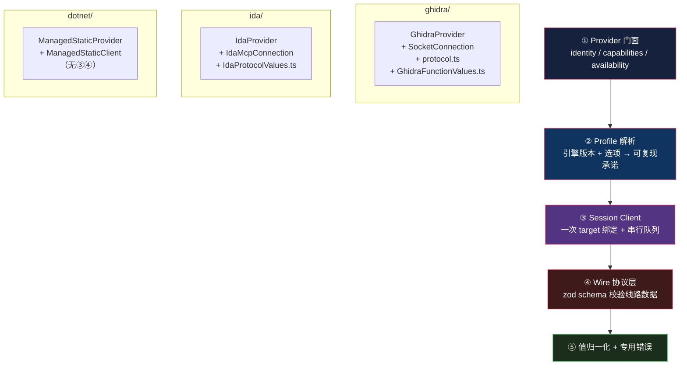

# Provider 适配：16 个引擎，两族契约

> 基于 [REA (morluto/rea)](https://github.com/morluto/rea) 源码分析。v6.4.0，commit `edf4624`。
> 系列：REA 源码阅读（8/15）。

## 一句话概括

`src/` 下有 **16 个 provider 目录**，每个适配一个外部引擎或一种分析能力。

它们**不是一套统一接口**——而是**两族**：

| 族 | 目录 | 共同点 |
|---|------|--------|
| **深 provider** | `ghidra` `hopper` `ida` `artifacts` `native` `dotnet` | 绑定**一个已打开的 target** |
| **窄口 provider** | `adb` `android` `apktool` `browser` `evm` `firmware` `inspector` `javascript` `jeb` `wasm` | **不需要先开 target** |

**为什么不分成一族？** 因为强行统一会造出一个大部分方法是空的接口。

## 生活比喻：专科门诊和体检中心

医院里有两类科室：

| | 专科门诊 | 体检中心 |
|---|---------|---------|
| **前提** | 先挂号建档，之后所有检查都基于**这个病人** | 谁来了都能做，**不需要建档** |
| **状态** | 有病历，全程共享 | 每次独立 |
| **能做的检查** | 依赖这个病人的历史 | 固定套餐 |

**把这两类塞进同一个「科室」接口会怎样？**

专科门诊得实现一个空的「无档案体检」方法，体检中心得实现一个空的「查既往病史」方法。**接口里一半的方法对一半的实现者是废话。**

REA 的选择是：**分成两族，各用各的契约。**

## 深 provider：绑定一个 target

### 契约

```typescript
// src/application/AnalysisProvider.ts:97-104
/** Provider-neutral application capability for one analysis operation. */
export interface AnalysisOperationPort {
  execute(
    operation: AnalysisOperation,
    parameters: Readonly<Record<string, JsonValue>>,
    options?: ExecutionOptions,
  ): Promise<Result<AnalysisExecution, AnalysisError>>;
}
```

```typescript
// src/application/AnalysisProvider.ts:197-210
/** Factory and capability declaration for an analysis implementation. */
export interface AnalysisProvider {
  identity(): ProviderIdentity;
  capabilities(): readonly CapabilityDescriptor[];
  resolveAnalysisProfile?(...);
  createClient(
    target: BinaryTarget,
    profile?: AnalysisProfileCommitment,
    context?: AnalysisClientContext,
  ): AnalysisClient;
}
```

**注意 `createClient(target, ...)`——target 是参数。**

这就是「深」的定义：**它必须先有一个 target 才能干活。**

而可被「选型」的候选还要多三个方法：

```typescript
// src/application/AnalysisProvider.ts:247-255
export interface AnalysisProviderCandidate extends AnalysisProvider {
  resolveAnalysisProfile(...): Promise<Result<AnalysisProfileResolution, AnalysisError>>;
  inspectAvailability(): ProviderAvailability;
  inspectTargetSupport(target: BinaryTarget): ProviderTargetSupport;
}
```

**这三个方法就是「选型」所需的信息**：你能用吗（availability）、你支持这个目标吗（target support）、你的分析语义是什么（profile）。

**选择逻辑因此不需要认识任何具体 provider**——它只调这三个方法。

### 三个实现，三种接法

同样是深 provider，内部差别巨大：

| | `ghidra/` | `ida/` | `dotnet/` |
|---|-----------|--------|-----------|
| **引擎** | Ghidra | IDA Pro | **无**——纯 TypeScript |
| **接法** | 自研 bridge（Java 注入） | **适配外部 MCP server** | 进程内解析 |
| **传输** | Unix socket / loopback TCP | MCP over stdio / HTTP | 无 |
| **文件数** | 59 | 23 | 33 |
| **有 transport 层吗** | ✅ | ✅ | ❌ |

**`dotnet/` 是「无外部引擎」的情况**：

```typescript
// src/dotnet/ManagedStaticProvider.ts:59-73（概述）
export class ManagedStaticProvider implements AnalysisProvider {
  createClient(...) {
    return new ManagedStaticClient(...);   // 直接 new，没有 transport
  }
}
```

**它没有 `GhidraClient` / `IdaSessionClient` 那种会话对象，没有协议层，没有进程管理。**

因为 PE/CLI 元数据解析**就是读文件字节**——不需要外部进程。

**同一个接口，一个实现背后是复杂的跨进程协议，另一个就是几行纯函数。** 这正是接口该有的样子：**它描述能力，不描述实现代价。**

### 固定的五层分工

有外部引擎的那几个，结构高度一致：



**第 ② 层「profile 解析」值得单独说。**

`IdaProvider.ts:139-153` 会写入一个 `compatibility_profile`——`"legacy-1.4"` 或 `"database-supervisor"`。

**这是什么？** 是「我的分析语义」的一份**可复现承诺**。

同一个二进制，用 IDA 1.4 和用 2.0 分析可能得到不同结果。**把引擎版本和关键选项记进 profile，证据才能被复现。**

**没有 profile，你就没法回答「这个结论是用哪个版本得出的」。**

## 窄口 provider：一个方法就够

另一族简单得多。它们的统一方式是**一个泛型模板函数**：

```typescript
// src/application/ProviderOperationExecution.ts:30-65（节选）
/**
 * Shared CLI/MCP admission, execution, and Evidence composition for
 * single-request providers. The caller retains its operation vocabulary and
 * confidence; this normalizes cancellation, input validation, and Evidence
 * assembly once instead of per provider.
 */
export const executeProviderOperation = async <TRequest extends ProviderOperationRequest>(
  operation: string,
  input: unknown,
  options: ExecutionOptions | undefined,
  schema: z.ZodType<TRequest>,
  provider: ProviderOperationPort<TRequest>,
  confidence: "observed" | "derived",
): Promise<Result<Evidence, AnalysisError>> => {
  if (options?.signal?.aborted === true)
    return err(new AnalysisCancelledError(operation));

  const request = schema.safeParse({ operation, input });
  if (!request.success)
    return err(new AnalysisInputError(operation, { cause: request.error }));

  const executed = await provider.execute(request.data, options);
  if (!executed.ok) return executed;

  const execution = executed.value;
  return ok(createEvidence(execution.subject ?? undefined, execution.provider, {
    operation,
    parameters: jsonObjectSchema.parse(request.data.input),
    result: execution.result,
    rawResult: execution.rawResult,
    limitations: execution.limitations,
    locations: execution.locations,
    confidence,
  }));
};
```

### 好在哪

**三件横切的事只写一次**：

1. **取消检查**——`options?.signal?.aborted`
2. **输入校验**——`schema.safeParse`
3. **证据组装**——`createEvidence(...)`

**provider 只需要实现一个方法**：

```typescript
// ProviderOperationPort（:20-28 概述）
execute(request: TRequest, options?): Promise<Result<AnalysisExecution, AnalysisError>>
```

**于是每个窄口 provider 的 Service 只有二十来行**（`src/application/jeb/JebAnalysisService.ts:17-30`）。

**注意 `confidence` 是参数，不是 provider 自己决定的。**

```typescript
confidence: "observed" | "derived",
```

**「这条证据是观测还是推导」由调用方判断，不由 provider 判断。**

为什么？因为**同一个 provider 的操作，在不同上下文里可能是观测也可能是推导**。比如「列出模块」——如果你直接问它，那是观测；如果它是从一次更大的分析里顺带得出的，那可能是推导。

**这个判断需要上下文，provider 手里没有上下文。**

### 还有一个细节：错误原样上抛

```typescript
if (!executed.ok) return executed;
```

**`return executed` 而不是 `return err(executed.error)`**——原样返回失败的 `Result`。

看起来是等价的，但有个区别：**`return executed` 保留了 `Result<never, E>` 的精确类型**，而重新包一层可能丢失类型信息。

**第 4 篇提过 `parseConfig.ts:36-48` 里同样的写法**：`if (!parsed.ok) return parsed;`。**这是这个代码库的一个固定惯用法。**

## 优秀代码一：能力必须可溯源

### 源码

```typescript
// src/application/binary/AnalysisProviderRegistry.ts:93-108（节选）
for (const capability of provider.capabilities()) {
  if (
    capability.provider.id !== identity.id ||
    capability.provider.name !== identity.name ||
    capability.provider.version !== identity.version
  )
    throw new TypeError(
      `Provider ${identity.id} published mismatched capability provenance for ${capability.operation}`,
    );
  if (providerOperations.has(capability.operation))
    throw new TypeError(
      `Provider ${identity.id} declares operation ${capability.operation} more than once`,
    );
}
```

### 好在哪

**provider 声明的每一项能力，都必须带着自己的身份。**

```typescript
// src/application/AnalysisProvider.ts:183-195（节选）
export type CapabilityDescriptor = CapabilityAvailability & {
  readonly cachePolicy?: "snapshot" | "live";
  readonly provider: ProviderIdentity;     // ← 每一项都自带 provider 身份
  readonly operation: Exclude<AnalysisOperation, "health">;
  readonly effects: CapabilityEffects;
  readonly limitations: readonly string[];
};
```

**为什么在自己声明的能力上还要写自己是谁？**

因为**能力清单会被用来做决策**——「这个操作能不能做」「该走哪个 provider」。如果 provider A 能声明「这是 provider B 的能力」而不被拦，那么能力清单就可以被伪造。

**在注册时当场比对三者（id / name / version），不一致就 throw。**

**重复声明的检查同理**：同一个 provider 声明两次同一个 operation，说明它的能力表有 bug——**与其让下游拿到两份可能矛盾的声明，不如当场拒绝。**

### 能力里还有 `effects`

```typescript
// src/application/AnalysisProvider.ts:161-169（概述）
// mutatesArtifact / launchesProcess / mayShowUi / mayAccessNetwork
// / mayWriteFilesystem / changesPermissions / requiresRoot
```

**这是封闭词表**——一个操作对系统有什么副作用，必须从这七项里选。

**它的用途很实际**：调用方（尤其 AI agent）可以先看 `effects` 再决定要不要执行。

比如 `mayShowUi` 为真意味着「这个操作会在屏幕上弹东西」——**在无人值守的场景里就不该调它**。

### 实现常常是机械推导的

```typescript
// src/hopper/HopperProviderCapabilities.ts:64-104（概述）
// 由 HOPPER_OPERATIONS + MUTATING_OPERATIONS 机械生成
```

**不给每个操作手写 effects 表，而是从「操作名 + 是否变更」两个集合推导。**

**手写 32 个操作 × 7 个 effects 字段 = 224 个布尔值要人工维护，迟早有一项写错。** 推导出来就不会。

### 骨架代码

```typescript
type Capability = {
  provider: Identity;            // ← 每项能力自带身份
  operation: Operation;
  effects: { mutates: boolean; spawnsProcess: boolean; showsUi: boolean };
  limitations: readonly string[];
};

// 注册时校验
const register = (provider: Provider) => {
  const identity = provider.identity();
  const seen = new Set<Operation>();
  for (const cap of provider.capabilities()) {
    if (cap.provider.id !== identity.id)
      throw new TypeError(`${identity.id} published mismatched provenance for ${cap.operation}`);
    if (seen.has(cap.operation))
      throw new TypeError(`${identity.id} declares ${cap.operation} twice`);
    seen.add(cap.operation);
  }
  // 校验通过后再排序冻结——注册顺序不影响后续选择
  return Object.freeze([...provider.capabilities()].sort(byOperationCodePoint));
};
```

**判断标准**：只要有一张「能力表」会被用来做决策，就要问——**这张表能不能被伪造？** 让每个条目自带身份，是防伪造最省事的办法。

## 优秀代码二：不编造空观测

### 源码

IDA provider 对接的是**外部 MCP server**（`docs/ida-provider.md:3`：`REA adapts an existing mrexodia/ida-pro-mcp server into its native analysis tools`）。

外部 server 的返回要经过一层解码器。`src/ida/IdaMcpConnection.ts:26-80`（节选）：

```typescript
const toolResultSchema = z.object({
  isError: z.boolean().optional(),
  structuredContent: z.record(z.string(), z.unknown()).optional(),
  content: z.array(
    z.object({ type: z.string(), text: z.string().optional() }).passthrough(),
  ),
  _meta: z.object({ ida_mcp: z.object({
    output_truncated: z.boolean().optional(),
    download_hint: z.string().optional(),
  }).passthrough().optional() }).passthrough().optional(),
});

// ...
if (result.isError === true)
  throw new AnalysisProtocolError(`IDA MCP tool failed: ${blocks.join("\n")}`);

if (result._meta?.ida_mcp?.output_truncated === true)
  throw new AnalysisProtocolError(
    `IDA MCP truncated its output; the preview cannot establish a complete observation. ...`);

if (result.structuredContent !== undefined) {
  const value = result.structuredContent;
  return jsonValueSchema.parse(
    Object.keys(value).length === 1 && "result" in value ? value.result : value,
  );
}

if (blocks.length !== 1)
  throw new AnalysisProtocolError(
    "IDA MCP omitted a single structured or text result; unsupported content cannot establish an empty observation.",
  );
```

### 好在哪

**多引擎适配最危险的失败模式是：「上游换了返回形状 → 你把 undefined 当成『没有发现』」。**

后果很严重：分析报告里会写「这个函数没有调用者」——而真相是**解析失败了**。

**「没找到」和「没看懂」被混为一谈，而后者会伪装成前者。**

这段代码把三种情况全部升级为**显式协议错误**：

| 情况 | 处理 |
|------|------|
| `isError: true` | 抛 `AnalysisProtocolError` |
| `output_truncated: true` | 抛——**截断的预览不能establish完整观测** |
| content 块数 ≠ 1 | 抛——**"不支持的内容"不等于"空结果"** |

**注意那句措辞**：

> `unsupported content cannot establish an empty observation`
>
> **不支持的内容，不能用来确立一个"空"的观测。**

**这句话是整个模式的精髓**——它区分了两件容易混淆的事：

- 「我查了，结果是空的」→ 这是一条**观测**
- 「我没看懂返回的是什么」→ 这**不是**任何观测

**只有前者能进证据。** 后者必须报错。

**同族的 JEB 适配器有几乎一样的注释**（`src/jeb/JebMcpConnection.ts:35`）——说明这个模式是**沉淀下来的**，不是某处的一次性处理。

### 还保留了上游的扩展字段

```typescript
_meta: z.object({...}).passthrough().optional()
content: z.array(z.object({...}).passthrough())
```

**`.passthrough()`——不认识的字段保留，不丢弃。**

**这和前面的「拒绝未知字段」正好相反**，为什么？

因为**对面不是自己的代码**：

| 场景 | 策略 | 理由 |
|------|------|------|
| 自己的桥（Hopper/Ghidra） | **拒绝未知字段** | 双方都是自己写的，不一致就是 bug |
| 外部 server（IDA/JEB） | **保留未知字段** | 对面会演化，丢弃会丢信息 |

**「严格」和「宽容」的分界线画在「谁拥有对方」上。**

### 模式

**边界解码器 / parse-don't-validate + fail closed**——解析失败就报错，绝不返回一个「看起来像空结果」的东西。

### 骨架代码

```typescript
const upstreamResultSchema = z.object({
  isError: z.boolean().optional(),
  structuredContent: z.record(z.string(), z.unknown()).optional(),
  content: z.array(z.object({ type: z.string(), text: z.string().optional() }).passthrough()),
  _meta: z.any().optional(),
});

const decodeUpstreamToolResult = (input: unknown): JsonValue => {
  const r = upstreamResultSchema.parse(input);         // ① 结构不对 → 抛

  if (r.isError === true) throw new ProtocolError();   // ② 引擎自报失败，原样升级
  if (truncated(r)) throw new ProtocolError();         // ③ 不完整不许当空结果

  if (r.structuredContent) return unwrap(r.structuredContent);

  const texts = textBlocks(r);
  if (texts.length !== 1)
    throw new ProtocolError("unsupported content cannot establish an empty observation");
  return tryParseJson(texts[0]);                       // ④ 文本回退，JSON 优先
};
```

**判断标准**：**你对接的每一个外部服务，都要问一句「它返回我没见过的东西时，我会怎么处理」。** 如果答案是「当成空的」，那就是个 bug。

## 归一化：三条纪律

### ① 出口只允许 JSON 值

```typescript
// src/application/AnalysisProvider.ts:64-95（概述）
// createAnalysisExecution 对 result / rawResult 做 jsonValueSchema.parse
```

**provider 的返回值必须是纯 JSON**——不能带 `undefined`、`Date`、`BigInt`、类实例。

**为什么？** 因为证据要跨进程、跨会话、跨机器传递（第 5 篇的证据包）。**任何非 JSON 的值都会在序列化时丢失或变形。**

### ② 线协议用 transform 抹平版本差异

最好的例子是 IDA 的地址归一化：

```typescript
// src/ida/IdaProtocolValues.ts:5-29（节选）
export const idaAddressSchema = z
  .string()
  .regex(/^(?:0x)?[0-9a-f]+$/iu)
  .transform(
    (value) =>
      `0x${BigInt(value.startsWith("0x") || value.startsWith("0X") ? value : `0x${value}`).toString(16)}`,
  );
```

**上游可能回 `"401000"`、`"0x401000"`、`"0X401000"`——全部归一成 `"0x401000"`。**

**注意用了 `BigInt` 而不是 `Number`。**

为什么？因为 64 位地址超出 JS `Number` 的安全整数范围（2^53）。**用 `Number` 转会静默丢精度**——`0x7fffffffffffffff` 变成 `9223372036854776000`。

**地址精度丢失在逆向工程里是致命的**——你会指向一个错误的地址，而且**不会有任何报错**。

### ③ 越界/不完整显式标注

```typescript
// src/firmware/FirmwareReports.ts:136-140（概述）
// 逐 region 校验 hit.offset >= size || hit.size > size - hit.offset
// 输出带 size_basis: "provider_reported_validation_unknown"
```

**注意那个 `size_basis` 字段名**——`provider_reported_validation_unknown`。

**它在说：「这个大小是 provider 报的，我没能验证它」。**

**不是「大小不可信」，是「我知道我不知道」。** 这和整个项目的价值观一致。

## 代价

### ① 两族契约增加了理解成本

新加入的人要搞清：

- 什么是「深 provider」，什么是「窄口 provider」
- 我的新 provider 属于哪一族
- 两族的契约分别在哪

**而且两族之间没有形式化的关系**——它们只是「不共享接口」。

### ② 五层分工有样板

`ghidra/` 59 个文件里，相当一部分是「协议 → 归一化 → 错误」的样板。**每个新引擎都要重写一遍。**

`executeProviderOperation` 把窄口那一族的横切关注点收口了，**但深 provider 那一族没有对应的模板**——因为它们的生命周期差异太大（有的有长连接、有的每次起进程、有的纯内存）。

### ③ `effects` 表要靠人维护语义

从操作名推导 `effects` 解决了「写错」的问题，**但没解决「推导规则本身写错」的问题**。

`MUTATING_OPERATIONS` 这个集合漏了一个操作，推导出来的 effects 就是错的——**而且不会有任何东西报警。**

### ④ 外部 server 的演化不受控

IDA/JEB 适配的是第三方 MCP server。**对面改接口、改返回形状、加字段——REA 只能被动跟进。**

`parse-don't-validate` + `passthrough` 缓解了一部分（不认识就保留），**但如果对面改了语义**（同一个字段含义变了），**任何技术手段都防不住。**

## 总结

| 结论 | 说明 |
|------|------|
| **两族而非一族** | 深 provider（绑定 target）vs 窄口 provider（单次请求） |
| **强行统一的代价** | 一半方法对一半实现者是空的 |
| **能力可溯源** | 每项 capability 自带 identity，注册时三字段比对 |
| **effects 词表** | 七个副作用标志，从操作名**推导**而非手写 |
| **不编造空观测** | 上游返回形状不对 → **报错**，不是「没有发现」 |
| **严格 vs 宽容的分界** | 自己的桥拒绝未知字段；外部 server 保留 |
| **地址归一用 BigInt** | 64 位地址超出 `Number` 安全范围，用 `Number` 会**静默丢精度** |
| **横切收口** | `executeProviderOperation` 把取消/校验/证据组装写一次 |

**一句话**：这一层最值得学的不是「怎么抽象 16 个引擎」，是**两条边界纪律**——

**第一，能力表要能防伪**（每项自带身份）。因为能力表会被用来做决策，**能被伪造的能力表等于没有能力表。**

**第二，「没找到」和「没看懂」必须分开。** 前者是观测，后者是错误。

**第二条尤其重要**——大多数多引擎适配的 bug 不是崩溃，是**静默地把解析失败当成空结果**，然后一份分析报告里出现了「这里什么也没有」的结论。

**坏消息不会自己传播，好消息会。** 一个错误的「空」会在下游被当成事实继续使用。

---

**下一篇**：[测试策略](09-testing-strategy.md)——0.92 的测试比是怎么来的，以及「模拟的 provider 不构成真实 provider 行为的证据」。
