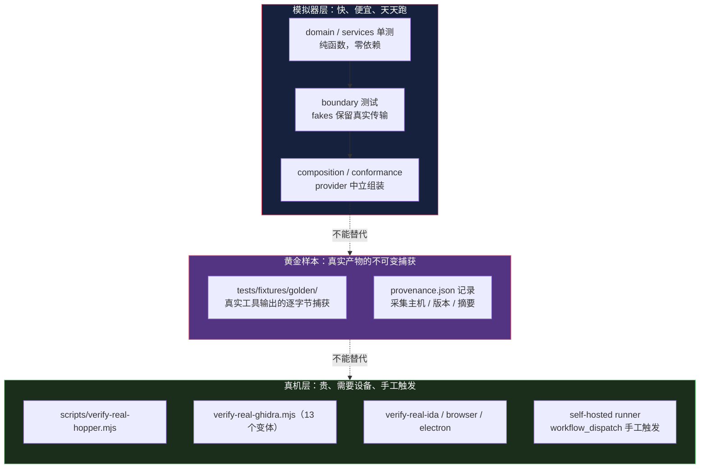

# 测试策略：模拟的 provider 不构成真实 provider 行为的证据

> 基于 [REA (morluto/rea)](https://github.com/morluto/rea) 源码分析。v6.4.0，commit `edf4624`。
> 系列：REA 源码阅读（9/15）。

## 一句话概括

REA 有 **约 894 个测试文件**（352 个与源码同目录 + 542 个在 `tests/`），测试比 0.92。

但真正值得学的不是「测得多」，是**它明确划定了测试不能证明什么**：

> Prefer real public CLI/MCP workflows, then production-boundary integration, then producer goldens. … Report unverified coverage explicitly; **simulated providers do not establish real-provider behavior.**
> —— `AGENTS.md:46`

**「我测过了」和「我验证过了」是两回事。**

## 生活比喻：飞行模拟器

飞行员训练有两套东西：

| | 模拟器 | 真机 |
|---|--------|------|
| **能练什么** | 流程、应急反应、仪表读数 | 真实的气流、故障、手感 |
| **便宜吗** | 便宜，随时跑 | 贵，要真飞机、真跑道、真天气 |
| **能证明什么** | 「他懂流程」 | 「他能飞」 |

**关键：飞满 1000 小时模拟器，不能说明你能飞真飞机。**

所以航校的规则是：**模拟器练流程，真机取证。** 两者都要，但**不能互相替代**。

REA 的测试体系就是这个结构：



**箭头上的「不能替代」是重点。**

## 分层：12 个 vitest project

`vitest.config.ts:31-138` 定义了 12 个 project，每个有自己的**运行方式和隔离级别**：

| project | 范围 | pool | 为什么这样配 |
|---------|------|------|-------------|
| `domain` | `src/{contracts,domain}/**` | threads, `isolate: false` | 纯模块无全局态，隔离只是白费启动成本 |
| `services` | `src/application/**` | threads, `isolate: false` | 同上 |
| `adapters` | `src/*.test.ts` + 19 个目录 | **forks** | 适配器有真实资源，需要进程隔离 |
| `boundary` | `tests/boundary/**` | **forks** | 跨一个生产边界 |
| `cli-boundary` | `tests/boundary/cli/**` | forks + 内存限制 384MB | CLI 子进程 |
| `process-boundary` | `tests/boundary/process/**` | forks + **串行** | 进程树采样共享主机资源 |
| `mcp-boundary` | `tests/boundary/mcp/**` | threads, `isolate: false` | 每文件自建内存 session |
| `acceptance` | `tests/acceptance/**` | forks | 编译后全旅程 |
| `process-global` | `tests/process-global/**` | forks | **唯一允许依赖进程全局态的地方** |
| `conformance` | `tests/conformance/**` | threads, `isolate: false` | provider 契约参数化 |
| `evaluation` | `tests/evaluation/**` | threads | 确定性 evaluator 逻辑 |
| `composition` | `tests/composition/**` | threads, `isolate: false` | provider 中立组装 |

### 三个配置细节值得看

**① `isolate: false` 是有论证的**

```typescript
// vitest.config.ts:37-38（注释原文）
// Domain and contract modules are pure and own no process-global state,
// so per-file module isolation adds startup cost without protecting a seam.
```

**「隔离只是白费启动成本，因为它保护的那个接缝在这里不存在。」**

**这句话是判断标准**：隔离是为了防「文件之间通过全局态互相污染」。**如果根本没有全局态，隔离就是在为一个不存在的风险付钱。**

**② `process-boundary` 故意串行**

```typescript
// vitest.config.ts:92-93/98-99（概述）
fileParallelism: false
sequence: { groupOrder: 1 }
```

**因为进程树采样要读系统进程表——并发跑会互相干扰。**

而且 `groupOrder: 1` 让它在其他 project 之后跑——**减少它对其他测试的干扰**。

**③ 全局只给 2 个 worker**

```typescript
// vitest.config.ts:29
const MAX_TEST_WORKERS = Math.min(2, availableParallelism());
```

**上限 2，不管机器有多少核。**

这看着反直觉——测试不是越多并行越快吗？

**因为这里的测试大量涉及真实进程、真实文件系统、真实 socket。** 并行度高了，测试之间会通过**操作系统资源**互相干扰（端口冲突、临时目录、进程数上限），**产生随机失败**。

**宁可慢，不要 flaky。**

## 快速反馈链

```bash
test:local      # 脏源码测试，走 import graph，不 build
test:changed    # merge base 以来受影响的（--changed=<mergeBase>）
test:focused    # 精确文件；编译边界会先 build
test:fast       # 6 个源码 project，不 build
test:boundary   # 5 个边界 project
test:acceptance # 编译后全旅程
test:ci         # 全量 + 覆盖率
```

规则是（`docs/testing.md:943-944`）：

> **编辑期用源码反馈，提交前跑显式的边界检查，合并前有完整的 CI 证据。**

### 一个诚实的细节

```javascript
// scripts/run-development-tests.mjs:48
console.log("compiled boundaries and real providers need explicit verification.");
```

**`test:changed` 跑完会打印这句话。**

而 `docs/testing.md:996-999` 说得更直白：

> **An empty changed selection means no tests were selected, not verified correctness.**
>
> 空的选择集意味着「没选中任何测试」，不意味着「验证过了」。

**测试工具主动声明自己的局限**——这在测试工具里很少见，但很重要。

## fixtures：假接缝，不是 mock

这是整个测试体系最值得学的设计。

### 核心思想

**不做模块 mock，而是在生产代码已有的某个「接缝」上放一个假生产者，尽可能保留真实传输。**

### 生产代码显式声明接缝

```typescript
// src/ghidra/GhidraLauncher.ts:119-120
/** Spawn seam for provider-boundary lifecycle tests. */
readonly spawnProcess?: typeof spawnOwnedProviderProcess;
```

```typescript
// src/native/CommandRunner.ts:106
/** Optional launch seam for production-boundary lifecycle verification. */
```

**接缝是生产代码**主动**留的，而且带注释说明它的用途。**

### 假的东西保留了多少

四种粒度，保留程度递增：

| 类型 | 例子 | 真的是什么 | 假的是什么 |
|------|------|-----------|-----------|
| **假 launcher** | `fakeLauncher.mjs` | 环境变量协议、参数顺序 | 被启动的程序 |
| **假 bridge** | `fakeHopper.mjs` | **真实 Unix socket 协议** | 桥的实现 |
| **假 CDP** | `fakeCdpBrowser.ts` | **真实 HTTP + WebSocket 服务器** | 浏览器 |
| **记录式 producer** | `RecordingIdaMcp` | 通过真实接口 | 上游实现 |

**假 CDP 是最彻底的**：

```typescript
// tests/fixtures/fakeCdpBrowser.ts:19-22
/** Start a real HTTP/WebSocket fake at the same seams as a user-owned browser. */
export const startFakeCdpBrowser = async (
  options: FakeOptions = {},
): Promise<FakeCdpBrowser> => {
```

```typescript
// tests/fixtures/fakeCdpBrowserTypes.ts:39
/** Producer reply seam preserves the real HTTP/WebSocket transport and command parser. */
```

**它起一个真的 HTTP 服务器、真的 WebSocket 服务器。**

所以被测的 `CdpConnection` 走的是**真实的 ws 传输、真实的握手、真实的帧解析**——只有「对面是不是 Chrome」是假的。

**这比 mock 掉 `CdpConnection` 强太多了**：mock 掉的话，**传输层的 bug 一个都测不出来。**

### 假的东西必须拒绝未建模的输入

```typescript
// tests/fixtures/idaMcp.ts:211
throw new Error(`Unimplemented producer tool ${name}`);
```

而 `docs/testing.md:23-24` 把它写成了规范：

> **Protocol fixtures must reject unmodeled commands and preserve actual producer reply shapes.**

**「假生产者遇到不认识的请求要报错」**——因为真实的生产者会报错。

**如果假生产者宽容地返回 undefined，测试就会通过，而真实环境会失败。** 这种测试比没有测试更糟——**它给了你虚假的信心。**

### 故障注入是一等公民

假 Ghidra 支持 **17 种故障模式**：

```typescript
// tests/boundary/providers/ghidra/ghidraClient.test.ts:42-59（概述）
// success | fragmented | oversized_result | wrong_identity | malformed
// | contradictory | ... | hang_tools | exit_tools | silent
```

**`fragmented`（分包）、`oversized_result`（超限）、`hang_tools`（挂起）、`silent`（静默）——**

**这些才是真实环境里会遇到的。** 而正常路径反而是最容易测的。

**故障模式不是「额外加的测试」，是假 producer 的必备能力。**

## 黄金样本：真实产物的不可变捕获

```markdown
<!-- tests/fixtures/golden/README.md:3-6 -->
These are actual tool outputs, not records assembled to match the parser.
`provenance.json` records the capture host, producer versions, source digests
and immutable capture/expectation digests.
```

**「这些是真实工具的输出，不是为了让解析器通过而拼装出来的记录。」**

`provenance.json` 记了什么：

```json
{
  "captured_on": "2026-10-04",
  "host": "macOS 26.3 arm64",
  "producers": { "xcode": ..., "swift": ..., "assetutil": ... },
  // 7 个输入与期望文件的 sha256
}
```

**这一句话把「黄金样本」和「手写的期望值」区分开了。**

而更新流程也有纪律：

```markdown
<!-- README.md:33-34 -->
Review expected graph changes against the source and XML before updating the
expectation or provenance. Tests never rewrite the golden.
```

**「测试永不改写 golden」**——否则它就变成了「记录当前行为」，失去了发现回归的能力。

**还有一条防自欺的规则**：

> Do not call handcrafted utility output or synthetic binary builders real-data goldens.
>
> **别把手工造的或合成的二进制叫做「真实数据黄金样本」。**

## 优秀代码一：声明的能力 × 真实的行为互相印证

### 源码

```typescript
// tests/conformance/ida/providerContracts.test.ts:37-70（节选）
describe.each(["attached", "headless"] as const)(
  "IDA %s caller-visible contracts",
  (mode) => {
    it.each(IDA_OPERATIONS)(
      "declares %s UI effects matching the upstream tools it reaches",
      async (operation) => {
        const { root, target } = await createIdaTarget();
        roots.push(root);
        const producer = new RecordingIdaMcp(target, mode);
        const client = new IdaSessionClient(/* ... */, target, producer);
        try {
          await client.execute(operation, parametersFor(operation));
        } finally {
          await client.close();
        }
        const descriptor = idaCapabilities(mode, true).find(
          (capability) => capability.operation === operation,
        );
        expect(descriptor?.effects.mayShowUi).toBe(
          producer.calls.some(({ name }) => GUI_NAVIGATING_TOOLS.has(name)),
        );
      },
    );
  },
);
```

### 好在哪

**断言的两边都是「算出来的」，不是写死的。**

```typescript
expect(descriptor?.effects.mayShowUi).toBe(
  producer.calls.some(({ name }) => GUI_NAVIGATING_TOOLS.has(name)),
);
```

- 左边：provider **声称** `mayShowUi` 是什么
- 右边：**实际调用**了哪些上游工具，这些工具是否在会导航 GUI 的集合里

**如果能力表撒谎（声称不显示 UI，实际却调了会弹窗的工具），测试失败。**

**这比 `expect(capability.mayShowUi).toBe(true)` 强得多**——后者只是把实现抄了一遍，实现改了测试也跟着改，**永远通过。**

### 参数化矩阵

```typescript
describe.each(["attached", "headless"] as const)(   // 两种运行模式
  it.each(IDA_OPERATIONS)(                          // × 全部操作
```

**一份代码覆盖 2 × N 的组合。**

而且 headless 模式下专门断言降级行为——**会弹 UI 的操作在无头模式下应该报 `AnalysisCapabilityUnavailableError`。**

### 那个 `throw` 的惯用法

```typescript
if (!execution.ok) throw execution.error;
```

`docs/testing.md:22-23` 把它写成了规范：

> **For successful `Result` values, throw the typed error before asserting the value; a preceding `.ok` assertion adds no coverage.**
>
> 对成功的 `Result`，直接抛类型化错误，**再断言值**。先来一句 `expect(result.ok).toBe(true)` 不增加任何覆盖率。

**因为 `throw` 一抛，测试就失败了，而且失败信息就是那个真实错误**——比 `expected false to be true` 有用得多。

### 模式

**声明与行为互证（declaration-behavior cross-check）**——**断言「系统说自己是什么」和「系统实际做了什么」一致。**

### 骨架代码

```typescript
// 你的项目中：元数据表要么被验证，要么会腐烂
it.each(OPERATIONS)("declares %s effects matching actual behavior", async (op) => {
  const producer = new RecordingProducer();          // 记录真实调用
  await service.execute(op, params);
  const declared = capabilities().find((c) => c.operation === op);

  // 左边：声明。右边：从真实调用集合推导。两边都是算出来的
  expect(declared?.effects.spawnsProcess).toBe(
    producer.calls.some((c) => SPAWNING_COMMANDS.has(c.name)),
  );
});
```

**判断标准**：只要有一张「声明表」（能力、权限、影响范围），就该问——**它是被验证的，还是只是被抄了一遍？**

## 优秀代码二：测试自己的资源所有权

### 源码

```typescript
// tests/support/process/processFixture.ts:140-164（节选）
shutdown: async () => {
  const results = await Promise.allSettled(
    [...children].reverse().map(async (child) => {
      if (!(await stopChild(child))) {
        throw new Error(
          `test child process ${String(child.pid)} did not exit after SIGKILL`,
        );
      }
    }),
  );
  // ...
  if (children.size > 0) {
    failures.push(new Error(`${children.size} test child process(es) leaked`));
  }
  if (failures.length > 0) {
    throw new AggregateError(failures, "Test child process shutdown failed");
  }
},
```

```typescript
// tests/support/process/processFixture.ts:169-179
export const processTest = base.extend<{ processes: TestProcesses }>({
  processes: async ({}, use) => {
    const processes = createTestProcessRegistry();
    try {
      await use(processes);
    } finally {
      await processes.shutdown();
    }
  },
});
```

### 好在哪

**这是第 3 篇「进程所有权」在测试侧的镜像。**

**① 所有权随测试生命周期**

```typescript
try { await use(processes); } finally { await processes.shutdown(); }
```

**Vitest fixture 的 `finally` 保证 shutdown 一定执行**——测试通过、失败、超时都一样。

**② 进程泄漏是失败，不是日志**

```typescript
if (children.size > 0) failures.push(new Error(`${children.size} test child process(es) leaked`));
if (failures.length > 0) throw new AggregateError(failures, "Test child process shutdown failed");
```

**「还有子进程没退出」→ 抛错。**

而不是 `console.warn("2 processes leaked")` 然后继续。

**③ 双层超时**

```typescript
// :63-71
const stopChild = async (child) => {
  if (child.exitCode !== null || child.signalCode !== null) return true;
  child.kill("SIGTERM");
  if (await waitForExit(child, SHUTDOWN_GRACE_MS)) return true;
  child.kill("SIGKILL");
  return waitForExit(child, SHUTDOWN_GRACE_MS);
};
```

**先 SIGTERM 给 1 秒优雅退出，再 SIGKILL 给 1 秒。**

而 `SIGKILL` 之后还不退出，就抛错——**因为那说明进程处于不可中断状态（D 状态），是真正的问题。**

**④ 逆序关闭**

```typescript
[...children].reverse().map(...)
```

**后创建的先关**——和栈一样。**如果进程之间有依赖（父启动了子），正序关会留下孤儿。**

### 为什么测试的资源清理值得这么较真

因为**测试的资源泄漏会累积**。

一个测试泄漏 2 个进程，跑 500 个测试就泄漏上千个——**最终 CI 机器会因为进程数耗尽而失败，而失败的还不是出问题的那个测试。**

**这类问题最难查**：症状（机器卡死）和原因（某个测试没清理）隔着几百个测试和几十分钟。

**所以唯一可靠的办法是：让泄漏在发生的那一刻就失败。**

### 模式

**RAII / 作用域所有权**——资源绑定到作用域，离开作用域必然释放，泄漏即失败。

### 骨架代码

```typescript
// 你的项目中：任何测试里起的进程/服务/临时目录
const ownedTest = base.extend<{ owned: Owned }>({
  owned: async ({}, use) => {
    const registry = createRegistry();
    try {
      await use(registry);
    } finally {
      const failures = await registry.shutdown();   // 逆序、SIGTERM→SIGKILL
      if (failures.length > 0)
        throw new AggregateError(failures, "test resources leaked");  // ← 泄漏即失败
    }
  },
});
```

**判断标准**：**你的测试套件里，资源泄漏会失败还是会打日志？** 如果是打日志，那就是在等一个几周后才发作的 flaky。

## 覆盖率阈值按层递增

```typescript
// vitest.config.ts:189-206（概述）
// 全局：    statements 65 / branches 60 / functions 60 / lines 68
// domain：  80 / 75 / 75 / 80
// contracts：85 / 80 / 80 / 85
```

**越靠内层，要求越高。**

理由很直接：**`contracts/` 和 `domain/` 是纯逻辑，测试成本最低、价值最高**。而 `browser/`（113 文件）要起真实浏览器，覆盖率成本极高。

**阈值跟着「测试的边际成本」走，而不是一刀切。**

（分片跑 CI 时阈值降为 0，由合并报告那一趟统一检查。）

## 代价

### ① 894 个测试文件的维护成本

**测试代码本身要维护、要重构、会过时。**

而且这份测试比 0.92 意味着：**改一行产品代码，可能要跟着改一行测试。** 这个成本是持续的。

`docs/testing.md` 里专门有一条删除标准：

> Before deleting a distinct regression, identify the replacement scenario and assertions.
>
> **删一个回归测试之前，先指出替代它的场景和断言。**

**因为「删测试」太容易了，而删掉的那些覆盖不会有人发现。**

### ② 真机 lane 需要设备

`verify-real-*` 脚本有 20 多个，其中 Ghidra 一个引擎就有 13 个变体。

**它们需要真机上装着 Ghidra / IDA / Hopper / 浏览器**，而且：

```yaml
# .github/workflows/real-hopper.yml:15
runs-on: [self-hosted, macOS, hopper]
```

**self-hosted runner，而且 workflow_dispatch 手工触发。**

**也就是说：这些验证不是每次提交都跑的。** 它们的价值在于「发布前跑一次」和「改 provider 时按 ownership 表自动触发对应 lane」。

### ③ fakes 本身会漂移

`fakeGhidra.mjs` 17 种故障模式、`fakeCdpBrowser.ts` 支持注入超时/畸形/挂起——**这些假生产者本身是代码，会过时。**

**真实 Ghidra 换了个错误格式，假的那个不知道。** 于是测试通过，真实环境失败。

**这是「假生产者」固有的风险**，REA 用「定期的真机 lane」来对冲——**但真机 lane 不是每次提交都跑，所以窗口期是存在的。**

### ④ 三种测试的边界靠人判

「什么算 boundary 测试」「什么该进 acceptance」——**这是判断，不是规则。**

代码里靠目录结构 + `docs/testing.md` 的表格约束，但**新加测试时放错目录不会有任何报警**。

### ⑤ 那些「不能证明什么」的话要靠人读

`docs/testing.md` 里反复出现这类声明：

> MCP SDK transport tests with recording providers remain integration tests. … **do not prove that Hopper, Ghidra or another substituted engine works.**

**这些声明写在文档里，不是写在代码里。** 不看文档的人不会知道。

（唯一机械化的部分是 `verify-real-ida.mjs:25-29` 那种——缺前置时直接抛错，而不是静默跳过：

```javascript
throw new Error(
  "IDA verification requires --target and REA_IDA_MCP_CONFIG; see docs/ida-provider.md. No toolchain is installed by this lane.",
);
```

**「这一趟没有安装任何工具链」——把「我没测」说清楚。**）

## 总结

| 结论 | 说明 |
|------|------|
| **规模** | 约 894 个测试文件，测试比 0.92；12 个 vitest project |
| **隔离按需** | 纯模块 `isolate: false`（没有全局态可污染）；适配器用 forks |
| **并发上限 2** | 涉及真实进程/端口/文件系统，宁慢不 flaky |
| **fixtures 不是 mock** | 假 producer **保留真实传输**——假 CDP 起真 HTTP + WebSocket 服务器 |
| **假 producer 必须会报错** | 遇到未建模的命令要 throw，否则给的是虚假信心 |
| **故障注入是必备** | 17 种故障模式；正常路径最好测 |
| **黄金样本** | 真实工具输出的不可变捕获，带 provenance；**测试永不改写** |
| **声明 × 行为互证** | 断言「声称的能力」等于「实际调用推导出的能力」 |
| **泄漏即失败** | 测试进程泄漏抛 `AggregateError`，不是打日志 |
| **诚实划界** | **模拟的 provider 不构成真实 provider 行为的证据** |

**一句话**：这套测试体系最值钱的不是覆盖率，是**它一直在说「这不能证明什么」**——

- `test:changed` 跑完会打印「编译边界和真实 provider 需要显式验证」
- testing.md 说「空的变更选择集 = 没选中测试 ≠ 验证过」
- 真机 lane 缺前置时抛错并声明「这一趟没装任何工具链」

**而最有力的一句是那句 AGENTS.md 里的**：

> **simulated providers do not establish real-provider behavior.**

**因为测试最大的危险不是「测少了」，是「测过了但以为验证过了」。**

前者的后果是发现问题，后者的后果是**不再去看**。

---

**下一篇**：[Prompt 全集](10-prompt-collection.md)——6 个 MCP prompt + 3 个 skill + 6 个 reference，中英双语对照。
