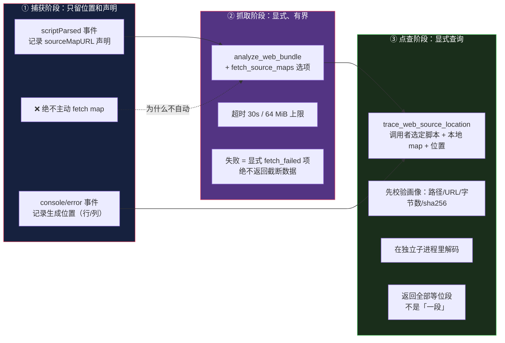

# 浏览器观测：为什么「拍到了」不够，还要说「拍全了没」

> 基于 [REA (morluto/rea)](https://github.com/morluto/rea) 源码分析。v6.4.0，commit `edf4624`。
> 系列：REA 源码阅读（11/15）。

## 一句话概括

`src/browser/` 是 REA 最大的单个 provider：**113 个文件，24,539 行**（其中 87 个非测试文件）。

它做的事听起来直白——**连上 Chrome，把页面发生了什么记下来**。

但真正的问题是后面那个：**你怎么知道记全了？**

## 生活比喻：监控摄像头

摄像头有个无法回避的性质：

> **它从装上那一刻才开始录。**

装之前发生的事，**录像是空白的——但空白不等于没发生。**

| 你的判断 | 对不对 |
|---------|-------|
| 「录像里没有张三」 | ❌ **只能说「录像的时间窗里没有张三」** |
| 「张三没来过」 | ❌ 他可能在你装摄像头之前就来了 |
| 「在我的录制窗口内，没有张三出现的记录」 | ✅ |

**浏览器观测完全一样。**

REA 只能记录**它 attach 之后**发生的事。页面在 attach 之前发出的请求、执行的脚本、报的错——**一个都拿不到。**

于是问题变成：**这份捕获怎么表达「我的窗口从哪开始」？**

## 第一层设计：按「权限」拆 provider

很多人以为用 CDP 还是 Playwright 是技术选择。**REA 说不是——是按权限（authority）拆。**

`docs/browser-observation.md:52-64` 原文：

> CDP page capture, V8 Inspector observation, and Playwright scenarios **stay separate providers because their authorities differ**: CDP and V8 **attach to an already-running target and never launch, drive, evaluate, or mutate it**, while Playwright providers **own and drive the runtime** (launch browsers, run actions, capture step snapshots). **Merging them would mix attach-only and owned-process lifecycles in one contract.**

**中文**：CDP 页面捕获、V8 Inspector 观测和 Playwright 场景**保持为不同的 provider，因为它们的权限不同**：CDP 和 V8 **附着到已经运行的目标上，从不启动、驱动、执行或修改它**；而 Playwright provider **拥有并驱动运行时**。**合并它们会把「仅附着」和「拥有进程」两种生命周期混进同一个契约。**

**这句话和第 6 篇那个 `≥2 → 报错` 是同一个思路**：

**「我只看看」和「我能操作它」是两种不同的权限，不该由同一个接口承担。**

于是有四个 provider 身份（`src/browser/providerIdentities.ts`）：

| ID | 模式 |
|----|------|
| `rea-cdp-browser` | 被动：附着到用户自己的 Chrome |
| `rea-playwright-browser-scenario` | 主动：启动并驱动浏览器 |
| `rea-cdp-electron` | 被动：Electron 的 `file://` |
| `rea-playwright-electron-active` | 主动：Electron |

**用户自己启动带 `--remote-debugging-port` 的 Chrome，REA 只连上去看**（`docs/browser-observation.md:66-77`：`REA does not launch, own, or terminate this browser.`）。

而主动模式要执行动作——**那是另一份权限，另一份契约。**

## 优秀代码一：捕获完整性不是布尔值

### 问题

如果让工程师设计「捕获完了吗」这个字段，八成会得到一个 `complete: boolean`。

**但布尔值在这里是错的**，因为它混淆了至少四种完全不同的情况：

| 情况 | `complete` 该填什么？ |
|------|---------------------|
| 我记下了窗口内的一切 | `true` |
| 有些请求因为跨域策略被我过滤了 | ？ |
| 我是在页面跑了 3 秒后才 attach 的 | ？ |
| 数据太多，超出了我的预算，截断了 | ？ |

**后三种填 `false` 都丢失了关键区别**——而它们对分析结论的影响完全不同。

### 源码

REA 用**四个状态 + 一个条件数组**：

```typescript
// src/domain/browserCompleteness.ts:99-124
const policyFiltered = input.policyFilteredSections.size > 0;
const truncated =
  input.truncatedSections.size > 0 ||
  Object.values(input.droppedEvents).some((count) => count > 0);
const attachLimited =
  input.attachLimitedSections.size > 0 || input.unavailableSections.size > 0;
const status = truncated
  ? "truncated"
  : policyFiltered
    ? "policy_filtered"
    : attachLimited
      ? "attach_limited"
      : "complete_within_window";
const conditions = [
  ...(attachLimited ? (["attach_limited"] as const) : []),
  ...(policyFiltered ? (["policy_filtered"] as const) : []),
  ...(truncated ? (["truncated"] as const) : []),
];
const droppedTotal = Object.values(input.droppedEvents).reduce(
  (sum, count) => sum + count,
  0,
);
return browserCompletenessSchema.parse({
  status,
  conditions:
    conditions.length === 0 ? ["complete_within_window"] : conditions,
```

### 好在哪

**三个设计点。**

**① `status` 用全序优先级消解歧义，`conditions` 数组保留全部真相。**

```typescript
const status = truncated ? "truncated"        // 截断最严重
  : policyFiltered ? "policy_filtered"        // 其次是被策略过滤
    : attachLimited ? "attach_limited"        // 再次是附着窗口受限
      : "complete_within_window";             // 都没有才是完整
```

**如果是「截断 + 策略过滤」同时发生，`status` 报 `truncated`——但 `conditions` 里两条都在。**

**枚举负责给一个唯一的结论，数组负责不丢信息。**

**② `complete_within_window` 这个名字是精心起的。**

**不是 `complete`。是「在窗口内完整」。**

**名字本身就在提醒读它的人：这个结论有个前提。** 一个字段名叫 `complete` 的话，下游很容易忘记那个窗口。

**③ 四个状态各自的含义**

| 状态 | 含义 | 分析上意味着 |
|------|------|------------|
| `complete_within_window` | 窗口内完整 | 窗口内「没有」可以当证据 |
| `policy_filtered` | 有内容被策略过滤 | **被过滤的部分不能当不存在** |
| `attach_limited` | 附着后才开始记录 | **窗口之前是盲区** |
| `truncated` | 有内容被丢弃 | 有明确的缺口 |

### 而 `attach_limited` 是默认状态

```typescript
// src/browser/CdpCaptureEvents.ts:32-38（概述）
// 构造时传入默认受限的 section：
["network_requests", "console_events", "websocket_connections", "websocket_frames", "metadata"]
```

**网络、console、WebSocket——默认就是「受限」。**

理由写在文档里（`docs/browser-observation.md:198`）：

> Network and console coverage **starts only after REA attaches** and enables the relevant CDP domains. **`prior_activity_available` is always `false`**; absence from these arrays is not evidence that an event never occurred.

**中文**：网络和 console 的覆盖**只在 REA 附着之后才开始**。**`prior_activity_available` 永远是 `false`**；这些数组里没有，**不构成「事件从未发生」的证据。**

**`prior_activity_available` 恒为 `false` 这个设计很有意思——**

**它是一个常量字段。** 设计上它永远不可能是 `true`（因为不可能拿到附着前的数据），**但它必须存在**，因为**下游需要显式地知道这件事**。

**一个恒为假的字段，是给读者看的提示，不是给程序用的开关。**

### 计数的三态

```typescript
// CdpCaptureCompleteness.ts:71-75（概述）
// count 为数字 = 精确计数
// count 为 null = 数量未知
```

**「我知道有 12 个被过滤了」和「我知道有东西被过滤了，但不知道多少」是两回事。**

**用 `0` 表示后者会是灾难**——`0` 意味着「没有」，而这里恰恰是「有，但数不清」。

### 骨架代码

```typescript
// 你的项目中：任何「采集/抓取/同步」的完整性表达
type Coverage = {
  status: "complete_within_window" | "policy_filtered" | "attach_limited" | "truncated";
  conditions: readonly string[];          // 同时成立的多个条件，全列出
  excluded: readonly { section: string; reason: string; count: number | null }[];
};

// 可变账本：热路径只做 O(1) 累加
class CoverageLedger {
  #byReason = new Map<string, { section: string; reason: string; count: number | null }>();

  exclude(section: string, reason: string, count: number | null = 1): void {
    // 按 `${section}\0${reason}` 聚合；count 为 null 时聚合结果也为 null
  }

  // 边界生成一次不可变快照，状态用优先级收敛，条件数组保留全部
  snapshot(): Coverage { /* ... */ }
}
```

**判断标准**：**只要你的系统有「没抓到全部」的可能，就别用布尔值。** 至少要区分「没抓到是因为不该抓」「没抓到是因为刚开始看」「没抓到是因为装不下」——**这三种缺失对下游的含义完全不同。**

## 优秀代码二：字节级脱敏，失败就丢掉整个字段

### 源码

```typescript
// src/browser/BrowserScenarioSecrets.ts:135-171
/** Replace declared UTF-8, URI/form, and JSON-escaped secrets without decoding binary data. */
redactBytes(value: Buffer): Buffer {
  const literals = declaredLiterals(this.values, "bytes");
  const candidates = secretNeedles(this.values, literals)
    .map((candidate) => ({ ...candidate, index: value.indexOf(candidate.needle) }))
    .sort((left, right) => right.needle.length - left.needle.length || (/* 按 id 稳定排序 */));
  const parts: Buffer[] = [];
  let offset = 0;
  while (true) {
    let next: (typeof candidates)[number] | undefined;
    for (const candidate of candidates) {
      if (candidate.index >= 0 && candidate.index < offset)
        candidate.index = value.indexOf(candidate.needle, offset);
      if (candidate.index >= 0 && (next === undefined || candidate.index < next.index))
        next = candidate;
    }
    if (next === undefined) break;
    parts.push(value.subarray(offset, next.index), next.marker);
    offset = next.index + next.needle.length;
  }
  if (parts.length === 0) return value;
  parts.push(value.subarray(offset));
  const redacted = Buffer.concat(parts);
  return literals.some((literal) => redacted.includes(Buffer.from(literal)))
    ? Buffer.alloc(0)
    : redacted;
}
```

### 背景

Playwright 场景可以声明机密（`{secret_id, environment_variable}`）——比如登录 token，需要**注入**到请求里，但**绝不能出现在捕获结果里**。

于是同一个模块要做两件相反的事：**注入**（`value()` / `url()`）和**脱敏**。

### 好在哪

**① 三种拼写都要认。**

```typescript
// :16-21
const encodedSecretValues = (secret: string): ReadonlySet<string> =>
  new Set([
    secret,                                                    // 原文
    encodeURIComponent(secret),                                // URL 编码
    new URLSearchParams([["value", secret]]).toString().slice("value=".length),  // 表单编码
  ]);
```

**同一个 token 在网络证据里可能以三种形态出现**——放在 URL query 里是 URL 编码的，放在 form body 里是表单编码的。

**只匹配原文，就会漏掉另外两种，然后 token 泄漏在捕获结果里。**

**② 长串优先，防止切断匹配。**

```typescript
.sort((left, right) => right.needle.length - left.needle.length || ...)
```

**如果短串先替换，它可能落在长串内部，把长串切断成两段都不匹配的残片。**

**③ 每轮从 `offset` 重启搜索。**

```typescript
if (candidate.index >= 0 && candidate.index < offset)
  candidate.index = value.indexOf(candidate.needle, offset);
```

**线性推进，不回头，也不漏重叠匹配。**

**④ 不解码二进制。**

**直接对 `Buffer` 做 `indexOf` 和 `subarray`，不做 UTF-8 往返。**

**因为一次 `toString("utf8")` + `Buffer.from(...)` 会把非法字节序列变成替换字符 U+FFFD——那就永久破坏了原始证据。**

同族的 `CaptureRedaction.ts:15-21` 有一句更精确的注释：

> An unpaired surrogate has no UTF-8 representation. `Buffer.from` would **invent replacement-character bytes and incorrectly discard real evidence**.
>
> 孤立代理项没有 UTF-8 表示。`Buffer.from` 会**凭空造出替换字符的字节，并错误地丢弃真实证据。**

**⑤ 最后那条 fail-closed 是精髓。**

```typescript
return literals.some((literal) => redacted.includes(Buffer.from(literal)))
  ? Buffer.alloc(0)      // ← 还有残留？整个字段丢掉
  : redacted;
```

**替换完之后再检查一遍。如果还有残留，返回空 Buffer。**

**「这个字段没了」是一个下游能处理的显式结果；「这个字段里有半个 token」不是。**

**保密优先于可用性。**

**⑥ 替换标记本身不能含机密。**

```typescript
// :47-51
/** Pick a marker that does not itself contain a declared secret spelling. */
const redactionMarker = (id: string, literals: readonly string[]): string =>
  [`${REDACTION_PREFIX}${id}]`, "[REDACTED]", "…", ""].find((candidate) =>
    literals.every((literal) => !candidate.includes(literal)),
  ) ?? "";
```

**如果机密字符串恰好是 `"REDACTED"`，用 `[REDACTED]` 做标记就等于没脱敏——甚至是主动引入了它。**

**降级链：`[REA-SECRET:id]` → `[REDACTED]` → `…` → 空串。** 逐级退让，保证标记自身绝对干净。

### 模式

**多编码 needle 集的流式脱敏器 + fail-closed 输出 + 自描述标记。**

### 骨架代码

```typescript
function redactBinary(input: Buffer, secrets: string[], marker: (id: string) => string): Buffer {
  // 1) 每个机密展开成多种拼写
  const needles = secrets.flatMap((s, i) =>
    spellings(s).map((t) => ({ id: String(i), needle: Buffer.from(t) })));
  // 2) 长串优先
  needles.sort((a, b) => b.needle.length - a.needle.length);
  // 3) 左到右扫描，每轮从 offset 重启
  // 4) 结束后若仍含任何机密 → 返回空 Buffer（fail closed）
}
```

**判断标准**：**脱敏函数的成功标准不是「替换了多少」，是「不可能有残留」。** 所以它必须能回答：**「替换完之后，我怎么知道干净了？」**

## 第三层：source map 归因

### 问题

前端代码发布时是压缩过的。运行时错误的堆栈长这样：

```
at t.min.js:1:48213
```

**`t` 是什么？48213 列在哪一行源码？**

靠 source map 映射回去。**但这件事比听起来难。**

### REA 的做法：三段式，每段都有明确边界



**三个设计决策值得说。**

### ① 捕获时不抓 source map

`docs/browser-observation.md:200`：

> **Source maps are not fetched by inspection.** Bundle analysis fetches them only when `fetch_source_maps` is selected.

**为什么？**

因为抓 source map 要**发网络请求**。而被动观测 provider 的契约是**「从不启动、驱动、执行或修改」**——**主动发请求越过了那条线。**

（而且 source map 文件经常很大，被动抓取会拖垮捕获。）

**这就是「按权限拆 provider」的实际后果**——一个看似技术性的选择（要不要顺手抓 map），实际是权限边界问题。

### ② map 与脚本的配对是「调用者选定的」

`src/application/WebSourceLocationService.ts:46-48` 的 LIMITATIONS 原文：

> The source/map pairing and source-map URL context are **caller-selected. Deployment authenticity and execution remain unknown.**

**中文**：源码/map 的配对和 source map 的 URL 上下文**由调用者选定**。**部署真实性和执行情况仍然未知。**

**这段话在说什么？**

**「你告诉我这个 map 对应这个脚本——但那是你说的，我没法验证这个 map 真的是线上部署的那份。」**

**如果攻击者提供一份伪造的 source map，映射出来的「原始源码」就是编造的。**

**REA 的做法是：明确声明这一点，不假装自己验证过。**

### ③ 返回「全部等位段」，不是「一段」

```typescript
// src/javascript/sourceMaps/TraceSourceMap.ts:126（semantics 字段原文）
"greatest generated position <= requested, across lines; all equal-position segments"
```

**查表语义是 ECMA-426 的 `GetOriginalPositions`**：

1. 跨行找**不超过请求位置的、最大的生成位置**
2. 返回该位置的**全部**等位段

**为什么是「全部」？** 因为一个生成位置可能对应**多个**原始位置（宏展开、代码生成、模板编译）。

**只返回第一个是错的**——你会在报告里写「这行代码来自 xxx.ts:42」，而真相是它可能来自三个地方。

（`TraceSourceMap.ts:30` 的注释：`Decode with the pinned upstream codec; preserve every equal-position candidate.`）

### 还有个副产品：坐标系陷阱

`src/domain/webRuntime.ts:8-16` 的注释：

> **CDP positions are zero-based and relative to the resource named by url** … `trace_web_source_location` takes **one-based, script-relative** lines, so the advertised units keep callers from passing a position off by one or by an inline script's offset.

**中文**：CDP 的位置是**从 0 开始**、相对于 url 所指的资源……而 `trace_web_source_location` 接受**从 1 开始、相对于脚本**的行号，所以对外声明的单位能防止调用者传一个差 1 的位置，或者差一个内联脚本偏移的位置。

**同一个概念（「第几行」）在两层里有不同的基准**——而这种差 1 的 bug **在结果里看不出来**：你得到的是「另一个位置」，不是错误。

**代码的选择是把单位写进契约描述，让调用方在传参时就看到。**

## 代价

### ① 24.5K 行，测试成本极高

浏览器测试要起真实的 HTTP + WebSocket 服务器（`fakeCdpBrowser.ts`），虽然比真浏览器便宜得多，**但仍比纯函数测试重一个数量级。**

而覆盖率阈值那边，`browser/` 是没法跟 `domain/` 用同一个标准的——**这就是分层阈值的来由**。

### ② 四个 provider 的认知负担

被动/主动 × 浏览器/Electron = 四份契约。**用户要搞清楚自己在哪个模式下，能做什么、不能做什么。**

这是「按权限拆分」的直接成本。

### ③ 完整性账本要人工登记

`exclude(section, reason, count)` 是**手动调用**的——写采集代码的人要记得在「这里过滤了一个请求」时登记。

**漏登记 = 完整性报告撒谎。** 而这不会有任何报警，因为「没登记」和「没发生」在账本里长得一样。

### ④ source map 的验证边界

前面说的「配对由调用者选定、真实性未知」——**这是一个诚实的声明，但不是一个解决方案。**

**REA 没法验证一份 source map 是不是线上真正部署的那份**（除非它自己去线上拉，但那是主动行为，越过了被动观测的权限边界）。

**所以 source map 归因的结论，永远是「有条件可信」的。**

### ⑤ 三套坐标系

CDP 的（0 基、资源相对）、source map 的（0 基、生成文件相对）、用户 API 的（1 基、脚本相对）。

**换算发生在多处，每一处都是一个差 1 的机会。**

## 总结

| 结论 | 说明 |
|------|------|
| **按权限拆 provider** | 被动（CDP/V8）和主动（Playwright）**不合并**——生命周期不同 |
| **完整性四态** | `complete_within_window` / `policy_filtered` / `attach_limited` / `truncated` |
| **枚举 + 数组** | `status` 给唯一结论，`conditions` 保留全部真相 |
| **名字带前提** | 不叫 `complete`，叫 **`complete_within_window`** |
| **计数三态** | 数字 = 精确；`null` = 未知数量。**`0` 是错的** |
| **不受限是例外** | 网络/console 默认 `attach_limited` |
| **字节级脱敏** | 三种拼写、长串优先、不解码、**残留即丢整个字段** |
| **source map 三段式** | 捕获不抓 → 显式抓取（有界）→ 显式点查（返回全部等位段） |
| **配对的真实性未知** | 声明，而不是假装验证过 |

**一句话**：这个模块最值得学的是**「完整性」被建模成了可表达的东西**——

**大多数系统只回答「抓到了什么」；它回答的是「抓到了什么 + 我的视野边界在哪 + 边界外的东西为什么没抓到」。**

而那个字段名 `complete_within_window` 我认为是最有分量的一处：

**一个名字里带着前提的字段，会在每一次被读到时提醒读者那个前提。**

**而叫 `complete` 的字段，会在第三次被读取时，那个 `within_window` 就从所有人的记忆里消失了。**

---

**下一篇**：[契约层与工具目录](12-contracts-catalog.md)——为什么「目录顺序永远不能决定用哪个操作」。
