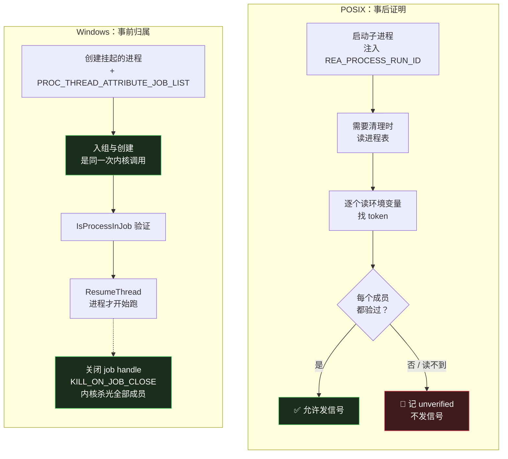

# Windows 原生扩展：把「事后证明」换成「事前归属」

> 基于 [REA (morluto/rea)](https://github.com/morluto/rea) 源码分析。v6.4.0，commit `edf4624`。
> 系列：REA 源码阅读（13/15）。

## 一句话概括

`src/` 有 231,301 行 TypeScript。**全仓唯一的 C++ 在 `native/windows/`——1,326 行，只做三件事**：

1. 路径准入（NTFS，逐组件打开）
2. 私有目录权限（protected DACL）
3. **进程归属（Job Object）**

**为什么这三件事值得写 C++？** 因为 Node.js 做不了——**而做不了的不是「功能」，是「保证」。**

## 生活比喻：名单核对 vs 门禁手环

回到[第 3 篇](03-process-ownership.md)那个问题：**「这个进程还是我启动的那个吗？」**

两个操作系统给了**两种截然不同的答案**：

| | POSIX（macOS/Linux） | Windows |
|---|---------------------|---------|
| **机制** | 环境变量 token + 事后枚举进程表 | **Job Object** |
| **怎么判定** | 逐个读进程的环境，找我的 token | 内核维护成员列表 |
| **什么时候成立** | **事后**——启动之后我再去查 | **创建那一刻** |
| **有窗口期吗** | **有**——从启动到验证之间 | **没有**（创建即入组） |
| **读不到怎么办** | 只能记「未验证」 | 不存在这个情况 |

打个比方：

**POSIX 的做法**是——客人走了以后，保安拿着名单和照片，**一个一个核对「刚才进来的是不是他」**。

问题在于：人可能已经走了、换了衣服、或者照片拍得不清楚。**保安只能说「我没核对上」，不能说「他没来过」。**（这正是第 3 篇那个 `unavailable` 状态的来历。）

**Windows 的做法**是——**进门就戴上不可摘的手环，绑死在这个房间上。**

**手环是内核发的，不是保安记的。** 房间锁了，里面的人全部清场——**不需要核对名单。**



**关键差别在左上角那一步和右下角那一步**：

- POSIX：**先启动，后验证**——中间有个窗口
- Windows：**创建即入组，验证后才放行**——没有窗口

## 优秀代码一：配置 → 读回 → 原子归属 → 验证后放行

### 源码

**第一步：创建 job，写策略，然后立刻读回来逐位比对。**

```cpp
// native/windows/src/process.cc:24-41
static Handle createJob(ULONGLONG memoryLimit = 0) {
  Handle job(CreateJobObjectW(nullptr, nullptr));
  require(job.valid(), "Create owned Job Object failed");
  const DWORD flags = JOB_OBJECT_LIMIT_KILL_ON_JOB_CLOSE | (memoryLimit != 0 ? JOB_OBJECT_LIMIT_JOB_MEMORY : 0);
  JOBOBJECT_EXTENDED_LIMIT_INFORMATION policy{};
  policy.BasicLimitInformation.LimitFlags = flags;
  policy.JobMemoryLimit = static_cast<SIZE_T>(memoryLimit);
  require(SetInformationJobObject(job.get(), JobObjectExtendedLimitInformation, &policy, sizeof(policy)),
          "Apply kill-on-owner-close Job Object policy failed");
  JOBOBJECT_EXTENDED_LIMIT_INFORMATION actual{};
  require(QueryInformationJobObject(job.get(), JobObjectExtendedLimitInformation, &actual, sizeof(actual), nullptr),
          "Read Job Object policy failed");
  require(actual.BasicLimitInformation.LimitFlags == flags,
          "Job Object policy permits unexpected breakaway", L"", ERROR_ACCESS_DENIED);
  require(memoryLimit == 0 || static_cast<ULONGLONG>(actual.JobMemoryLimit) == memoryLimit,
          "Job Object memory limit was not applied exactly", L"", ERROR_INVALID_PARAMETER);
  return job;
}
```

**第二步：入组与创建是同一次内核调用。**

```cpp
// process.cc:101-105
Attributes attributes(2);
HANDLE job = result->job.get();
attributes.add(PROC_THREAD_ATTRIBUTE_JOB_LIST, &job, sizeof(job));
```

（进程用 `CREATE_SUSPENDED | EXTENDED_STARTUPINFO_PRESENT` 创建——**先挂起**。）

**第三步：恢复之前验证成员资格，不通过就杀。**

```cpp
// process.cc:179-185
BOOL assigned = FALSE;
if (!IsProcessInJob(result->process.get(), result->job.get(), &assigned) || !assigned) {
  TerminateJobObject(result->job.get(), 1);
  throw Failure("Suspended process has no owned Job Object membership", command, ERROR_ACCESS_DENIED);
}
require(ResumeThread(thread.get()) != MAXDWORD, "Resume job-owned process failed", command);
return result;
```

### 好在哪

**三步各防一件事，缺一不可。**

**① 写策略后立刻读回比对——防的是「策略被静默改写」。**

```cpp
require(actual.BasicLimitInformation.LimitFlags == flags,
        "Job Object policy permits unexpected breakaway", L"", ERROR_ACCESS_DENIED);
```

**`JOB_OBJECT_LIMIT_BREAKAWAY_OK` 是一个能让子进程逃离 job 的标志。**

如果它被意外打开（比如某个继承来的模板、某次 API 行为变化），**整个所有权机制就失效了**——被拥有的进程能自己跑掉。

所以代码在写完策略后**马上 `QueryInformationJobObject` 读回来**，**逐位比对**。

**不一致时用的错误码是 `ERROR_ACCESS_DENIED`——把「允许了不该允许的」当安全事件，不是配置错误。**

**这个分类很重要**：它决定了这个失败会被当成 bug 修，还是被当成漏洞处理。

注意连内存上限也比了（`process.cc:38-39`）：`Job Object memory limit was not applied exactly`——**「大致应用上了」不算通过。**

**② 原子归属——防的是「子进程先跑一段再被纳管」。**

**如果用「先 CreateProcess，再 AssignProcessToJobObject」，中间有一个窗口**：

```
CreateProcess → [窗口期：子进程已经在跑，还没入组] → AssignProcessToJobObject
```

**在窗口期里，子进程可以 fork 出逃逸的后代、可以自己退出。**

而 `PROC_THREAD_ATTRIBUTE_JOB_LIST` 把入组变成 `CreateProcess` 的**一个属性**——**创建和入组是同一次内核操作。**

配合 `CREATE_SUSPENDED`，进程被创建出来时**是挂起的**——**它一纳秒都没跑过，但已经属于这个 job 了。**

**③ 恢复前验证——防的是「属性没生效却继续」。**

```cpp
if (!IsProcessInJob(...) || !assigned) {
  TerminateJobObject(result->job.get(), 1);    // ← 直接用最狠的动词
  throw Failure(...);
}
```

**注意失败时调用的是 `TerminateJobObject`，不是「忽略」或「重试」。**

**因为此时进程已经存在于系统里，但归属关系不明确。** 继续下去就是让一个不受控的进程跑起来——**宁可杀掉，不能放行。**

### 关于「不用 PID」

`process.cc:405-407` 的注释直白：

```cpp
if (operation == L"process_close") {
  // Closing the job is the crash-safe authority; no PID enumeration is used.
  process.job.reset(); process.process.reset(); process.stdoutRead.reset(); ...
```

**「关闭 job 就是崩溃安全的权威；不使用任何 PID 枚举。」**

而 `KILL_ON_JOB_CLOSE` 的效果是：

> **持有 job handle 的进程崩溃了 → 内核自动关闭句柄 → job 里所有进程被杀。**

**这是「崩溃安全」的含义**——不需要在启动时写一个"如果我不在了记得清理"的逻辑，**内核帮你兜底。**

**POSIX 上没有对应物。** 你的进程被 kill -9，它启动的子进程就成了孤儿。

### 判定成员是否清理完：不数 PID，读内核

```cpp
// process.cc:204-209（概述）
QueryInformationJobObject(..., JobObjectBasicAccountingInformation, ...)
// → ActiveProcesses
```

TS 侧要求 `activeProcesses === 0` **且输出耗尽**才释放（`WindowsOwnedProcess.ts:284-291`）。

**同样是「不问名单，问内核」。**

### 模式

**configure-then-readback-verify** + **atomic assignment before the resource can act** + **fail-closed with the strongest verb**。

### 骨架代码

```cpp
// 1) 创建 + 写策略 + 读回精确比对
Handle job(CreateJobObjectW(nullptr, nullptr));
policy.BasicLimitInformation.LimitFlags = REQUIRED_FLAGS;    // 只放必须的，不多一个
SetInformationJobObject(job, JobObjectExtendedLimitInformation, &policy, sizeof(policy));
QueryInformationJobObject(job, ..., &actual, ...);
require(actual.LimitFlags == REQUIRED_FLAGS, "policy drift", ERROR_ACCESS_DENIED);

// 2) 挂起创建 + 原子入组
Attributes attributes(1);
attributes.add(PROC_THREAD_ATTRIBUTE_JOB_LIST, &job, sizeof(job));
CreateProcessW(..., CREATE_SUSPENDED | EXTENDED_STARTUPINFO_PRESENT, ..., &startup.StartupInfo, ...);

// 3) 验证成员资格，通过了才让它跑
if (!IsProcessInJob(process, job, &assigned) || !assigned) {
  TerminateJobObject(job, 1);
  throw Failure(...);
}
ResumeThread(thread);
```

**判断标准**：任何「我创建了资源，之后要操作它」的场景——**问一句：从创建到我能控制它，中间有没有窗口？** 有的话，能不能把「控制」变成创建的**属性**？

## 优秀代码二：穷举式验证的安全描述符

### 源码

**构造：**

```cpp
// native/windows/src/filesystem.cc:124-153（节选）
acl.resize(sizeof(ACL) + 2 * (sizeof(ACCESS_ALLOWED_ACE) - sizeof(DWORD)) + GetLengthSid(userSid()) + systemSize);
auto access = reinterpret_cast<PACL>(acl.data());
require(InitializeAcl(access, acl.size(), ACL_REVISION), "Initialize private DACL failed");
for (PSID sid : {userSid(), static_cast<PSID>(system.data())})
  require(AddAccessAllowedAceEx(access, ACL_REVISION, OBJECT_INHERIT_ACE | CONTAINER_INHERIT_ACE,
                               FILE_ALL_ACCESS, sid), "Populate private DACL failed");
require(InitializeSecurityDescriptor(&descriptor, SECURITY_DESCRIPTOR_REVISION) &&
        SetSecurityDescriptorOwner(&descriptor, userSid(), FALSE) &&
        SetSecurityDescriptorDacl(&descriptor, TRUE, access, FALSE) &&
        SetSecurityDescriptorControl(&descriptor, SE_DACL_PROTECTED, SE_DACL_PROTECTED),
        "Create protected security descriptor failed");
```

**验证（按句柄读回真实对象）：**

```cpp
// filesystem.cc:195-209
require(acl->AceCount == 2, "Private DACL contains unexpected trustees", path, ERROR_ACCESS_DENIED);
bool user = false, system = false;
for (DWORD index = 0; index < acl->AceCount; ++index) {
  void* rawAce;
  require(GetAce(acl, index, &rawAce), "Read private DACL entry failed", path);
  const auto ace = static_cast<ACCESS_ALLOWED_ACE*>(rawAce);
  require(ace->Header.AceType == ACCESS_ALLOWED_ACE_TYPE && ace->Mask == FILE_ALL_ACCESS &&
          (ace->Header.AceFlags & INHERIT_ONLY_ACE) == 0 &&
          (!root || (ace->Header.AceFlags & (OBJECT_INHERIT_ACE | CONTAINER_INHERIT_ACE)) ==
                    (OBJECT_INHERIT_ACE | CONTAINER_INHERIT_ACE)),
          "Private DACL contains unsupported rights or ACE type", path, ERROR_ACCESS_DENIED);
  PSID sid = const_cast<DWORD*>(&ace->SidStart);
  if (EqualSid(sid, expected.userSid())) user = true;
  else if (EqualSid(sid, expected.system.data())) system = true;
  else throw Failure("Private DACL permits an unrelated principal", path, ERROR_ACCESS_DENIED);
}
```

### 好在哪

**① 安全描述符在创建时安装，不是「先建后改」。**

通过 `NtCreateFile` 的 `OBJECT_ATTRIBUTES` 传进去，**而且路径是相对于已准入的父 handle**——**路径不再被二次解析。**

**「先建后改」有一个权限窗口**：文件建出来了、权限还没设好，这段时间里别的进程能读到它。

**而它是相对父 handle 创建的**——这意味着中间没有任何一处会重新解析路径字符串（防符号链接/重定向攻击）。

**② 验证是按句柄读回真实对象。**

```cpp
GetSecurityInfo(handle, ...)   // 读的是磁盘上对象的实际 ACL
```

**不是相信刚才传进去的参数。**

**「创建者不自动可信」**——这是整个验证逻辑的前提。

**③ 验证是穷举拒绝，不是白名单检查。**

这一条是全文最值得抄的地方。对比两种写法：

```cpp
// ❌ 常见写法：检查「我期望的那两项在不在」
if (hasAceFor(user) && hasAceFor(system)) return OK;
// 问题：多出来一项不会有任何反应
```

```cpp
// ✅ REA 的写法：数量必须正好 2，且每一项都必须合法
require(acl->AceCount == 2, ...);
for (每个 ACE) {
  require(类型是 ACCESS_ALLOWED && 掩码是 FILE_ALL_ACCESS && 无 INHERIT_ONLY, ...);
  if (是当前用户) user = true;
  else if (是 SYSTEM) system = true;
  else throw Failure("Private DACL permits an unrelated principal", ...);   // ← 陌生 SID 直接硬失败
}
```

**差别在于：白名单检查问「该在的在不在」，穷举检查问「不该在的在不在」。**

**只有后者能防住「多了一个」。**

**而且注意那个 `throw` 的位置**——它认识两个 SID，**第三个出现的任何东西都是错误**。不是 warning，不是跳过，是 `ERROR_ACCESS_DENIED`。

**④ 每一项的属性也全查。**

```cpp
ace->Mask == FILE_ALL_ACCESS              // 权限不能少
(ace->Header.AceFlags & INHERIT_ONLY_ACE) == 0   // 不能是「仅继承」（不生效的项）
(!root || 继承位齐全)                      // 根目录必须可继承
```

**`INHERIT_ONLY_ACE` 那一条很细**：一个「仅继承」的 ACE 对它所在的对象本身不生效——**如果它出现在这里，说明这个 ACE 是无效的，但检查 name 和权限时会通过。**

**⑤ 每次打开私有对象都验。**

`verifyPrivate` 在 `filesystem.cc` 里被调用 **8 次**（`:229, 267, 273, 277, 286, 290, 326, 552`）——**不是只在创建时验一次。**

**因为权限可能在之后被改**（管理员操作、策略变更、恶意进程）。

### 保护的是什么

`runtime_create` 生成一个私有运行时根（目录名带 128 位 `BCryptGenRandom` 随机数），其下存放：

`docs/windows-ghidra-p0.md:132-136`：

> Runtime creation installs a protected DACL permitting exactly the current user and SYSTEM. Readback checks the actual owner and ACEs by handle.
>
> The random 256-bit bearer token stays in the private, immutable session descriptor and is **redacted from diagnostic output**.

**翻译**：运行时创建时安装一个 protected DACL，**恰好**允许当前用户和 SYSTEM。读回时按句柄检查实际的属主和 ACE。

随机的 256 位 bearer token 保存在私有的、不可变的会话描述符中，**并从诊断输出中脱敏。**

**所以保护的对象是**：bearer token 描述符、源文件快照、Ghidra 的 `JDK_JAVA_OPTIONS` / `APPDATA`——**不让同机其他用户读到。**

**⑥ 但那句 `not a sandbox` 必须说。**

`README.md:135-136` 原文：

> these controls are **not a sandbox** for the Ghidra engine or other processes using the same user.

**「这些控制不是沙箱」**——同一用户下的其他进程仍然可以做很多事。

**和第 11 篇那个 `prior_activity_available` 一样：明确说出防线的边界在哪。**

### 模式

**install-at-creation** + **verify-by-readback** + **allowlist-by-exhaustion**。

### 骨架代码

```
build Security {
  owner = currentUserSid
  acl   = [ALLOW(currentUser, FULL, CONTAINER|OBJECT_INHERIT),
           ALLOW(LocalSystem, FULL, CONTAINER|OBJECT_INHERIT)]
  sd    = { owner, dacl present, SE_DACL_PROTECTED }   // ← 挡住父目录继承
}
create object relative to admitted parent handle with that descriptor   // 不重新解析路径

verify:
  GetSecurityInfo(handle, OWNER|DACL)
  require owner == currentUser
  require dacl present && (!isRoot || protected)
  require AceCount == expected                      // ← 数量精确
  for each ace:
    require type/mask/inherit-flags legal
    require sid ∈ {currentUser, LocalSystem}        // ← 陌生即硬失败
  require both principals seen
```

**判断标准**：**你的权限检查是「该有的在不在」还是「不该有的在不在」？** 前者会被「多了一项」绕过，后者不会。

## 这层 C++ 怎么和 TypeScript 接

### 只有一个导出

```cpp
// native/windows/src/addon.cc:145-155（节选）
if (napi_create_function(env, "call", NAPI_AUTO_LENGTH, call, data, &function) != napi_ok) return nullptr;
if (napi_set_named_property(env, exports, "call", function) != napi_ok) return nullptr;
```

```cpp
// addon.cc:159
NAPI_MODULE(NODE_GYP_MODULE_NAME, rea::initialize)
```

**`exports.call(operation, args)`——一个函数，操作名分派。**

```
inspect          → inspect()
process_*        → processCall()
其余             → filesystemCall()
```

### 不透明句柄：路径字符串拿不到权限

```cpp
// addon.cc:56-71（概述）
napi_type_tag_object(..., &RESOURCE_TAG)   // 打类型标签
napi_wrap                                  // 携带 finalizer
// 取回时
napi_check_object_type_tag(...)
require(tagged, "Native handle does not belong to REA", ...)
// 再校验 kind 与 closed
```

**TS 侧只把它当 `z.custom<object>`**（`WindowsNativeLoader.ts:11-14`）。

**也就是说：TypeScript 拿到的是一个不透明的对象。** 你没法：

- 伪造一个（类型标签对不上）
- 传一个路径字符串冒充（那根本不是这个类型）
- 反序列化一个出来（finalizer 和 tag 是进程内的）

**「句柄即授权」这个语义，就落在这 16 行上。**

### 加载要过五道检查

`src/windows/WindowsNativeLoader.ts`：

| 顺序 | 检查 |
|:---:|------|
| 1 | 平台/架构门（`:92-96`） |
| 2 | manifest schema + 包版本一致（`:98-100`） |
| 3 | `process.versions.napi >= 8`（`:101-103`） |
| 4 | **读文件算 SHA-256 与 manifest 比对**（`:104-111`） |
| 5 | **手工解析 PE**：`MZ` / `PE\0\0` / machine `0x8664` / magic `0x20b`（`:134-145`） |

**任何一步失败都不加载。**

而 README 里有一句硬规定：

> **There is no environment override for loading an arbitrary native module.**
>
> **没有任何环境变量可以覆盖，用来加载任意的原生模块。**

**这是对的**——一个「可以用环境变量指定 .node 路径」的加载器，等于给了攻击者一个任意代码执行入口。

### 加载后还要自检

```typescript
// WindowsNativeLoader.ts:113-125（概述）
const observed = binding.call("inspect", []);
inspectionSchema.parse(observed);
// privateDacl: z.literal(true)
// atomicJobAssignment: z.literal(true)
// killOnOwnerClose: z.literal(true)
```

**`z.literal(true)`——不是 `true` 就不算可用。**

**「我加载成功了」不等于「它按预期工作」。** 所以加载完立刻让原生层报告它的能力，**每一项都必须是肯定的 `true`。**

### 没有 stub，只有「类型化不可用」

**全仓 `grep stub` 在 native/scripts 下无命中。**

非 win32 / 非 x64 直接返回：

```typescript
{ available: false, reason: "REA Windows native controls require a Windows x64 host." }
```

而 `src/process/WindowsAuthority.ts` 用三态表达：

```typescript
proof: "native-authority" | "not-proven" | "not-applicable"
```

| 情况 | proof |
|------|-------|
| 非 Windows 主机 | `not-applicable` |
| Windows 但没加载成功 | `not-proven` |
| Windows 且三项自检全绿 | `native-authority` |

**注释里还有一句关键的话**（`WindowsAuthority.ts:27-30`）：

> Describe native Windows controls **without inferring them from taskkill, chmod, symlink creation, or a numeric POSIX open flag.**

**中文**：描述 Windows 原生控制时，**不要从 `taskkill`、`chmod`、创建符号链接、或 POSIX 的打开标志位去推断它们。**

**这是防「用相似的东西冒充」**——`taskkill /t` 能杀进程树，**但它的语义和 Job Object 所有权完全不同**（第 3 篇引用过那段 P0 降级声明）。

**在能力报告里把它们混为一谈，就是在撒谎。**

## 构建：不用 node-gyp

`scripts/build-windows-native.mjs`：

```javascript
// :37-40
if (process.platform !== "linux")
  throw new Error("The Windows x64 artifact build lane currently requires Linux and MinGW-w64.");
```

**在 Linux 上交叉编译 Windows 的 `.node`。**

而 **Node 头文件固定到 `22.19.0`，从官方发布下载并校验 SHASUMS256**（`:62-74`，失败信息 `Node build prerequisite SHA-256 mismatch`）。

**为什么不用 node-gyp？** 看那段：

```javascript
// :90-115（注释原文）
// MSVC short-import libraries do not produce a correct Node import table with GNU ld.
```

**MSVC 的短导入库在 GNU ld 下产不出正确的 Node 导入表。**

所以它从三个 `.cc` 源码里**正则抽取 `napi_*` 符号**，生成 `.def`，再用 `x86_64-w64-mingw32-dlltool` 造 GNU 延迟导入库。

**这解释了 `addon.cc:164-169` 那个「延迟导入宿主解析」**——把 N-API 符号解析到 `GetModuleHandleW(nullptr)`（宿主可执行文件），**这样同一个 `.node` 在 Node.js 和 Bun 下都能加载**（因为两者都导出 N-API 符号，但文件名不同）。

```cpp
// addon.cc:164-169（注释原文）
// Resolve them against the host executable so Node.js, Bun, and other Node-API
// hosts load the addon regardless of their executable file name.
```

## 代价

### ① 唯一一处需要交叉编译的代码

**CI 上要有 Linux + MinGW-w64**（`ci.yml:305-307`），发布流水线要复现同一 lane。

而真机验证在 Windows runner 上（`ci.yml:513`）——**两条不同的流水线。**

**改一行 C++，要跑通「Linux 交叉编译 → Windows 真机验证」这条链。**

### ② 1,326 行 C++ 的维护成本

仓库里其余 23 万行是 TypeScript。**这一小撮 C++ 需要不同的工具链、不同的调试器、不同的知识。**

**而它是唯一一处内存安全问题可能出现的代码。**（虽然用了 RAII 的 `Handle` 包装——`authority.hpp:51-68`，move-only，析构即 `CloseHandle`。）

### ③ 平台能力不对称

| 能力 | Windows | POSIX |
|------|---------|-------|
| 进程归属 | **内核强保证**（Job Object） | 事后证明，有不可验证集 |
| 目录权限 | protected DACL（安装时） | `chmod`（**先建后改**，有窗口） |
| 路径准入 | 逐组件 `OPEN_REPARSE_POINT` handle | 无对应机制 |

**于是同一个抽象（"私有运行时根"、"被拥有的进程"）在两个平台上的保证强度不同。**

**上层代码要能表达这个差异**——`proof: "native-authority" | "not-proven" | "not-applicable"` 就是为此存在的。

### ④ 「没有环境变量覆盖」也意味着没有灵活性

想测试一个自己编译的 `.node`？**只能放到固定路径**，`../../native/windows/build/rea-windows-x64.node`。

**安全性和可调试性在这里是直接冲突的**，REA 选了前者。

（缓解方式是 `--inspection-fixture` 分支——构建时把 `filesystem.cc` 换成故障注入版，`:128-130`。）

## 总结

| 结论 | 说明 |
|------|------|
| **全部价值** | 把「事后证明」换成「事前归属」 |
| **Job Object** | 匿名、不可继承、`KILL_ON_JOB_CLOSE` |
| **原子归属** | `PROC_THREAD_ATTRIBUTE_JOB_LIST` + `CREATE_SUSPENDED`——**创建即入组，无窗口** |
| **验证后放行** | `IsProcessInJob` 不通过 → `TerminateJobObject`，不重试不忽略 |
| **策略要读回** | 逐位比对 flags；**`BREAKAWAY_OK` 意外打开 = 所有权失效** |
| **DACL 穷举验证** | 数量必须正好、陌生 SID **硬失败**——防「多了一项」 |
| **不透明句柄** | 类型标签 + finalizer；**路径字符串拿不到权限** |
| **无环境变量覆盖** | 加载路径固定；能力靠 SHA-256 + PE 头 + 自检三重确认 |
| **不推断能力** | **不从 `taskkill` 推断 Job Object 所有权** |
| **明说边界** | `these controls are not a sandbox` |

**一句话**：这 1,326 行 C++ 换来的是一个**性质上的升级**——

**POSIX 上，「这个进程是我的」是一个需要不断重新证明的断言，而且存在证明不了的角落。**

**Windows 上，「这个进程是我的」在它被创建的那一刻就已经是事实了，而且内核替你记着，直到你放手或者崩溃。**

**前者需要 1,000 行 TS 和 4 万行测试来维持；后者需要 1,326 行 C++。**

而那种把「保证」从「运行时努力」变成「创建时属性」的思路，**比这段代码本身更值得带走**——

**每当你写下「创建资源，然后再给它加上某某属性」，都该问一句：中间那个窗口，谁能钻进去？**

---

**下一篇**：[Agent 评估](14-agent-evaluation.md)——逆向任务没有标准答案，那怎么评一个 agent 干得好不好。
