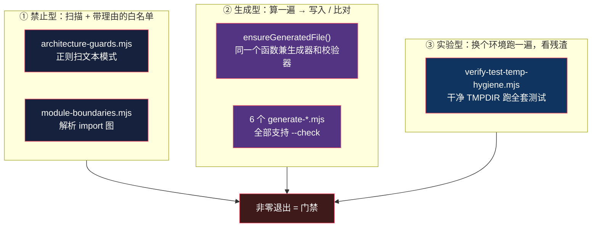

# 规格文档即约束：写在墙上的规矩和装成门禁的规矩

> 基于 [REA (morluto/rea)](https://github.com/morluto/rea) 源码分析。v6.4.0，commit `edf4624`。
> 系列：REA 源码阅读（15/15）。收官篇。

## 一句话概括

REA 根目录有一个 **6.8KB 的 `AGENTS.md`**，里面是几十条「仓库不变量」。

**但真正让这些不变量成立的，不是那个文件。**

而是：**每一条都能指到 `package.json` 里的一个命令，那个命令会失败。**

## 生活比喻：写下来的规矩 vs 装上的门禁

一栋楼可以有两种方式管「不许抽烟」：

| | 写在墙上 | 装成门禁 |
|---|---------|---------|
| **形式** | 告示牌 | 烟雾联动，检测到就断电 |
| **靠什么生效** | 人的自觉 | **机制** |
| **半年后** | 有人在楼道抽，没人管 | 还在生效 |

**软件工程里的「架构约定」绝大多数是第一种。**

「domain 层不要依赖框架」写进文档，然后**第一个赶 deadline 的人就破坏了它**——而且**破坏了不会有任何反应**。

REA 的选择是：**每一条都装成门禁。**

## 映射表：约定 → 脚本 → 接线点

这张表是整个仓库最值得看的东西：

| 约定（AGENTS.md 原文） | 执行脚本 | 接在哪 |
|----------------------|---------|--------|
| `Dependencies flow inward` | `verify-module-boundaries.mjs`<br/>+ `lib/module-boundaries.mjs` | **挂在 `lint` 里**（`package.json:119`） |
| `Normalize once at the owning boundary` | `verify/architecture-guards.mjs` | `check` / `check:ci` |
| `model expected failures with … Result` | `generate-error-schema.mjs --check` | `docs:check:built` |
| `Validate advertised JSON Schemas after SDK conversion` | `generate-mcp-tool-catalog.mjs`<br/>（内部用 Ajv 验） | `mcp-catalog:check:built` |
| `Configuration changes must be additive and idempotent` | `verify-linux-setup-e2e.mjs`<br/>`verify-package-setup.mjs` | `verify:setup:linux` / `verify:package` |
| `Remove superseded representations` | `.jscpd.json`（重复率 3%）<br/>`knip.json`（`duplicates: error`） | `check:pr` / `check:ci` |
| `Retain ownership of resources whose cleanup failed` | `lib/real-hopper-cleanup.mjs` | `verify:hopper*` 族 |
| 测试卫生（CONTRIBUTING.md） | `verify-test-temp-hygiene.mjs` | 独立门 |
| `Run verify:test-discovery after adding or moving tests` | `verify-test-discovery.mjs` | CI `ci.yml:96` |
| **工程债零容忍** | `scan-todos.mjs` | `check:pr` / `check:ci` |

**最后一行没有「AGENTS.md 原文」——因为那条规则只存在于脚本里。**

## 三类固化手法



**第 ③ 类最有意思，也最少见。**

## 优秀代码一：一个函数同时当生成器和校验器

### 源码

```javascript
// scripts/lib/generated-file.mjs:17-40
export const ensureGeneratedFile = async ({
  path,
  source,
  check,
  generateCommand,
}) => {
  let existing;
  try {
    existing = await readFile(path, "utf8");
  } catch (cause) {
    if (!isMissing(cause)) throw cause;
  }
  if (
    existing !== undefined &&
    normalizeLineEndings(existing) === normalizeLineEndings(source)
  )
    return { changed: false };
  if (check)
    throw new Error(
      `${path} is missing or stale. Run \`${generateCommand}\` to regenerate it; commit the result if the file is tracked.`,
    );
  await writeFile(path, preserveLineEndings(source, existing), "utf8");
  return { changed: true };
};
```

### 好在哪

**① 生成逻辑和校验逻辑在物理上不可能漂移。**

```javascript
if (check) throw new Error(...);
await writeFile(path, ...);
```

**同一个 `source` 计算，`check` 只切换「写」还是「抛」。**

**为什么这很重要？**

常见的做法是两个脚本：

```
scripts/generate-x.mjs    # 生成
scripts/verify-x.mjs      # 检查生成物是不是最新的
```

**然后它们的算法慢慢分叉**——生成器改了格式，校验器没跟上。**于是校验器永远报「不一致」，或者更糟：永远报「一致」。**

**REA 把它们合并了。** 这不是省代码，是**消除了一类 bug 的生存空间**。

**② 错误信息是可执行的。**

```
docs/error-contract.schema.json is missing or stale.
Run `npm run docs:generate` to regenerate it; commit the result if the file is tracked.
```

**三件事一次说清**：哪个文件、怎么修、**要不要提交**。

**最后那半句 `if the file is tracked` 是个聪明的设计**——见下文「两种所有权策略」。

**③ 跨平台边角全收在一个 40 行助手里。**

| 处理 | 行 | 防什么 |
|------|---|--------|
| `normalizeLineEndings` 比对 | `:9` | Windows 检出后换行符不同导致误报「不一致」 |
| `preserveLineEndings` 写入 | `:11-14` | 写回时改变原有换行风格 |
| 区分 ENOENT 和真读错误 | `:23-28` | 「文件不存在」和「读不了」是两件事 |

**六个调用点因此零负担。**

### 两种所有权策略，同一个内核

REA 的 6 个生成物里，**两种处理方式并存**：

| 生成物 | 提交进仓库？ | `--check` 校验的是什么 |
|--------|:---:|---------------------|
| `src/generatedPackageMetadata.ts` | ✅ 是 | 「提交物新不新」 |
| `docs/error-contract.schema.json` | ✅ 是 | 同上 |
| `docs/public/product-catalog.json` | ❌ 否（`.gitignore`） | **「生成管线在干净环境下可复现」** |
| `skills/reverse-engineer-anything/**` | ❌ 否 | 同上 |
| `docs/verification/managed-conformance-*.json` | ❌ 否 | 同上 |
| `.cache/mcp-tool-catalog.json` | ❌ 否 | 同上 |

**为什么会有两种？**

`.gitignore:65-66` 把立场写成了原文：

```
# Derived catalogs, portable conformance projections, and packaged skill bundles
# (regenerated by `npm run docs:generate`; never commit)
```

**「派生的大文件不塞进 git 历史。」**

而**必须提交的那两个**，理由在 `turbo.json`：

```json
"compile": { "dependsOn": ["metadata:check"] }
```

**`generatedPackageMetadata.ts` 被 `src/` 的编译直接消费**——**裸克隆 `npm ci && npm run build` 必须不用先跑生成器就能编译。**

**所以「提交与否」是部署约束决定的，而校验逻辑完全相同。**

**这就是 `if the file is tracked` 那半句话的来由——同一个内核服务两种策略。**

### 模式

**生成即校验（generate-as-verify）**——一个计算，两种出口。

### 骨架代码

```javascript
// 你的项目中：任何「派生文件不许手改」的场景
const ensureGeneratedFile = async ({ path, source, check, generateCommand }) => {
  let existing;
  try { existing = await readFile(path, "utf8"); }
  catch (cause) { if (cause.code !== "ENOENT") throw cause; }   // 区分不存在 vs 读不了

  if (existing !== undefined && normalize(existing) === normalize(source))
    return { changed: false };                                   // 已是最新

  if (check)                                                     // ← 唯一的开关
    throw new Error(`${path} is stale. Run \`${generateCommand}\`; commit the result if the file is tracked.`);

  await writeFile(path, source, "utf8");
  return { changed: true };
};
```

**判断标准**：**你有几个「生成器 + 校验器」对？** 只要有第二对，就该问——它们的算法会不会分叉？

## 优秀代码二：声明式护栏表 + 带理由的白名单

### 源码

```javascript
// scripts/verify/architecture-guards.mjs:51-76
const failures = [];
const check = (label, selected, pattern, allow = []) => {
  const offenders = selected.filter(
    (file) => pattern.test(file.content) && !allow.includes(file.path),
  );
  if (offenders.length > 0)
    failures.push(
      `${label}:\n${offenders.map((file) => `  ${file.path}`).join("\n")}`,
    );
};

check(
  "src/domain uses localeCompare (use compareUnicodeCodePoints)",
  inDir("src/domain/"),
  /\.localeCompare\(/,
);

check(
  "NUL-joined list key (use compositeKey)",
  files,
  /\.join\(["']\\0["']\)/,
  [
    // Sorted pair of constrained trace IDs; documented in plan.
    "src/domain/process/processTraceSpecification.ts",
  ],
);
```

### 好在哪

**① 一条护栏 = 一行。**

```javascript
check(label, 选择器, 正则, 例外表)
```

**`label` 不是「哪里错了」，是「**该改成什么**」**：

```
"src/domain uses localeCompare (use compareUnicodeCodePoints)"
                            ~~~~~~~~~~~~~~~~~~~~~~~~~~~~~~~
```

**看报错的人立刻知道下一步做什么。**

**② 例外即批准记录。**

```javascript
[
  // Sorted pair of constrained trace IDs; documented in plan.
  "src/domain/process/processTraceSpecification.ts",
],
```

**白名单项必须和它的理由注释同生共死。**

**这条纪律把「特例」从潜规则变成了可 review 的代码**——你在 PR 里加一个白名单项，reviewer 会看到你写了什么理由。

**第 5 条护栏（backtick-`\0` 键）甚至写了审计日期和准入条件**（`:92-96`）：

```javascript
// Fixed-arity backtick keys audited 2026-10-10: every prefix field is NUL-free
// (hex digests, file paths, enums, numbers, or compositeKey JSON which escapes
// NUL), with free-form source strings only in final position. New backtick-\0
// keys must either meet that shape (and extend this list with justification)
// or use compositeKey.
```

**中文**：反引号 `\0` 键于 **2026-10-10 审计**：每个前缀字段都不含 NUL（十六进制摘要、文件路径、枚举、数字、或会转义 NUL 的 `compositeKey` JSON），自由格式的源字符串只允许在最后位置。**新的反引号 `\0` 键要么满足这个形状（并带理由扩展此列表），要么用 `compositeKey`。**

**这已经是一份规格了**——不是一个「允许列表」，是**「允许的充分条件」**。

**③ 先剥注释再匹配。**

```javascript
// :35-40 stripComments
```

**否则讨论护栏的注释本身会触发护栏。**

**这个细节说明作者踩过这个坑**——你在一个文件里写「我们不用 `localeCompare`」，然后检查器报了你自己。

### 和 `verify-module-boundaries.mjs` 的分工

| | `architecture-guards` | `verify-module-boundaries` |
|---|---|---|
| **检查手段** | **正则扫文件内容** | **解析 import 图**（`@babel/parser`） |
| **管什么** | 「话只准在一个地方说」（单一 owner） | 「依赖只准向内流」（分层规则） |
| **漏报风险** | 换行、加空格可能绕过 | **解析真实路径，绕不过** |
| **接入** | `check` / `check:ci` | **`lint`**（每次 lint 都跑） |

**两者互补**：一个管横向（依赖方向），一个管纵向（每件事只有一个实现）。

**注意「漏报风险」那一行**——正则能被格式变化绕过（`a.localeCompare(` 写成 `a\n.localeCompare(`），**而 AST 解析不会**。

**这就是为什么依赖规则用 AST、单一 owner 规则用正则**——前者是安全性质，后者是风格性质。

## 一个极端案例：规则只存在于脚本里

`scripts/scan-todos.mjs`（51 行，无依赖）：

```javascript
// :24-28
const patterns = [
  { regex: /TODO(?::\s*(.*))?$/gm, label: "TODO" },
  { regex: /FIXME(?::\s*(.*))?$/gm, label: "FIXME" },
  { regex: /HACK(?::\s*(.*))?$/gm, label: "HACK" },
];
```

```javascript
// :46-48
if (failures.length > 0) process.exitCode = 1;
```

**而全仓库（`AGENTS.md`、`CONTRIBUTING.md`、`docs/`、`.github/`）grep 不到任何「TODO 政策」的文字。**

**规则就是那三个正则。**

**当前状态：`src/` `tests/` `bridge/` 下 0 个标记。**

**这是一条「零工程债标记」的硬门**，跑在 `check:pr` 和 `check:ci` 里。

### 为什么这是个有意思的极端

**它把「约定固化成脚本」推到了尽头：文档完全不写规则，脚本成为唯一规格。**

好坏参半：

- ✅ **不可能漂移**——没有第二份文档需要同步
- ✅ **精确**——`$` 锚定 + `m` 多行模式，只有行尾注释才算；字符串里的 "TODO" 不误报
- ❌ **不可发现**——新人不知道这条规则存在，直到他的代码挂了
- ❌ **也不知道为什么**——脚本没说「为什么工程债零容忍」

**代码里那个注释倒是体现了一种经验固化**：

```javascript
// :8-9
// Native globSync is available throughout the Node versions in package.engines.
// Its exclusion option is `exclude`; `ignore` and `nodir` belong to npm glob.
```

**「Node 原生的 globSync 用 `exclude`，`ignore` 和 `nodir` 是 npm glob 的选项。」**

**这是一个只在「用错过一次」之后才会写的注释。**

## 层级：三道门，检查什么

| 命令 | 组成 | 什么时候跑 |
|------|------|-----------|
| `check:fast` | `turbo run typecheck lint` | **pre-push hook** |
| `check` | `typecheck lint format:check knip metadata:check`<br/>+ `verify:architecture-guards` | 手动/CI |
| `check:pr` | 上面 + `docs:check jscpd scan:todos` | 提交 PR 前 |
| `check:ci` | `check:pr` 的并集 + `architecture-guards` | CI Static checks job |

**注意 `check:pr` 不含 `architecture-guards`**——它在 `check` 和 `check:ci` 里，但漏在 `check:pr`。

**这可能是有意的**（PR 本地检查更快），**也可能是一次遗漏**。**代码里看不出答案。**

而 git hook 那层：

```
.husky/pre-commit  →  npx --no-install lint-staged
.husky/pre-push    →  npm run check:fast
```

**pre-push 跑 `check:fast` 而 `check:fast` 含 `lint`——而 `lint` 含依赖边界检查。**

**所以依赖规则在 push 之前就拦住了。**

## 代价

### ① 脚本本身的维护成本

**REA 的 `scripts/` 目录下有多少脚本？** 光 `verify:*` 就有 **40 多个**（`package.json` 的 scripts 里）。

**它们都是代码，都会过时，都需要维护。**

`verify-real-ghidra.mjs` 一个人就 19.9KB。

**「把约定变成脚本」不是免费的**——它是把「偶尔被人违反的约定」换成「持续维护的代码」。

### ② 有几处仍然靠记性

系列里反复出现的模式——**门禁很严，但门禁的清单本身是手工维护的**：

| 位置 | 靠记性的是什么 |
|------|--------------|
| `MIGRATED_PROVIDER_ROOTS`（[01](01-architecture.md)/[06](06-composition-root.md)） | 加新 provider 要记得加进这张表 |
| `contractPresentation.mjs` 的数组列表（[12](12-contracts-catalog.md)） | 加新 contract 文件要记得加进反转测试 |
| `toolEffects.ts` 的审计表（[12](12-contracts-catalog.md)） | 新工具要登记 effects——**这个有抛出兜底** |
| `KNOWN_ERROR_TAGS`（[04](04-error-algebra.md)） | 新错误标签要登记两处 |
| 完整性账本的 `exclude()` 调用（[11](11-browser-observation.md)） | 过滤内容要记得登记 |

**前两个是纯靠记性**——忘了不会有任何反馈。

**这是「机制化」的边界**：你能机械化的只有「你想到的那部分」。

### ③ 门禁会产生「为了过门禁」的写法

`scan-todos` 零容忍 → 有人会把 `TODO` 写成 `NOTE` 或者干脆不写注释。

**这是所有 lint 规则的共同代价。**

（REA 用「零容忍 + 只认行尾注释」把误报降到零，**但绕过仍然很容易**。）

### ④ 文档和脚本的关系不统一

有的约定两边都写（AGENTS.md 有原文 + 脚本执行），**有的只在脚本里**（scan-todos）。

**不统一本身是认知负担**——你不知道该信哪边。

### ⑤ `.oxlintrc.json` 里的规则是第三种形态

测试通道的 import 限制（[01](01-architecture.md) 提过）写在第**三**个地方：lint 配置。

**于是「约束」分散在**：AGENTS.md（散文）、`scripts/`（独立脚本）、`package.json`（接线）、`.oxlintrc.json`（lint 配置）。

**四种载体，各有各的发现路径。**

## 收束：这 15 篇的共同线索

回头看这个系列，**每一篇讲的都是同一个动作**：

> **把「判断」变成「机制」。**

| 篇 | 原本是「判断」的事 | 变成了什么 |
|:--:|------------------|-----------|
| [01](01-architecture.md) | 「这段代码该放哪层」 | 131 行依赖检查器，接在 lint 上 |
| [02](02-domain-layer.md) | 「这个依赖纯不纯」 | `PURE_LAYERS` 边界规则 |
| [04](04-error-algebra.md) | 「新增错误类型别忘了更新对外契约」 | `satisfies Record<...>` 编译期穷尽 |
| [05](05-evidence-model.md) | 「这条证据够不够消解这个未知」 | `evidenceQualifies()` 可执行闸门 |
| [06](06-composition-root.md) | 「该用哪个 provider」 | **基数决策**：≥2 就报错，不猜 |
| [09](09-testing-strategy.md) | 「测试够不够」 | 分层阈值 + **明说不能证明什么** |
| [12](12-contracts-catalog.md) | 「重排目录会不会错绑」 | 反转顺序重跑的测试 |
| [13](13-windows-native.md) | 「这个进程还是我的吗」 | **Job Object：创建即归属** |
| [14](14-agent-evaluation.md) | 「agent 干得好不好」 | 自造靶子 + 双记账判分 |
| [15](15-spec-as-constraint.md) | 「大家要遵守约定」 | **每条约定指向一个会失败的命令** |

**而每一篇也都提到了代价**——这不是「REA 做得对」的系列，是「它做了这些取舍」的系列。

### 最值得带走的三条

**① 规则要能被机器验证，否则等于没有规则。**

`catalog ordering must never select an operation or schema` 写进文档没用——**配一个反转顺序的测试才有用**。

**② 「不知道」要被建模成可以推进的对象，不是空白。**

[第 5 篇](05-evidence-model.md)的 `ResidualUnknown` 有 ID、有状态、有**验收标准**。而[第 2 篇](02-domain-layer.md)的 `not_found` 和 `unknown` 是两个不同的返回值。

**③ 明确说出「这不能证明什么」，比多说一句「已验证」值钱。**

[第 9 篇](09-testing-strategy.md)那句 `simulated providers do not establish real-provider behavior`、[第 11 篇](11-browser-observation.md)的 `complete_within_window`、[第 13 篇](13-windows-native.md)的 `these controls are not a sandbox`——**都在做同一件事。**

**因为最大的危险不是「测少了」，是「测过了但以为验证过了」。**

## 总结

| 结论 | 说明 |
|------|------|
| **AGENTS.md** | 6.8KB 的仓库不变量，**每一条都指向一个会失败的命令** |
| **三类手法** | 禁止型（扫描）、生成型（算+比对）、**实验型（换环境跑看残渣）** |
| **生成即校验** | `ensureGeneratedFile` 一个函数兼两职——**算法不可能分叉** |
| **护栏表** | 一行一条；`label` 写「该改成什么」；**白名单必须带理由注释** |
| **正则 vs AST** | 风格规则用正则，**安全性质用 AST**（正则能被格式绕过） |
| **两种所有权** | 提交与否由部署约束决定，校验逻辑相同 |
| **极端案例** | `scan-todos`：规则只存在于脚本里，文档一字不写 |
| **仍有靠记性的地方** | `MIGRATED_PROVIDER_ROOTS`、反转测试的数组列表——**忘了没反馈** |

**一句话**：这份源码最值得学的不是任何一个具体设计，是**「约定」和「执行」之间的距离被压到了零**——

**在这个仓库里，你看不到一条「应该」而没有对应「会失败」的约定。**

**而这件事的价值在于**：它把架构从「需要每个人都记得的东西」，变成了**「新人不记得也不会做错的东西」**。

**前者靠文化，后者靠机制。** 文化会随人员流动而稀释，机制不会。

---

## 系列完

**15 篇，覆盖 REA v6.4.0 的 231,301 行 TypeScript + 1,326 行 C++ + 8,426 行跨语言桥接代码。**

| 部分 | 篇 |
|------|-----|
| 架构与规则 | [01](01-architecture.md) 总览 · [02](02-domain-layer.md) 纯领域层 |
| 核心机制 | [03](03-process-ownership.md) 进程所有权 · [04](04-error-algebra.md) 错误代数 · [05](05-evidence-model.md) 证据模型 |
| 组装与适配 | [06](06-composition-root.md) 组装根 · [07](07-in-process-bridges.md) 进程内桥 · [08](08-provider-adapters.md) Provider 适配 |
| 工程体系 | [09](09-testing-strategy.md) 测试策略 · [10](10-prompt-collection.md) Prompt 全集 · [15](15-spec-as-constraint.md) 规格即约束 |
| 专项模块 | [11](11-browser-observation.md) 浏览器观测 · [12](12-contracts-catalog.md) 契约层 · [13](13-windows-native.md) Windows 原生 · [14](14-agent-evaluation.md) Agent 评估 |

**所有引用的行号、数字、代码片段都经过逐条核对。系列中标注的 5 处「实测与报告不符」均已修正——包括我自己写错的 3 处。**
