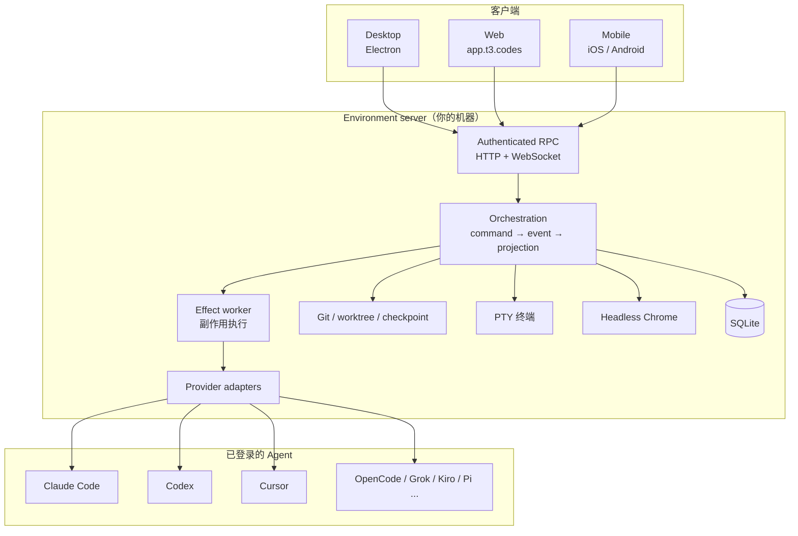
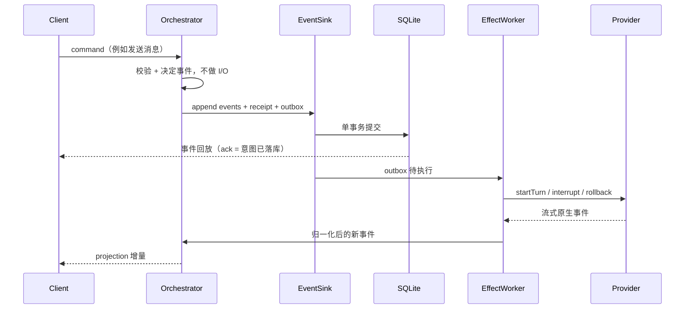
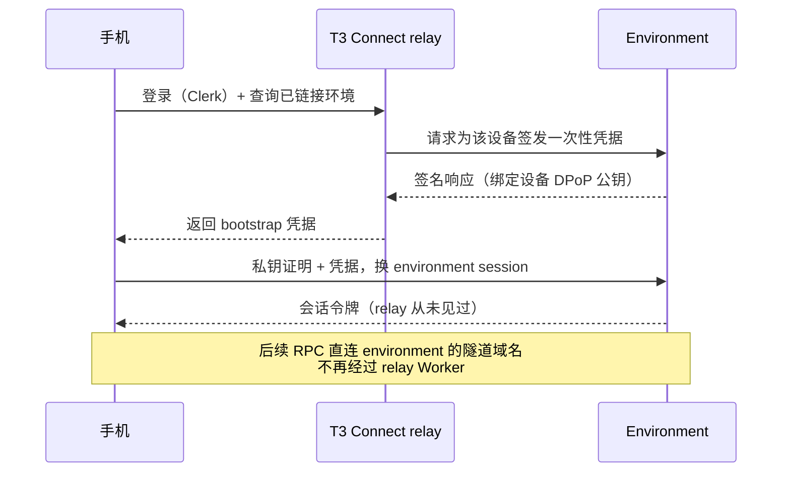

# T3 Code：给 Claude Code 和 Codex 装一个随时在线的驾驶舱

> 早上在工位给 Claude Code 开了一个线程，让它重构支付模块。中午出门吃饭，手机弹出一条审批：Codex 想在你的 VPS 上跑 `pnpm test`。你点了允许。晚上回家打开笔记本，线程已经跑完，diff 和一次 checkpoint 回滚点都在那里。
>
> 这就是 T3 Code 想卖给你的东西——不是一个新的 Agent，而是一个能让你在任何设备上接管已有 Agent 的**控制面**。

> 本文基于 T3 Code v0.1.9（2026-11-16 的 npm latest 版本），源码和文档取自同日期的 main 分支。

## 它到底是个什么东西

[T3 Code](https://github.com/pingdotgg/t3code) 的自我定位只有一句话：

> The open-source control plane for coding agents.

翻译过来：**不做新 Agent、不卖 token、不建云 IDE，只负责控制**。

它做的事情可以拆成三层：

| 层 | T3 Code 做什么 | 不做什么 |
|:---|:---------------|:---------|
| 执行层 | 在**你的机器**上启动 Claude Code、Codex、Cursor、OpenCode、Grok、Kiro、Pi 等 Agent | 不托管模型、不转卖 token |
| 控制层 | 一个 server 管理线程、worktree、终端、审批、checkpoint | 不替代 Agent 自己的工具链 |
| 接入层 | 桌面端、Web、iOS、Android 连同一个 server，看到同一批线程 | 不做云端 IDE，执行留在你的机器 |

几个硬事实（截至 2026-11-16）：

- **MIT 协议**，2026 年 2 月创建，约 6.2 万 star
- 支持 macOS、Windows、Linux 桌面端，iOS 和 Android 原生 App，以及浏览器
- 支持的 Agent 列表已经有十个：Claude Code、Codex、Cursor、OpenCode、Grok Build、Antigravity、Kiro、Pi、Muse Code、fx，再加上任何实现 ACP 协议的 Agent
- 每个线程可以选择独立的 git worktree，内置 diff 审查、commit、push、一键开 PR
- 版本号还停在 **0.1.x**，nightly 几乎每天发版

写文章时实际查到的数字：

```bash
$ npm view t3 dist-tags
{
  alpha: '0.0.2',
  latest: '0.1.9',
  preview: '0.1.10-preview.20261112.4593',
  nightly: '0.1.10-nightly.20261116.4761'
}

$ gh api repos/pingdotgg/t3code --jq '.stargazers_count'
61808

$ find apps packages -name '*.ts' -o -name '*.tsx' | grep -v node_modules | wc -l
    6565

$ wc -l apps/server/src/orchestration-v2/Orchestrator.ts
   16458 apps/server/src/orchestration-v2/Orchestrator.ts
```

一个 0.1.x 的项目拿到 6 万 star，通常意味着「概念对了，产品还在长身体」。但 6,500 个 TypeScript 文件、单文件 1.6 万行的编排器，又说明它的代码量完全不像玩具。

## 和 Superset、Orca 不是一类东西

我之前写过 [Superset](superset-guide.md) 和 [Orca](orca-guide.md)，它们经常被放在一起比较。实际上三者解决的是不同层面的问题：

| | Superset | Orca | T3 Code |
|---|---|---|---|
| 核心问题 | 多个 Agent 并行跑，文件互不干扰 | 给 Agent 做一个专用 IDE | 一个环境，所有设备随时接管 |
| 隔离单位 | git worktree | 工作区 | 环境（environment）+ 可选 worktree |
| 形态 | macOS 桌面应用 | 桌面 IDE | server + 桌面/Web/手机客户端 |
| 远程能力 | 弱 | 取决于 IDE | 一等公民：LAN / Tailscale / SSH / 内网穿透 |
| 开源协议 | Elastic License 2.0 | — | MIT |

一句话区分：

```text
Superset = 让 Agent 并行干活的调度器
Orca     = 让 Agent 干活的编辑器
T3 Code  = 让你随时能找到 Agent 的远程控制台
```

Superset 赌的是「吞吐」，T3 Code 赌的是「在场」。而 2026 年的现实是：Agent 跑得越来越久，人不可能一直坐在终端前面。**当任务从 30 秒变成 30 分钟，交互就必须从 TUI 变成 client-server 架构。**

## 架构：一个 environment，多个客户端

T3 Code 的架构文档里有一句话，基本概括了所有设计决策：

> T3 Code keeps execution in the environment that owns the workspace.

执行留在拥有工作区的那个环境里。客户端只是「视图」和「遥控器」，永远不能拿自己的文件系统、凭证或机器状态去替代环境的。



这张图里有几个关键取舍。

**为什么是 server + 客户端，而不是一个 Electron 单体？**

因为 Agent 是长生命周期的。一个线程可能跑 40 分钟，中途要审批、要回答问题、要切换模型。如果状态只存在于打开的那个窗口里，关掉就没了。把状态放在 server，客户端才可以随时来随时走——手机、浏览器、桌面看到的是同一条线程、同一个进度。

**为什么 Web 和手机共享一个 `client-runtime` 包？**

重连、会话续期、快照分页、缓存失效——这些逻辑如果每个客户端各写一套，行为一定会分叉。T3 Code 把它们抽到 `packages/client-runtime`，Web、桌面渲染进程、React Native 共用，平台层只提供存储、凭证、网络信号和生命周期事件。

**为什么客户端要处理「服务器比自己老」？**

远程 server 可能跑着旧版本，客户端可能已经升级了。所以 RPC 契约里带了能力广播（比如 `threadPullRequests`、`shellThreadFamilies`），新客户端遇到旧服务器要降级，而不是假设服务器一定理解自己的版本。这是分布式系统的老规矩，但很多本地工具根本不需要考虑。

## 编排内核：先记意图，再做副作用

T3 Code 最值得读的部分不是 UI，而是它的 orchestration 层。核心流程只有一条：

```text
command
  → Orchestrator 决定事件（不做 provider / 文件系统操作）
  → EventSink 在一个事务里提交：事件 + 投影 + 命令回执 + outbox
  → 订阅者收到事件
  → EffectWorker 执行副作用，把结果再喂回编排层
```



这个设计解决了三个具体问题：

1. **重试幂等**：命令带 id，`EventSink` 把「已接受命令的回执」和事件放进同一个事务。客户端断线重发，不会让 Agent 跑两遍。
2. **投影不会跑到事件前面**：持久化投影和事件日志同事务提交，读到的状态一定是事件已经发生过的状态。
3. **ack 的语义变清楚了**：命令被确认只代表「意图已提交」，不代表 provider 已经干完活。后者要等事件流里的 turn 状态。

这其实就是很多后端系统里的 **transactional outbox** 模式，只不过被用在了「控制 Agent」这件事上。Agent 会失败、会卡住、会超时，所以「记录我想让它做什么」和「它实际做了什么」必须分开存。

### 三层抽象：AppThread、Run、ExecutionNode

如果把不同 Agent 的原生事件直接映射成 UI 上的消息，很快会撞墙。比如：

- Codex 的 `/goal` 模式会在上一个 turn 完成的几毫秒后自动开始下一个 turn
- 子 Agent 的 `turn/completed` 可能比父 turn 更早到达
- 不同 provider 对「线程」「轮次」「工具调用」的定义完全不同
- 有的 provider 有强 ID，有的只有序号，有的连 ID 都没有

T3 Code 的解法是把应用层的身份和 provider 层的身份彻底分开：

```text
AppThread                     用户看到的对话
  Run 1                       用户可见的一轮（计数单位）
    root ExecutionNode        这一轮内部的执行树
      tool ExecutionNode
      approval ExecutionNode
      subagent ExecutionNode
        ProviderThread        provider 原生的会话句柄
          child root ExecutionNode
  Run 2
```

对应的不变量写在 V2 文档里，每一条都踩过坑：

- App ID 是主键，Provider ID 只是引用
- provider 事件绝不伪装成另一个 provider 的事件
- 子执行完成**不能**关闭父 run
- 切换 provider 不创建新的 AppThread，只创建或重新激活 ProviderThread，并附带上下文交接摘要
- 每个命令只针对 App ID，适配器在最边缘翻译成 provider 引用

这就解释了一个产品行为：你可以在线程中途把 Claude 换成 Codex，对话还在原地。因为对应用来说，线程一直在，只是背后的 provider 会话换了。

### 能力系统，而不是 `if provider === "codex"`

多 provider 最脏的写法，是把差异写成散落各处的条件分支。T3 Code 把它收拢成一套 capability：

```ts
type ProviderCapabilities = {
  sessions: SessionCapabilities;
  threads: ThreadCapabilities;
  turns: TurnCapabilities;
  streaming: StreamingCapabilities;
  tools: ToolCapabilities;
  approvals: ApprovalCapabilities;
  planning: PlanningCapabilities;
  subagents: SubagentCapabilities;
  context: ContextCapabilities;
  checkpointing: CheckpointCapabilities;
  identity: IdentityCapabilities;
};
```

每个 adapter 在会话开始时上报自己的能力，UI 和编排层按能力做决策。比如：

- `supportsActiveSteering = false` → 不能直接改写进行中的 turn，由策略决定是排队，还是打断后重开
- `terminalStatusQuality = "weak"` → 终端状态由 adapter 推断，并标记置信度
- `providerCanRollbackConversation = false` → 回滚整个 turn 的操作在碰文件之前就被拒绝

一个很具体的例子：Antigravity 能保存工作区 checkpoint，但**不能回滚自己的对话**。所以 T3 Code 的回滚边界会在碰文件之前就拒绝这次操作，而不是先把文件还原了，再发现对话已经对不上。

这背后的原则是：**能力缺失要显式表达，由策略处理，而不是在 UI 里弹一个 provider 专属报错。**

## Provider 适配器：把十几种协议翻译成一种语言

`packages/` 下有一长串 `provider-*` 包，对应完全不同的接入方式：

| Agent | 接入协议 |
|:------|:---------|
| Claude Code | Anthropic 的 `@anthropic-ai/claude-agent-sdk` |
| Codex | Codex app-server 的 JSON-RPC |
| Cursor | `@cursor/sdk` |
| OpenCode | 本地 HTTP server（1.x 和 2.x 两种形态） |
| Pi | 用户自己安装的 `pi`，RPC 模式 |
| fx / Grok / Kiro | ACP（各自带扩展） |
| Muse | `@muse-code/sdk` |
| ACP Agent | Agent Client Protocol |

适配器接口本身是一个 Effect service，方法集合大致是：

```ts
interface ProviderAdapterV2SessionRuntime {
  readonly ensureThread: (...) => Effect<ProviderThread, ProviderAdapterV2Error>;
  readonly startTurn: (...) => Effect<void, ProviderAdapterV2Error>;
  readonly steerTurn: (...) => Effect<void, ProviderAdapterV2Error>;
  readonly interruptTurn: (...) => Effect<void, ProviderAdapterV2Error>;
  readonly respondToRuntimeRequest: (...) => Effect<void, ProviderAdapterV2Error>;
  readonly readThreadSnapshot: (...) => Effect<ThreadSnapshot, ProviderAdapterV2Error>;
  readonly rollbackThread: (...) => Effect<ThreadSnapshot, ProviderAdapterV2Error>;
  readonly forkThread: (...) => Effect<ProviderThread, ProviderAdapterV2Error>;
  readonly events: Stream<ProviderAdapterV2Event, ProviderAdapterV2Error>;
}
```

注意几个细节：

- 错误是 `Schema.TaggedError` 的具体类型，不是 `Error` 一把梭——调用方可以按错误类型决定降级策略
- 事件是 `Stream`，天然支持流式输出和中断
- `Scope` 管理会话生命周期，作用域结束时触发清理
- 有的方法是可选的（`compactThread?`、`injectHistory?`、`mcpApps?`），由 capability 守卫

### 异构协议的麻烦，都藏在这些边角里

读文档时最让我惊讶的不是架构，而是这些「只有真接进去才会知道」的细节：

- **OpenCode 1.x 和 2.x 是两种进程模型**。1.x 每个线程一个 T3 管理的 chat server；2.x 每个实例一个 server，但 MCP 注册是按目录的，而 T3 的 MCP 连接是按线程的——所以 2.x 里每个线程注册自己的 `t3-code-<thread>` 条目，再用 session 权限规则拒绝其他线程的条目。
- **Antigravity 的账号隔离**。它按实例分账号 profile，但默认会读 macOS keychain，导致多个实例共享同一份凭证。T3 Code 强制它用文件存凭证，并在启动环境里移除 Google 的环境变量，防止一个实例悄悄用了另一个账号的额度。
- **Codex 的「异步问题」不是 RPC 响应**。它的提问以通知形式到达，答案要作为一条新的用户消息发回去，没有 pending RPC 可以回复。适配器只好把它持久化成 `user_input_request`，并标记 `responseCapability: { type: "message" }`。
- **谁来升级这个 CLI**。Homebrew、npm、pnpm、Bun、Volta、mise、Chocolatey、Nix……每种安装方式的升级命令不同，路径所有权判定也不同。T3 Code 会先证明「这个可执行文件确实归这个包管理器管」，否则拒绝自动升级，避免装出第二份二进制。

这些细节说明一件事：**做一个「支持所有 Agent」的工具，80% 的工作量在适配层，而不是在主流程。** 也说明为什么这类工具很难被快速复制——模型 API 是标准的，Agent 的进程协议不是。

## 远程访问：四条路，一副身份

环境（environment）是 T3 Code 的核心概念：它拥有 provider、终端、Git 和持久状态，身份在 server 重启和地址变化后保持不变。项目、线程都属于某个 environment。

到达这个 environment 有四条路：

| 路径 | 适用场景 | 特点 |
|:-----|:---------|:-----|
| LAN | 同一 Wi-Fi | 最快，地址会变 |
| Tailscale | 自己的设备之间 | 不需要公网 IP，HTTPS 证书可选 |
| SSH | 远程服务器 | 桌面端负责拉起 server 和端口转发 |
| T3 Connect | 运营商 NAT / 无公网 | 托管 Cloudflare tunnel，最省心 |

客户端为一个 environment 保存一个**有序路由列表**，按顺序尝试第一个能通的。连上之后，supervisor 还会在后台探测更靠前的路由（比如从 4G 回到家里的 Wi-Fi），一旦可用就切回去。

一个容易被忽略的细节：**服务器报告的 LAN / tailnet 地址只是提示，不是身份证明。** 因为另一台机器可能在同一个 IP 上应答。所以保存的直连路由在用之前，还要用 public descriptor 校验一次；loopback 地址永远不能作为共享路由，因为它在每台机器上都指向自己。

### T3 Connect 的信任模型

T3 Connect 是最有意思的一层。它用 Clerk 做身份，用 Cloudflare tunnel 打通网络，但 relay 本身**不是**流量代理。



关键点：

- relay 拿不到 environment session token
- 一次性凭据绑定了设备的 DPoP 公钥，光偷到凭据没有私钥也换不到会话
- environment 只接受绑定自己身份、用户和操作的、有重放保护的 relay 证明
- 可选「新设备审批」：未受信任的设备密钥即使拿到合法凭据，也只能排队等有管理权限的人批准

这是一个典型的「受信任但最小化」设计：relay 掌握签发权，所以必须信任它。DPoP 保护的是诚实交换免于凭据复用，但签名密钥一旦被攻破，后果并不小——文档把这条信任假设写得很直白。

还有一个很现实的工程设计：**Cloudflare 对没有 connector 的 tunnel 照样收费**。所以 relay 有一个每 5 分钟跑的回收任务，把离线超过 5 分钟的 tunnel 删掉。这个任务默认关闭，需要在 relay 部署时开启；而且只删「注册过恢复能力」的主机，并用一个 generation 字段防止清理任务和重连竞争。

T3 Connect 本身有机器数量限制：免费账号最多链接 3 台机器（手机和浏览器不计），付费 T3 Chat 计划可以提升到 10 台（Pro）或 100 台（Premier）。

### 重连不是 UI 问题

`client-runtime` 里的 supervisor 是另一个值得读的模块。它做的事情看起来琐碎，但每一条都来自真实故障：

- 瞬时失败用**带 jitter 的指数退避**，上限 5 分钟；不做 jitter 的话，服务器重启后所有客户端会在同一秒涌回来
- 只有连接稳定存活过一段时间，退避才重置
- 离线报告经常是错的（比如 loopback server），所以前台、网络变化、手动重试都先**探测已有 socket**，探测失败才重连
- 探测 500ms 没响应，就通过新请求问服务器要 public descriptor：如果新请求能通、旧 socket 没帧，说明 socket 已经死了
- 探测超时时间按场景分：loopback / LAN 3 秒，其他路径 15 秒（tailnet over DERP 可能真的很慢）

这些逻辑放在共享包而不是各端 UI 里，所以 Web、桌面、手机的重连行为是一致的。

## Git：worktree、隐藏 refs 和可回滚的每一步

T3 Code 的 Git 集成有三层。

**第一层是工作区策略。** 启动线程时可以选择：

```ts
type ThreadLaunchWorkspaceStrategy =
  | { type: "root"; branch?: string }
  | { type: "existing_worktree"; worktreePath: string; branch?: string }
  | { type: "worktree"; baseRef: string; branch?: string; startFromOrigin?: boolean };
```

选 `worktree` 时，线程在自己的目录和分支里工作，主分支不受影响。`startFromOrigin` 为 `true` 时会先 fetch 远端对应的 base 分支，确保起点是最新提交。

**第二层是 checkpoint。** 这是我认为最优雅的设计：在 run 开始前和每个 checkpoint 点，T3 Code 用**隐藏的 Git ref** 记录工作区状态，而不是在你的分支上提交一个「checkpoint commit」。

```text
refs/t3/orchestration-v2/checkpoints/<scope 哈希>/ordinal/<序号>
```

这样做的好处：

- 不会污染 `git log`，也不会触发 commit hook
- 复用 Git 的对象存储，天然去重；ref 存在时，对应对象不会被 GC 回收
- 回滚时用 `git restore --source=<checkpoint 指向的 commit> --worktree --staged` 还原工作区和索引

但回滚不只是文件问题。一个 turn 可能已经改完了文件，Agent 的对话上下文却停在新状态。所以回滚要**同时协调工作区和 provider 对话**：能回滚对话的 provider 一起回滚；不能回滚的（比如 Antigravity），在碰文件之前就拒绝。

**第三层是 diff 与 PR。** 每个 turn 的 diff 只显示这个 turn 自己改的东西——turn 里执行 `git pull` 带进来的文件不算。审查完可以直接 commit、push、开 PR，支持 GitHub、GitLab、Forgejo/Gitea、Bitbucket、Azure DevOps、GitCafe、Cursor Origin。

这套设计背后的想法很明确：**Agent 的每一步都应该是一个可回滚的事务。** 人写代码靠 review 兜底，Agent 写代码除了 review，还需要「退回去重来」的成本足够低。

## 终端和浏览器也归 server 管

如果只看功能列表，很容易觉得「终端」就是一个 xterm.js。但 T3 Code 把 PTY 放在 server：

- PTY 生命周期、输出缓存、session 都在 environment
- 每个终端最多保留 5,000 行、8 MiB UTF-8 文本；客户端另有 512 KiB 上限
- 历史是增量追加的，快照和合并持久化才是物化边界——不是每次输出都复制整个 scrollback
- 恢复历史时只读文件的有界尾部，跳过不完整的 UTF-8 前缀

这样做的结果是：你可以在桌面开一个终端，关掉，再从手机接上去，看到的还是同一个 shell。甚至 Agent 跑的进程也不依赖某个客户端是否在线。

Web 和 Android 的终端渲染共用 `libghostty-vt` 的 C ABI；Web 端把同一套实现编译成 WASM，每个标签页共享一个 WebAssembly 实例，每个终端自己持有并释放句柄。React 不参与每帧渲染。

浏览器也是环境的一部分：桌面端、手机、Web 看到的是同一批标签页，Agent 在没有客户端连接时也能继续用。Agent 的标签页有独立存储，共享一个 Chromium 进程；你要操作时先「接管」，否则会和 Agent 抢输入。`localhost` 指的是 host 机器上的端口，这对远程调试很关键。

## 安装与第一次运行

官方安装方式很全：

```bash
# macOS
brew install --cask t3-code

# Windows
winget install T3Tools.T3Code
# 或 scoop install extras/t3code

# 任意平台，装 CLI（会从 GitHub Release 下载对应平台的自包含可执行文件）
curl -fsSL https://t3.codes/install.sh | sh

# 不安装，直接试一次
npx t3@latest
```

也可以直接下载桌面应用（macOS / Windows / Linux）。前置条件只有一个：**至少安装并登录一个 Agent**。

```bash
# 二选一，或都装
claude auth login
codex login
```

然后：

```bash
# 启动 server 并打开 Web 界面
t3

# 作为后台服务运行，并配置远程访问方式
t3 up

# 为已有 server 生成配对链接（手机扫码即用）
t3 pair

# 查看当前状态
t3 status
```

`t3 up` 会问你「其他设备怎么访问这台机器」：T3 Connect、局域网，或者两者都要。选择后它会把 T3 Code 装成后台服务，关机重启也能自动恢复。如果不选 T3 Connect，也可以在同一 Wi-Fi 下用 `t3 pair` 生成配对链接，手机扫码加入。

配对链接的权限可以用 scope 控制：

```bash
t3 pair --scope orchestration:read --scope relay:read
```

不传 scope 的话，配对 token 默认拥有全部权限，包括管理访问权限和 T3 Connect。**配对链接要当密码对待**——官方文档的原话是：不要把它放进截图、日志或 bug report。

## 实战：工位开线程，地铁上批准

一个典型的个人工作流：

```text
09:30  工位。桌面端新建线程，选择 worktree 模式，
       baseRef = main，Agent 选 Claude Code，权限选 Supervised。
       任务："把支付回调的幂等键从内存 Map 换成 Redis，补测试。"

09:35  Claude 开始干活。你在同一个窗口看它读文件、跑测试、
       请求执行 pnpm test（你点允许）。

12:10  出门吃饭。手机收到推送：Claude 的一个子任务想执行 git push（被 Supervised 拦下）。
       你在地铁上打开 App，看 diff，批准。

18:40  回家。桌面端显示线程已完成，两个 commit 在独立分支上。
       你打开 Diff 面板审查，发现一个边界条件没处理，
       在对话里补一句，让 Agent 继续改。

19:00  审查通过，点 Commit & Push，再点 Create PR。
       不满意的话，随时可以退回到任意一个 checkpoint。
```

这个流程里真正有价值的不是「手机上能点按钮」，而是**上下文一直在 server 上**：手机看到的线程、diff、终端输出，和桌面完全一致；切换设备不需要重新解释任务。

第二个场景更适合有常驻机器的人：

```text
家里一台 Mac mini 常开，作为 environment。
笔记本在咖啡厅通过 Tailscale 连它，手机用 T3 Connect。
三个客户端看到同一批线程，Agent 始终跑在那台常开的机器上。
合盖、换网络、切 4G，连接由 supervisor 自动重连，
不需要重新开线程，也不需要把代码 clone 到第二台机器。
```

这也是 T3 Code 和「在每台机器上装一个 CLI」最大的区别：**environment 是稳定的，客户端是可替换的。**

## 读源码能学到的三个设计

就算不用这个工具，它的源码也有几个值得偷的点。

**1. 把「意图」和「副作用」分开，用同一个事务提交。**

这是分布式系统里 outbox 模式的教科书用法。很多 Agent 工具把「用户点了发送」和「provider 真的开始跑了」混为一谈，断线重试就会重复执行。T3 Code 用命令回执保证幂等，用 outbox 保证副作用最终会发生。

**2. 面对异构外部依赖，先建能力模型，再写适配器。**

`ProviderCapabilities` 不是装饰，是策略的分发依据。新接一个 provider 时，先回答「它能做什么、不能做什么、缺能力时怎么降级」，再写代码。这比在业务层写 `if (provider === "codex")` 可维护得多。

**3. 把别人的版本控制系统当存储层。**

用隐藏 ref 做 checkpoint，是一个很聪明的「不重复造轮子」：Git 本身就是内容寻址的对象存储，天然支持增量、去重、原子更新。用 `refs/t3/...` 而不是新数据库，既省了实现，也省了同步问题。

另外，整个项目重度使用 [Effect](https://effect.website/)：`Context.Service` 做依赖注入，`Schema` 做边界校验，`Stream` 做事件流，`TaggedError` 做错误分类。如果你在找一个真实的大型 Effect 代码库，这是一个不错的样本——虽然 1.6 万行的 `Orchestrator.ts` 也提醒你，函数式框架不会自动让业务变简单。

## 限制和适用边界

**1. 它要求「那台机器一直在线」。**

这是 client-server 架构的代价。桌面机关了、笔记本合盖休眠、VPS 欠费——线程就停了。手机审批也依赖 host 可达。真正的「随时在线」需要一台常开的机器（Mac mini、NAS、VPS）。

**2. 远程控制面 = 远程 shell。**

T3 Code 的 server 能在你的机器上启动进程、读写文件、操作 Git。手机丢了、账号被盗、配对链接泄露，影响范围是整台机器。它做了很多防护（DPoP、一次性凭据、设备审批、scope 分离），但**默认权限模式是 Full access**，这是一个明显偏向个人效率的取舍。团队使用建议至少从 Supervised 开始，并开启新设备审批。

**3. worktree 隔离文件，不隔离进程。**

每个线程可以有自己的目录和分支，但 Agent 还是以你的用户身份运行，能访问整台机器。它不是容器，不是沙箱，不做资源限制。别把它当成多租户环境。

**4. 0.1.x 的成熟度。**

nightly 每天发版意味着迭代很快，也意味着协议、UI、行为都可能变。文档里大量出现「legacy」「migration」「compatibility」字样——这是快速演进项目的正常状态，但不适合作为强依赖的基础设施。

**5. 复杂度不低。**

6,500 个 TypeScript 文件、Effect 全家桶、十几个 provider 适配器。想改一个功能，需要理解 command/event/projection、client-runtime、capability 三层。它不是一个「周末读完就能随便改」的小项目。

**6. token 成本还是你的。**

T3 Code 不转卖 token，也不会帮你省 token。它只是把你已有的 Claude / Codex 订阅接到一个统一的控制面上。长线程、多 Agent 并行，账单还是照付。

## 小结

T3 Code 真正解决的不是「Agent 不够聪明」，而是 **Agent 变聪明之后，人怎么持续参与**。

2026 年的编码 Agent 已经能连续工作几十分钟，会提问、会等待审批、会开子任务。这时候瓶颈从「模型能力」转移到了「交互架构」：

- 状态必须在 server，不能在窗口里
- 客户端必须可替换，不能绑定一台设备
- 每一步必须可回滚，不能只有最终结果
- provider 必须可替换，不能被某一家锁死

T3 Code 用一套相当工程化的方式回答了这四个问题：environment 作为唯一真相源，客户端只是视图；orchestration 用事件日志记录意图；checkpoint 用 Git 隐藏 ref 兜底；provider 用 capability + adapter 抽象。

它还很年轻，0.1.x 的版本号和每天一版的 nightly 都在提醒你这一点。但如果你已经在日常使用 Claude Code 或 Codex，并且经常遇到「任务跑着跑着我要出门」的场景，它可能是目前最接近「Agent 时代的远程驾驶舱」的开源实现。

> 官方仓库：[https://github.com/pingdotgg/t3code](https://github.com/pingdotgg/t3code)
> 官网：[https://t3.codes](https://t3.codes)
> 文档：[docs/user/install.md](https://github.com/pingdotgg/t3code/blob/main/docs/user/install.md)
