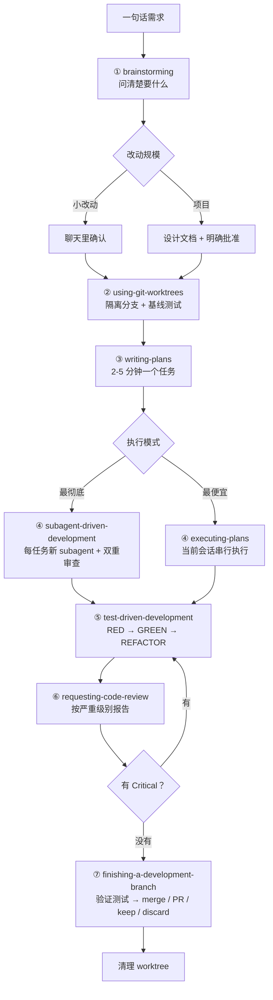
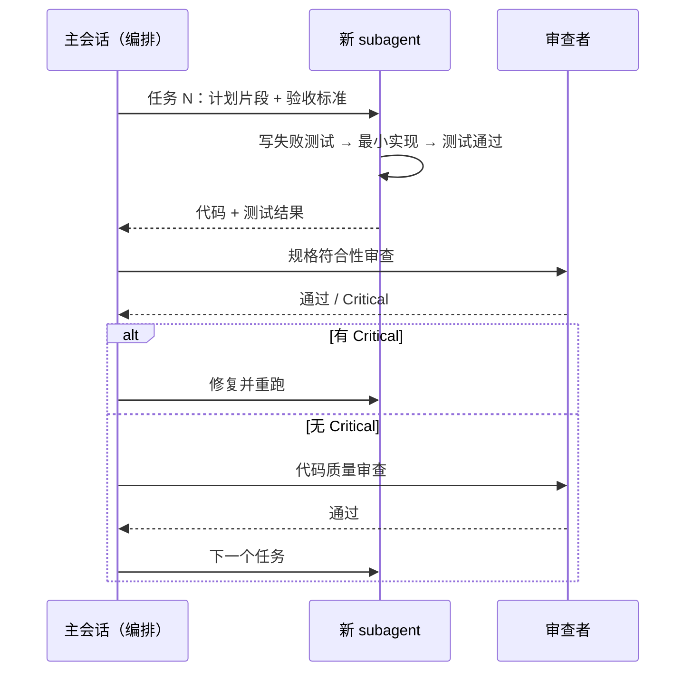
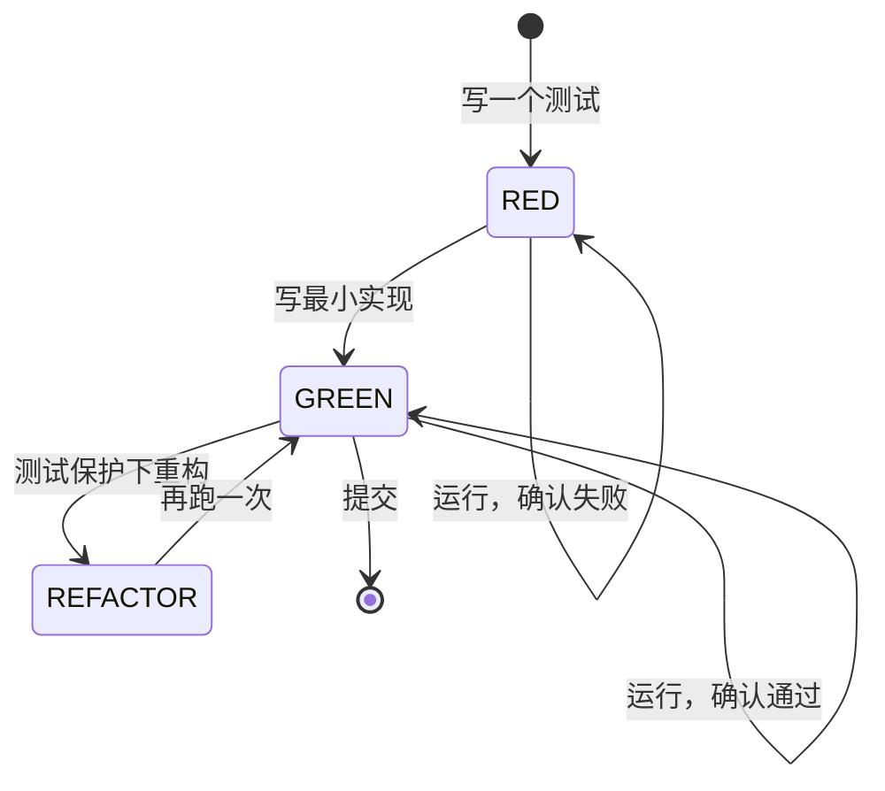

# 七道闸门：我的 AI 辅助开发工作流

> 本文写于 2026-11，基于 Claude Code 2.1.181 的 skills 机制。文中这套流程来自 [Superpowers](https://github.com/obra/superpowers)（MIT，Jesse Vincent / Prime Radiant），我把它作为默认开发工作流。命令和测试输出在 macOS、git 2.54.0、uv 0.11.8、Python 3.14.6 上实际执行过。

你大概见过这种场面：给 AI 一句「给 API 加个限流」，十分钟后它交回 400 行——Redis、令牌桶、漏桶、队列、Prometheus 指标、配置文件，甚至顺手重构了两个不相关的模块。代码能跑，但和你要的不是一回事。你花一小时 review，最后只留下 30 行。

问题不在 AI 写得慢，而在它写得太快。快到在你把「要什么」想清楚之前，代码已经写完了；快到错误的方向在 review 之前已经铺开了 400 行。

我现在的做法，是在「写」的前后放七道闸门。每道闸门只做一件事：**把一种模糊的东西，变成一件可以检查的产物**。产物不过关，不许进下一步。

用装修打比方：先量房、访谈需求（brainstorming），再围起工地、确认水电正常（worktree + 基线测试），然后出施工图（plan），接着分包施工或自己施工（subagent / inline），每道隐蔽工程验收（TDD），监理巡检（code review），最后交付、决定 merge 还是返工（finishing）。没有哪一步是为了显得专业，每一步都是为了让下一步有据可查。

## 全景：七道闸门



这不是瀑布模型。箭头随时会往回走：审查发现 Critical 回到实现，测试写不出来回到计划，计划做不下去回到设计。闸门不是阶段，是检查点。

| # | 闸门 | 把什么变清楚 | 产物 | 通过条件 |
|:--|:-----|:-------------|:-----|:---------|
| 1 | brainstorming | 要什么、为什么 | 聊天共识或设计文档 | 明确批准 |
| 2 | using-git-worktrees | 在哪做、基线是否干净 | 隔离工作区 + 基线结果 | 基线可解释 |
| 3 | writing-plans | 怎么做、分几步 | 2-5 分钟粒度的计划 | 任务可独立执行 |
| 4 | 执行模式 | 谁来做、审查多密 | 每个任务的代码和测试 | 每任务通过审查 |
| 5 | test-driven-development | 行为对不对 | 先失败的测试 | RED → GREEN |
| 6 | requesting-code-review | 质量、是否偏离计划 | 按严重级别的报告 | 没有 Critical |
| 7 | finishing-a-development-branch | 能不能交付 | 测试结果 + 合并选项 | 全绿 + 明确选择 |

## 第一道闸门：brainstorming，先问清楚再动手

**触发时机**：动手之前，哪怕只是「加个功能」。

AI 的默认行为是「填补空白」：你没说清楚的，它会用最合理（对它来说）的假设补上。于是「限流」被补成「Redis + 令牌桶 + 队列」，「导出」被补成「后台任务 + 对象存储 + 邮件通知」。这些假设单独看都合理，合在一起就是另一个项目。

brainstorming 做的事很朴素：

- **一次只问一个问题**，让你用自己的话描述想要什么，而不是从选项里挑；
- 追问「为什么」：这个功能解决谁的什么问题？不做会怎样？
- 给出 2-3 个方案和取舍，而不是直接写代码；
- 最后把理解**复述一遍**：「我理解你要的是 X，不做 Y，验收标准是 Z，对吗？」

复述是最便宜的错误检测。在聊天里纠正一句「不是这个意思」，比 review 400 行代码便宜两个数量级。

### 小改动和项目的分界线

这套流程自己就区分了规模：

| 规模 | 产物 | 例子 |
|:-----|:-----|:-----|
| 小改动 | 聊天里说清楚即可 | 改文案、修 typo、单文件小修 |
| 项目 | 写设计文档，明确批准后才继续 | 新功能、跨模块重构、协议变更 |

设计文档不需要长篇大论，但要能回答四个问题：

1. **目标与非目标**：这次做什么，明确不做什么；
2. **约束**：兼容性、性能、安全、部署环境；
3. **备选方案**：至少两个，以及为什么选这个；
4. **验收标准**：什么情况算完成，怎么验证。

以「加限流」为例，问清楚之后可能得到这样的结论：

> 单机令牌桶，按 API key 限流，100 请求/分钟，超限返回 429 加 `Retry-After`，不做分布式，不排队，不打点。验收：并发 200 请求时拒绝数符合令牌桶模型，已有单测全绿。

有了这段，实现可能只要 30 行；没有这段，400 行都不一定对。

**闸门**：你明确说「就按这个做」。在批准之前，不创建 worktree、不写计划、不碰代码。

## 第二道闸门：using-git-worktrees，先隔离再施工

**触发时机**：设计批准之后。

为什么不在当前目录拉个分支就干？因为分支只切换当前工作区，你和 AI 共用同一块地。AI 在 feature 分支上跑测试、改配置、生成文件时，你的主工作区也跟着变；如果想同时验证 main 上的行为，还得来回切。

worktree 给每个任务一个独立目录、共享同一个 git 仓库：

```bash
$ git worktree add ../myapp-feature -b feature/rate-limit
Preparing worktree (new branch 'feature/rate-limit')
HEAD is now at 9a1d6d4 init

$ git worktree list
/private/tmp/demo/myapp          9a1d6d4 [master]
/private/tmp/demo/myapp-feature  9a1d6d4 [feature/rate-limit]
```

（以上是在临时目录 `/tmp/demo/myapp` 里的实际输出；macOS 会把 `/tmp` 解析成 `/private/tmp`。）

这样主工作区保持干净，feature 在另一个目录里独立推进。多个任务并行时，一个任务一个 worktree，互不踩文件。

### 基线测试比隔离更重要

创建完 worktree，`using-git-worktrees` 还会做两件事：按项目方式安装依赖，然后跑一遍完整测试，确认**基线**。

```bash
$ uv sync
$ uv run pytest -q
```

这一步的价值经常被低估。没有基线，后面测试挂了，你分不清是 AI 改坏的还是本来就坏的；review 时看到 3 个失败，也不知道该不该放行。有了基线，任何新失败都能直接归因。

如果基线本来就不绿，把已知失败记录下来，作为这次任务的「背景噪音」。不要让 AI 去修和任务无关的失败——那是另一个任务。

几个实际注意点：

- **依赖是每个 worktree 各自的**。新目录里要重新 `uv sync`、`npm install`，别指望主目录的虚拟环境能共用；
- **环境文件不提交**。worktree 里的 `.env` 自己配置，且永远不进 git；
- **不要把 worktree 建在仓库内部**，否则会变成嵌套仓库，工具和编辑器都会犯迷糊；
- **用完就删**。worktree 是临时工地，不是第二个家。

**闸门**：基线测试通过，或已知失败有明确清单。否则不进入计划阶段。

## 第三道闸门：writing-plans，把设计切成能做完的任务

**触发时机**：设计批准、工作区就绪。

设计文档回答「做什么」，计划回答「按什么顺序做、每一步怎么验收」。writing-plans 的硬性要求是：**每个任务 2-5 分钟能做完**。

这个粒度不是拍脑袋：

- 一个任务小到可以完整读一遍，review 才有意义；
- 一个任务小到失败时容易定位，不会一挂挂一片；
- 一个任务小到能塞进一个全新 subagent 的上下文，不需要它猜；
- 一个任务小到中断后能接着做，进度是可见的 checkbox。

每个任务必须包含：

- 精确的文件路径；
- 要写的完整代码或命令，不能有 `TBD`、`TODO`、「类似上一节」；
- 先写的失败测试；
- 验证命令；
- 一个可以勾选的完成项。

示例节选（示意）：

```markdown
## Task 3: 令牌桶核心逻辑

- [ ] 文件：`app/rate_limit.py`
- [ ] 先写测试：`tests/test_rate_limit.py::test_rejects_after_limit`
- [ ] 实现：`TokenBucket.allow(key)`，容量 100，每分钟补充 100
- [ ] 验证：`uv run pytest tests/test_rate_limit.py -q`
- [ ] 提交：`feat: add token bucket limiter`
```

为什么禁止占位符？因为执行者可能是一个**没有任何上下文的新 subagent**。它看不到你和用户之前的讨论，也看不到你脑子里的「那个很明显的意思」。计划是它唯一的输入，计划含糊，它就开始猜——而猜测正是我们要消灭的东西。

计划放在项目的 `docs/plans/YYYY-MM-DD-HHMM.md`，开头链接设计文档，任务按依赖排序。写完后先自己过一遍：**每个任务能不能在不问任何问题的情况下执行？** 不能，就补。

**闸门**：计划里的每个任务都自带输入、输出和验证方式。否则不开始实现。

## 第四道闸门：选择执行模式

计划有了，接下来是「谁来做」。两条路：

### subagent-driven-development：一个任务一个新人

主会话只做编排：把第 N 个任务连同计划片段、验收标准交给一个全新的 subagent；subagent 在隔离上下文里完成实现和测试；完成后交给审查者做两轮检查——**规格符合性**（有没有按计划做）和**代码质量**（写得干不干净）。发现 Critical，打回重做；没有，才进入下一个任务。

它的好处是上下文干净。subagent 不会背着前 5 个任务的讨论、试错和废弃方案；它只看到计划，像一个新同事按施工图干活。代价是计划和审查必须足够严密，否则错误会在任务之间累积。

### executing-plans：自己一口气干完

另一种是当前会话按计划串行执行，中途不换人，最后对整个分支做一次 fresh review。它更便宜：没有反复派发 subagent 的开销，适合中小规模、上下文强相关的任务。

| 维度 | subagent-driven | executing-plans |
|:-----|:----------------|:----------------|
| 上下文 | 每个任务全新 | 全程同一个 |
| 审查粒度 | 每任务两轮 | 分支末尾一次 |
| 成本 | 高（token、协调） | 低 |
| 适合 | 任务多、风险高、可并行 | 中小计划、强依赖上下文 |
| 主要风险 | 计划不完整导致跑偏 | 错误累积到最后才暴露 |

用序列图看 subagent 模式：



注意：**两种模式都不跳过 TDD**。执行模式改变的是「谁写、什么时候审」，不是「要不要先写测试」。

**闸门**：每个任务通过审查，或整条分支通过末尾审查。

## 第五道闸门：test-driven-development，先看它失败

**触发时机**：实现阶段，每个行为变更。

TDD 的循环只有三步：RED → GREEN → REFACTOR。

1. **RED**：写一个测试，描述你希望的行为；运行，确认它失败；
2. **GREEN**：写最小的实现让它通过，不多写一行；
3. **REFACTOR**：在测试全绿的保护下整理代码，再跑一次。



这套流程有一条铁律：**没有失败的测试，不写生产代码**。先写了实现再补测试？那段实现会被删掉重来。听起来极端，但它解决了一个非常具体的问题：人（和 AI）都会写出「照着实现写的测试」——实现是什么，测试就断言什么，永远绿，永远发现不了错误。

先让测试失败，证明了两件事：测试确实覆盖了新行为；失败是可控的、可观察的。

一个真实的两分钟例子。先写测试，实现先放一个空壳：

```python
# test_slugify.py
from slugify import slugify


def test_slugify_basic():
    assert slugify("Hello, World!") == "hello-world"


def test_slugify_collapses_spaces():
    assert slugify("  a   b  ") == "a-b"
```

```python
# slugify.py：故意不实现，先看 RED
def slugify(text: str) -> str:
    return text
```

运行，两个测试都失败：

```text
$ uv run --with pytest pytest -q
...
E       AssertionError: assert '  a   b  ' == 'a-b'
...
FAILED test_slugify.py::test_slugify_basic - AssertionError: assert 'Hello, W...
FAILED test_slugify.py::test_slugify_collapses_spaces - AssertionError: asser...
2 failed in 0.01s
```

现在写最小实现：

```python
import re


def slugify(text: str) -> str:
    text = text.strip().lower()
    text = re.sub(r"[^a-z0-9]+", "-", text)
    return text.strip("-")
```

再跑，全绿：

```text
$ uv run --with pytest pytest -q
..                                                                       [100%]
2 passed in 0.00s
```

在 AI 工作流里，TDD 还有一个额外作用：**测试是唯一能自动验证的规格**。subagent 会忘、会话会被压缩、计划可能被简化，但测试文件会留在仓库里。下一个 subagent 不需要读你们的聊天记录，跑一遍测试就知道自己有没有搞砸。

探索性的 spike 可以例外：明确标记为「一次性」，不合并、不基于它写生产代码。spike 结束后删掉，再按 TDD 重做。

**闸门**：每个任务的行为都有先失败、后通过的测试。否则不算完成。

## 第六道闸门：requesting-code-review，按严重级别设闸

**触发时机**：subagent 模式在每个任务之后；inline 模式在整条分支末尾。

代码审查不是「看看写得順不順眼」，它对照的是**计划和标准**：

| 审查维度 | 具体问题 |
|:---------|:---------|
| 规格符合性 | 有没有做计划里没要求的事？有没有漏掉要求的事？ |
| 正确性 | 边界条件、错误处理、并发、空值、资源释放 |
| 测试质量 | 测试验证的是行为还是实现细节？失败时能不能定位？ |
| 范围 | 有没有顺手改无关文件、无关注释？ |
| 复用 | 有没有重复实现已有的工具函数、已有的调用链？ |
| 安全 | 输入校验、权限边界、SQL 注入、敏感信息泄漏 |

报告按严重级别分层：

- **Critical**：数据丢失、安全漏洞、构建/测试挂了、核心行为错误。**必须修复才能继续**；
- **Important**：边界 bug、明显的设计偏离、缺失的测试。合并前修；
- **Nit**：命名、格式、个人偏好。可以不改。

Critical 阻断是这套流程里最硬的闸门。没有它，subagent 会带着一个错误进入下一个任务，后面的代码都建在这个错误上，最后一起爆炸。

审查放在每个任务之后，还有一个成本上的原因：review 50 行比 review 500 行便宜，而且早发现的问题修改成本更低。inline 模式把审查放到最后，是用「更便宜」换「更晚发现」，所以只适合风险可控的中小任务。

**闸门**：没有未解决的 Critical。Important 至少要记录，不能假装没看见。

## 第七道闸门：finishing-a-development-branch，交付也是流程

**触发时机**：所有任务完成。

最后一步不是「让 AI 说完成了」，而是拿证据：

```bash
$ git status
$ git diff main...HEAD --stat
$ uv run pytest -q
```

- 跑**完整**测试套件，不只是改过的文件；
- 看一遍相对主分支的 diff，确认没有意外改动；
- 有 lint / build / 类型检查的，一并跑。

全绿之后，流程不会自动合并，而是把选项摆出来：

| 选项 | 适用场景 | 动作 |
|:-----|:---------|:-----|
| Merge | 本地任务，已确认无误 | 合并到主分支 |
| PR | 需要团队审查 | push 分支，开 PR |
| Keep | 还不确定，想保留现场 | 保留 worktree 和分支 |
| Discard | spike 或方向错误 | 删除分支和 worktree |

最后清理工地：

```bash
$ git worktree remove ../myapp-feature
$ git branch -d feature/rate-limit   # 已合并时
```

很多人会省掉「明确选择」这一步，结果要么误合并，要么留下十几个不知道能不能删的分支。把「保留」和「丢弃」都做成正式选项，反而更容易做决定。

**闸门**：测试全绿 + 没有 Critical + 你明确选了一个选项。三者缺一，不交付。

## 为什么顺序不能反

| 跳过的闸门 | 当时省下的 | 后面付出的 |
|:-----------|:-----------|:-----------|
| brainstorming | 十句提问 | 做错的东西，写得越多越难改 |
| worktree + 基线 | 两分钟 | 主工作区被污染，失败无法归因 |
| writing-plans | 半小时 | 执行者自由发挥，review 没有基准 |
| TDD | 一个测试 | 测试变成实现的镜子，安全网失效 |
| code review | 一次审查 | 错误在任务之间复利，最后一起爆 |
| finish 验证 | 一次全量测试 | 把坏分支合进主线 |

这套流程真正的产出不是代码，而是**证据**：设计文档证明方向经过确认，基线证明失败是新引入的，计划证明每一步都可复核，测试证明行为符合预期，审查报告证明风险被看过。AI 是概率性的，证据让它变得可问责。

## 什么时候可以简化

不要把七道闸门变成七道形式主义。流程是个旋钮，不是开关：

| 改动规模 | 建议闸门 |
|:---------|:---------|
| typo、文案、单行修复 | 聊天确认 → 跑相关测试 → 直接提交 |
| 单文件 bug fix | 复现 → 先写回归测试 → 修复 → 审查 |
| 中小功能 | 聊天确认 → worktree → 简版计划 → TDD → 末尾审查 |
| 跨模块项目 | 全套七道闸门 |

判断标准很简单：**这次改动如果做错，代价有多大？** 代价小，流程就短；代价大，流程就长。对 typo 跑完整套流程的人，最后会放弃流程，这比不用流程更糟。

## 成本与收益

成本是真实的：

- 前置提问、写设计、拆计划都要时间；
- subagent 模式和逐任务审查消耗更多 token；
- TDD 会让「先写出来再说」的爽感消失。

收益也是真实的：

- 方向错误在写代码之前就被拦住；
- 任何一步中断，都能从计划和 checkbox 恢复；
- worktree 让并行任务互不干扰；
- 测试和审查报告让「AI 说完成了」变成「有证据表明完成了」；
- 你敢让 AI 跑得更久，因为每一步都有回退点。

对我来说，最大的变化不是 AI 写得更快，而是**我敢放手让它跑更久**。以前它写 200 行我就得盯着；现在计划、测试、审查各自有闸门，我可以隔一段时间看一次结果。

## 收尾：流程是 AI 的放大器

AI 会放大你的流程。流程是「先写再说」，它就放大混乱；流程有闸门，它就放大产出。

七道闸门可以压缩成七个动词：

**问清楚 → 隔离 → 计划 → 执行 → 测试 → 审查 → 交付。**

即使不用 Superpowers，这七件事也可以手工做；skills 的作用只是把触发条件和检查标准固化下来，让「这次算了吧」变得没那么容易。工具会变，这七个动词不会。

---

**相关文章**

- [Claude Code 最佳实践：从 vibe coding 到 agentic engineering](claude-code-best-practice.md)
- [Andrej Karpathy Skills：把 LLM 编程观察变成可执行的工程纪律](../ai-tooling/karpathy-skills-guide.md)
- [Trellis：给 AI Agent 装上工程框架，不再每次从零开始](../ai-tooling/trellis-guide.md)
- [Planning with Files：给 AI Agent 装上"外存"，让它不再失忆](../ai-tooling/planning-with-files-guide.md)
- [gstack + Spec-Kit：打造 AI 编程的完整工作流](../ai-tooling/gstack-plus-spec-kit.md)

**参考**

- [Superpowers（obra/superpowers）](https://github.com/obra/superpowers)：本文七段流程的 skill 实现，MIT 协议
