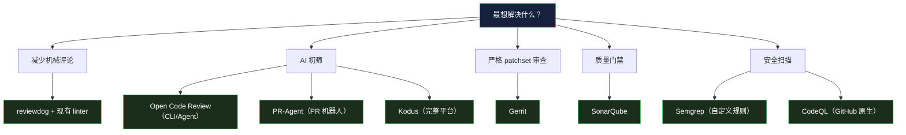

# Code Review 工具怎么选：AI 初筛、静态分析与人工终审

> GitHub 数据截至 2026-11-20；工具版本和功能变化很快，接入前请核对当前文档。
> 本文讨论的是审查流水线，不绑定单一编程语言。

## 目录

- [先给结论](#先给结论)
- [生活比喻：工厂质检线](#生活比喻工厂质检线)
- [先分清：Code Review 工具有四层](#先分清code-review-工具有四层)
- [GitHub 数据对比](#github-数据对比)
- [AI 审查工具](#ai-审查工具)
- [reviewdog：不是 AI，是检查结果的搬运工](#reviewdog不是-ai是检查结果的搬运工)
- [经典平台：Gerrit、Review Board、Danger](#经典平台gerritreview-boarddanger)
- [静态分析与质量门禁：SonarQube、Semgrep、CodeQL](#静态分析与质量门禁sonarqubesemgrepcodeql)
- [组合成一条审查流水线](#组合成一条审查流水线)
- [选择决策树](#选择决策树)
- [AI Review 如何不添乱](#ai-review-如何不添乱)
- [常见误区与反模式](#常见误区与反模式)
- [按场景选型速查](#按场景选型速查)
- [结语](#结语)
- [参考资料](#参考资料)

## 先给结论

Code Review 工具不是一类东西。把它们放在一张表里比较，就像把“安检门”“监控摄像头”“质检员”放在同一张表里比价格。

先按作用分层：

| 层 | 典型工具 | 负责什么 | 是否 AI |
|----|----------|----------|---------|
| 机械检查 | formatter、linter、type checker、测试 | 格式、语法、类型、行为 | 否 |
| 深度静态分析 | Semgrep、CodeQL、SonarQube | 安全漏洞、代码异味、质量门禁 | 否 |
| 流程规则 | Danger、reviewdog | PR 规范检查、把工具结果贴到 PR | 否 |
| AI 初筛 | Open Code Review、PR-Agent、Kodus | 摘要、潜在问题、可读性建议 | 是 |
| 人工终审 | 人 | 架构、业务、权衡、风险 | 否 |

一句话建议：

> **让机器做机器能确定的事，让 AI 做初筛，让人做最终判断。**

如果你想要 CLI/Agent 工作流，先看 **Open Code Review**（Apache-2.0、阿里开源、可配置模型）；如果你想要 PR 机器人，优先看 **PR-Agent**（MIT、BYOK、自托管）；如果你需要完整平台和规则体系，再看 **Kodus**（AGPLv3、自托管）。但无论选哪个，都不要跳过 linter、测试和人工 review。

## 生活比喻：工厂质检线

把 Code Review 想成一条工厂质检线：

- **formatter / linter / 测试**是卡尺和检具：尺寸对不对，机器一量就知道；
- **Semgrep / CodeQL / SonarQube**是 X 光、材料检测和质量门禁：能发现人眼容易漏的结构性问题；
- **reviewdog** 是把检测结果贴到工位看板的传送带：它不检测，只负责把结果送到该看的地方；
- **Danger** 是工单规范检查：PR 有没有写 Changelog、有没有测试、改动是不是太大；
- **AI Review** 是机器视觉初筛：看得快、能提意见，但会误判，不能替代质检员；
- **人工 Review** 是主厨/质检员终审：判断设计、业务和风险。

一条好的质检线，不是仪器越多越好，而是**每台仪器都有明确职责，结果能汇总，人能快速做决定**。

## 先分清：Code Review 工具有四层

### 第一层：机械检查

这些应该自动化，不应该占用人工 review 的注意力：

- 代码格式：Prettier、gofmt、rustfmt、Black；
- lint：ESLint、golangci-lint、Ruff、Clippy；
- 类型检查：TypeScript、mypy、javac；
- 单元测试、集成测试；
- 构建和打包检查。

**这一层不需要 AI。** 规则确定、结果可重复，交给 CI 就够了。

### 第二层：深度静态分析

- **SonarQube**：代码质量、覆盖率、重复代码、质量门禁；
- **Semgrep**：模式化规则、安全扫描、自定义规则；
- **CodeQL**：语义查询，强在安全漏洞和数据流分析。

这一层也不一定是 AI，但比 linter 更“懂代码结构”。

### 第三层：流程规则和结果聚合

- **Danger**：在 CI 里检查 PR 规范（文件大小、Changelog、测试）；
- **reviewdog**：把 linter / 分析器的输出转成 PR 评论；
- **Gerrit**：严格的 patchset 审查平台；
- **Review Board**：自托管的多 VCS 审查平台。

### 第四层：AI 初筛与人工终审

- **Open Code Review / PR-Agent / Kodus**：让 LLM 先读 PR，生成摘要、风险点、改进建议；
- **人**：决定是否合并，承担最终责任。

Open Code Review 更像“本地/Agent 的审查 CLI”，PR-Agent 更像“PR 机器人”，Kodus 更像“审查平台”；三者不是同一种形态。

**AI 的位置是“初筛”，不是“门禁”。** 这是整篇文章最重要的一句话。

## GitHub 数据对比

以下数据来自 GitHub API，截至 **2026-11-20**。星数代表社区规模，不代表适配度。

| 工具 | Stars | 类型 | 许可 | 平台/集成 | 最适合 |
|------|-------|------|------|-----------|--------|
| [Open Code Review](https://github.com/alibaba/open-code-review) | 54,471 | AI Review CLI | Apache-2.0 | CLI / Agent Skills | 本地/Agent 驱动的 AI 审查 |
| [Semgrep](https://github.com/semgrep/semgrep) | 17,838 | 静态分析 | LGPL-2.1 | CLI / CI | 自定义安全规则 |
| [PR-Agent](https://github.com/qodo-ai/pr-agent) | 16,461 | AI Review | MIT | GitHub/GitLab/Bitbucket 等 | 自托管 AI 初筛 |
| [SonarQube](https://github.com/SonarSource/sonarqube) | 11,198 | 质量门禁 | LGPL-3.0 | 自托管 / CI | 代码质量与覆盖率门禁 |
| [CodeQL](https://github.com/github/codeql) | 10,390 | 语义分析 | MIT（查询库） | GitHub Code Scanning | 深度安全扫描 |
| [reviewdog](https://github.com/reviewdog/reviewdog) | 9,753 | 结果聚合 | MIT | GitHub/GitLab 等 | 把 linter 结果贴到 PR |
| [Danger](https://github.com/danger/danger) | 5,697 | PR 规则 | MIT | GitHub/GitLab/Bitbucket 等 | PR 规范自动检查 |
| [Review Board](https://github.com/reviewboard/reviewboard) | 1,734 | 审查平台 | MIT | 自托管 / 多 VCS | 企业多 VCS 审查 |
| [Kodus](https://github.com/kodustech/kodus-ai) | 1,633 | AI Review 平台 | AGPLv3 | GitHub/GitLab/Bitbucket/Azure DevOps/Forgejo | 自托管完整 AI 平台 |
| [Gerrit](https://www.gerritcodereview.com/) | 1,244（GitHub 镜像） | Patchset 审查 | Apache-2.0 | 自托管 / Git | 大型项目严格审查 |

几个容易被误解的点：

- **reviewdog 不是 AI。** 它只是把 linter 的结果转成 PR 评论；
- **Danger 也不是 AI。** 它执行你写的规则；
- **CodeQL 的查询库是开源 MIT，但 CodeQL 引擎/平台不是普通自托管工具**；私有仓库通常需要 GitHub Advanced Security；
- **Kodus 的仓库是 `kodustech/kodus-ai`**，不是 `kodustech/kodus`；
- **Open Code Review 是 CLI/Agent 工具，不是自动 PR 评论 SaaS**；接 PR 还需要 CI/Agent 集成；
- **Gerrit 的 GitHub 只是镜像**，官方开发在 googlesource。

## AI 审查工具

### Open Code Review

[Open Code Review](https://github.com/alibaba/open-code-review) 是阿里巴巴开源的 AI 代码审查 CLI，Apache-2.0，npm 包 `@alibaba-group/open-code-review`（2026-11-20 版本 1.13.13）。

它不是“给每个 PR 自动留言”的 SaaS，而是一个可以在本地或 CI 里运行的 CLI：

- 读取 Git diff，用确定性的文件选择、文件打包、规则匹配组织审查；
- Agent 可以读取完整文件、搜索仓库、查看其他改动，生成行级评论；
- 支持 OpenAI / Anthropic 兼容的模型端点；
- 提供 native mode 和 delegation mode：前者用 OCR 自己的模型配置，后者让 Claude Code、Codex、Cursor 等宿主 agent 执行审查流程；
- README 宣称在自建的 AACR-Bench 上比通用 agent 有更高 precision/F1、约 1/9 的 token 消耗；这是项目自报数据，选型时建议用自己的仓库验证。

快速使用（来自官方 README）：

```bash
npm install -g @alibaba-group/open-code-review
ocr config provider
ocr config model
ocr review
ocr review --from main
```

**适合：** 想在本地/Agent 工作流里做 AI 审查、需要自控模型和规则、希望审查过程可确定、可调优的团队。

**不适合：** 想开箱即用自动评论 GitHub PR 的团队；这类需求需要再写 CI/PR 集成，或者用 delegation mode 配合宿主 agent。

### PR-Agent

[PR-Agent](https://github.com/qodo-ai/pr-agent) 是 Qodo 开源的 PR 审查工具，MIT 许可：

- 支持 GitHub、GitLab、Bitbucket 等平台；
- 支持自托管、BYOK（自己带模型 Key）；
- 可以生成 PR 摘要、代码建议、改进意见；
- 可以只在 PR 上跑，不必把整个仓库交给 SaaS；
- 有 CLI/CI 集成方式，适合想自己控制模型和成本的团队。

典型使用方式：

```text
PR 创建
  → 触发 CI / PR-Agent
  → 生成摘要和 review 建议
  → 评论到 PR
  → 人决定哪些采纳
```

**优点：** 开源、可自托管、平台多、模型可替换。

**代价：** 需要自己配置模型和运行环境；AI 建议有误报；大 PR 的上下文和成本需要控制。

### Kodus

[Kodus](https://github.com/kodustech/kodus-ai) 是一个自托管的 AI code review 平台，AGPLv3：

- 支持 GitHub、GitLab、Bitbucket、Azure DevOps、Forgejo；
- 支持自托管和自带模型 Key；
- 有规则、配置、平台化的工作流，适合需要“完整系统”的团队；
- 部署和运维成本比单个 CLI 工具高。

**什么时候选 Kodus？** 当你需要的是一个可配置、可运营的 AI review 平台，而不是一个 PR 机器人。

**什么时候不选？** 你只想在 CI 里加一个轻量 AI 初筛；PR-Agent 或商业 SaaS 更省事。

### 商业 SaaS 选项

如果允许代码离开自己的基础设施，2026 年常见的还有 GitHub Copilot Code Review、CodeRabbit、Qodo Merge 等 SaaS。它们通常提供更完整的托管体验，但代码隐私、价格、模型选择和企业合规需要单独评估。

**自托管和 SaaS 的分界线不是“开源 vs 商业”，而是“代码是否离开你的边界”。**

## reviewdog：不是 AI，是检查结果的搬运工

[reviewdog](https://github.com/reviewdog/reviewdog) 的定位经常被误解。它不是 AI reviewer，而是一个**结果聚合器**：

- 接收 ESLint、golangci-lint、Ruff、Semgrep 等工具的诊断输出；
- 把诊断转成 GitHub/GitLab 等平台的 PR 评论；
- 支持不同 reporter（PR review、check、commit comment 等）；
- 让现有 linter 的结果直接出现在代码行旁边。

它解决的是“工具跑完了，但没人看日志”的问题：

```text
linter 输出 → reviewdog → PR 行内评论
```

**reviewdog + 现有 linter** 往往比“再上一个 AI 工具”更能减少机械 review 噪音。它便宜、确定、可重复，是审查流水线里性价比很高的一层。

## 经典平台：Gerrit、Review Board、Danger

### Gerrit

[Gerrit](https://www.gerritcodereview.com/) 是起源于 Google 的代码审查系统，Android、Chromium 等大型项目使用过：

- 以 **Change / Patchset** 为中心，而不是 GitHub PR；
- 每次修改是一个新的 patchset，审查历史可追溯；
- 支持严格的 submit 规则、权限和分支控制；
- 适合大型项目、需要逐版本审查和精细权限的团队。

代价是工作流和 GitHub PR 差异大，接入成本高；小团队通常不需要。

### Review Board

[Review Board](https://github.com/reviewboard/reviewboard) 是老牌的自托管 code review 平台：

- 支持 Git、SVN、Mercurial、Perforce 等多种 VCS；
- 提供 Web UI、diff、评论和审查请求；
- 适合企业内多 VCS、非 GitHub 工作流。

它不是 GitHub-native 工具，和现代 PR 工作流的集成不如 GitHub/GitLab 自带 review 顺畅。

### Danger

[Danger](https://github.com/danger/danger) 用 `Dangerfile` 在 CI 里执行 PR 规则：

```js
// Dangerfile.js（示意）
const changedFiles = [
  ...danger.git.created_files,
  ...danger.git.modified_files,
];

if (changedFiles.length > 20) {
  fail("这个 PR 改动太大，请拆分");
}

if (!danger.git.modified_files.some((file) => file.includes("CHANGELOG"))) {
  warn("记得更新 CHANGELOG");
}
```

它适合检查：

- PR 是否太大；
- 是否更新 Changelog / 文档；
- 是否补了测试；
- 是否改了敏感目录；
- PR 标题/描述是否符合规范。

**Danger 不做代码语义分析，也不做 AI review；它只执行规则。**

## 静态分析与质量门禁：SonarQube、Semgrep、CodeQL

### SonarQube

[SonarQube](https://github.com/SonarSource/sonarqube) 是最成熟的代码质量平台之一：

- 代码异味、重复代码、复杂度、覆盖率；
- Quality Gate：不达标可以阻止合并；
- 自托管，支持多语言；
- Community 版覆盖基础质量分析，部分分支/PR 装饰能力需要确认版本。

适合已经有一定工程规范、想把“质量门禁”落到 CI 的团队。

### Semgrep

[Semgrep](https://github.com/semgrep/semgrep) 是轻量级静态分析工具：

- 规则接近源码模式，写起来比传统查询语言轻；
- 支持自定义规则和安全扫描；
- 可以快速在 CI 里跑，反馈快；
- 适合“团队自己的编码规范 + 常见安全模式”。

它不是完整的类型系统或数据流平台；复杂语义分析仍要配合 CodeQL/SonarQube。

### CodeQL

[CodeQL](https://github.com/github/codeql) 是 GitHub 的语义代码分析引擎：

- 用查询语言分析数据流、调用路径和漏洞模式；
- 与 GitHub Code Scanning 深度集成；
- 开源项目的公开仓库通常可以免费使用；
- 私有仓库通常需要 GitHub Advanced Security；
- 查询库开源，但引擎不是普通 OSS 自托管组件。

适合把安全扫描放进 GitHub 原生流程，而不是自己搭一套扫描平台。

## 组合成一条审查流水线

一个务实的顺序：


一个最小组合：

1. **CI 必过**：格式化、lint、类型检查、测试；
2. **静态安全**：Semgrep 自定义规则（或 CodeQL/SonarQube）；
3. **PR 规范**：Danger 检查大小、Changelog、测试；
4. **结果聚合**：reviewdog 把 linter 结果贴到 PR；
5. **AI 初筛（可选）**：Open Code Review 或 PR-Agent 生成摘要和建议；
6. **人工终审**：架构、业务、风险。

**不是每个团队都需要全部六层。** 小团队从 1 + 2 + 6 开始，比一上来接 6 个工具更有效。

## 选择决策树



## AI Review 如何不添乱

AI review 最容易犯的错，不是“不够聪明”，而是“话太多”。接入时建议：

1. **只在 PR 阶段跑**，不要在每次 commit 上产生一堆评论；
2. **限制 PR 大小**，大 PR 先拆；AI 对超大 diff 的上下文和成本都会失控；
3. **区分严重级别**：把“建议”和“阻塞”分开，不要默认 fail；
4. **忽略生成文件/依赖目录**：lockfile、vendor、dist 不要喂给 AI；
5. **自托管或明确数据边界**：代码可能离开你的基础设施，先过安全评审；
6. **防 prompt injection**：代码注释、README、issue 文本都可能包含对模型的指令，AI 输出要当不可信输入；
7. **人工复核**：AI 说的“安全漏洞”和“性能问题”都可能是误报。

**AI 是初筛员，不是审批人。**

## 常见误区与反模式

### 1. 以为工具越多越好

每个工具都会产生评论、告警和维护成本。工具太多，review 会变成“清通知”，人反而不看代码。

### 2. 让 AI 阻塞合并

AI 的建议不是确定性的规则。把 AI 建议设成 merge gate，会产生大量误报和绕过。

### 3. 把 reviewdog 当 AI

reviewdog 只是结果聚合器；它的价值来自背后的 linter/分析器。

### 4. 把 Danger 当代码审查

Danger 只检查 PR 元数据和规则，不理解业务逻辑。

### 5. 只看星数选工具

星数高不代表适合你的工作流。Gerrit 星数不高，但大型项目的 patchset 审查仍然很强；Review Board 的社区规模也不大，却在多 VCS 企业环境里很实用。

### 6. 质量门禁一刀切

Quality Gate 太严，团队会学会“绕过”；太松，等于没有。先从阻断严重问题开始，再逐步加规则。

### 7. 忽略隐私和合规

把私有代码发给外部模型之前，确认数据保留、训练使用、区域合规和密钥管理。

### 8. 没有人工 Review

把 AI 和静态分析当终点，架构、业务取舍和风险评估就没人负责了。

## 按场景选型速查

| 场景 | 推荐 |
|------|------|
| 想减少机械评论 | reviewdog + 现有 linter |
| 想在本地/Agent 工作流做 AI 审查 | Open Code Review |
| 想自托管 PR 机器人 | PR-Agent |
| 想要完整 AI Review 平台 | Kodus |
| 已有 Selenium 式企业流程、多 VCS | Review Board |
| 大型项目、严格 patchset | Gerrit |
| PR 规范/Changelog/大小检查 | Danger |
| 质量门禁和代码异味 | SonarQube |
| 自定义安全规则 | Semgrep |
| GitHub 原生深度安全分析 | CodeQL |
| 任何情况 | 保留人工 Review |

## 结语

Code Review 工具的价值，不是“自动批准 PR”，而是：

- 把机械问题挡在人工 review 之前；
- 把检查结果放到正确的位置（PR 行内、CI 状态、质量门禁）；
- 让 AI 做低成本的初筛；
- 让人把时间花在架构、业务和风险上。

**先有流程，再上工具。** 没有分层和规则的团队，接十个工具也只是把噪音放大了十倍。

## 参考资料

- [Open Code Review GitHub](https://github.com/alibaba/open-code-review)
- [PR-Agent GitHub](https://github.com/qodo-ai/pr-agent)
- [Kodus GitHub](https://github.com/kodustech/kodus-ai)
- [reviewdog GitHub](https://github.com/reviewdog/reviewdog)
- [Gerrit Code Review](https://www.gerritcodereview.com/)
- [Review Board GitHub](https://github.com/reviewboard/reviewboard)
- [Danger GitHub](https://github.com/danger/danger)
- [SonarQube GitHub](https://github.com/SonarSource/sonarqube)
- [Semgrep GitHub](https://github.com/semgrep/semgrep)
- [CodeQL GitHub](https://github.com/github/codeql)
- [GitHub Code Scanning 文档](https://docs.github.com/en/code-security/code-scanning)
