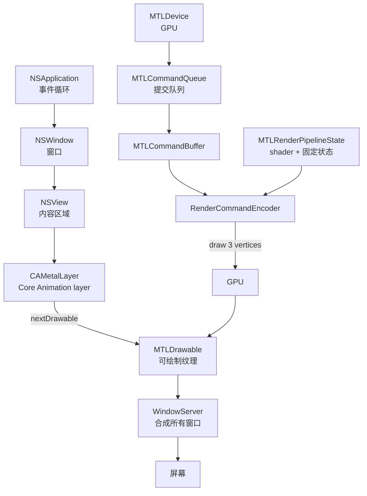
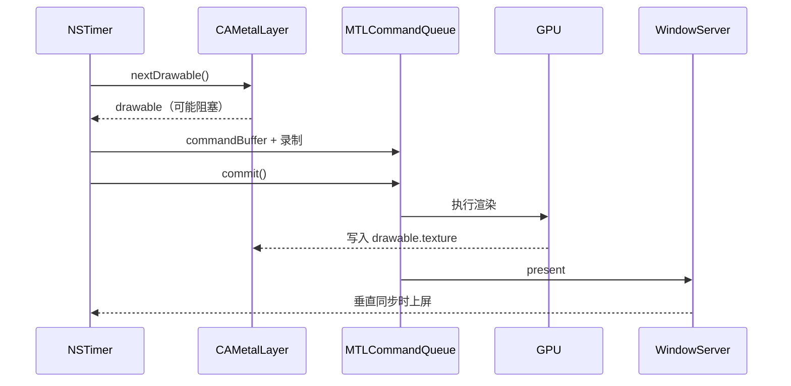

# Cocoa + Metal：在 macOS 上画一个三角形，从窗口到像素

> 本文基于 macOS 26.4.1（Darwin 25.4）、Apple M3、Apple Clang 21.0.0。示例使用 Metal 的稳定 API 子集；`CAMetalLayer`、`MTLRenderPipelineState` 从 macOS 10.11 起可用，`NSApplication.activate()` 需要 macOS 14+。

Cocoa 是写字楼的前台，Metal 是后厨。前台负责给你一间办公室（窗口），并在墙上开一个取餐口（`CAMetalLayer`）；后厨不关心你坐在哪儿，只接收一张张订单（`MTLCommandBuffer`），做完把菜放到取餐口（drawable）。

你要写的代码同时扮演两个角色：先向前台租场地，再向后厨下单。两边通过一块「可以画的纹理」交接，这块纹理就是 drawable。

## 三套栈，三种分工

同样是画一个三角形，三个平台把责任切得不一样：

| 平台 | 窗口系统 | 图形 API | 谁管理呈现 | 谁管理同步 |
|:-----|:---------|:---------|:-----------|:-----------|
| macOS | Cocoa（AppKit） | Metal | `CAMetalLayer` + WindowServer | Metal 内部 + drawable 节流 |
| Windows | Win32 | Direct3D 11 | DXGI 交换链 | DXGI + driver |
| Linux | XCB | Vulkan | 应用自己创建 swapchain | 应用自己写 semaphore / fence |

最值得看的是后两列。Metal 和 D3D11 都帮你把「什么时候可以画下一帧」包进了 drawable 和交换链；Vulkan 把这件事摊开，让你用同步对象自己写。本文走最短的一条链路：Cocoa 开窗，Metal 画图。

## 一条从窗口到像素的链路



这条链上每一段都是清晰的边界：

- AppKit 不知道 GPU 的存在，它只认识 `NSWindow` 和 `NSView`；
- Metal 不知道窗口的存在，它只认识纹理和命令缓冲；
- 唯一同时出现在两边的对象是 `CAMetalLayer`，它把 Core Animation 的图层交给 Metal 当画布。

## 第一层：Cocoa 只负责占一块地

一个没有 storyboard、纯代码启动的 macOS 应用，最少需要四样东西：

| 对象 | 作用 | 在本 demo 里 |
|:-----|:-----|:-------------|
| `NSApplication` | 进程级事件循环，接收鼠标、键盘、窗口事件 | `[NSApp run]` |
| `NSWindow` | 一个真实窗口，由 WindowServer 合成 | 960 × 540 点 |
| `NSView` | 内容区域，承载 layer | 只作为 layer 的宿主 |
| `CAMetalLayer` | 内容由 Metal 填写的图层 | `nextDrawable` 的来源 |

视图的关键在 `makeBackingLayer`：

```objc
- (CALayer*)makeBackingLayer {
    return [CAMetalLayer layer];
}

- (instancetype)initWithFrame:(NSRect)frame {
    if ((self = [super initWithFrame:frame])) {
        self.wantsLayer = YES;
        self.layerContentsRedrawPolicy = NSViewLayerContentsRedrawNever;
    }
    return self;
}
```

`wantsLayer = YES` 让 AppKit 给这个 view 配一个 backing layer；`makeBackingLayer` 决定用哪种 layer。返回 `CAMetalLayer` 之后，`self.layer` 就成了 Metal 的取餐口。

`layerContentsRedrawPolicy = Never` 同样重要：它告诉 AppKit 不要用 `drawRect:` 去重绘 layer 内容。否则窗口缩放、切换显示器、失焦时，AppKit 可能先铺一层空白，再让你的 Metal 帧盖上去，屏幕就会闪。

### 点、像素和 Retina

`NSWindow` 的尺寸单位是**点（point）**，drawable 的尺寸单位是**像素（pixel）**。在 Retina 屏上两者差一个 `backingScaleFactor`：

```objc
- (void)syncLayerGeometry {
    CGFloat scale = self.window ? self.window.backingScaleFactor : 1.0;
    self.metalLayer.contentsScale = scale;
    self.metalLayer.frame = self.bounds;
    self.metalLayer.drawableSize = CGSizeMake(self.bounds.size.width * scale,
                                              self.bounds.size.height * scale);
}
```

这段函数要在 `viewDidMoveToWindow`、`viewDidChangeBackingProperties` 和 `layout` 里都调用一次。只设一次 `drawableSize` 的代码在内置屏上看起来没问题，拖到外接显示器（或者从外接屏拖回内置屏）就会变得模糊或者被拉伸，因为 scale 变了。

demo 实际跑出来的尺寸是：

```text
drawable: 1920 x 1080 px (scale 2.0x)
```

窗口是 960 × 540 点，drawable 是 1920 × 1080 像素。

### framebufferOnly

```objc
view.metalLayer.framebufferOnly = YES;
```

这个属性告诉 Metal：这块 drawable 只作为渲染目标使用，CPU 不会直接读它的像素。驱动因此可以选择更高效的存储布局。如果之后要做截图、录像，需要 `getBytes` 读回，就得把它设为 `NO`（或者单独渲染到一张可读纹理）。demo 不需要读回，保持默认的 `YES`。

## 第二层：Metal 的三个常驻对象

Metal 的对象分成两类：**活很久的**和**每帧重建的**。分清楚这两类，性能问题就少一半。

| 对象 | 角色 | 创建时机 |
|:-----|:-----|:---------|
| `MTLDevice` | GPU 的抽象，资源工厂 | 应用启动一次 |
| `MTLCommandQueue` | 按顺序把命令缓冲提交给 GPU | 应用启动一次 |
| `MTLRenderPipelineState` | shader + 固定管线状态的编译结果 | 启动时一次 |
| `CAMetalDrawable` | 轮换使用的可绘制纹理 | 每帧获取 |
| `MTLCommandBuffer` | 一帧的命令清单 | 每帧新建 |
| `MTLRenderCommandEncoder` | 往命令缓冲里录渲染命令 | 每帧新建 |

用厨房打比方：

- `MTLDevice` 是厨房本身；
- `MTLCommandQueue` 是取餐窗口的排队顺序，先提交的先做；
- `MTLRenderPipelineState` 是「这道菜的灶台设置 + 菜谱」，一次性调好，之后每单直接复用；
- 每帧新建 pipeline，相当于每炒一盘菜就重新装修一次厨房。

创建管线时，渲染目标的像素格式必须和 layer 一致：

```objc
desc.colorAttachments[0].pixelFormat = MTLPixelFormatBGRA8Unorm;
// ...
view.metalLayer.pixelFormat = MTLPixelFormatBGRA8Unorm;
```

两处不一致时，轻则 `newRenderPipelineStateWithDescriptor` 返回 nil，重则画的时候被 Metal 验证层拦下。这个坑在复制别人的 sRGB 代码时特别常见：管线用 `BGRA8Unorm_sRGB`，layer 还是 `BGRA8Unorm`。

## 第三层：一帧的四个动作

去掉错误处理，一帧只有四步：

```objc
// 1. 拿一张可画的纹理
id<CAMetalDrawable> drawable = [self.view.metalLayer nextDrawable];

// 2. 描述这次渲染：附件、清屏色、存储行为
MTLRenderPassDescriptor* pass = [MTLRenderPassDescriptor renderPassDescriptor];
pass.colorAttachments[0].texture = drawable.texture;
pass.colorAttachments[0].loadAction = MTLLoadActionClear;
pass.colorAttachments[0].clearColor = MTLClearColorMake(0.08, 0.08, 0.12, 1.0);

// 3. 录制命令
id<MTLCommandBuffer> cb = [self.commandQueue commandBuffer];
id<MTLRenderCommandEncoder> enc = [cb renderCommandEncoderWithDescriptor:pass];
[enc setRenderPipelineState:self.pipeline];
[enc drawPrimitives:MTLPrimitiveTypeTriangle vertexStart:0 vertexCount:3];
[enc endEncoding];

// 4. 提交并呈现
[cb presentDrawable:drawable];
[cb commit];
```

四个动作对应的语义：

1. **`nextDrawable`**：从 layer 的 drawable 池里取一张。池子通常只有 3 张，三张都在 GPU 或 WindowServer 手里时，这个调用会阻塞——这就是 Metal 的帧率节流。窗口最小化或完全被遮挡时，它可能返回 nil，必须判空。
2. **render pass descriptor**：声明这次渲染写哪张纹理、开始时清不清屏、结束时保不保存。`MTLLoadActionClear` 是由 GPU 在渲染开始时执行的，不是 CPU 在内存里填一遍。
3. **encoder**：把「用哪套管线、画几个顶点」录进命令缓冲。这一步只是在录命令，GPU 还没开始干活。
4. **`presentDrawable` + `commit`**：`present` 是一个排进队列的动作，必须写在 `commit` 之前；`commit` 把命令缓冲交给 GPU 后立刻返回，CPU 可以继续准备下一帧。

用序列图看更清楚：



注意这张图里没有 fence，也没有 semaphore。Metal 把「GPU 什么时候画完」「哪张 drawable 还能用」都封装在 queue 和 drawable 池里了。到了 Vulkan，这两件事会变成你亲手创建的同步对象。

## 第四层：MSL 与运行时编译

Metal 的 shading language 叫 MSL，语法建立在 C++14 的一个子集上。demo 里的 shader 只有十几行：

```metal
#include <metal_stdlib>
using namespace metal;

struct VertexOut {
    float4 position [[position]];
    float3 color;
};

vertex VertexOut vertex_main(uint vid [[vertex_id]]) {
    const float2 positions[3] = {
        float2( 0.0,  0.75),
        float2(-0.75, -0.75),
        float2( 0.75, -0.75)
    };
    const float3 colors[3] = {
        float3(1.0, 0.2, 0.2),
        float3(0.2, 1.0, 0.2),
        float3(0.2, 0.4, 1.0)
    };
    VertexOut out;
    out.position = float4(positions[vid], 0.0, 1.0);
    out.color = colors[vid];
    return out;
}

fragment float4 fragment_main(VertexOut in [[stage_in]]) {
    return float4(in.color, 1.0);
}
```

几个 MSL 特有的标记：

- `[[vertex_id]]`：当前顶点编号，等价于 OpenGL 的 `gl_VertexID`、HLSL 的 `SV_VertexID`、GLSL 的 `gl_VertexIndex`；
- `[[position]]`：顶点着色器输出、片元着色器输入的系统位置；
- `[[stage_in]]`：片元着色器的输入结构，由光栅化插值得到。

demo 没有顶点缓冲，三角形的三个顶点直接在 shader 里按 `vid` 取。这是画第一个三角形最省事的方式，三篇文章都用了同一招，方便你把注意力放在 API 的差异上。

### 运行时编译 vs 离线编译

demo 用 `newLibraryWithSource` 在运行时编译 MSL：

```objc
id<MTLLibrary> library =
    [device newLibraryWithSource:[NSString stringWithUTF8String:kMSLSource]
                         options:nil
                           error:&error];
```

这样做的好处是单文件、无需 Xcode 工程、改 shader 不用重新构建。代价是启动时多一次编译（有可感知的开销），而且语法错误只能在运行时发现。

生产项目一般离线编译。但离线编译器 `metal` 不在 Command Line Tools 里，只有完整 Xcode 才有：

```bash
$ xcrun -sdk macosx metal --version
xcrun: error: unable to find utility "metal", not a developer tool or in PATH
```

装好完整 Xcode 后，流程是：

```bash
xcrun -sdk macosx metal -c triangle.metal -o triangle.air
xcrun -sdk macosx metallib triangle.air -o triangle.metallib
```

然后在代码里用 `newLibraryWithURL:` 加载 `.metallib`。运行时编译依然可用，因为 Metal framework 在系统里自带编译器服务，不依赖 Xcode。

三种图形栈的 shader 处理方式对比：

| 栈 | 着色语言 | 编译产物 | 离线工具 |
|:---|:---------|:---------|:---------|
| Metal | MSL（C++14 子集） | `metallib` | `xcrun metal` / `metallib` |
| Direct3D 11 | HLSL | DXBC 字节码 | `fxc` / `D3DCompile` |
| Vulkan | GLSL / HLSL | SPIR-V | `glslc` / `dxc` |

## 完整 demo

一个 `.mm` 文件，约 260 行，包含窗口、layer、渲染器和最小菜单。保存为 `cocoa_metal_triangle.mm`：

```objc++
// cocoa_metal_triangle.mm — Cocoa 窗口 + CAMetalLayer + 运行时编译 MSL
// 构建: clang++ -std=c++20 -fobjc-arc -O2 cocoa_metal_triangle.mm \
//       -framework Cocoa -framework Metal -framework QuartzCore -o triangle

#import <Cocoa/Cocoa.h>
#import <Metal/Metal.h>
#import <QuartzCore/QuartzCore.h>

#include <cstdio>
#include <chrono>

static const char* kMSLSource = R"MSL(
#include <metal_stdlib>
using namespace metal;

struct VertexOut {
    float4 position [[position]];
    float3 color;
};

vertex VertexOut vertex_main(uint vid [[vertex_id]]) {
    const float2 positions[3] = {
        float2( 0.0,  0.75),
        float2(-0.75, -0.75),
        float2( 0.75, -0.75)
    };
    const float3 colors[3] = {
        float3(1.0, 0.2, 0.2),
        float3(0.2, 1.0, 0.2),
        float3(0.2, 0.4, 1.0)
    };
    VertexOut out;
    out.position = float4(positions[vid], 0.0, 1.0);
    out.color = colors[vid];
    return out;
}

fragment float4 fragment_main(VertexOut in [[stage_in]]) {
    return float4(in.color, 1.0);
}
)MSL";

// MARK: - 视图：把 backing layer 换成 CAMetalLayer

@interface MetalView : NSView
@end

@implementation MetalView

- (CALayer*)makeBackingLayer {
    return [CAMetalLayer layer];
}

- (instancetype)initWithFrame:(NSRect)frame {
    if ((self = [super initWithFrame:frame])) {
        self.wantsLayer = YES;
        self.layerContentsRedrawPolicy = NSViewLayerContentsRedrawNever;
    }
    return self;
}

- (CAMetalLayer*)metalLayer {
    return (CAMetalLayer*)self.layer;
}

- (BOOL)isOpaque { return YES; }

- (void)syncLayerGeometry {
    CGFloat scale = self.window ? self.window.backingScaleFactor : 1.0;
    self.metalLayer.contentsScale = scale;
    self.metalLayer.frame = self.bounds;
    self.metalLayer.drawableSize = CGSizeMake(self.bounds.size.width * scale,
                                              self.bounds.size.height * scale);
}

- (void)viewDidMoveToWindow {
    [super viewDidMoveToWindow];
    [self syncLayerGeometry];
}

- (void)viewDidChangeBackingProperties {
    [super viewDidChangeBackingProperties];
    [self syncLayerGeometry];
}

- (void)layout {
    [super layout];
    [self syncLayerGeometry];
}

@end

// MARK: - 渲染器：设备、队列、管线各建一次

@interface Renderer : NSObject
@property (nonatomic, strong) NSWindow* window;
@property (nonatomic, strong) MetalView* view;
@property (nonatomic, strong) id<MTLDevice> device;
@property (nonatomic, strong) id<MTLCommandQueue> commandQueue;
@property (nonatomic, strong) id<MTLRenderPipelineState> pipeline;
@property (nonatomic, strong) NSTimer* timer;
@property (nonatomic) NSUInteger frameCount;
@property (nonatomic) NSUInteger frameLimit;
@property (nonatomic) std::chrono::steady_clock::time_point startTime;
- (instancetype)initWithSize:(NSSize)size;
- (void)start;
@end

@implementation Renderer

- (instancetype)initWithSize:(NSSize)size {
    if ((self = [super init])) {
        _device = MTLCreateSystemDefaultDevice();
        if (!_device) {
            std::fprintf(stderr, "没有可用的 Metal 设备\n");
            return nil;
        }
        _commandQueue = [_device newCommandQueue];

        // 运行时编译 MSL：不用 xcrun metal 预编译 .metallib
        NSError* error = nil;
        id<MTLLibrary> library =
            [_device newLibraryWithSource:[NSString stringWithUTF8String:kMSLSource]
                                  options:nil
                                    error:&error];
        if (!library) {
            std::fprintf(stderr, "MSL 编译失败: %s\n",
                         error.localizedDescription.UTF8String);
            return nil;
        }

        MTLRenderPipelineDescriptor* desc = [MTLRenderPipelineDescriptor new];
        desc.vertexFunction = [library newFunctionWithName:@"vertex_main"];
        desc.fragmentFunction = [library newFunctionWithName:@"fragment_main"];
        desc.colorAttachments[0].pixelFormat = MTLPixelFormatBGRA8Unorm;

        _pipeline = [_device newRenderPipelineStateWithDescriptor:desc error:&error];
        if (!_pipeline) {
            std::fprintf(stderr, "管线创建失败: %s\n",
                         error.localizedDescription.UTF8String);
            return nil;
        }

        NSRect contentRect = NSMakeRect(0, 0, size.width, size.height);
        _view = [[MetalView alloc] initWithFrame:contentRect];
        _view.metalLayer.device = _device;
        _view.metalLayer.pixelFormat = MTLPixelFormatBGRA8Unorm;
        _view.metalLayer.framebufferOnly = YES;

        NSWindowStyleMask style = NSWindowStyleMaskTitled |
                                  NSWindowStyleMaskClosable |
                                  NSWindowStyleMaskMiniaturizable;
        _window = [[NSWindow alloc] initWithContentRect:contentRect
                                              styleMask:style
                                                backing:NSBackingStoreBuffered
                                                  defer:NO];
        _window.title = @"Cocoa + Metal";
        _window.contentView = _view;
        [_window center];

        _frameLimit = 120;   // demo 自动退出；真实应用不需要
    }
    return self;
}

- (void)start {
    [_window makeKeyAndOrderFront:nil];
    [NSApp activate];
    self.startTime = std::chrono::steady_clock::now();
    self.timer = [NSTimer scheduledTimerWithTimeInterval:1.0 / 60.0
                                                  target:self
                                                selector:@selector(drawFrame:)
                                                userInfo:nil
                                                 repeats:YES];
}

- (void)drawFrame:(NSTimer*)timer {
    @autoreleasepool {
        id<CAMetalDrawable> drawable = [self.view.metalLayer nextDrawable];
        if (!drawable) {
            return;   // 窗口最小化或 drawable 暂时不可用
        }

        MTLRenderPassDescriptor* pass = [MTLRenderPassDescriptor renderPassDescriptor];
        pass.colorAttachments[0].texture = drawable.texture;
        pass.colorAttachments[0].loadAction = MTLLoadActionClear;
        pass.colorAttachments[0].storeAction = MTLStoreActionStore;
        pass.colorAttachments[0].clearColor = MTLClearColorMake(0.08, 0.08, 0.12, 1.0);

        id<MTLCommandBuffer> cb = [self.commandQueue commandBuffer];
        id<MTLRenderCommandEncoder> enc = [cb renderCommandEncoderWithDescriptor:pass];
        [enc setRenderPipelineState:self.pipeline];
        [enc drawPrimitives:MTLPrimitiveTypeTriangle vertexStart:0 vertexCount:3];
        [enc endEncoding];

        [cb presentDrawable:drawable];
        [cb commit];

        ++self.frameCount;
        if (self.frameCount >= self.frameLimit) {
            [self.timer invalidate];
            self.timer = nil;
            [self reportAndQuit];
        }
    }
}

- (void)reportAndQuit {
    auto elapsed = std::chrono::duration<double, std::milli>(
                       std::chrono::steady_clock::now() - self.startTime)
                       .count();
    CAMetalLayer* layer = self.view.metalLayer;
    std::printf("device:   %s\n", self.device.name.UTF8String);
    std::printf("pipeline: runtime-compiled MSL\n");
    std::printf("drawable: %.0f x %.0f px (scale %.1fx)\n",
                layer.drawableSize.width, layer.drawableSize.height, layer.contentsScale);
    std::printf("frames:   %lu in %.0f ms (%.1f fps)\n",
                (unsigned long)self.frameCount, elapsed,
                self.frameCount * 1000.0 / elapsed);
    std::fflush(stdout);
    [NSApp terminate:nil];
}

@end

// MARK: - 应用入口

@interface AppDelegate : NSObject <NSApplicationDelegate>
@property (nonatomic, strong) Renderer* renderer;
@end

@implementation AppDelegate
- (void)applicationDidFinishLaunching:(NSNotification*)note {
    self.renderer = [[Renderer alloc] initWithSize:NSMakeSize(960, 540)];
    [self.renderer start];
}
- (BOOL)applicationShouldTerminateAfterLastWindowClosed:(NSApplication*)sender {
    return YES;
}
@end

int main() {
    @autoreleasepool {
        NSApplication* app = [NSApplication sharedApplication];
        [app setActivationPolicy:NSApplicationActivationPolicyRegular];

        // 最小主菜单，让 Cmd+Q 生效
        NSMenu* menubar = [NSMenu new];
        NSMenuItem* appItem = [NSMenuItem new];
        [menubar addItem:appItem];
        [app setMainMenu:menubar];
        NSMenu* appMenu = [NSMenu new];
        [appMenu addItemWithTitle:@"Quit" action:@selector(terminate:) keyEquivalent:@"q"];
        appItem.submenu = appMenu;

        AppDelegate* delegate = [AppDelegate new];
        app.delegate = delegate;
        [app run];
    }
    return 0;
}
```

几点说明：

- 用 `.mm`（Objective-C++）是因为渲染器里用了 `std::chrono`；
- `-fobjc-arc` 是必须的，代码依赖 ARC 管理 window、view、timer 的引用；
- demo 在画满 120 帧后自动退出，方便命令行运行；真实应用删掉 `frameLimit` 相关逻辑即可；
- `NSTimer` 只是 demo 的驱动方式。生产代码应该用 `CAMetalDisplayLink`（macOS 14+）或按需触发，把渲染节奏绑定到显示刷新。

## 构建与运行

```bash
$ clang++ -std=c++20 -fobjc-arc -Wall -Wextra -O2 cocoa_metal_triangle.mm \
      -framework Cocoa -framework Metal -framework QuartzCore -o triangle
$ MTL_DEBUG_LAYER=1 ./triangle
2026-11-19 15:23:10.789 triangle[32709:13703694] Metal API Validation Enabled
device:   Apple M3
pipeline: runtime-compiled MSL
drawable: 1920 x 1080 px (scale 2.0x)
frames:   120 in 2034 ms (59.0 fps)
```

运行后会弹出一个 960 × 540 点的窗口，背景是深蓝灰色（clear color），中间一个红绿蓝渐变的三角形。

`MTL_DEBUG_LAYER=1` 打开 Metal API 验证层，任何资源绑定、像素格式、线程使用上的错误都会打印到控制台。**调试 Metal 时始终打开它**，成本和收益完全不成比例。

59 fps 不是性能数字：demo 用 1/60 秒的 `NSTimer` 驱动，又会被 vsync 限制，这个数字只说明链路是通的。测性能要用 Metal System Trace（Instruments）或者 `MTLCounterSampleBuffer`。

## 常见坑

| 坑 | 症状 | 修法 |
|:---|:-----|:-----|
| layer 与管线的 `pixelFormat` 不一致 | 管线创建失败或验证层报错 | 两处统一成同一个格式 |
| 忘记更新 `drawableSize` | Retina 上模糊，外接屏切换后拉伸 | 在 `layout` / `viewDidChangeBackingProperties` 里重算 |
| `nextDrawable` 返回 nil | 崩溃或黑屏 | 判空，跳过这一帧 |
| `presentDrawable` 写在 `commit` 之后 | 画面不显示 | present 必须在 commit 前调用 |
| 每帧创建 pipeline | 帧率抖动、CPU 占用高 | 管线、队列、设备都只建一次 |
| 在后台线程操作 layer / drawable | 随机崩溃、验证层报错 | 让 drawable 相关操作留在主线程 |
| 窗口关闭后 timer 还在跑 | 访问已释放对象 | `windowWillClose` 里停掉 timer |
| 把 clear 当成一次 draw | 以为清了屏就能画 | clear 是附件操作，draw 是另一回事 |
| 没开验证层就调 Metal | 错误静默、画面黑 | 调试期设置 `MTL_DEBUG_LAYER=1` |

## 同一件事，三种写法

把三个平台的三角形放在一起量，差异比想象中大：

| 维度 | Cocoa + Metal | Win32 + D3D11 | XCB + Vulkan |
|:-----|:--------------|:--------------|:-------------|
| 窗口创建 | `NSWindow` + `NSView` | `RegisterClassEx` + `CreateWindowEx` | `xcb_create_window` |
| GPU 初始化 | 设备 + 队列 + 管线 | 设备 + 上下文 + 交换链 + shader | instance → surface → device → swapchain → pipeline |
| 呈现 | `presentDrawable` | `IDXGISwapChain::Present` | `vkQueuePresentKHR` |
| 同步 | 框架内部处理 | DXGI 处理 | 自己写 semaphore / fence |
| shader | 运行时或 `xcrun metal` | `D3DCompile` 或 `fxc` | `glslc` 编译 SPIR-V |
| demo 行数 | ~260 | ~410 | ~820 |
| 典型失败 | Metal 验证层 | HRESULT | 验证层 + 自己排查同步 |

行数不是全部：Metal 的 260 行里有相当一部分是窗口和 demo 脚手架；Vulkan 多出来的部分几乎全是显式状态和同步。行数差，恰好就是三个 API 在「替你做了多少」上的差。

## 小结

Cocoa + Metal 的分工可以压缩成一句话：**AppKit 管「在哪里画」，Metal 管「怎么画」**。

- `NSWindow` 向 WindowServer 要一块屏幕区域；
- `CAMetalLayer` 把这块区域变成一张可绘制的纹理；
- `MTLDevice` / `MTLCommandQueue` / `MTLRenderPipelineState` 在启动时准备好；
- 每帧拿 drawable、录命令、提交、呈现。

如果你从 OpenGL 过来，可以把 Metal 理解成「精简版 Vulkan」：命令缓冲、管线状态都显式，但呈现、内存和同步的一部分仍然被 layer 和驱动接管。等你读完 XCB + Vulkan 那篇，就会知道「全部接管」长什么样。

---

**相关文章**

- [图形编程：三套窗口系统与 GPU API](index.md)
- [Win32 + Direct3D 11：在 Windows 上画一个三角形](win32-d3d11.md)
- [XCB + Vulkan：在 Linux 上画一个三角形](xcb-vulkan.md)
- [C++ 面向对象系列](../../languages/cpp/oop/index.md)
