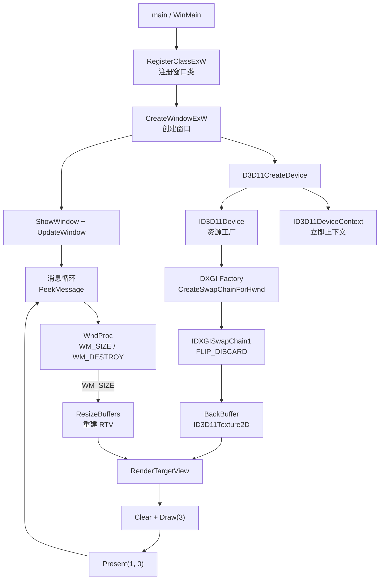

# Win32 + Direct3D 11：在 Windows 上画一个三角形，从消息循环到交换链

> 本文基于 Windows 10/11、Direct3D 11（Shader Model 5.0）、D3DCompiler 47、C++20。作者在 macOS 上用 mingw-w64 GCC 16.2.0 完成了交叉编译与链接检查，但无法启动 Windows 窗口；文中会明确区分「实测」与「需要在 Windows 上运行」。示例使用 `DXGI_SWAP_EFFECT_FLIP_DISCARD`，需要 Windows 10 及以上。

Win32 是写字楼的物业，消息循环是前台的值班表。窗口不是「你想画就画」——系统把鼠标、键盘、重绘、缩放这些事件一件件塞给你，你在 `WndProc` 里决定怎么响应。

Direct3D 11 是装修队。你告诉它「清空这块地、用这套工序、画三个点」，剩下的状态怎么排布、什么时候提交给 GPU，driver 帮你处理。和 Metal 相比，D3D11 少了「管线状态对象」这个中枢，多了「立即上下文」这台状态机；和 Vulkan 相比，它把同步和内存管理的大部分工作留给了驱动。

## 三套栈，三种分工

| 平台 | 窗口系统 | 图形 API | 谁管理呈现 | 谁管理同步 |
|:-----|:---------|:---------|:-----------|:-----------|
| macOS | Cocoa（AppKit） | Metal | `CAMetalLayer` + WindowServer | Metal 内部 + drawable 节流 |
| Windows | Win32 | Direct3D 11 | DXGI 交换链 | DXGI + driver |
| Linux | XCB | Vulkan | 应用自己创建 swapchain | 应用自己写 semaphore / fence |

D3D11 站在中间：呈现交给 DXGI，同步大部分交给 driver，比 Vulkan 省事，比 Metal 啰嗦。本文把 Win32 窗口和 D3D11 渲染拼成一条完整链路。

## 从窗口到屏幕的链路



这张图有两个入口：Win32 负责「窗口活着」，D3D11 负责「画面出来」。消息循环是它们交汇的地方：每一轮先处理消息，再渲染一帧。

## 第一层：Win32 窗口是消息驱动的

一个最小 Win32 应用要做四件事：

1. 注册窗口类（`WNDCLASSEXW` + `RegisterClassExW`）；
2. 创建窗口（`CreateWindowExW`）；
3. 显示窗口（`ShowWindow` + `UpdateWindow`）；
4. 跑消息循环，把消息分发给 `WndProc`。

```cpp
WNDCLASSEXW wc{};
wc.cbSize = sizeof(wc);
wc.style = CS_HREDRAW | CS_VREDRAW;
wc.lpfnWndProc = WndProc;
wc.hInstance = instance;
wc.hCursor = LoadCursorW(nullptr, IDC_ARROW);
wc.lpszClassName = L"D3D11TriangleWindow";
RegisterClassExW(&wc);
```

`WndProc` 是一个大 `switch`，只处理你关心的事件，其余交给 `DefWindowProcW`：

```cpp
switch (msg) {
case WM_SIZE:
    if (g_app && wParam != SIZE_MINIMIZED) {
        g_app->resize(LOWORD(lParam), HIWORD(lParam));
    }
    return 0;
case WM_DESTROY:
    PostQuitMessage(0);
    return 0;
default:
    return DefWindowProcW(hwnd, msg, wParam, lParam);
}
```

两个消息决定了 demo 的骨架：

- `WM_SIZE` 的 `lParam` 低 16 位是客户区宽度，高 16 位是高度。窗口被拖动、最大化、最小化都会触发，交换链必须跟着重建；
- `WM_DESTROY` 是窗口销毁时最后的机会，这里调用 `PostQuitMessage(0)`，让消息循环退出。

### 为什么不用 GetMessage

教科书的窗口循环长这样：

```cpp
while (GetMessage(&msg, nullptr, 0, 0)) {
    TranslateMessage(&msg);
    DispatchMessage(&msg);
}
```

`GetMessage` 在没有消息时会阻塞。对纯事件驱动的程序没问题，对游戏/渲染循环不行：窗口静止时没有消息，你就不画了。

demo 用 `PeekMessage` 非阻塞地取消息，取完就渲染：

```cpp
while (running) {
    MSG msg;
    while (PeekMessageW(&msg, nullptr, 0, 0, PM_REMOVE)) {
        if (msg.message == WM_QUIT) { running = false; break; }
        TranslateMessage(&msg);
        DispatchMessageW(&msg);
    }
    if (!running) break;

    if (!app.render()) break;   // 渲染 + Present
}
```

这个循环会跑满 CPU 吗？不会。`Present(1, 0)` 会等垂直同步，相当于自带帧率上限。这也是为什么 demo 没有 `Sleep`。

### 客户区 vs 窗口区

`CreateWindowExW` 的宽高指的是**整个窗口**，包括标题栏和边框；D3D11 要的是**客户区**尺寸。所以创建前用 `AdjustWindowRect` 换算：

```cpp
RECT rect{0, 0, 1280, 720};
AdjustWindowRect(&rect, WS_OVERLAPPEDWINDOW, FALSE);
// rect.right - rect.left 才是传给 CreateWindowExW 的宽度
```

拿到窗口后，再用 `GetClientRect` 取实际客户区大小交给 D3D11。窗口边框宽度随主题和 DPI 变化，不要硬编码。

## 第二层：设备和上下文

D3D11 的核心只有两个对象：

| 对象 | 角色 | 线程模型 |
|:-----|:-----|:---------|
| `ID3D11Device` | 资源工厂：纹理、缓冲、shader、状态对象 | 可以被多个线程同时使用 |
| `ID3D11DeviceContext` | 命令录制器：设置状态、发起 draw | 立即上下文同一时间只能被一个线程使用 |

创建入口是 `D3D11CreateDevice`：

```cpp
const D3D_FEATURE_LEVEL levels[] = {
    D3D_FEATURE_LEVEL_11_0,
    D3D_FEATURE_LEVEL_10_1,
    D3D_FEATURE_LEVEL_10_0,
};
HRESULT hr = D3D11CreateDevice(
    nullptr, D3D_DRIVER_TYPE_HARDWARE, nullptr, flags, levels,
    static_cast<UINT>(sizeof(levels) / sizeof(levels[0])), D3D11_SDK_VERSION,
    device_.GetAddressOf(), &featureLevel_, context_.GetAddressOf());
```

特征等级（feature level）决定你能用哪些能力：`11_0` 支持完整的 D3D11 特性集；`10_0` 是降级路径。demo 传入数组让系统挑最高的，实际拿到哪个由硬件决定。

### 资源与视图分离

D3D11 有一个和 Metal、Vulkan 都不太一样的设计：**资源**和**视图**分开。

- `ID3D11Texture2D` 是显存里的一块纹理，只描述尺寸、格式、用途；
- `ID3D11RenderTargetView` 描述「这块纹理作为渲染目标时怎么用」；
- `ID3D11ShaderResourceView` 描述「作为 shader 输入时怎么读」；
- `ID3D11DepthStencilView` 描述「作为深度模板时怎么用」。

同一块纹理可以创建多个视图，用不同格式读写。这种设计把「存储」和「绑定用途」解耦，是 D3D 家族从 D3D10 开始的核心思想。

demo 里交换链的后备缓冲是纹理，渲染前要给它建一个 RTV：

```cpp
ComPtr<ID3D11Texture2D> backBuffer;
swapChain_->GetBuffer(0, IID_PPV_ARGS(backBuffer.GetAddressOf()));
device_->CreateRenderTargetView(backBuffer.Get(), nullptr, rtv_.GetAddressOf());
```

### 没有 PSO，状态是「设」出来的

Metal 把 shader 和固定状态编译成一个 `MTLRenderPipelineState`；Vulkan 把它们编译成 `VkPipeline`。D3D11 没有等价物：

- shader 在 `CreateVertexShader` / `CreatePixelShader` 时编译；
- 光栅化、混合、深度状态是独立的 `ID3D11RasterizerState` / `ID3D11BlendState` / `ID3D11DepthStencilState`；
- 每帧通过 `RSSetState`、`OMSetBlendState`、`VSSetShader` 这些调用把状态设到上下文上；
- driver 在 draw 时把当前状态组合成真正的硬件配置。

好处是灵活、状态对象可以复用；坏处是状态泄漏很容易：上一帧设的混合状态没关，下一帧就莫名透明。Vulkan 的 pipeline 和 Metal 的 PSO 用「一次性编译」换来了「状态不可变」，D3D11 用「随时可设」换来了「你必须自己记得复位」。

### COM 与引用计数

D3D11 的所有对象都是 COM 接口。COM 的规则很简单：`AddRef` 加一，`Release` 减一，减到零自动销毁。C++ 里裸用指针很容易漏 `Release`，所以 demo 写了一个 20 行的 `ComPtr`：

```cpp
template <typename T>
class ComPtr {
public:
    ~ComPtr() { Reset(); }
    T* Get() const { return ptr_; }
    T* operator->() const { return ptr_; }
    T** GetAddressOf() { Reset(); return &ptr_; }
    void Reset() {
        if (ptr_) { ptr_->Release(); ptr_ = nullptr; }
    }
private:
    T* ptr_ = nullptr;
};
```

生产代码用 `Microsoft::WRL::ComPtr`（在 `<wrl/client.h>` 里）就行。demo 手写一份，一是为了让「所有权」显式可见，二是因为 mingw-w64 不带 WRL，手写版才能做跨平台语法检查。

## 第三层：DXGI 交换链

D3D11 只负责画，不负责「把画好的东西送到屏幕上」。呈现由 DXGI 管：

- `IDXGIFactory2` 创建交换链；
- `IDXGISwapChain1` 管理后台缓冲和呈现；
- `Present` 把后台缓冲交给桌面窗口管理器（DWM）。

拿到工厂的路径有点绕：device → DXGI device → adapter → factory。

```cpp
ComPtr<IDXGIDevice> dxgiDevice;
device_->QueryInterface(IID_PPV_ARGS(dxgiDevice.GetAddressOf()));

ComPtr<IDXGIAdapter> adapter;
dxgiDevice->GetAdapter(adapter.GetAddressOf());

ComPtr<IDXGIFactory2> factory;
adapter->GetParent(IID_PPV_ARGS(factory.GetAddressOf()));
```

然后创建交换链：

```cpp
DXGI_SWAP_CHAIN_DESC1 desc{};
desc.Width = width_;
desc.Height = height_;
desc.Format = DXGI_FORMAT_B8G8R8A8_UNORM;
desc.SampleDesc.Count = 1;
desc.BufferUsage = DXGI_USAGE_RENDER_TARGET_OUTPUT;
desc.BufferCount = 2;
desc.SwapEffect = DXGI_SWAP_EFFECT_FLIP_DISCARD;
desc.AlphaMode = DXGI_ALPHA_MODE_IGNORE;

factory->CreateSwapChainForHwnd(device_.Get(), hwnd_, &desc,
                                nullptr, nullptr, swapChain_.GetAddressOf());
```

### FLIP_DISCARD 是什么

老代码常见 `DXGI_SWAP_EFFECT_DISCARD`，那是 BitBlt 模型：每次 Present 要把后台缓冲的内容拷贝给 DWM。`FLIP_DISCARD` 是 Windows 10 引入的现代模型：

- 交换链维护一组可翻转的缓冲，Present 只是把「当前前台」和「后台」的引用交换，不做拷贝；
- `DISCARD` 表示 Present 之后后台缓冲内容作废，下次画之前必须整个重画（对我们这种每帧清屏的程序正合适）；
- 更低的 CPU 开销，更好的全屏和 HDR 行为。

代价是限制更多：flip 模型不能直接对交换链后台缓冲做 MSAA（要自己 resolve），也不能用 GDI 往上画。demo 的 `SampleDesc.Count = 1` 避开了 MSAA 的问题。

### Present 与垂直同步

```cpp
swapChain_->Present(1, 0);   // 1 = 等一个垂直同步
```

第一个参数是 sync interval：`1` 表示等下一个 vblank，相当于开垂直同步；`0` 表示立即呈现，可能撕裂。第二个参数是 flags，一般传 0。

`Present` 不保证立即返回：GPU 队列满时它会阻塞，这也是 demo 的帧率节流来源。

### ResizeBuffers

窗口大小改变时必须重建交换链缓冲：

```cpp
context_->OMSetRenderTargets(0, nullptr, nullptr);   // 1. 解绑
rtv_.Reset();                                        // 2. 释放 RTV

swapChain_->ResizeBuffers(0, width, height,
                          DXGI_FORMAT_UNKNOWN, 0);   // 3. 尺寸变了，格式不变

createRenderTarget();                                // 4. 重建 RTV
```

顺序不能乱。只要还有任何一个引用指向后台缓冲（RTV、shader 资源视图、甚至上下文里绑定的目标），`ResizeBuffers` 就会返回 `DXGI_ERROR_INVALID_CALL`。`0` 参数的意思是「沿用原来的缓冲数量和格式」。

## 第四层：HLSL 与运行时编译

demo 的 HLSL 和 Metal 版几乎一一对应：

```hlsl
struct VSOut {
    float4 position : SV_POSITION;
    float3 color    : COLOR;
};

VSOut VS(uint vid : SV_VertexID) {
    float2 positions[3] = { ... };
    float3 colors[3] = { ... };
    VSOut o;
    o.position = float4(positions[vid], 0.0, 1.0);
    o.color    = colors[vid];
    return o;
}

float4 PS(VSOut input) : SV_TARGET {
    return float4(input.color, 1.0);
}
```

语义（semantic）对照：

| 语义 | 含义 | Metal 等价物 |
|:-----|:-----|:-------------|
| `SV_VertexID` | 顶点编号 | `[[vertex_id]]` |
| `SV_POSITION` | 裁剪空间位置 | `[[position]]` |
| `SV_TARGET` | 像素着色器输出 | 片段函数返回值 |
| `COLOR`（自定义） | 顶点到像素的插值数据 | `[[stage_in]]` 结构成员 |

运行时用 `D3DCompile` 编译：

```cpp
HRESULT hr = D3DCompile(kHLSL, std::strlen(kHLSL), "triangle.hlsl",
                        nullptr, nullptr, "VS", "vs_5_0", flags, 0,
                        vsBlob.GetAddressOf(), errorBlob.GetAddressOf());
```

参数依次是源码、长度、文件名（用于报错）、宏定义、include 处理器、入口点、profile、标志。失败时 `errorBlob` 里是完整的编译错误，直接打印即可。

生产项目通常在构建期用 `fxc` 离线编译成 `.cso`，运行时用 `D3DReadFileToBlob` 加载。`D3DCompile` 在 Windows 10/11 上由 `D3DCompiler_47.dll` 提供，做 demo 和工具足够；新项目如果要用 Shader Model 6 / DXIL，则要换 `dxc`。

三种 shader 路径对比：

| 栈 | 着色语言 | 中间产物 | 离线工具 |
|:---|:---------|:---------|:---------|
| Metal | MSL | metallib | `xcrun metal` |
| Direct3D 11 | HLSL | DXBC | `fxc` / `D3DCompile` |
| Vulkan | GLSL / HLSL | SPIR-V | `glslc` / `dxc` |

## 第五层：每帧做什么

```cpp
// 1. 清屏
context_->OMSetRenderTargets(1, rtv_.GetAddressOf(), nullptr);
context_->ClearRenderTargetView(rtv_.Get(), clear);

// 2. 设置管线状态
context_->RSSetViewports(1, &viewport_);
context_->IASetInputLayout(nullptr);   // shader 不用顶点输入
context_->IASetPrimitiveTopology(D3D11_PRIMITIVE_TOPOLOGY_TRIANGLELIST);
context_->VSSetShader(vs_.Get(), nullptr, 0);
context_->PSSetShader(ps_.Get(), nullptr, 0);

// 3. 画
context_->Draw(3, 0);

// 4. 呈现
swapChain_->Present(1, 0);
```

和 Metal 版的四步几乎同构：清屏 → 设状态 → 画 → 呈现。区别在于：

- Metal 的清屏是 render pass 的 `loadAction`，D3D11 是显式的 `ClearRenderTargetView`；
- Metal 把状态打包在 PSO 里，D3D11 要把状态一项项设到上下文；
- D3D11 的 `Draw` 是立即上下文 API，调用时命令被录进驱动队列，不需要手动 commit；`Present` 时会提交。

因为 shader 只用 `SV_VertexID` 生成顶点，输入布局传 `nullptr` 即可。这和 Vulkan 的 `gl_VertexIndex`、Metal 的 `[[vertex_id]]` 是同一个思路。

没有 fence、没有 semaphore、没有内存屏障。D3D11 的运行时和驱动在 `Map`/`Unmap`、`UpdateSubresource`、`Present` 这些边界上替你处理大部分同步。代价是你看不见它们，遇到性能问题需要 PIX 或 GPUView 才能定位。

## 完整 demo

约 410 行，单文件，保存为 `win32_d3d11_triangle.cpp`：

```cpp
// win32_d3d11_triangle.cpp — Win32 窗口 + Direct3D 11 + 运行时编译 HLSL
// MSVC:
//   cl /nologo /std:c++20 /EHsc /W4 win32_d3d11_triangle.cpp ^
//      /link d3d11.lib dxgi.lib d3dcompiler.lib user32.lib gdi32.lib
// mingw-w64 交叉编译（语法检查）:
//   x86_64-w64-mingw32-g++ -std=c++20 -Wall -Wextra -municode ^
//      win32_d3d11_triangle.cpp -ld3d11 -ldxgi -ld3dcompiler -lgdi32 -o triangle.exe

#ifndef UNICODE
#define UNICODE
#endif
#ifndef _UNICODE
#define _UNICODE
#endif
#define WIN32_LEAN_AND_MEAN
#define NOMINMAX

#include <windows.h>
#include <d3d11.h>
#include <dxgi1_2.h>
#include <d3dcompiler.h>

#include <cstdio>
#include <cstring>
#include <chrono>

// ---------------------------------------------------------------- COM 小助手
// 生产代码用 Microsoft::WRL::ComPtr；这里手写 20 行，顺便看清 AddRef/Release。
template <typename T>
class ComPtr {
public:
    ComPtr() = default;
    ~ComPtr() { Reset(); }

    ComPtr(const ComPtr&) = delete;
    ComPtr& operator=(const ComPtr&) = delete;

    T* Get() const { return ptr_; }
    explicit operator bool() const { return ptr_ != nullptr; }
    T* operator->() const { return ptr_; }
    T** GetAddressOf() {
        Reset();
        return &ptr_;
    }

    void Reset() {
        if (ptr_) {
            ptr_->Release();
            ptr_ = nullptr;
        }
    }

private:
    T* ptr_ = nullptr;
};

// ---------------------------------------------------------------- HLSL 源码
static const char* kHLSL = R"HLSL(
struct VSOut {
    float4 position : SV_POSITION;
    float3 color    : COLOR;
};

VSOut VS(uint vid : SV_VertexID) {
    float2 positions[3] = {
        float2( 0.0,  0.75),
        float2(-0.75, -0.75),
        float2( 0.75, -0.75)
    };
    float3 colors[3] = {
        float3(1.0, 0.2, 0.2),
        float3(0.2, 1.0, 0.2),
        float3(0.2, 0.4, 1.0)
    };
    VSOut o;
    o.position = float4(positions[vid], 0.0, 1.0);
    o.color    = colors[vid];
    return o;
}

float4 PS(VSOut input) : SV_TARGET {
    return float4(input.color, 1.0);
}
)HLSL";

// ---------------------------------------------------------------- 应用状态
class App {
public:
    bool init(HWND hwnd, UINT width, UINT height);
    void resize(UINT width, UINT height);
    bool render();
    void shutdown();

private:
    bool createDeviceAndSwapChain(HWND hwnd, UINT width, UINT height);
    bool compileShaders();
    bool createRenderTarget();
    void printAdapterInfo();

    HWND hwnd_ = nullptr;
    UINT width_ = 0;
    UINT height_ = 0;

    ComPtr<ID3D11Device> device_;
    ComPtr<ID3D11DeviceContext> context_;
    ComPtr<IDXGISwapChain1> swapChain_;
    ComPtr<ID3D11RenderTargetView> rtv_;
    ComPtr<ID3D11VertexShader> vs_;
    ComPtr<ID3D11PixelShader> ps_;
    D3D_FEATURE_LEVEL featureLevel_ = D3D_FEATURE_LEVEL_11_0;
    D3D11_VIEWPORT viewport_{};
};

static void logHr(const char* what, HRESULT hr) {
    std::fprintf(stderr, "%s failed: HRESULT 0x%08lX\n", what,
                 static_cast<unsigned long>(hr));
}

bool App::createDeviceAndSwapChain(HWND hwnd, UINT width, UINT height) {
    hwnd_ = hwnd;
    width_ = width;
    height_ = height;

    UINT flags = 0;
#if defined(_DEBUG)
    flags |= D3D11_CREATE_DEVICE_DEBUG;
#endif
    const D3D_FEATURE_LEVEL levels[] = {
        D3D_FEATURE_LEVEL_11_0,
        D3D_FEATURE_LEVEL_10_1,
        D3D_FEATURE_LEVEL_10_0,
    };

    HRESULT hr = D3D11CreateDevice(
        nullptr, D3D_DRIVER_TYPE_HARDWARE, nullptr, flags, levels,
        static_cast<UINT>(sizeof(levels) / sizeof(levels[0])), D3D11_SDK_VERSION,
        device_.GetAddressOf(), &featureLevel_, context_.GetAddressOf());
    if (FAILED(hr)) {
        logHr("D3D11CreateDevice", hr);
        return false;
    }

    // 从 device 一路拿到 DXGI 工厂：device -> adapter -> factory
    ComPtr<IDXGIDevice> dxgiDevice;
    hr = device_->QueryInterface(IID_PPV_ARGS(dxgiDevice.GetAddressOf()));
    if (FAILED(hr)) { logHr("QueryInterface(IDXGIDevice)", hr); return false; }

    ComPtr<IDXGIAdapter> adapter;
    hr = dxgiDevice->GetAdapter(adapter.GetAddressOf());
    if (FAILED(hr)) { logHr("GetAdapter", hr); return false; }

    ComPtr<IDXGIFactory2> factory;
    hr = adapter->GetParent(IID_PPV_ARGS(factory.GetAddressOf()));
    if (FAILED(hr)) { logHr("GetParent(IDXGIFactory2)", hr); return false; }

    DXGI_SWAP_CHAIN_DESC1 desc{};
    desc.Width = width_;
    desc.Height = height_;
    desc.Format = DXGI_FORMAT_B8G8R8A8_UNORM;
    desc.SampleDesc.Count = 1;
    desc.BufferUsage = DXGI_USAGE_RENDER_TARGET_OUTPUT;
    desc.BufferCount = 2;                       // 双缓冲
    desc.SwapEffect = DXGI_SWAP_EFFECT_FLIP_DISCARD;
    desc.AlphaMode = DXGI_ALPHA_MODE_IGNORE;

    hr = factory->CreateSwapChainForHwnd(device_.Get(), hwnd_, &desc,
                                         nullptr, nullptr,
                                         swapChain_.GetAddressOf());
    if (FAILED(hr)) { logHr("CreateSwapChainForHwnd", hr); return false; }

    factory->MakeWindowAssociation(hwnd_, DXGI_MWA_NO_ALT_ENTER);

    DXGI_ADAPTER_DESC adapterDesc{};
    adapter->GetDesc(&adapterDesc);
    std::printf("adapter: %ls\n", adapterDesc.Description);
    return true;
}

bool App::compileShaders() {
    UINT flags = D3DCOMPILE_ENABLE_STRICTNESS;
#if defined(_DEBUG)
    flags |= D3DCOMPILE_DEBUG | D3DCOMPILE_SKIP_OPTIMIZATION;
#else
    flags |= D3DCOMPILE_OPTIMIZATION_LEVEL3;
#endif

    ComPtr<ID3DBlob> vsBlob;
    ComPtr<ID3DBlob> psBlob;
    ComPtr<ID3DBlob> errorBlob;

    HRESULT hr = D3DCompile(kHLSL, std::strlen(kHLSL), "triangle.hlsl",
                            nullptr, nullptr, "VS", "vs_5_0", flags, 0,
                            vsBlob.GetAddressOf(), errorBlob.GetAddressOf());
    if (FAILED(hr)) {
        if (errorBlob) {
            std::fprintf(stderr, "%s\n",
                         static_cast<const char*>(errorBlob->GetBufferPointer()));
        }
        logHr("D3DCompile(VS)", hr);
        return false;
    }

    hr = D3DCompile(kHLSL, std::strlen(kHLSL), "triangle.hlsl",
                    nullptr, nullptr, "PS", "ps_5_0", flags, 0,
                    psBlob.GetAddressOf(), errorBlob.GetAddressOf());
    if (FAILED(hr)) {
        if (errorBlob) {
            std::fprintf(stderr, "%s\n",
                         static_cast<const char*>(errorBlob->GetBufferPointer()));
        }
        logHr("D3DCompile(PS)", hr);
        return false;
    }

    hr = device_->CreateVertexShader(vsBlob->GetBufferPointer(),
                                     vsBlob->GetBufferSize(), nullptr,
                                     vs_.GetAddressOf());
    if (FAILED(hr)) { logHr("CreateVertexShader", hr); return false; }

    hr = device_->CreatePixelShader(psBlob->GetBufferPointer(),
                                    psBlob->GetBufferSize(), nullptr,
                                    ps_.GetAddressOf());
    if (FAILED(hr)) { logHr("CreatePixelShader", hr); return false; }
    return true;
}

bool App::createRenderTarget() {
    ComPtr<ID3D11Texture2D> backBuffer;
    HRESULT hr = swapChain_->GetBuffer(0, IID_PPV_ARGS(backBuffer.GetAddressOf()));
    if (FAILED(hr)) { logHr("GetBuffer", hr); return false; }

    hr = device_->CreateRenderTargetView(backBuffer.Get(), nullptr,
                                         rtv_.GetAddressOf());
    if (FAILED(hr)) { logHr("CreateRenderTargetView", hr); return false; }

    viewport_.TopLeftX = 0.0f;
    viewport_.TopLeftY = 0.0f;
    viewport_.Width = static_cast<float>(width_);
    viewport_.Height = static_cast<float>(height_);
    viewport_.MinDepth = 0.0f;
    viewport_.MaxDepth = 1.0f;
    return true;
}

bool App::init(HWND hwnd, UINT width, UINT height) {
    if (!createDeviceAndSwapChain(hwnd, width, height)) return false;
    if (!compileShaders()) return false;
    if (!createRenderTarget()) return false;

    std::printf("feature level: 0x%04X\n", static_cast<unsigned>(featureLevel_));
    std::printf("swap chain: %ux%u, FLIP_DISCARD, 2 buffers\n", width_, height_);
    return true;
}

void App::resize(UINT width, UINT height) {
    if (!swapChain_ || width == 0 || height == 0) return;
    if (width == width_ && height == height_) return;

    width_ = width;
    height_ = height;

    // 1. 解绑并释放对后备缓冲区的所有引用
    context_->OMSetRenderTargets(0, nullptr, nullptr);
    rtv_.Reset();

    // 2. 0 表示沿用原来的缓冲区数量和格式
    HRESULT hr = swapChain_->ResizeBuffers(0, width_, height_,
                                           DXGI_FORMAT_UNKNOWN, 0);
    if (FAILED(hr)) { logHr("ResizeBuffers", hr); return; }

    // 3. 重建 RTV 和 viewport
    if (!createRenderTarget()) { logHr("recreate RTV", E_FAIL); }
}

bool App::render() {
    if (!rtv_) {
        return true;   // 窗口最小化或 resize 失败时没有可画的 target
    }
    const float clear[4] = {0.08f, 0.08f, 0.12f, 1.0f};
    context_->OMSetRenderTargets(1, rtv_.GetAddressOf(), nullptr);
    context_->ClearRenderTargetView(rtv_.Get(), clear);

    context_->RSSetViewports(1, &viewport_);
    context_->IASetInputLayout(nullptr);
    context_->IASetPrimitiveTopology(D3D11_PRIMITIVE_TOPOLOGY_TRIANGLELIST);
    context_->VSSetShader(vs_.Get(), nullptr, 0);
    context_->PSSetShader(ps_.Get(), nullptr, 0);
    context_->Draw(3, 0);

    HRESULT hr = swapChain_->Present(1, 0);   // 1 = 等垂直同步
    if (hr == DXGI_ERROR_DEVICE_REMOVED) {
        std::fprintf(stderr, "device removed: 0x%08lX\n",
                     static_cast<unsigned long>(device_->GetDeviceRemovedReason()));
        return false;
    }
    return SUCCEEDED(hr);
}

void App::shutdown() {
    if (context_) context_->ClearState();
    ps_.Reset();
    vs_.Reset();
    rtv_.Reset();
    swapChain_.Reset();
    context_.Reset();
    device_.Reset();
}

// ---------------------------------------------------------------- Win32 窗口
static App* g_app = nullptr;

static LRESULT CALLBACK WndProc(HWND hwnd, UINT msg, WPARAM wParam, LPARAM lParam) {
    switch (msg) {
    case WM_SIZE:
        if (g_app && wParam != SIZE_MINIMIZED) {
            g_app->resize(LOWORD(lParam), HIWORD(lParam));
        }
        return 0;
    case WM_DESTROY:
        PostQuitMessage(0);
        return 0;
    default:
        return DefWindowProcW(hwnd, msg, wParam, lParam);
    }
}

static int run(HINSTANCE instance, int showCmd) {
    const wchar_t kClassName[] = L"D3D11TriangleWindow";

    WNDCLASSEXW wc{};
    wc.cbSize = sizeof(wc);
    wc.style = CS_HREDRAW | CS_VREDRAW;
    wc.lpfnWndProc = WndProc;
    wc.hInstance = instance;
    wc.hCursor = LoadCursorW(nullptr, IDC_ARROW);
    wc.lpszClassName = kClassName;
    if (!RegisterClassExW(&wc)) {
        std::fprintf(stderr, "RegisterClassExW failed\n");
        return 1;
    }

    RECT rect{0, 0, 1280, 720};
    AdjustWindowRect(&rect, WS_OVERLAPPEDWINDOW, FALSE);
    HWND hwnd = CreateWindowExW(
        0, kClassName, L"Win32 + Direct3D 11", WS_OVERLAPPEDWINDOW,
        CW_USEDEFAULT, CW_USEDEFAULT, rect.right - rect.left,
        rect.bottom - rect.top, nullptr, nullptr, instance, nullptr);
    if (!hwnd) {
        std::fprintf(stderr, "CreateWindowExW failed\n");
        return 1;
    }

    RECT client{};
    GetClientRect(hwnd, &client);
    UINT width = static_cast<UINT>(client.right - client.left);
    UINT height = static_cast<UINT>(client.bottom - client.top);

    App app;
    g_app = &app;
    if (!app.init(hwnd, width, height)) {
        g_app = nullptr;
        DestroyWindow(hwnd);
        return 1;
    }

    ShowWindow(hwnd, showCmd);
    UpdateWindow(hwnd);

    constexpr UINT kFrameLimit = 180;   // demo 自动退出
    UINT frames = 0;
    bool running = true;
    auto start = std::chrono::steady_clock::now();

    while (running) {
        MSG msg;
        while (PeekMessageW(&msg, nullptr, 0, 0, PM_REMOVE)) {
            if (msg.message == WM_QUIT) {
                running = false;
                break;
            }
            TranslateMessage(&msg);
            DispatchMessageW(&msg);
        }
        if (!running) break;

        if (!app.render()) break;

        if (++frames == kFrameLimit) {
            PostMessageW(hwnd, WM_CLOSE, 0, 0);
        }
    }

    auto elapsed = std::chrono::duration<double, std::milli>(
                       std::chrono::steady_clock::now() - start).count();
    std::printf("frames: %u in %.0f ms (%.1f fps)\n", frames, elapsed,
                frames * 1000.0 / elapsed);

    app.shutdown();
    g_app = nullptr;

    if (IsWindow(hwnd)) {
        DestroyWindow(hwnd);
    }
    return 0;
}

// 用控制台子系统（main 而不是 WinMain），方便直接看到 printf 输出。
int main() {
    HINSTANCE instance = GetModuleHandleW(nullptr);
    return run(instance, SW_SHOWDEFAULT);
}
```

几个说明：

- 用 `main()` 而不是 `WinMain()`，是为了让 demo 作为控制台程序运行，`printf` 的输出能直接看到；窗口本身不要求 `WinMain`；
- 画满 180 帧后自动 `WM_CLOSE`，方便演示；真实应用删掉 `kFrameLimit` 逻辑；
- `_DEBUG` 下会请求 `D3D11_CREATE_DEVICE_DEBUG`，需要系统装了「图形工具」可选功能，否则设备创建会失败；正式构建不会定义 `_DEBUG`；
- `ComPtr` 是手写的子集，够 demo 用；生产代码用 WRL 的 `ComPtr<ID3D11Device>`。

## 构建与验证

Windows 上用 MSVC：

```bat
cl /nologo /std:c++20 /EHsc /W4 win32_d3d11_triangle.cpp ^
   /link d3d11.lib dxgi.lib d3dcompiler.lib user32.lib gdi32.lib
```

作者环境是 macOS，无法启动 Windows 窗口，所以做了力所能及的交叉编译验证：用 mingw-w64 的头文件和导入库，检查语法并链接出真正的 PE 可执行文件。

```bash
$ x86_64-w64-mingw32-g++ -std=c++20 -Wall -Wextra -DUNICODE -D_UNICODE \
    win32_d3d11_triangle.cpp -o triangle.exe \
    -ld3d11 -ldxgi -ld3dcompiler -lgdi32 -luser32 -luuid
$ file triangle.exe
triangle.exe: PE32+ executable (console) x86-64, for MS Windows
$ x86_64-w64-mingw32-objdump -p triangle.exe | grep 'DLL Name'
	DLL Name: d3d11.dll
	DLL Name: D3DCOMPILER_47.dll
	DLL Name: libgcc_s_seh-1.dll
	DLL Name: KERNEL32.dll
	...
	DLL Name: USER32.dll
```

（输出里省略了 libstdc++、若干 `api-ms-win-crt-*` 等 mingw 运行时依赖。）

这说明代码的 API 调用、头文件、链接符号都是对的；它不能证明运行时行为，窗口、交换链、着色器都要在 Windows 10/11 上实际跑过才算数。

在 Windows 上运行后，会看到一个 1280 × 720 的窗口，深蓝灰背景，中间一个红绿蓝渐变的三角形。控制台会打印适配器名称、feature level、交换链参数，画满 180 帧后打印平均帧率并退出。

## 常见坑

| 坑 | 症状 | 修法 |
|:---|:-----|:-----|
| 不检查 HRESULT | 后面某一步莫名失败，找不到源头 | 每个返回 HRESULT 的调用都检查，失败时打印 `0x%08lX` |
| COM 引用泄漏 | 显存越用越多，退出时资源没释放 | 用 RAII 的 `ComPtr`；每次 `GetAddressOf` 前先 `Reset` |
| `ResizeBuffers` 前没解绑 | 返回 `DXGI_ERROR_INVALID_CALL` | 先 `OMSetRenderTargets(0, ...)`，再释放 RTV |
| 窗口最小化时 `WM_SIZE` 为 0 | 创建 0 尺寸缓冲失败 | 判断 `wParam != SIZE_MINIMIZED` 和宽高非零 |
| 设备被移除 | `Present` 返回 `DXGI_ERROR_DEVICE_REMOVED` | 用 `GetDeviceRemovedReason` 查原因并重建设备 |
| 调试层没装 | `D3D11CreateDevice` 失败，错误码 `DXGI_ERROR_SDK_COMPONENT_MISSING` | 安装「图形工具」可选功能，或别在 `_DEBUG` 下请求调试层 |
| 状态泄漏 | 上一帧的混合/深度状态影响下一帧 | 每帧显式设置用到的状态，或统一走状态管理器 |
| 高 DPI 下尺寸不对 | 画面只占窗口一部分或模糊 | 声明 Per-Monitor DPI 感知，按物理像素创建交换链 |
| `Present(0, 0)` | 画面撕裂、GPU 空转 | 用 `Present(1, 0)` 跟随垂直同步 |
| 在 flip 模型上直接用 MSAA | 交换链创建失败 | 先渲染到 MSAA 纹理，再 resolve 到后台缓冲 |

## D3D11 在 2026 年的位置

D3D11 不新，但它没有消失：

- Windows 10/11 全支持，覆盖广；
- API 比 D3D12/Vulkan 简单得多，中小项目、工具、引擎的兼容路径大量使用；
- 驱动替你管理内存和同步，开发快，但在 draw call 密集的场景 CPU 开销更高；
- D3D12 和 Vulkan 把控制权交给你，适合引擎和性能敏感场景，但代码量和心智负担成倍增长。

D3D11 的定位很像 Metal：够用、够快、比 Vulkan 省心。真正需要精细控制时，才值得付出显式同步和内存管理的代价。

## 小结

Win32 + D3D11 的链路可以压缩成两句话：

- **Win32 管窗口生命周期**：注册、创建、消息循环、`WM_SIZE` / `WM_DESTROY`；
- **D3D11 管 GPU 工作**：设备当工厂、上下文当状态机、DXGI 交换链负责呈现。

记忆点只有三个：

1. 设备与上下文分离，资源与视图分离；
2. 状态是「设」出来的，不是编译进管线的，用完记得复位；
3. 交换链的 `ResizeBuffers` 之前，先释放所有后台缓冲引用。

如果你已经读过 Cocoa + Metal 那篇，会发现两边的每帧结构几乎一样：清屏、设状态、draw、present。差异主要在「谁持有这些状态」——Metal 打包进 PSO，D3D11 摊在上下文里。到了 Vulkan，这些状态会被进一步摊开成 pipeline、render pass 和同步对象。

---

**相关文章**

- [图形编程：三套窗口系统与 GPU API](index.md)
- [Cocoa + Metal：在 macOS 上画一个三角形](cocoa-metal.md)
- [XCB + Vulkan：在 Linux 上画一个三角形](xcb-vulkan.md)
- [C++ 编译与链接：菜单、厨房和分店](../../languages/cpp/compile-and-link.md)
