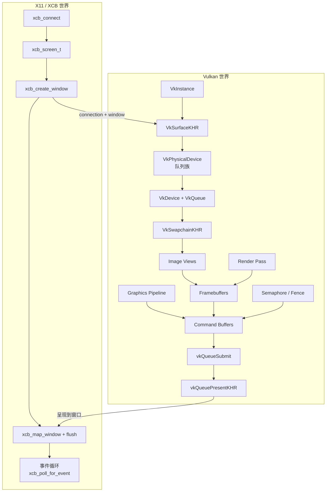
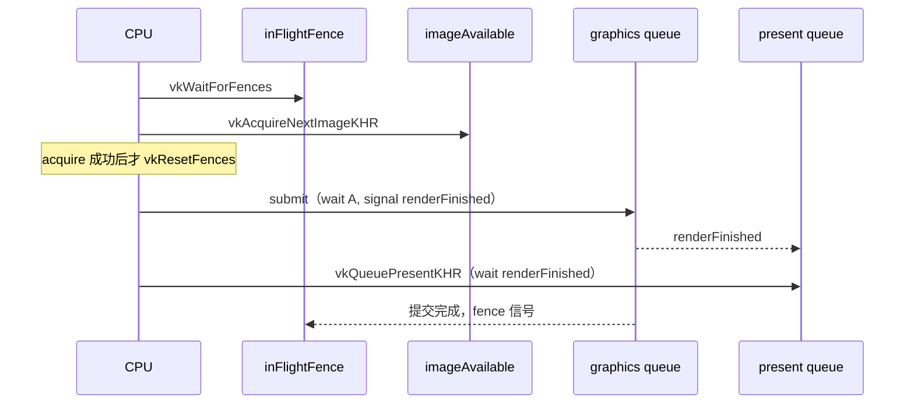

# XCB + Vulkan：在 Linux 上画一个三角形，把 GPU 的每一步都写出来

> 本文基于 Vulkan 1.0 API 与 C++20。本地编译使用 Vulkan-Headers 1.4.363.0、glslc / shaderc v2026.4、XCB 1.17.0；完整的构建、运行和验证输出见文末「构建与运行」。

X11 是写字楼的物业，XCB 是那本物业协议的直接实现。你不「调用函数」，而是往连接里写请求，再等回复或事件。窗口、键盘、屏幕都归另一个进程——X server——管；你的程序只是它的一个客户端。

Vulkan 更像自己开餐厅。厨房、燃气、传菜口、洗碗间全都要自己接。OpenGL 像点外卖：说一句「来份三角形」，driver 帮你安排；Vulkan 把安排本身也交给你。代价是代码量，收益是确定性——每一步什么时候发生、哪块内存归谁、CPU 和 GPU 在哪里同步，都写在你的代码里。

## 三套栈，三种分工

| 平台 | 窗口系统 | 图形 API | 谁管理呈现 | 谁管理同步 |
|:-----|:---------|:---------|:-----------|:-----------|
| macOS | Cocoa（AppKit） | Metal | `CAMetalLayer` + WindowServer | Metal 内部 + drawable 节流 |
| Windows | Win32 | Direct3D 11 | DXGI 交换链 | DXGI + driver |
| Linux | XCB | Vulkan | 应用自己创建 swapchain | 应用自己写 semaphore / fence |

Vulkan 是三者里唯一要求应用自己创建交换链、自己写同步的。这篇文章就围绕这两件事展开。

## 全景：两个世界，一个 surface



两个世界通过 `VkSurfaceKHR` 连接：创建 surface 时把 XCB 的 `connection` 和 `window` 交给 Vulkan；之后 XCB 管输入和窗口生命周期，Vulkan 管图像和呈现。两边各自独立，只在「往哪个窗口显示」这一点上重合。

## 第一层：XCB 是异步的物业协议

先和 X server 建立连接，拿到屏幕：

```cpp
int screenNumber = 0;
xcb_connection_t* connection = xcb_connect(nullptr, &screenNumber);
if (int error = xcb_connection_has_error(connection)) {
    std::fprintf(stderr, "xcb_connect failed: %d\n", error);
    return 1;
}

const xcb_setup_t* setup = xcb_get_setup(connection);
xcb_screen_iterator_t iter = xcb_setup_roots_iterator(setup);
for (int i = 0; i < screenNumber; ++i) {
    xcb_screen_next(&iter);
}
xcb_screen_t* screen = iter.data;
```

一个 X server 可以有多块屏幕，`xcb_connect` 的第二个参数返回默认屏号，再用迭代器走到对应屏幕。大多数单屏环境走 0 次循环。

创建窗口：

```cpp
xcb_window_t window = xcb_generate_id(connection);
uint32_t mask = XCB_CW_BACK_PIXEL | XCB_CW_EVENT_MASK;
uint32_t values[] = {
    screen->black_pixel,
    XCB_EVENT_MASK_EXPOSURE | XCB_EVENT_MASK_KEY_PRESS,
};
xcb_create_window(connection, XCB_COPY_FROM_PARENT, window, screen->root,
                  0, 0, 1280, 720, 0, XCB_WINDOW_CLASS_INPUT_OUTPUT,
                  screen->root_visual, mask, values);
```

- `XCB_COPY_FROM_PARENT`：深度和 class 沿用父窗口；
- `screen->root`：根窗口，所有普通窗口都是它的子窗口；
- `screen->root_visual`：像素格式（visual），Vulkan 的 surface 要和它兼容；
- 事件掩码决定 X server 往你的连接里塞哪些事件。

窗口不会立刻出现，要先 `xcb_map_window`，再 `xcb_flush`：

```cpp
xcb_map_window(connection, window);
xcb_flush(connection);
```

XCB 的请求是缓冲的。`flush` 把缓冲区里的请求发给 X server；如果你在等待事件或呈现之前不 flush，看起来就是「程序卡住了」。

### cookie 与 reply：把往返变成显式

X11 协议是请求 / 回复模型。XCB 把它拆成两步：发请求拿到 `cookie`，需要结果时再 `reply`。设置窗口标题就是例子：

```cpp
const char title[] = "XCB + Vulkan";
xcb_intern_atom_cookie_t atomCookie =
    xcb_intern_atom(connection, 0, std::strlen("WM_NAME"), "WM_NAME");
xcb_intern_atom_reply_t* atomReply =
    xcb_intern_atom_reply(connection, atomCookie, nullptr);
xcb_change_property(connection, XCB_PROP_MODE_REPLACE, window,
                    atomReply->atom, XCB_ATOM_STRING, 8,
                    static_cast<uint32_t>(std::strlen(title)), title);
std::free(atomReply);
```

`intern_atom` 把字符串映射成 X server 的原子 ID，这一步必须等回复。XCB 让「发」和「等」分开，你可以在等之前继续发别的请求，减少往返。

这也是 XCB 和 Xlib 的主要区别：

| 维度 | Xlib | XCB |
|:-----|:-----|:-----|
| 协议绑定 | 高层封装，有隐藏往返 | 直接对应协议请求 |
| 往返控制 | 由库决定 | cookie / reply 显式 |
| 状态管理 | 隐式状态和缓存较多 | 更贴近协议，状态显式 |
| 体积 | 大 | 小 |

### 事件循环

```cpp
while (running) {
    while (xcb_generic_event_t* event = xcb_poll_for_event(connection)) {
        if ((event->response_type & ~0x80) == XCB_KEY_PRESS) {
            running = false;
        }
        std::free(event);
    }
    drawFrame();
}
```

`xcb_poll_for_event` 不阻塞，没有事件时返回 `nullptr`；每个事件都要 `free`。`& ~0x80` 是因为 `response_type` 的最高位表示「这是 send_event 合成的事件」，比较类型时要先掩掉。

`XCB_KEY_PRESS` 只在窗口有输入焦点时才来。demo 主要靠画满 180 帧自动退出。

## 第二层：Vulkan 的初始化链

Vulkan 的初始化不是一条平铺的调用列表，而是一张依赖图：

| 步骤 | 创建什么 | 为什么必须在前一步之后 |
|:-----|:---------|:-----------------------|
| 1 | `VkInstance` | 所有 Vulkan 对象的根 |
| 2 | `VkSurfaceKHR` | 需要 instance，以及 XCB 的 connection + window |
| 3 | `VkPhysicalDevice` | 需要 surface 才能检查队列族是否支持呈现 |
| 4 | 队列族索引 | 需要物理设备 + surface |
| 5 | `VkDevice` + `VkQueue` | 需要选定的队列族 |
| 6 | `VkSwapchainKHR` | 需要设备 + surface 的格式/模式能力 |
| 7 | `VkImageView` | 需要交换链图像 |
| 8 | `VkRenderPass` | 需要交换链格式 |
| 9 | `VkPipeline` | 需要 render pass 兼容和 shader |
| 10 | `VkFramebuffer` | 需要 image view + render pass |
| 11 | `VkCommandPool` / `VkCommandBuffer` | 需要队列族 |
| 12 | semaphore / fence | 提交和呈现时使用 |

每一步的 `VkResult` 都要检查。Vulkan 没有 `glGetError` 那种全局错误状态；失败直接返回错误码，成功返回 `VK_SUCCESS`。demo 的 `VK_CHECK` 就是最朴素的检查：

```cpp
#define VK_CHECK(x)                                                          \
    do {                                                                     \
        VkResult result_ = (x);                                              \
        if (result_ != VK_SUCCESS) {                                         \
            std::fprintf(stderr, "Vulkan error %d at %s:%d\n", (int)result_, \
                         __FILE__, __LINE__);                                \
            std::exit(1);                                                    \
        }                                                                    \
    } while (0)
```

真实项目不应该在失败时直接 `exit`，但 demo 里这样能最快暴露第一个错误。

### instance 与平台扩展

```cpp
const char* extensions[] = {
    VK_KHR_SURFACE_EXTENSION_NAME,
    VK_KHR_XCB_SURFACE_EXTENSION_NAME,
};
```

`VK_KHR_surface` 是所有平台共用的 surface 接口；`VK_KHR_xcb_surface` 是 X11 专用实现。同样的角色在 Windows 上是 `VK_KHR_win32_surface`，在 macOS 上是 `VK_EXT_metal_surface`，在 Wayland 上是 `VK_KHR_wayland_surface`。

demo 的 `apiVersion` 写的是 Vulkan 1.0，为了最大兼容性。代码没有用到 1.1+ 的特性，声明 1.0 能让更多老驱动跑起来。

### surface

```cpp
VkXcbSurfaceCreateInfoKHR info{.sType = VK_STRUCTURE_TYPE_XCB_SURFACE_CREATE_INFO_KHR};
info.connection = connection;
info.window = window;
VK_CHECK(vkCreateXcbSurfaceKHR(instance_, &info, nullptr, &surface_));
```

surface 是呈现引擎和窗口系统之间的契约。后面查询格式、创建交换链、`Present` 都要通过它。

### 物理设备与队列族

选设备不是「挑第一个」，而是找一个同时满足两件事的设备：

1. 有 `VK_QUEUE_GRAPHICS_BIT` 的队列族；
2. 有一个队列族能把图像呈现到 surface（`vkGetPhysicalDeviceSurfaceSupportKHR`）。

```cpp
for (uint32_t i = 0; i < count; ++i) {
    if (families[i].queueFlags & VK_QUEUE_GRAPHICS_BIT) {
        indices.graphics = i;
    }
    VkBool32 presentSupport = VK_FALSE;
    vkGetPhysicalDeviceSurfaceSupportKHR(device, i, surface_, &presentSupport);
    if (presentSupport) {
        indices.present = i;
    }
}
```

图形队列和呈现队列经常是同一个；demo 在创建逻辑设备时对队列族去重，同一个族只创建一个队列。

### 逻辑设备

创建逻辑设备时启用 `VK_KHR_swapchain` 扩展，并请求队列：

```cpp
const char* extensions[] = {VK_KHR_SWAPCHAIN_EXTENSION_NAME};
VkDeviceCreateInfo info{...};
info.queueCreateInfoCount = static_cast<uint32_t>(queueInfos.size());
info.pQueueCreateInfos = queueInfos.data();
info.enabledExtensionCount = 1;
info.ppEnabledExtensionNames = extensions;
VK_CHECK(vkCreateDevice(physicalDevice_, &info, nullptr, &device_));

vkGetDeviceQueue(device_, indices.graphics, 0, &graphicsQueue_);
vkGetDeviceQueue(device_, indices.present, 0, &presentQueue_);
```

从这里开始，所有资源都归你的 `VkDevice` 管；销毁时必须按相反顺序 `vkDestroy*`。

## 第三层：驱动从「管家」变成「执行者」

Vulkan 的仪式感来自一次责任转移：

| 事项 | OpenGL | Vulkan |
|:-----|:-------|:-------|
| 错误检查 | `glGetError`，驱动内部检查 | `VkResult` + validation layers |
| shader | GLSL 源码运行时编译 | 离线编译成 SPIR-V |
| 状态 | 全局状态机，随时改 | pipeline 是不可变对象 |
| 内存 | 驱动管理 | 应用管理（VMA 等库辅助） |
| 同步 | 隐式 | semaphore / fence 显式 |
| 命令录制 | 立即模式 | 预录 command buffer，可多线程 |
| 呈现 | 平台相关扩展 | 应用自己创建 `VkSwapchainKHR` |

OpenGL 的 driver 像一个管家：你说「画三角形」，它帮你检查状态、分配内存、安排同步。Vulkan 的 driver 只执行：你告诉它「用这条管线、读这些缓冲、等这个 semaphore」，它照着做，不猜你的意图。

代价是代码量，收益是确定性。多线程录制命令、显式内存管理、可预测的帧时间，这些在 OpenGL 里很难做到的事，在 Vulkan 里是默认能力。

## 第四层：交换链是图像的传送带

交换链是一组图像，呈现引擎轮流把它们送到窗口。创建前先查三件事：

```cpp
vkGetPhysicalDeviceSurfaceCapabilitiesKHR(device, surface_, &caps);
vkGetPhysicalDeviceSurfaceFormatsKHR(device, surface_, &count, formats);
vkGetPhysicalDeviceSurfacePresentModesKHR(device, surface_, &count, modes);
```

- **格式**：demo 优先选 `VK_FORMAT_B8G8R8A8_SRGB` + `VK_COLOR_SPACE_SRGB_NONLINEAR_KHR`，没有就退到驱动给的第一个。sRGB 格式让硬件在写入时做线性到 sRGB 的转换；
- **呈现模式**：`VK_PRESENT_MODE_FIFO_KHR` 是唯一保证支持的模式，相当于垂直同步；`MAILBOX`、`IMMEDIATE` 都是可选的；
- **尺寸**：`currentExtent` 不是 `UINT32_MAX` 时表示窗口系统已经给出精确尺寸；否则要自己夹在 `minImageExtent` 和 `maxImageExtent` 之间。

图像数量按 `minImageCount + 1` 申请，再夹到 `maxImageCount`。多要一张是为了让 CPU 在等下一张图时还有活干；但具体几张由驱动决定。

```cpp
VkSwapchainCreateInfoKHR info{...};
info.surface = surface_;
info.minImageCount = imageCount;
info.imageFormat = surfaceFormat.format;
info.imageColorSpace = surfaceFormat.colorSpace;
info.imageExtent = extent;
info.imageArrayLayers = 1;
info.imageUsage = VK_IMAGE_USAGE_COLOR_ATTACHMENT_BIT;
info.preTransform = caps.currentTransform;
info.compositeAlpha = VK_COMPOSITE_ALPHA_OPAQUE_BIT_KHR;
info.presentMode = VK_PRESENT_MODE_FIFO_KHR;
info.clipped = VK_TRUE;
```

如果图形队列和呈现队列不是同一个族，`imageSharingMode` 要设成 `VK_SHARING_MODE_CONCURRENT`，并给出两个队列族的索引；否则用 `VK_SHARING_MODE_EXCLUSIVE`。

拿到图像后，为每张图创建 image view。render pass 和 framebuffer 需要的是 view，不是原始图像。

### 交换链会过期

窗口缩放、显示器切换、系统主题变化，都可能让交换链返回 `VK_ERROR_OUT_OF_DATE_KHR`。`vkAcquireNextImageKHR` 和 `vkQueuePresentKHR` 都可能返回这个值，处理方式只有一个：

```cpp
vkDeviceWaitIdle(device_);
cleanupSwapchain();          // 销毁 framebuffer / pipeline / render pass / views / swapchain
createSwapchain();
createRenderPass();
createGraphicsPipeline();
createFramebuffers();
```

demo 把「和交换链绑定的对象」全部重建。注意 `renderFinished_` semaphore 的数量和交换链图像数一致，重建交换链时也要一起重建，否则图像数量变化后会越界或缺少信号量。

## 第五层：render pass 和 pipeline

render pass 描述「这次渲染用哪些附件、内容怎么进出」：

```cpp
VkAttachmentDescription color{};
color.format = swapchainFormat_;
color.samples = VK_SAMPLE_COUNT_1_BIT;
color.loadOp = VK_ATTACHMENT_LOAD_OP_CLEAR;
color.storeOp = VK_ATTACHMENT_STORE_OP_STORE;
color.initialLayout = VK_IMAGE_LAYOUT_UNDEFINED;
color.finalLayout = VK_IMAGE_LAYOUT_PRESENT_SRC_KHR;
```

三个关键选择：

- `initialLayout = UNDEFINED`：我们每帧都清屏，不关心上一帧的内容，允许驱动丢弃旧数据；
- `finalLayout = PRESENT_SRC_KHR`：渲染结束后图像要交给呈现引擎，布局必须切到它期望的状态；
- `loadOp = CLEAR`：清屏是 render pass 的一部分，不是单独的 draw 调用。

附件布局的转换由 render pass 自动完成，但需要一条 subpass dependency 告诉驱动「什么时候转」：

```cpp
dependency.srcSubpass = VK_SUBPASS_EXTERNAL;
dependency.dstSubpass = 0;
dependency.srcStageMask = VK_PIPELINE_STAGE_COLOR_ATTACHMENT_OUTPUT_BIT;
dependency.dstStageMask = VK_PIPELINE_STAGE_COLOR_ATTACHMENT_OUTPUT_BIT;
dependency.dstAccessMask = VK_ACCESS_COLOR_ATTACHMENT_WRITE_BIT;
```

pipeline 是 shader 和固定状态的不可变组合。和 Metal 的 PSO、D3D11 的「上下文状态」相比，Vulkan 的 pipeline 创建最啰嗦，但它把所有状态差异都摊在结构体里：

```cpp
VkPipelineShaderStageCreateInfo stages[2]{};  // vertex + fragment
VkPipelineVertexInputStateCreateInfo vertexInput{};  // 空：不用顶点缓冲
VkPipelineInputAssemblyStateCreateInfo inputAssembly{};  // triangle list
VkPipelineViewportStateCreateInfo viewportState{};  // 动态视口
VkPipelineRasterizationStateCreateInfo raster{};  // fill，不剔除
VkPipelineMultisampleStateCreateInfo multisample{};  // 1x
VkPipelineColorBlendStateCreateInfo colorBlend{};  // 直接写 RGBA
VkPipelineDynamicStateCreateInfo dynamic{};  // viewport + scissor
```

demo 把 viewport 和 scissor 设成动态状态，这样窗口缩放时只重建交换链和 framebuffer，不必重建 pipeline。MVP 变换、顶点缓冲、纹理采样都没有出现：三角形顶点由 `gl_VertexIndex` 在 shader 里生成，pipeline layout 为空。

## 第六层：Vulkan 不替你猜同步

Vulkan 有两类同步对象：

| 对象 | 同步谁和谁 | 典型用途 |
|:-----|:-----------|:---------|
| `VkSemaphore` | GPU 队列之间 | 图像可用、渲染完成 |
| `VkFence` | GPU 和 CPU | CPU 等这一帧提交完成，复用帧资源 |

demo 用 2 帧在飞（`kMaxFramesInFlight = 2`）：CPU 录第 N+1 帧时，GPU 还在画第 N 帧。每帧需要：

- 一个 `imageAvailable` semaphore：acquire 图像后由呈现引擎信号；
- 一个 `inFlightFence`：提交时绑定，GPU 完成后信号，CPU 下一轮等它；
- 一个 `renderFinished` semaphore：渲染完成后信号，present 等它。

注意 `renderFinished` 是**每张 swapchain 图像一个**，不是每帧一个。原因：present 引擎可能还在等某张图的 renderFinished，如果你把这个 semaphore 复用到下一帧，就会出现「同一 semaphore 同时被两个 present 等待」的竞争。这是 Vulkan 最经典的同步 bug 之一。



两个容易踩的细节：

1. **fence 要在 acquire 成功后再 reset**。如果先 reset 再 acquire，而 acquire 返回 `OUT_OF_DATE`，这一帧就提前返回了，fence 永远等不到信号，下一帧直接死锁。
2. **wait stage 用 `COLOR_ATTACHMENT_OUTPUT`，不要用 `TOP_OF_PIPE`**。图像在片元写入颜色附件时才需要，太早等待只会让顶点阶段一起停摆。

## 第七层：shader 与坐标系

shader 用 GLSL 450 写，顶点由 `gl_VertexIndex` 生成：

```glsl
#version 450

layout(location = 0) out vec3 vColor;

void main() {
    vec2 positions[3] = vec2[](
        vec2( 0.0,  -0.75),
        vec2( 0.75,  0.75),
        vec2(-0.75,  0.75)
    );
    vec3 colors[3] = vec3[](
        vec3(1.0, 0.2, 0.2),
        vec3(0.2, 1.0, 0.2),
        vec3(0.2, 0.4, 1.0)
    );
    gl_Position = vec4(positions[gl_VertexIndex], 0.0, 1.0);
    vColor = colors[gl_VertexIndex];
}
```

注意顶点坐标的 y 值和另外两篇相反：Vulkan 的 NDC 是 y 轴向下，屏幕上方对应 `y = -0.75`；Metal 和 D3D11 的 NDC 是 y 轴向上，屏幕上方是 `y = +0.75`。

| 栈 | NDC y 方向 | 三角形顶点（屏幕上方） |
|:---|:-----------|:-----------------------|
| Metal | 向上 | `y = +0.75` |
| Direct3D 11 | 向上 | `y = +0.75` |
| Vulkan | 向下（默认视口） | `y = -0.75` |

如果想让 Vulkan 也用「向上」的坐标，可以创建一个高度为负的 viewport（需要 `VK_KHR_maintenance1`），但大多数引擎选择在投影矩阵里处理这个差异。

编译 shader：

```bash
$ glslc --version
shaderc v2026.4 unknown hash, 2026-09-11
spirv-tools v2026.4 v2022.4-1347-gef96ed76
glslang 11.1.0-1566-ge1b562a8
Target: SPIR-V 1.0

$ glslc triangle.vert -o triangle.vert.spv
$ glslc triangle.frag -o triangle.frag.spv
```

产物是 SPIR-V：一个 4 字节字组成的二进制中间格式。文件头的前两个 32 位字是魔数和版本：

```text
$ xxd -l 8 triangle.vert.spv
00000000: 0302 2307 0000 0100                      ..#.....
```

`0x07230203` 是 SPIR-V 魔数（小端存储为 `03 02 23 07`），`0x00010000` 表示版本 1.0。两个 shader 的大小分别是 1532 和 568 字节。

demo 在运行时用 `readFile` 读 `.spv`，再交给 `vkCreateShaderModule`。生产项目可以把 SPIR-V 嵌进二进制（比如用 `xxd -i` 或 `incbin`），避免运行时找文件。

## 完整 demo

约 820 行，三个文件：`xcb_vulkan_triangle.cpp`、`triangle.vert`、`triangle.frag`。这就是 Vulkan 画一个三角形的真实成本：大部分代码不是「画」，而是「建立并维护让画能发生的前提」。

```cpp
// xcb_vulkan_triangle.cpp — XCB 窗口 + Vulkan 交换链 + 显式同步
// Linux 构建:
//   glslc triangle.vert -o triangle.vert.spv
//   glslc triangle.frag -o triangle.frag.spv
//   g++ -std=c++20 -O2 xcb_vulkan_triangle.cpp -lvulkan -lxcb -o triangle
// 运行:
//   ./triangle

#define VK_USE_PLATFORM_XCB_KHR

#include <xcb/xcb.h>
#include <vulkan/vulkan.h>

#include <algorithm>
#include <array>
#include <chrono>
#include <cstdio>
#include <cstdlib>
#include <cstring>
#include <vector>

#define VK_CHECK(x)                                                          \
    do {                                                                     \
        VkResult result_ = (x);                                              \
        if (result_ != VK_SUCCESS) {                                         \
            std::fprintf(stderr, "Vulkan error %d at %s:%d\n", (int)result_, \
                         __FILE__, __LINE__);                                \
            std::exit(1);                                                    \
        }                                                                    \
    } while (0)

namespace {

constexpr uint32_t kWindowWidth = 1280;
constexpr uint32_t kWindowHeight = 720;
constexpr uint32_t kFrameLimit = 180;          // demo 自动退出
constexpr uint32_t kMaxFramesInFlight = 2;

struct QueueFamilyIndices {
    uint32_t graphics = UINT32_MAX;
    uint32_t present = UINT32_MAX;

    bool complete() const {
        return graphics != UINT32_MAX && present != UINT32_MAX;
    }
};

struct SwapchainSupport {
    VkSurfaceCapabilitiesKHR caps{};
    std::vector<VkSurfaceFormatKHR> formats;
    std::vector<VkPresentModeKHR> presentModes;
};

std::vector<char> readFile(const char* path) {
    std::FILE* file = std::fopen(path, "rb");
    if (!file) {
        std::fprintf(stderr, "无法打开 %s\n", path);
        std::exit(1);
    }
    std::fseek(file, 0, SEEK_END);
    long size = std::ftell(file);
    std::rewind(file);
    std::vector<char> data(static_cast<size_t>(size));
    if (std::fread(data.data(), 1, data.size(), file) != data.size()) {
        std::fprintf(stderr, "读取 %s 失败\n", path);
        std::exit(1);
    }
    std::fclose(file);
    return data;
}

class App {
public:
    void init(xcb_connection_t* connection, xcb_window_t window);
    void run(xcb_connection_t* connection);
    void cleanup();

private:
    // 初始化链
    void createInstance();
    void createSurface(xcb_connection_t* connection, xcb_window_t window);
    void pickPhysicalDevice();
    void createDevice();
    void createSwapchain();
    void createImageViews();
    void createRenderPass();
    void createShaderModules();
    void createGraphicsPipeline();
    void createFramebuffers();
    void createCommandPool();
    void createCommandBuffers();
    void createSyncObjects();
    void createRenderFinishedSemaphores();

    // 每帧
    void recordCommandBuffer(VkCommandBuffer cmd, uint32_t imageIndex);
    void drawFrame();
    void recreateSwapchain();
    void cleanupSwapchain();

    QueueFamilyIndices findQueueFamilies(VkPhysicalDevice device) const;
    SwapchainSupport querySwapchainSupport(VkPhysicalDevice device) const;
    VkSurfaceFormatKHR chooseSurfaceFormat(
        const std::vector<VkSurfaceFormatKHR>& formats) const;
    VkExtent2D chooseExtent(const VkSurfaceCapabilitiesKHR& caps) const;

    VkInstance instance_ = VK_NULL_HANDLE;
    VkSurfaceKHR surface_ = VK_NULL_HANDLE;
    VkPhysicalDevice physicalDevice_ = VK_NULL_HANDLE;
    VkDevice device_ = VK_NULL_HANDLE;
    VkQueue graphicsQueue_ = VK_NULL_HANDLE;
    VkQueue presentQueue_ = VK_NULL_HANDLE;

    VkSwapchainKHR swapchain_ = VK_NULL_HANDLE;
    VkFormat swapchainFormat_ = VK_FORMAT_UNDEFINED;
    VkExtent2D swapchainExtent_{};
    std::vector<VkImage> swapchainImages_;
    std::vector<VkImageView> swapchainImageViews_;
    std::vector<VkFramebuffer> framebuffers_;

    VkRenderPass renderPass_ = VK_NULL_HANDLE;
    VkPipelineLayout pipelineLayout_ = VK_NULL_HANDLE;
    VkPipeline pipeline_ = VK_NULL_HANDLE;
    VkShaderModule vertModule_ = VK_NULL_HANDLE;
    VkShaderModule fragModule_ = VK_NULL_HANDLE;

    VkCommandPool commandPool_ = VK_NULL_HANDLE;
    std::vector<VkCommandBuffer> commandBuffers_;

    std::vector<VkSemaphore> imageAvailable_;   // 每帧一个
    std::vector<VkSemaphore> renderFinished_;   // 每张 swapchain image 一个
    std::vector<VkFence> inFlightFences_;       // 每帧一个
    uint32_t currentFrame_ = 0;

    uint32_t frameCount_ = 0;
    std::chrono::steady_clock::time_point startTime_{};
};

void App::init(xcb_connection_t* connection, xcb_window_t window) {
    createInstance();
    createSurface(connection, window);
    pickPhysicalDevice();
    createDevice();
    createSwapchain();
    createImageViews();
    createRenderPass();
    createShaderModules();
    createGraphicsPipeline();
    createFramebuffers();
    createCommandPool();
    createCommandBuffers();
    createSyncObjects();
    startTime_ = std::chrono::steady_clock::now();
}

void App::createInstance() {
    VkApplicationInfo appInfo{};
    appInfo.sType = VK_STRUCTURE_TYPE_APPLICATION_INFO;
    appInfo.pApplicationName = "XCB Vulkan Triangle";
    appInfo.apiVersion = VK_API_VERSION_1_0;

    const char* extensions[] = {
        VK_KHR_SURFACE_EXTENSION_NAME,
        VK_KHR_XCB_SURFACE_EXTENSION_NAME,
    };

    VkInstanceCreateInfo info{};

    info.sType = VK_STRUCTURE_TYPE_INSTANCE_CREATE_INFO;
    info.pApplicationInfo = &appInfo;
    info.enabledExtensionCount = 2;
    info.ppEnabledExtensionNames = extensions;
    // 验证层不在这里写死：运行前用 VK_INSTANCE_LAYERS=VK_LAYER_KHRONOS_validation 打开
    VK_CHECK(vkCreateInstance(&info, nullptr, &instance_));
}

void App::createSurface(xcb_connection_t* connection, xcb_window_t window) {
    VkXcbSurfaceCreateInfoKHR info{};
    info.sType = VK_STRUCTURE_TYPE_XCB_SURFACE_CREATE_INFO_KHR;
    info.connection = connection;
    info.window = window;
    VK_CHECK(vkCreateXcbSurfaceKHR(instance_, &info, nullptr, &surface_));
}

QueueFamilyIndices App::findQueueFamilies(VkPhysicalDevice device) const {
    QueueFamilyIndices indices;

    uint32_t count = 0;
    vkGetPhysicalDeviceQueueFamilyProperties(device, &count, nullptr);
    std::vector<VkQueueFamilyProperties> families(count);
    vkGetPhysicalDeviceQueueFamilyProperties(device, &count, families.data());

    for (uint32_t i = 0; i < count; ++i) {
        if (families[i].queueFlags & VK_QUEUE_GRAPHICS_BIT) {
            indices.graphics = i;
        }
        VkBool32 presentSupport = VK_FALSE;
        VK_CHECK(vkGetPhysicalDeviceSurfaceSupportKHR(device, i, surface_,
                                                      &presentSupport));
        if (presentSupport) {
            indices.present = i;
        }
        if (indices.complete()) {
            break;
        }
    }
    return indices;
}

SwapchainSupport App::querySwapchainSupport(VkPhysicalDevice device) const {
    SwapchainSupport support;
    VK_CHECK(vkGetPhysicalDeviceSurfaceCapabilitiesKHR(
        device, surface_, &support.caps));

    uint32_t formatCount = 0;
    vkGetPhysicalDeviceSurfaceFormatsKHR(device, surface_, &formatCount, nullptr);
    support.formats.resize(formatCount);
    if (formatCount > 0) {
        vkGetPhysicalDeviceSurfaceFormatsKHR(device, surface_, &formatCount,
                                             support.formats.data());
    }

    uint32_t modeCount = 0;
    vkGetPhysicalDeviceSurfacePresentModesKHR(device, surface_, &modeCount,
                                              nullptr);
    support.presentModes.resize(modeCount);
    if (modeCount > 0) {
        vkGetPhysicalDeviceSurfacePresentModesKHR(
            device, surface_, &modeCount, support.presentModes.data());
    }
    return support;
}

void App::pickPhysicalDevice() {
    uint32_t count = 0;
    VK_CHECK(vkEnumeratePhysicalDevices(instance_, &count, nullptr));
    if (count == 0) {
        std::fprintf(stderr, "没有 Vulkan 设备\n");
        std::exit(1);
    }
    std::vector<VkPhysicalDevice> devices(count);
    VK_CHECK(vkEnumeratePhysicalDevices(instance_, &count, devices.data()));

    for (VkPhysicalDevice device : devices) {
        QueueFamilyIndices indices = findQueueFamilies(device);
        if (!indices.complete()) {
            continue;
        }
        SwapchainSupport support = querySwapchainSupport(device);
        if (support.formats.empty() || support.presentModes.empty()) {
            continue;
        }
        physicalDevice_ = device;
        break;
    }
    if (physicalDevice_ == VK_NULL_HANDLE) {
        std::fprintf(stderr, "没有同时支持图形和呈现的 Vulkan 设备\n");
        std::exit(1);
    }
}

void App::createDevice() {
    QueueFamilyIndices indices = findQueueFamilies(physicalDevice_);

    // 图形和呈现可能是同一个队列族，去重后只创建一次
    float priority = 1.0f;
    std::vector<VkDeviceQueueCreateInfo> queueInfos;
    for (uint32_t family : {indices.graphics, indices.present}) {
        bool seen = false;
        for (const VkDeviceQueueCreateInfo& existing : queueInfos) {
            if (existing.queueFamilyIndex == family) {
                seen = true;
                break;
            }
        }
        if (seen) {
            continue;
        }
        VkDeviceQueueCreateInfo queueInfo{};
        queueInfo.sType = VK_STRUCTURE_TYPE_DEVICE_QUEUE_CREATE_INFO;
        queueInfo.queueFamilyIndex = family;
        queueInfo.queueCount = 1;
        queueInfo.pQueuePriorities = &priority;
        queueInfos.push_back(queueInfo);
    }

    const char* extensions[] = {VK_KHR_SWAPCHAIN_EXTENSION_NAME};
    VkDeviceCreateInfo info{};
    info.sType = VK_STRUCTURE_TYPE_DEVICE_CREATE_INFO;
    info.queueCreateInfoCount = static_cast<uint32_t>(queueInfos.size());
    info.pQueueCreateInfos = queueInfos.data();
    info.enabledExtensionCount = 1;
    info.ppEnabledExtensionNames = extensions;
    VK_CHECK(vkCreateDevice(physicalDevice_, &info, nullptr, &device_));

    vkGetDeviceQueue(device_, indices.graphics, 0, &graphicsQueue_);
    vkGetDeviceQueue(device_, indices.present, 0, &presentQueue_);
}

VkSurfaceFormatKHR App::chooseSurfaceFormat(
    const std::vector<VkSurfaceFormatKHR>& formats) const {
    for (const auto& format : formats) {
        if (format.format == VK_FORMAT_B8G8R8A8_SRGB &&
            format.colorSpace == VK_COLOR_SPACE_SRGB_NONLINEAR_KHR) {
            return format;
        }
    }
    return formats[0];   // 至少要有一个格式
}

VkExtent2D App::chooseExtent(const VkSurfaceCapabilitiesKHR& caps) const {
    if (caps.currentExtent.width != UINT32_MAX) {
        return caps.currentExtent;   // 窗口系统已经给出精确尺寸
    }
    VkExtent2D extent{kWindowWidth, kWindowHeight};
    extent.width = std::max(caps.minImageExtent.width,
                            std::min(caps.maxImageExtent.width, extent.width));
    extent.height = std::max(caps.minImageExtent.height,
                             std::min(caps.maxImageExtent.height, extent.height));
    return extent;
}

void App::createSwapchain() {
    SwapchainSupport support = querySwapchainSupport(physicalDevice_);
    VkSurfaceFormatKHR surfaceFormat = chooseSurfaceFormat(support.formats);
    VkExtent2D extent = chooseExtent(support.caps);

    uint32_t imageCount = support.caps.minImageCount + 1;
    if (support.caps.maxImageCount > 0 && imageCount > support.caps.maxImageCount) {
        imageCount = support.caps.maxImageCount;
    }

    VkSwapchainCreateInfoKHR info{};

    info.sType = VK_STRUCTURE_TYPE_SWAPCHAIN_CREATE_INFO_KHR;
    info.surface = surface_;
    info.minImageCount = imageCount;
    info.imageFormat = surfaceFormat.format;
    info.imageColorSpace = surfaceFormat.colorSpace;
    info.imageExtent = extent;
    info.imageArrayLayers = 1;
    info.imageUsage = VK_IMAGE_USAGE_COLOR_ATTACHMENT_BIT;

    QueueFamilyIndices indices = findQueueFamilies(physicalDevice_);
    uint32_t families[] = {indices.graphics, indices.present};
    if (indices.graphics != indices.present) {
        info.imageSharingMode = VK_SHARING_MODE_CONCURRENT;
        info.queueFamilyIndexCount = 2;
        info.pQueueFamilyIndices = families;
    } else {
        info.imageSharingMode = VK_SHARING_MODE_EXCLUSIVE;
    }

    info.preTransform = support.caps.currentTransform;
    info.compositeAlpha = VK_COMPOSITE_ALPHA_OPAQUE_BIT_KHR;
    info.presentMode = VK_PRESENT_MODE_FIFO_KHR;   // 垂直同步，必须支持
    info.clipped = VK_TRUE;
    info.oldSwapchain = VK_NULL_HANDLE;

    VK_CHECK(vkCreateSwapchainKHR(device_, &info, nullptr, &swapchain_));

    uint32_t count = 0;
    vkGetSwapchainImagesKHR(device_, swapchain_, &count, nullptr);
    swapchainImages_.resize(count);
    vkGetSwapchainImagesKHR(device_, swapchain_, &count, swapchainImages_.data());

    swapchainFormat_ = surfaceFormat.format;
    swapchainExtent_ = extent;
    std::printf("swapchain: %ux%u, format=%d, %u images\n", extent.width,
                extent.height, (int)surfaceFormat.format, count);
}

void App::createImageViews() {
    swapchainImageViews_.resize(swapchainImages_.size());
    for (size_t i = 0; i < swapchainImages_.size(); ++i) {
        VkImageViewCreateInfo info{};
        info.sType = VK_STRUCTURE_TYPE_IMAGE_VIEW_CREATE_INFO;
        info.image = swapchainImages_[i];
        info.viewType = VK_IMAGE_VIEW_TYPE_2D;
        info.format = swapchainFormat_;
        info.components = {VK_COMPONENT_SWIZZLE_IDENTITY,
                           VK_COMPONENT_SWIZZLE_IDENTITY,
                           VK_COMPONENT_SWIZZLE_IDENTITY,
                           VK_COMPONENT_SWIZZLE_IDENTITY};
        info.subresourceRange.aspectMask = VK_IMAGE_ASPECT_COLOR_BIT;
        info.subresourceRange.baseMipLevel = 0;
        info.subresourceRange.levelCount = 1;
        info.subresourceRange.baseArrayLayer = 0;
        info.subresourceRange.layerCount = 1;
        VK_CHECK(vkCreateImageView(device_, &info, nullptr,
                                   &swapchainImageViews_[i]));
    }
}

void App::createRenderPass() {
    VkAttachmentDescription color{};
    color.format = swapchainFormat_;
    color.samples = VK_SAMPLE_COUNT_1_BIT;
    color.loadOp = VK_ATTACHMENT_LOAD_OP_CLEAR;
    color.storeOp = VK_ATTACHMENT_STORE_OP_STORE;
    color.stencilLoadOp = VK_ATTACHMENT_LOAD_OP_DONT_CARE;
    color.stencilStoreOp = VK_ATTACHMENT_STORE_OP_DONT_CARE;
    color.initialLayout = VK_IMAGE_LAYOUT_UNDEFINED;
    color.finalLayout = VK_IMAGE_LAYOUT_PRESENT_SRC_KHR;

    VkAttachmentReference colorRef{0, VK_IMAGE_LAYOUT_COLOR_ATTACHMENT_OPTIMAL};

    VkSubpassDescription subpass{};
    subpass.pipelineBindPoint = VK_PIPELINE_BIND_POINT_GRAPHICS;
    subpass.colorAttachmentCount = 1;
    subpass.pColorAttachments = &colorRef;

    VkSubpassDependency dependency{};
    dependency.srcSubpass = VK_SUBPASS_EXTERNAL;
    dependency.dstSubpass = 0;
    dependency.srcStageMask = VK_PIPELINE_STAGE_COLOR_ATTACHMENT_OUTPUT_BIT;
    dependency.srcAccessMask = 0;
    dependency.dstStageMask = VK_PIPELINE_STAGE_COLOR_ATTACHMENT_OUTPUT_BIT;
    dependency.dstAccessMask = VK_ACCESS_COLOR_ATTACHMENT_WRITE_BIT;

    VkRenderPassCreateInfo info{};

    info.sType = VK_STRUCTURE_TYPE_RENDER_PASS_CREATE_INFO;
    info.attachmentCount = 1;
    info.pAttachments = &color;
    info.subpassCount = 1;
    info.pSubpasses = &subpass;
    info.dependencyCount = 1;
    info.pDependencies = &dependency;
    VK_CHECK(vkCreateRenderPass(device_, &info, nullptr, &renderPass_));
}

void App::createShaderModules() {
    std::vector<char> vertCode = readFile("triangle.vert.spv");
    std::vector<char> fragCode = readFile("triangle.frag.spv");

    auto makeModule = [this](const std::vector<char>& code) {
        VkShaderModuleCreateInfo info{};
        info.sType = VK_STRUCTURE_TYPE_SHADER_MODULE_CREATE_INFO;
        info.codeSize = code.size();
        info.pCode = reinterpret_cast<const uint32_t*>(code.data());
        VkShaderModule module = VK_NULL_HANDLE;
        VK_CHECK(vkCreateShaderModule(device_, &info, nullptr, &module));
        return module;
    };
    vertModule_ = makeModule(vertCode);
    fragModule_ = makeModule(fragCode);
}

void App::createGraphicsPipeline() {
    VkPipelineShaderStageCreateInfo stages[2]{};
    stages[0].sType = VK_STRUCTURE_TYPE_PIPELINE_SHADER_STAGE_CREATE_INFO;
    stages[0].stage = VK_SHADER_STAGE_VERTEX_BIT;
    stages[0].module = vertModule_;
    stages[0].pName = "main";
    stages[1].sType = VK_STRUCTURE_TYPE_PIPELINE_SHADER_STAGE_CREATE_INFO;
    stages[1].stage = VK_SHADER_STAGE_FRAGMENT_BIT;
    stages[1].module = fragModule_;
    stages[1].pName = "main";

    // 顶点由 gl_VertexIndex 在 shader 里生成，不需要顶点缓冲和输入布局
    VkPipelineVertexInputStateCreateInfo vertexInput{};
    vertexInput.sType = VK_STRUCTURE_TYPE_PIPELINE_VERTEX_INPUT_STATE_CREATE_INFO;

    VkPipelineInputAssemblyStateCreateInfo inputAssembly{};

    inputAssembly.sType = VK_STRUCTURE_TYPE_PIPELINE_INPUT_ASSEMBLY_STATE_CREATE_INFO;
    inputAssembly.topology = VK_PRIMITIVE_TOPOLOGY_TRIANGLE_LIST;

    VkPipelineViewportStateCreateInfo viewportState{};

    viewportState.sType = VK_STRUCTURE_TYPE_PIPELINE_VIEWPORT_STATE_CREATE_INFO;
    viewportState.viewportCount = 1;
    viewportState.scissorCount = 1;

    VkPipelineRasterizationStateCreateInfo raster{};

    raster.sType = VK_STRUCTURE_TYPE_PIPELINE_RASTERIZATION_STATE_CREATE_INFO;
    raster.polygonMode = VK_POLYGON_MODE_FILL;
    raster.cullMode = VK_CULL_MODE_NONE;
    raster.frontFace = VK_FRONT_FACE_COUNTER_CLOCKWISE;
    raster.lineWidth = 1.0f;

    VkPipelineMultisampleStateCreateInfo multisample{};

    multisample.sType = VK_STRUCTURE_TYPE_PIPELINE_MULTISAMPLE_STATE_CREATE_INFO;
    multisample.rasterizationSamples = VK_SAMPLE_COUNT_1_BIT;

    VkPipelineColorBlendAttachmentState blendAttachment{};
    blendAttachment.colorWriteMask = VK_COLOR_COMPONENT_R_BIT |
                                     VK_COLOR_COMPONENT_G_BIT |
                                     VK_COLOR_COMPONENT_B_BIT |
                                     VK_COLOR_COMPONENT_A_BIT;
    blendAttachment.blendEnable = VK_FALSE;

    VkPipelineColorBlendStateCreateInfo colorBlend{};

    colorBlend.sType = VK_STRUCTURE_TYPE_PIPELINE_COLOR_BLEND_STATE_CREATE_INFO;
    colorBlend.attachmentCount = 1;
    colorBlend.pAttachments = &blendAttachment;

    VkDynamicState dynamicStates[] = {VK_DYNAMIC_STATE_VIEWPORT,
                                      VK_DYNAMIC_STATE_SCISSOR};
    VkPipelineDynamicStateCreateInfo dynamic{};
    dynamic.sType = VK_STRUCTURE_TYPE_PIPELINE_DYNAMIC_STATE_CREATE_INFO;
    dynamic.dynamicStateCount = 2;
    dynamic.pDynamicStates = dynamicStates;

    VkPipelineLayoutCreateInfo layoutInfo{};

    layoutInfo.sType = VK_STRUCTURE_TYPE_PIPELINE_LAYOUT_CREATE_INFO;
    VK_CHECK(vkCreatePipelineLayout(device_, &layoutInfo, nullptr,
                                    &pipelineLayout_));

    VkGraphicsPipelineCreateInfo info{};

    info.sType = VK_STRUCTURE_TYPE_GRAPHICS_PIPELINE_CREATE_INFO;
    info.stageCount = 2;
    info.pStages = stages;
    info.pVertexInputState = &vertexInput;
    info.pInputAssemblyState = &inputAssembly;
    info.pViewportState = &viewportState;
    info.pRasterizationState = &raster;
    info.pMultisampleState = &multisample;
    info.pColorBlendState = &colorBlend;
    info.pDynamicState = &dynamic;
    info.layout = pipelineLayout_;
    info.renderPass = renderPass_;
    info.subpass = 0;
    VK_CHECK(vkCreateGraphicsPipelines(device_, VK_NULL_HANDLE, 1, &info,
                                       nullptr, &pipeline_));
}

void App::createFramebuffers() {
    framebuffers_.resize(swapchainImageViews_.size());
    for (size_t i = 0; i < swapchainImageViews_.size(); ++i) {
        VkImageView attachments[] = {swapchainImageViews_[i]};
        VkFramebufferCreateInfo info{};
        info.sType = VK_STRUCTURE_TYPE_FRAMEBUFFER_CREATE_INFO;
        info.renderPass = renderPass_;
        info.attachmentCount = 1;
        info.pAttachments = attachments;
        info.width = swapchainExtent_.width;
        info.height = swapchainExtent_.height;
        info.layers = 1;
        VK_CHECK(vkCreateFramebuffer(device_, &info, nullptr, &framebuffers_[i]));
    }
}

void App::createCommandPool() {
    QueueFamilyIndices indices = findQueueFamilies(physicalDevice_);
    VkCommandPoolCreateInfo info{};
    info.sType = VK_STRUCTURE_TYPE_COMMAND_POOL_CREATE_INFO;
    info.flags = VK_COMMAND_POOL_CREATE_RESET_COMMAND_BUFFER_BIT;
    info.queueFamilyIndex = indices.graphics;
    VK_CHECK(vkCreateCommandPool(device_, &info, nullptr, &commandPool_));
}

void App::createCommandBuffers() {
    commandBuffers_.resize(kMaxFramesInFlight);
    VkCommandBufferAllocateInfo info{};
    info.sType = VK_STRUCTURE_TYPE_COMMAND_BUFFER_ALLOCATE_INFO;
    info.commandPool = commandPool_;
    info.level = VK_COMMAND_BUFFER_LEVEL_PRIMARY;
    info.commandBufferCount = static_cast<uint32_t>(commandBuffers_.size());
    VK_CHECK(vkAllocateCommandBuffers(device_, &info, commandBuffers_.data()));
}

void App::createSyncObjects() {
    VkSemaphoreCreateInfo semaphoreInfo{};
    semaphoreInfo.sType = VK_STRUCTURE_TYPE_SEMAPHORE_CREATE_INFO;
    VkFenceCreateInfo fenceInfo{};
    fenceInfo.sType = VK_STRUCTURE_TYPE_FENCE_CREATE_INFO;
    fenceInfo.flags = VK_FENCE_CREATE_SIGNALED_BIT;   // 第一帧不用先等

    imageAvailable_.resize(kMaxFramesInFlight);
    inFlightFences_.resize(kMaxFramesInFlight);

    for (uint32_t i = 0; i < kMaxFramesInFlight; ++i) {
        VK_CHECK(vkCreateSemaphore(device_, &semaphoreInfo, nullptr,
                                   &imageAvailable_[i]));
        VK_CHECK(vkCreateFence(device_, &fenceInfo, nullptr, &inFlightFences_[i]));
    }
    createRenderFinishedSemaphores();
}

void App::createRenderFinishedSemaphores() {
    VkSemaphoreCreateInfo info{};
    info.sType = VK_STRUCTURE_TYPE_SEMAPHORE_CREATE_INFO;
    renderFinished_.resize(swapchainImages_.size());   // 每张 swapchain image 一个
    for (size_t i = 0; i < swapchainImages_.size(); ++i) {
        VK_CHECK(vkCreateSemaphore(device_, &info, nullptr, &renderFinished_[i]));
    }
}

void App::recordCommandBuffer(VkCommandBuffer cmd, uint32_t imageIndex) {
    VkCommandBufferBeginInfo begin{};
    begin.sType = VK_STRUCTURE_TYPE_COMMAND_BUFFER_BEGIN_INFO;
    VK_CHECK(vkBeginCommandBuffer(cmd, &begin));

    VkClearValue clear{};
    clear.color = {{0.08f, 0.08f, 0.12f, 1.0f}};

    VkRenderPassBeginInfo pass{};

    pass.sType = VK_STRUCTURE_TYPE_RENDER_PASS_BEGIN_INFO;
    pass.renderPass = renderPass_;
    pass.framebuffer = framebuffers_[imageIndex];
    pass.renderArea.offset = {0, 0};
    pass.renderArea.extent = swapchainExtent_;
    pass.clearValueCount = 1;
    pass.pClearValues = &clear;
    vkCmdBeginRenderPass(cmd, &pass, VK_SUBPASS_CONTENTS_INLINE);

    vkCmdBindPipeline(cmd, VK_PIPELINE_BIND_POINT_GRAPHICS, pipeline_);

    VkViewport viewport{};
    viewport.width = static_cast<float>(swapchainExtent_.width);
    viewport.height = static_cast<float>(swapchainExtent_.height);
    viewport.maxDepth = 1.0f;
    vkCmdSetViewport(cmd, 0, 1, &viewport);

    VkRect2D scissor{{0, 0}, swapchainExtent_};
    vkCmdSetScissor(cmd, 0, 1, &scissor);

    vkCmdDraw(cmd, 3, 1, 0, 0);
    vkCmdEndRenderPass(cmd);
    VK_CHECK(vkEndCommandBuffer(cmd));
}

void App::drawFrame() {
    VkFence fence = inFlightFences_[currentFrame_];
    VK_CHECK(vkWaitForFences(device_, 1, &fence, VK_TRUE, UINT64_MAX));

    uint32_t imageIndex = 0;
    VkResult acquire = vkAcquireNextImageKHR(
        device_, swapchain_, UINT64_MAX, imageAvailable_[currentFrame_],
        VK_NULL_HANDLE, &imageIndex);
    if (acquire == VK_ERROR_OUT_OF_DATE_KHR) {
        recreateSwapchain();
        return;   // 注意：此时 fence 还没 reset，下次可以继续等
    }
    if (acquire != VK_SUCCESS && acquire != VK_SUBOPTIMAL_KHR) {
        VK_CHECK(acquire);
    }

    // acquire 成功后才 reset：如果上面提前 return，fence 保持已触发状态
    VK_CHECK(vkResetFences(device_, 1, &fence));

    VkCommandBuffer cmd = commandBuffers_[currentFrame_];
    VK_CHECK(vkResetCommandBuffer(cmd, 0));
    recordCommandBuffer(cmd, imageIndex);

    VkPipelineStageFlags waitStage =
        VK_PIPELINE_STAGE_COLOR_ATTACHMENT_OUTPUT_BIT;
    VkSemaphore waitSemaphore = imageAvailable_[currentFrame_];
    VkSemaphore signalSemaphore = renderFinished_[imageIndex];

    VkSubmitInfo submit{};

    submit.sType = VK_STRUCTURE_TYPE_SUBMIT_INFO;
    submit.waitSemaphoreCount = 1;
    submit.pWaitSemaphores = &waitSemaphore;
    submit.pWaitDstStageMask = &waitStage;
    submit.commandBufferCount = 1;
    submit.pCommandBuffers = &cmd;
    submit.signalSemaphoreCount = 1;
    submit.pSignalSemaphores = &signalSemaphore;
    VK_CHECK(vkQueueSubmit(graphicsQueue_, 1, &submit, fence));

    VkPresentInfoKHR present{};

    present.sType = VK_STRUCTURE_TYPE_PRESENT_INFO_KHR;
    present.waitSemaphoreCount = 1;
    present.pWaitSemaphores = &signalSemaphore;
    present.swapchainCount = 1;
    present.pSwapchains = &swapchain_;
    present.pImageIndices = &imageIndex;

    VkResult result = vkQueuePresentKHR(presentQueue_, &present);
    if (result == VK_ERROR_OUT_OF_DATE_KHR || result == VK_SUBOPTIMAL_KHR) {
        recreateSwapchain();
    } else {
        VK_CHECK(result);
    }

    currentFrame_ = (currentFrame_ + 1) % kMaxFramesInFlight;
    ++frameCount_;
}

void App::cleanupSwapchain() {
    for (VkFramebuffer framebuffer : framebuffers_) {
        vkDestroyFramebuffer(device_, framebuffer, nullptr);
    }
    framebuffers_.clear();
    vkDestroyPipeline(device_, pipeline_, nullptr);
    pipeline_ = VK_NULL_HANDLE;
    vkDestroyRenderPass(device_, renderPass_, nullptr);
    renderPass_ = VK_NULL_HANDLE;
    for (VkImageView view : swapchainImageViews_) {
        vkDestroyImageView(device_, view, nullptr);
    }
    swapchainImageViews_.clear();
    vkDestroySwapchainKHR(device_, swapchain_, nullptr);
    swapchain_ = VK_NULL_HANDLE;
}

void App::recreateSwapchain() {
    vkDeviceWaitIdle(device_);
    cleanupSwapchain();

    for (VkSemaphore semaphore : renderFinished_) {
        vkDestroySemaphore(device_, semaphore, nullptr);
    }
    renderFinished_.clear();

    createSwapchain();
    createRenderFinishedSemaphores();
    createImageViews();
    createRenderPass();
    createGraphicsPipeline();
    createFramebuffers();
    std::printf("swapchain recreated\n");
}

void App::run(xcb_connection_t* connection) {
    bool running = true;
    while (running) {
        while (xcb_generic_event_t* event = xcb_poll_for_event(connection)) {
            if ((event->response_type & ~0x80) == XCB_KEY_PRESS) {
                running = false;   // 按任意键退出
            }
            std::free(event);
        }
        drawFrame();
        if (frameCount_ >= kFrameLimit) {
            running = false;
        }
    }
    vkDeviceWaitIdle(device_);

    auto elapsed = std::chrono::duration<double, std::milli>(
                       std::chrono::steady_clock::now() - startTime_).count();
    std::printf("frames: %u in %.0f ms (%.1f fps)\n", frameCount_, elapsed,
                frameCount_ * 1000.0 / elapsed);
}

void App::cleanup() {
    vkDeviceWaitIdle(device_);

    for (VkSemaphore semaphore : imageAvailable_) {
        vkDestroySemaphore(device_, semaphore, nullptr);
    }
    for (VkSemaphore semaphore : renderFinished_) {
        vkDestroySemaphore(device_, semaphore, nullptr);
    }
    for (VkFence fence : inFlightFences_) {
        vkDestroyFence(device_, fence, nullptr);
    }

    vkDestroyCommandPool(device_, commandPool_, nullptr);
    cleanupSwapchain();
    vkDestroyShaderModule(device_, vertModule_, nullptr);
    vkDestroyShaderModule(device_, fragModule_, nullptr);
    vkDestroyPipelineLayout(device_, pipelineLayout_, nullptr);

    vkDestroyDevice(device_, nullptr);
    vkDestroySurfaceKHR(instance_, surface_, nullptr);
    vkDestroyInstance(instance_, nullptr);
}

}  // namespace

int main() {
    int screenNumber = 0;
    xcb_connection_t* connection = xcb_connect(nullptr, &screenNumber);
    if (int error = xcb_connection_has_error(connection)) {
        std::fprintf(stderr, "xcb_connect failed: %d\n", error);
        return 1;
    }

    const xcb_setup_t* setup = xcb_get_setup(connection);
    xcb_screen_iterator_t iter = xcb_setup_roots_iterator(setup);
    for (int i = 0; i < screenNumber; ++i) {
        xcb_screen_next(&iter);
    }
    xcb_screen_t* screen = iter.data;

    xcb_window_t window = xcb_generate_id(connection);
    uint32_t mask = XCB_CW_BACK_PIXEL | XCB_CW_EVENT_MASK;
    uint32_t values[] = {
        screen->black_pixel,
        XCB_EVENT_MASK_EXPOSURE | XCB_EVENT_MASK_KEY_PRESS,
    };
    xcb_create_window(connection, XCB_COPY_FROM_PARENT, window, screen->root,
                      0, 0, kWindowWidth, kWindowHeight, 0,
                      XCB_WINDOW_CLASS_INPUT_OUTPUT, screen->root_visual, mask,
                      values);

    // XCB 的请求 / 回复模型：先拿 cookie，再用 reply 触发 round-trip
    const char title[] = "XCB + Vulkan";
    xcb_intern_atom_cookie_t atomCookie =
        xcb_intern_atom(connection, 0, std::strlen("WM_NAME"), "WM_NAME");
    xcb_intern_atom_reply_t* atomReply =
        xcb_intern_atom_reply(connection, atomCookie, nullptr);
    xcb_change_property(connection, XCB_PROP_MODE_REPLACE, window,
                        atomReply->atom, XCB_ATOM_STRING, 8,
                        static_cast<uint32_t>(std::strlen(title)), title);
    std::free(atomReply);

    xcb_map_window(connection, window);
    xcb_flush(connection);

    App app;
    app.init(connection, window);
    app.run(connection);
    app.cleanup();

    xcb_destroy_window(connection, window);
    xcb_disconnect(connection);
    return 0;
}
```

`triangle.vert` 和 `triangle.frag` 的完整内容就是上一节的两段 shader，保存成同名文件即可。

## 构建与运行

```bash
$ glslc triangle.vert -o triangle.vert.spv
$ glslc triangle.frag -o triangle.frag.spv
$ g++ -std=c++20 -O2 xcb_vulkan_triangle.cpp -lvulkan -lxcb -o triangle
$ ./triangle
```

需要安装 Vulkan loader（`libvulkan1` / `libvulkan-dev`）和 XCB 开发包。运行环境必须是 X11；纯 Wayland 会话需要改用 `VK_KHR_wayland_surface`。

调试时打开验证层：

```bash
$ VK_INSTANCE_LAYERS=VK_LAYER_KHRONOS_validation ./triangle
```

验证层由 loader 按环境变量启用，需要安装发行版的 `vulkan-validationlayers` 包。demo 的代码里没有硬编码验证层，这样发布构建不会因为缺包而启动失败。

作者在 macOS 上只能做语法检查（Clang 21 + Homebrew 的 Vulkan/XCB 头文件，`-fsyntax-only` 无输出），没有 X server 和 Vulkan 运行时。为了验证运行时行为，用 Ubuntu 24.04 容器 + Xvfb + Mesa 的 llvmpipe 软件 Vulkan 实际跑了一遍：

```bash
$ g++ --version | head -1
g++ (Ubuntu 13.3.0-6ubuntu2~24.04.1) 13.3.0

$ g++ -std=c++20 -Wall -Wextra -O2 xcb_vulkan_triangle.cpp -lvulkan -lxcb \
      -o triangle_linux
# 无警告、无错误

$ vulkaninfo --summary | grep -E 'deviceName|driverName'
	deviceName         = llvmpipe (LLVM 20.1.2, 128 bits)
	driverName         = llvmpipe

$ Xvfb :98 -screen 0 1280x720x24 &
$ DISPLAY=:98 VK_INSTANCE_LAYERS=VK_LAYER_KHRONOS_validation ./triangle_linux
swapchain: 1280x720, format=50, 4 images
frames:   180 in 282 ms (639.0 fps)
```

几点说明：

- `format=50` 是 `VK_FORMAT_B8G8R8A8_SRGB`；
- `4 images` 是 llvmpipe 给出的交换链图像数量；
- 639 fps 是软件光栅化 + Xvfb 没有真实垂直同步的结果，不代表 GPU 性能；
- 验证层通过 `VK_LOADER_DEBUG=layer` 确认已加载（`Inserted instance layer "VK_LAYER_KHRONOS_validation"`），整个运行过程没有验证错误。

这不是真机验证：llvmpipe 走 CPU，Xvfb 不是真实窗口系统。但它覆盖了完整的 API 调用链：surface 创建、队列选择、交换链、render pass、pipeline、semaphore / fence、present。换到真实 Linux 桌面（Mesa RADV / NVIDIA 驱动）时，代码不变，驱动换成硬件实现。

macOS 上的语法检查命令也记录在这里：

```bash
$ clang++ -std=c++20 -Wall -Wextra -fsyntax-only -I/opt/homebrew/include \
      xcb_vulkan_triangle.cpp
# 无输出
```


## 常见坑

| 坑 | 症状 | 修法 |
|:---|:-----|:-----|
| 没开验证层 | 画面黑屏或随机崩溃，无任何提示 | 安装 validation layers，用环境变量启用 |
| 一处同步写错 | 花屏、卡死、只在某些驱动上出错 | 用验证层；检查 semaphore 的配对和 fence 的 reset 时机 |
| `renderFinished` 所有图像共用一个 | 验证层报 semaphore 正在使用 | 每张 swapchain image 一个 semaphore |
| fence 在 acquire 前 reset | 交换链过期后下一帧死锁 | acquire 成功后再 `vkResetFences` |
| 交换链过期不重建 | 窗口缩放后不再出画 | 处理 `OUT_OF_DATE` / `SUBOPTIMAL`，重建全部依赖对象 |
| 销毁时没等 GPU | `vkDestroy*` 崩溃或验证层报错 | 先 `vkDeviceWaitIdle`，再按相反顺序销毁 |
| 队列族不支持呈现 | `vkCreateSwapchainKHR` 失败 | 用 `vkGetPhysicalDeviceSurfaceSupportKHR` 选族 |
| image layout 不对 | 验证层报 layout 不匹配 | render pass 的 initial/final layout 与实际用途一致 |
| 窗口最小化时尺寸为 0 | 交换链/ framebuffer 创建失败 | 尺寸为 0 时跳过重建，等恢复 |
| 在纯 Wayland 下跑 XCB surface | `vkCreateXcbSurfaceKHR` 失败 | 用 XWayland，或改 Wayland surface 扩展 |
| 无 X server 的服务器上运行 | `xcb_connect` 失败 | 用 Xvfb 或换离屏渲染 |

## 同一件事，三种写法

| 维度 | Cocoa + Metal | Win32 + D3D11 | XCB + Vulkan |
|:-----|:--------------|:--------------|:-------------|
| 窗口创建 | `NSWindow` + `NSView` | `RegisterClassEx` + `CreateWindowEx` | `xcb_create_window` |
| GPU 初始化 | 设备 + 队列 + 管线 | 设备 + 上下文 + 交换链 + shader | instance → surface → device → swapchain → pipeline |
| 呈现 | `presentDrawable` | `IDXGISwapChain::Present` | 应用创建 swapchain + `vkQueuePresentKHR` |
| 同步 | 框架内部处理 | DXGI + driver | semaphore / fence 全手写 |
| shader | 运行时编译或 `xcrun metal` | `D3DCompile` 或 `fxc` | `glslc` → SPIR-V |
| demo 行数 | ~260 | ~410 | ~820 |
| 典型失败模式 | Metal 验证层 | HRESULT | 验证层 + 自己排查同步 |

Vulkan 多出来的行数不是「更强大」，而是「更多决定由你来做」：交换链几张图、什么时候重建、用几个 semaphore、fence 什么时候 reset。这些决定在 Metal 和 D3D11 里被框架或驱动藏起来了，Vulkan 把它们摊在代码里。

## 小结

XCB + Vulkan 的链路可以压缩成三句话：

1. **XCB 负责窗口**：连接、创建、映射、事件循环，异步请求用 cookie/reply 显式同步；
2. **Vulkan 负责图像**：instance → surface → device → swapchain → render pass → pipeline → command buffer；
3. **同步自己写**：semaphore 管 GPU 队列之间，fence 管 CPU 和 GPU 之间，交换链重建是常态而不是异常。

Vulkan 的仪式感不是故意为难人。它把 driver 替你做的决定搬进了代码：显式内存、显式同步、不可变管线、多线程命令录制。代价是一个三角形 820 行；收益是当你要做引擎、做跨平台渲染器、做计算和图形混合的管线时，每一步都在你的控制之下。

如果只是开个窗口画 2D 界面，Metal 或 D3D11 的 260/410 行显然更划算。工具没有高下，只有「你把控制权放在哪」的选择。

---

**相关文章**

- [图形编程：三套窗口系统与 GPU API](index.md)
- [Cocoa + Metal：在 macOS 上画一个三角形](cocoa-metal.md)
- [Win32 + Direct3D 11：在 Windows 上画一个三角形](win32-d3d11.md)
- [C++ 并发：共享白板、原子操作与内存序](../../languages/cpp/concurrency.md)
