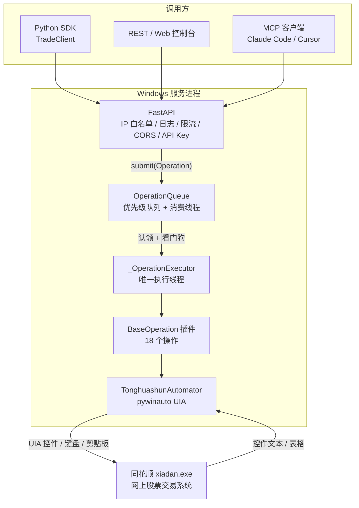
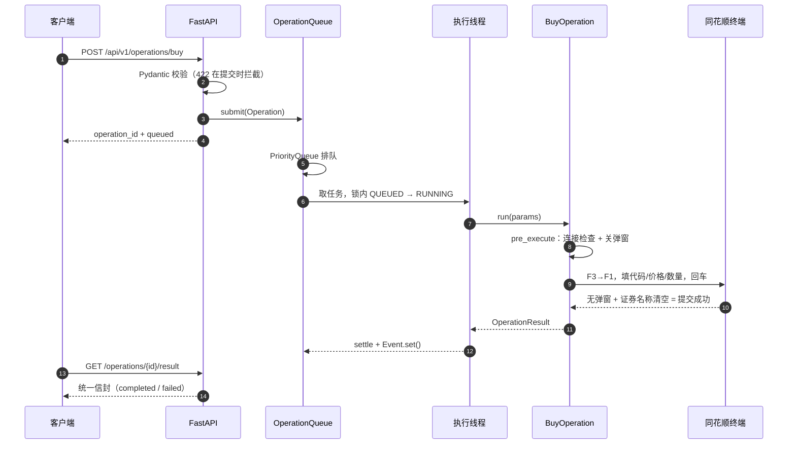
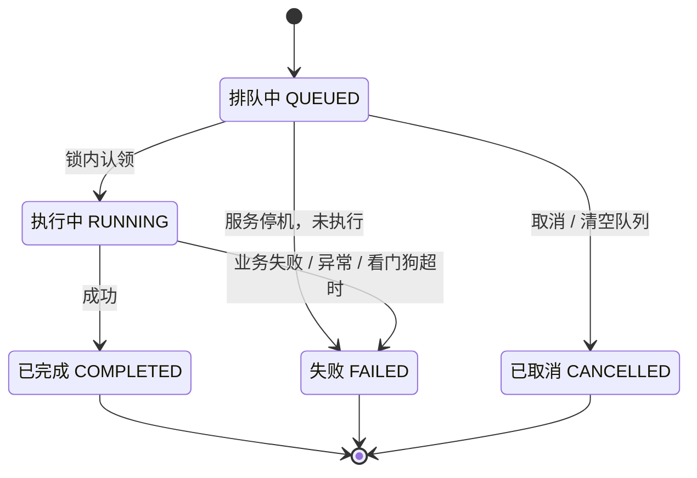
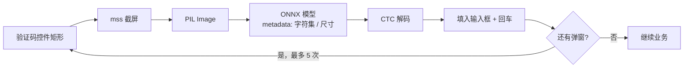
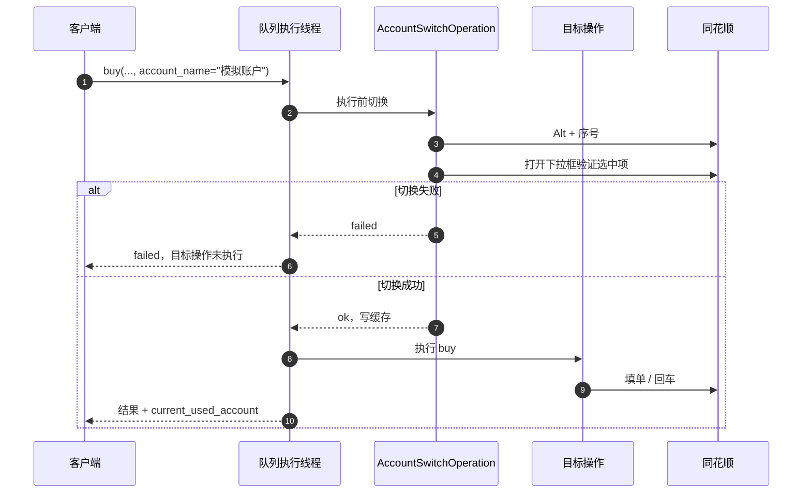

# EasyTHS：把同花顺交易客户端变成 REST API 与 MCP 服务

> 项目：[noimank/easyths](https://github.com/noimank/easyths)
> 基于 v2.0.7（commit `c7ea854`，2026-10-20），MIT 协议，服务端仅支持 Windows。
> 本文讨论工程实现与适用边界，不构成投资建议。自动化交易有风险，请先在模拟环境验证，并遵守券商与软件的使用协议。

## 一句话定义

EasyTHS 是一个**用 GUI 自动化把同花顺交易客户端封装成服务**的项目：它通过 pywinauto 操作已登录的 `xiadan.exe`，对外提供 REST API、Python SDK、MCP 工具和内嵌 Web 控制台，把"人点终端"变成"程序点终端"。

> **原理速记**：没有注入、没有 hook、没有内存修改。服务端就是一个外部的 Windows 进程，用 UI Automation 找到同花顺的按钮和输入框，按键、填数、读表格；再用 FastAPI 把这些动作包装成 API。

它解决的不是"怎么预测行情"，而是一个更底层的问题：**当券商只给你一个图形终端时，策略代码怎么下单。**

## 背景：交易 API 的最后一公里

个人量化常见的三条路：

| 路径 | 代表 | 优点 | 门槛/代价 |
|------|------|------|-----------|
| 券商官方 API | miniQMT / QMT、券商 OpenAPI | 稳定、快、能拿行情和回报 | 需要券商开通，部分有资产/权限门槛 |
| 第三方数据/交易网关 | 各类付费网关 | 省事 | 费用、合规、依赖第三方 |
| GUI 自动化 | EasyTrader、EasyTHS | 有同花顺账户就能用，不改终端 | 慢、脆、依赖界面版本 |

EasyTHS 走的是第三条。它不碰券商的柜台协议，也不要求开通 QMT；它复用的是你**已经登录在终端里的那个账户**。代价也很直接：终端是为人设计的，不是为程序设计的。

这决定了它的形态：

- 它不是一个"行情 + 交易"的完整框架，**没有股票行情/K 线/tick 接口**；它只有账户、持仓、委托、逆回购利率等查询数据，价格要由外部行情源提供
- 它不是高频系统：单笔操作大约 0.6~4.1 秒，所有操作串行执行
- 它必须跑在 Windows 的交互式桌面里，同花顺客户端要保持登录
- 终端升级、控件 ID 变化、弹窗改文案，都可能让它失效

所以更准确的定位是：**一个个人账户的"最后一公里"执行器**，适合低频策略、条件单管理、账户巡检、AI 助手的交易入口。把它当 miniQMT 的替代品，会失望；把它当"没有官方 API 时的兜底"，它的工程完成度相当高。

## 它提供什么

按 v2.0.7 代码统计，一共有 **18 个操作插件**：

| 类别 | 操作 |
|------|------|
| 下单 | `buy`、`sell`、`market_buy`、`market_sell` |
| 条件单 | `condition_buy`、`condition_sell`、`stop_loss_profit`、`condition_order_query`、`condition_order_cancel` |
| 撤单/查询 | `order_cancel`、`order_query`、`historical_commission_query` |
| 账户 | `holding_query`、`funds_query`、`account_query`、`account_switch` |
| 国债逆回购 | `reverse_repo_buy`、`reverse_repo_query` |

> 注：`historical_commission_query` 在模拟账号上不可用；条件单在非交易日也可能被客户端禁用，具体以终端为准。

对外有四个面：

1. **REST API**：FastAPI，统一信封，提交返回 `operation_id`，再查结果
2. **Python SDK**：`TradeClient`，跨平台，只依赖 `httpx` 等少量库
3. **MCP**：18 个工具，可被 Claude Code / Cursor 直接调用
4. **Web 控制台**：浏览器打开服务地址即可下单/查询，表单由接口 schema 自动生成

## 架构总览



最核心的一句话是：**API 层可以并发，GUI 层必须串行。** FastAPI 的异步事件循环负责接请求、做校验、返回 `operation_id`；真正的业务操作全部进入后台队列，由同一个执行线程按优先级逐个完成。

一次下单的完整路径：



注意最后一步：**下单接口的"成功"是"委托已提交"，不是"已成交"**。要确认成交，得再调 `order_query` 看 `filled_quantity`。这个语义后面会反复出现。

## 设计一：一次只让一只手碰 GUI

### 为什么必须串行

GUI 自动化不是线程安全的，原因不是 Python 的 GIL，而是 Windows 桌面的**全局状态**：

- 键盘焦点只有一个，`type_keys()` 打到哪个控件取决于当前焦点
- 剪贴板是全局的，查询持仓/委托靠 `Ctrl+A`、`Ctrl+C` 复制表格
- 同花顺只有一个主窗口，页面切换、弹窗、下拉框都是全局状态
- UIA 控件树会随页面变化，两个线程同时找控件会互相踩

如果两个请求并发执行，最典型的后果不是报错，而是**串台**：A 请求输入的股票代码，被 B 请求的回车提交了；或者 A 读到了 B 的剪贴板。

所以 EasyTHS 做了一个明确的选择：**所有 GUI 操作串行化**。这不是性能妥协，而是正确性前提。

### 队列的四个细节

`easyths/core/operation_queue.py` 里的队列不长，但有几个细节值得看。

**1）优先级队列的排序键**

```python
# (-priority, counter, operation)
# -priority 实现降序；counter 保证同优先级 FIFO
self._queue.put((-operation.priority, counter, operation), block=False)
```

如果只放 `(-priority, operation)`，同优先级时 Python 会尝试比较 `Operation` 对象，直接 `TypeError`。加一个单调递增的 `counter`，既解决了不可比较问题，又保住了 FIFO。这是优先级队列的经典写法。

**2）认领（claim）必须原子**

消费线程从队列里取到操作后，不是立刻执行，而是先在锁里把 `QUEUED` 改成 `RUNNING`（`operation_queue.py:251`）：

```python
def _claim(self, operation: Operation) -> bool:
    with self._lock:
        if operation.status is not OperationStatus.QUEUED:
            return False
        operation.update_status(OperationStatus.RUNNING)
        return True
```

取消、停机、清空队列只能在锁内把 `QUEUED` 直接推到终态。于是会出现一种情况：操作已经被取消，但还留在 `PriorityQueue` 里（标准库的优先队列不支持按 ID 删除）。消费线程取到它，`_claim` 失败，直接跳过。**"已取消的操作绝不会再执行"** 这个保证，就是靠这把锁和这个状态检查实现的。



**3）取消的边界**

`cancel_operation()` 只对 `QUEUED` 生效。一旦进入 `RUNNING`，取消会返回失败——因为 GUI 操作已经发出去了，强行"取消"没有意义，还可能留下半截状态。这个语义很诚实：**能取消的是排队，不是已经伸出去的手。**

**4）结果 TTL**

已完成的操作不会永久留在内存里。默认保留 3 小时，消费循环每 5 分钟扫一次，清掉过期的 `_operations` / `_completed_operations` / `_events`。否则一个长期运行的服务，内存会被历史结果慢慢吃掉。

### 这个设计的代价

- **吞吐量上限 = 1 / 单操作耗时**。按下单类 1.5~3.5 秒估算，每秒不到 1 笔；资金查询更快，但整体仍受串行限制。
- **队列是进程内的**。服务重启，排队中的操作和已完成结果都会消失；没有持久化，也没有跨进程的分布式锁。
- **同一客户端只应由一个服务实例操作**。代码没有单例锁，靠部署纪律保证；两个实例同时操作同一个同花顺窗口，等于把串行假设打破了。
- **`queue_position` 是快照**。它是入队瞬间的排队数，消费线程可能马上就把操作取走，不要把它当精确排位。

## 设计二：看门狗——Python 线程杀不死

这是整个项目里最值得写进笔记的一段。

### 问题

GUI 操作可能卡死：同花顺弹出一个没见过的对话框、网络断了、控件树卡住。如果消费线程直接执行操作，一旦卡住，整个队列就陪葬——后续所有请求都排在后面，永远轮不到。

EasyTHS 的配置里有一个 `queue.operation_timeout`，默认 10 秒。直觉上的做法是"超时就把线程杀掉"，但 Python 没有安全的线程强杀机制。`Thread.kill()` 不存在；用 `ctypes` 杀线程会留下锁、句柄和半截 UI 状态，比不杀更危险。

### 解法：监督者与执行者分离

代码把"取任务"和"执行任务"拆成两个线程：

- **消费线程**（`OperationQueue._process_loop`）：从优先级队列取任务、认领、提交给执行线程、限时等待结果
- **执行线程**（`_OperationExecutor`）：真正调用 `operation.run()`，一次只跑一个任务

消费线程不碰 GUI，它只在 `threading.Event` 上等待（`operation_queue.py:288`）：

```python
executor.submit(_run)
if not done.wait(timeout=self.operation_timeout):
    self._stats["total_timeouts"] += 1
    executor.retire()          # 让旧线程处理完当前任务后退出
    self._executor = None      # 下一个操作会创建新线程
    if self.automator is not None:
        self.automator.disconnect()
    return OperationResult(
        status=OperationStatus.FAILED,
        success=False,
        message="操作执行超时（>10秒），疑似界面卡死，已断开同花顺连接...",
        error_code=ErrorCode.TIMEOUT,
    )
```

超时后做三件事：

1. **放弃旧执行线程**：`retire()` 往它的任务队列里放一个 `None` 哨兵；线程如果恢复，会处理完当前任务后退出。
2. **断开 automator**：`disconnect()` 清空 `app` / 主窗口引用，后续操作的 `pre_execute` 会快速失败，不会继续往一个卡死的界面上堆操作。
3. **以 `timeout` 终态收尾**：调用方拿到明确错误，而不是无限等待。

下一个操作进来时，`_execute_with_watchdog` 发现 `_executor` 为空，会新建一个执行线程。旧线程如果还活着，它的 `None` 哨兵会在恢复后让它退出。

### 这不是"恢复"，是"隔离"

必须说清楚：**看门狗不能终止已经卡死的操作**。旧的执行线程可能还在某个 `click()` 或 `type_keys()` 里；服务只是把它"隔离"掉，并通过断开连接来阻止新的操作进入同一个界面。

这带来两个重要的运维建议：

- 超时后，**先确认同花顺客户端的状态**（有没有半截对话框、有没有已经提交的委托），再决定是否 `reconnect`。如果旧线程还没退出就重连，理论上存在"旧线程 + 新执行线程"同时操作同一个窗口的窗口期。
- 超时的操作**可能已经执行了一部分**。比如回车已经按下，但读结果时卡住。这时不能简单重试，否则可能重复下单。正确做法是用 `order_query` / `funds_query` 核对实际状态。

> 一句话：看门狗保证的是"队列不被一个卡死操作拖死"，不是"操作一定没执行"。

### 两种 timeout 不要混淆

| 超时类型 | 触发点 | 返回 | 操作还会继续吗 |
|----------|--------|------|----------------|
| 执行硬超时 | `queue.operation_timeout`（默认 10s） | 终态 `failed` + `error_code=timeout`，并断开连接 | 可能仍在旧线程里执行，无法保证停止 |
| 等待结果超时 | HTTP `GET .../result?timeout=` 或 SDK 参数 | HTTP 408，`success=null`，`status` 仍是当前状态 | **会**，操作仍在队列/执行中 |

第二种是"查询结果等太久了"，不是"操作失败了"。EasyTHS 的文档明确写了：408 **勿重复提交**，稍后重查。这个区分对交易系统非常关键，因为重复提交的后果是真金白银。

## 设计三：契约即插件

18 个操作，如果每个都手写路由、校验、文档、前端表单，维护成本会迅速失控。EasyTHS 的做法是把**契约放在类属性上**。

### 一个操作长什么样

以买入为例（`easyths/operations/buy.py:9`）：

```python
class BuyOperation(BaseOperation[LimitOrderParams]):
    operation_name = "buy"
    description = "买入股票"
    Params = LimitOrderParams
    Result = LimitOrderResult

    def execute(self, params: LimitOrderParams) -> OperationResult:
        ...
```

四个类属性就是全部元数据：

| 属性 | 作用 |
|------|------|
| `operation_name` | 注册名，也是 REST 路径 `/api/v1/operations/{name}` |
| `description` | 文档描述、Web 控制台操作标题 |
| `Params` | Pydantic 参数模型：提交校验、执行期校验、OpenAPI schema 的唯一来源 |
| `Result` | Pydantic 结果模型：返回字段契约、文档 schema 的唯一来源 |

`BaseOperation.run()` 是一条固定流水线（`base_operation.py:111`）：

```python
def run(self, params):
    # 1. 参数校验
    model = self.Params.model_validate(params)
    # 2. 执行前检查：连接、聚焦、清弹窗
    if not self.pre_execute():
        return self._fail("同花顺未连接或环境准备失败", ErrorCode.NOT_CONNECTED)
    # 3. 核心业务
    return self.execute(model)
```

业务代码只需要写 `execute()`，参数错误、未连接、未捕获异常都有统一的错误码和结果信封。这个分层让 18 个操作看起来像 18 个小函数，而不是 18 份重复的样板。

### 参数契约里的业务规则

`easyths/operations/params.py` 不只是字段声明，还把 A 股的交易规则编码进了校验：

| 规则 | 实现 | REST/SDK 校验时机 |
|------|------|-------------------|
| 股票代码 | `^\d{6}$`，只校验 6 位数字，不校验市场或标的存在性 | 提交时 |
| 手数 | 股票 100 的倍数；可转债（11/12 开头）10 的倍数 | 提交时 |
| 价格精度 | ETF/可转债（5/1 开头）3 位小数，其余 2 位 | 执行时格式化 |
| 单笔金额 | 限价/条件单不超过 1000 万元 | 提交时 |
| 有效期 | 条件单只允许 1/3/5/10/20/30 天 | 提交时 |

对 REST/SDK，大部分规则在**提交时**就校验，不会等到 GUI 操作到一半才发现数量不是 100 的倍数。价格精度是例外：`format_price()` 在 `execute()` 里把价格格式化成 2/3 位小数，不做提交期拒绝；单笔金额上限也只作用于限价/条件单参数，不覆盖所有操作。

MCP 是另一条路径：MCP 工具直接构造 `Operation` 入队，业务规则要到 `BaseOperation.run()` 执行时才校验。因此 `quantity=50` 或 `expire_days=7` 这类非法参数会先排队，再以 `invalid_params` 失败，而不是在调用时就被拒绝。把业务规则尽量放在契约层，仍然是"参数模型即文档"的好处。

### 插件发现

`OperationRegistry.load_plugins()` 用 `pkgutil.iter_modules` 扫描 `easyths/operations/`，导入每个模块，只注册**定义在该模块内**的 `BaseOperation` 子类：

```python
for attr_name, attr in vars(module).items():
    if (
        isinstance(attr, type)
        and issubclass(attr, BaseOperation)
        and attr is not BaseOperation
        and attr.__module__ == module_name
    ):
        self.register(attr)
```

`attr.__module__ == module_name` 这一行很重要：操作模块之间会互相 import 基类/辅助类，如果不加这个判断，同一个类会被重复注册，甚至把 import 进来的别的操作也注册一遍。

### 路由是"生成"的

`create_operations_router()` 在启动时遍历注册表（`operations.py:90`），对每个操作调用 `_build_execute_route()`（`operations.py:31`）动态创建一个 Pydantic 请求模型：

```python
fields = {
    "priority": (int, Field(default=0, ge=0, le=10)),
}
if name not in NO_ACCOUNT_DIRECTIVE_OPS:
    fields["account_name"] = (str | None, Field(default=None, min_length=1))

model_name = "".join(part.title() for part in name.split("_"))
request_model = create_model(
    f"Execute{model_name}Request",
    **fields,
    __base__=operation_class.Params,
)
```

于是：

- 除 `account_switch` / `account_query` 外，每个操作的请求体 = 自己的 `Params` 字段 + `priority` + 可选 `account_name`；`account_switch` 的 `account_name` 是业务参数，`account_query` 没有这个字段
- REST 的非法参数在**提交时**就返回 422，不会排队执行到一半才失败
- FastAPI 自动生成 OpenAPI 文档
- Web 控制台的 `app.js` 读取 `/api/v1/operations/` 返回的 JSON Schema，**自动生成表单**，新增操作不需要改前端

这是一个很干净的"schema 驱动"闭环：**模型 → 校验 → 文档 → UI**，四者同源。

### 统一信封与错误码

REST 全端点、MCP 工具的业务返回、SDK 解析目标基本共用一个形状（MCP 提交前错误/超时分支是精简字典；SDK 对任何非 2xx 都抛 `TradeClientError`，408/404 只是消息更具体）：

```json
{
  "success": true,
  "status": "completed",
  "message": "成功提交000001的买入委托，耗时1.82秒",
  "error_code": null,
  "current_used_account": "模拟账户",
  "data": {"stock_code": "000001", "price": 10.5, "quantity": 100},
  "timestamp": "2026-10-21 09:30:01"
}
```

`success` 的三种状态值得注意：

- `true` / `false`：终态业务结果
- `null`：**非终态**——还在排队或执行中

这不是随便定的，而是为了让"提交受理"和"执行完成"在同一个字段里不撒谎。提交接口返回 `success: null` + `status: queued`，调用方必须再查结果，不能把"已受理"当成"已成功"。

错误码也是一套可编程的词表：`invalid_params`、`not_connected`、`client_rejected`、`ui_error`、`cancelled`、`timeout`、`not_found`、`internal`，以及中间件层的 `unauthorized` / `forbidden` / `rate_limited`。REST/MCP 的业务失败可以按错误码做分支，而不是去解析中文 message；SDK 的 HTTP 层错误会先抛异常，需要捕获后再按 `status_code` 处理。

### 一个不对称：MCP 工具是手写的

REST 路由是自动生成的，但 `mcp_server.py` 里的 18 个工具是逐个手写的。这未必是偷懒：MCP 工具的 docstring 就是给模型看的"工具说明"，参数描述、返回字段、使用注意事项需要针对 AI 重新组织；直接把 OpenAPI schema 丢给模型，效果未必好。

代价是：**新增一个操作，REST 自动生效，MCP 要手动补一个函数**。如果项目继续长大，这里可以考虑从注册表半自动生成 MCP 工具，再把需要人工措辞的部分做成覆盖层。

## 设计四：把 UI 当协议

这一节是 EasyTHS 最"脏"、也最见功力的地方。它没有官方 API，只能把同花顺的界面当成一个**没有文档、会随时改版的协议**来解析。

### 输入：键盘和控件 ID

买入操作的路径（`easyths/operations/buy.py:17`）：

```python
main_window.type_keys("{F3}")   # 先跳到别的页面
self.sleep(0.2)
main_window.type_keys("{F1}")   # 再切回买入页：清空残留输入
self.sleep(0.25)

main_panel = self.get_control_with_children(
    main_window, class_name="AfxMDIFrame140s", control_type="Pane", auto_id="59648"
).children(class_name="AfxMDIFrame140s")[0]

# 股票代码 / 价格 / 数量，三个 Edit 控件
self.get_control_with_children(
    main_panel, control_type="Edit", auto_id="1032"
).type_keys(stock_code)
self.sleep(0.08)
self.get_control_with_children(
    main_panel, control_type="Edit", auto_id="1033"
).type_keys(price)
self.sleep(0.08)
self.get_control_with_children(
    main_panel, control_type="Edit", auto_id="1034"
).type_keys(str(quantity))
self.sleep(0.3)
main_window.type_keys("{ENTER}")  # 提交
```

几个细节：

- **F3 → F1 不是多余动作**。同花顺切页面会清空上次残留的代码/价格；不切，第二次下单可能带着上次的字段。这是"用 UI 行为做状态重置"。
- **控件用 `auto_id` 定位**。`1032/1033/1034` 是下单面板的代码/价格/数量输入框。这些 ID 不是公开 API，是逆向 UIA 树得到的。
- **`sleep` 是协议的一部分**。UI 渲染、网络请求、控件可编辑状态都需要时间；这些毫秒数是实测出来的，不是随便写的。
- **回车提交，不点按钮**。因为客户端配置要求关闭确认对话框；回车是最短路径。

### 成功判定：没有弹窗 + 证券名称被清空

```python
main_window.type_keys("{ENTER}")
self.wait_for_pop_dialog(0.3)
is_op_success = not self.is_exist_pop_dialog()
# 证券名称，如果提交成功，stock_name 会清空
stock_name = self.get_control_with_children(
    main_panel, control_type="Text", auto_id="1036"
).window_text()

if not is_op_success:
    # 弹窗内容就是拒绝原因：涨跌停、资金不足、标的不支持...
    ...
if len(stock_name) > 0:
    return self._fail("买入操作未能成功，请检查软件设置...", ErrorCode.UI_ERROR)
```

这是一个很典型的 GUI 断言：

1. **弹窗即失败**：同花顺拒绝委托时会弹窗；没弹窗就是提交成功
2. **证券名称被清空即成功**：提交成功后，下单表单的证券名称会清空；没清空说明回车没生效
3. **成功消息里带耗时**：方便调用方监控性能退化

这种断言方式很快，但依赖一个前提：**客户端必须按项目要求配置**（关闭委托确认、关闭悬浮工具栏、切换页面清空代码、清空默认价格）。README 用加粗强调"请一定一定要根据项目要求设置下单客户端，否则不保证可用"——这不是使用建议，而是**接口契约的一部分**。因为代码把"无弹窗"当成了成功信号，如果你开着委托确认，每一笔都会被判成失败。

### 输出：剪贴板 + pandas

查询持仓/委托不是读控件树，而是让客户端把表格复制到剪贴板：

```python
table_control.click_input()
table_control.type_keys("^a")
time.sleep(0.05)
table_control.type_keys("^c")
time.sleep(0.2)
self.process_captcha_dialog()   # 复制可能触发验证码
table_df = text2df(self.get_clipboard_data())
```

`text2df` 只做一件事：

```python
pd.read_csv(io.StringIO(text), delimiter="\t", dtype=str, na_filter=False)
```

`dtype=str` 是关键。金融表格里 `000001` 是股票代码，不是数字 1；`002594` 是比亚迪，不是 2594。如果让 pandas 自动推断类型，前导零会被吃掉。项目在 2.0.2 的 changelog 里专门修过这个问题。

拿到 DataFrame 后，**逐行显式装配**成 Pydantic 模型：

```python
return HoldingRow(
    stock_code=record["证券代码"],
    stock_name=record["证券名称"],
    # 实盘列名 vs 模拟账户列名
    quantity=record.get("持仓数量") or record.get("股票余额"),
    available_quantity=record.get("可用数量") or record.get("可用余额"),
    cost_price=record.get("参考成本价") or record.get("成本价"),
    current_price=record.get("当前价") or record.get("市价"),
    ...
)
```

这里的设计取舍是：

- **不用自动映射**（比如把中文列名转拼音/英文），因为列名会变，自动映射出错时很难发现
- **显式列名 + 明确的回退**，把"实盘/模拟账户列名不同"这种适配逻辑集中在解析函数里
- **必需列缺失就报错**（直接 `record["..."]`），兼容列用 `.get(...) or .get(...)` 回退；如果两套列名都不存在，值会是 `None`，由结果模型的可空类型承接

数值清洗也集中在一处：`_parse_num` 去掉千分位逗号、百分号、全角空格，把 `--` / `-` / 空串统一转成 `None`。这样 18 个操作不用各写一遍。

### 弹窗：用文案当异常类型

`get_pop_dialog()` 把弹窗内容映射成业务类型：

```python
if "您的风险承受能力等级即将过期" in content:
    return "风险测评提示", children
elif "您输入的价格已超出涨跌停限制" in content:
    return "提示信息", children
elif "先输入验证码" in content:
    return "验证码提示框", children
...
```

`close_pop_dialog()` 再按类型选择按钮：

- 风险测评 → 点"否"
- 验证码 → 点"取消"（不是所有验证码都需要解，有些是提示）
- 程序退出确认 → 点"否"
- 未知弹窗 → 按 ESC

这是一个**以文案为键的异常表**。它很实用，也很脆弱：同花顺改一句提示语，映射就失效了。项目通过"未知弹窗按 ESC"和日志来兜底，但这仍然是 UI 自动化不可避免的维护成本。

### 市价委托：按内容匹配，不按序号

市价委托的成交策略下拉框，在不同券商/版本里**数量和顺序都不固定**，同一个策略的中文名也有多种写法。EasyTHS 的做法是：

```python
EXECUTION_STRATEGIES = {
    1: "对手方最优",
    2: "本方最优",
    3: "五档即成剩撤",
    ...
}
_STRATEGY_KEYWORDS = {
    1: ["对手方最优"],
    2: ["本方最优"],
    6: ["最优五档即时成交剩余转限价", "五档即时成交剩余转限价", ...],
    3: ["最优五档即时成交剩余撤销", "五档即时成交剩余撤销", ...],
    ...
}
```

先用关键词把下拉框每一项归属到策略编号，再按"请求策略 → 兜底策略（3 号）"的顺序找可用项。**绝不能按索引定位**，因为索引在别的券商那里可能对应另一个策略；那会下错单。

代码里还有一个很细的坑：3 号策略的关键词是 4 号的超集（"最优五档即时成交剩余撤销" 包含 "即时成交剩余撤销"），所以匹配顺序必须先 3 后 4，否则 4 号会把 3 号的选项抢走。这种细节只有真正被线上问题咬过才会写出来。

## 设计五：验证码识别

同花顺在部分场景（查询复制、频繁操作）会弹验证码。EasyTHS 内置了一个 CRNN 模型，用 ONNX Runtime 在 CPU 上推理。



### 模型与预处理

`captcha_model/` 是一个独立的训练子项目：

- **架构**：ResNet-style CNN + BiLSTM + CTC，约 1M 参数
- **训练数据**：合成数据，模拟同花顺验证码特征——84×38、纯白背景、天蓝色文字、4 位、`0-9A-Za-z` 共 62 类、无旋转/干扰线
- **推理**：导出 ONNX，`onnxruntime` CPU 推理

推理代码从 ONNX 模型的 metadata 里读取预处理参数（`captcha_ocr.py:21`）：

```python
onnx_model = onnx.load(model_path)
metadata = {p.key: p.value for p in onnx_model.metadata_props}
self.character = metadata["character"]
self.img_h = int(metadata["img_h"])
self.img_w = int(metadata["img_w"])
self.nc = int(metadata.get("nc", 1))
```

这是一个很值得学的工程决策：**把字符集、输入尺寸、通道数写进模型文件本身**，而不是放在另一个 YAML 里。模型和预处理参数一起走，部署时不会出现"模型换了、配置没换"的静默错误。

CTC 解码也很简洁：去掉连续重复和 blank：

```python
def _ctc_decode(self, pred_indices):
    result, prev = [], -1
    for idx in pred_indices:
        if idx != prev and idx != self.blank and idx < len(self.character):
            result.append(self.character[idx])
        prev = idx
    return "".join(result)
```

### 失败样本闭环

`process_captcha_dialog()` 有一个细节：如果上一次填完验证码后弹窗还在（通常意味着识别错了），会把验证码图片保存到 `~/easyths/captcha_error/`，供后续人工标注和模型微调。配置项 `save_error_captcha_image` 默认开启。这形成了一个小型的**数据飞轮**：线上失败样本 → 人工微调 → 模型更新。

> 合规提醒：验证码本质上是券商/软件的反自动化控制。这里讨论的是技术实现；实际使用应只针对自己的账户，并确认不违反券商与软件的使用协议。不要用它做多账户批量、撞库或任何未授权操作。

## 设计六：多账户的原子切换

个人用户可能只有一个账户，但多账户是实盘常见需求。GUI 自动化的难点在于：**账户是终端级全局状态，不是请求级参数**。你不能在请求里带一个 account 字段就完事，因为下单面板只有一个。

EasyTHS 的解法分三层。

### 1）账户缓存

`account_state` 在进程内保存：

- `available_accounts`: `(account_name, account_index)` 列表
- `current_used_account`: 当前账户名

`account_query` 第一次执行时，点开账户下拉框，读取所有条目，并根据选中项识别当前账户；之后直接复用缓存。服务启动时会自动执行一次 `account_query` 完成初始化。

### 2）切换：Alt + 序号，并验证

`account_switch` 用 `Alt + 账户序号` 切换（`%` 是 pywinauto 的 Alt 前缀，`account_switch.py:61`）：

```python
main_window.type_keys(f"%{index}")
self.sleep(0.3)
if not self._check_already_change(account_name_unverified=params.account_name):
    return self._fail(
        f"账户切换失败，当前账户保持为{previous or '未确认'}",
        ErrorCode.INTERNAL,
    )
account_state.set_current_used_account(params.account_name)
```

注意顺序：**先验证，后写缓存**。如果切换没生效，缓存保持原账户，返回失败；而不是先把缓存改成目标账户，造成"以为切了、其实没切"的灾难。

`_check_already_change()` 会重新点开下拉框，检查目标条目是否 `is_selected()`。这个"动作后验证"（act-then-verify）是自动化系统里非常重要的模式：UI 操作没有返回值，不能假设点了就生效。

### 3）请求级账户指令：同一个队列槽内原子完成

REST 的每个操作（除 `account_switch` / `account_query`）都可以带一个可选的 `account_name`。它不是业务参数，而是**执行前指令**：

```python
# 队列执行线程内
if operation.account_name is not None:
    switch_failure = self._switch_account_before(operation.account_name)
    if switch_failure:
        return switch_failure   # 目标操作不再执行

result = operation_instance.run(operation.params)
```

因为切换和目标操作都在**同一个执行线程、同一个队列槽**里完成，中间不会有其他操作插进来。这保证了：

- 指定了 `account_name` 的操作，**必然落在该账户**
- 切换失败时，目标操作**不会执行**，不会错误地落到当前账户
- 结果信封里的 `current_used_account` 可以事后核对



### 边界

- `reconnect` 会清空账户缓存：客户端可能重启，账户集合、顺序、当前账户都不可信；重连后要显式 `account_query` 重新初始化。
- 启动时初始化失败（比如有弹窗干扰），账户缓存为空；此后带 `account_name` 的操作和 `account_switch` 都会快速失败，需要手动 `account_query`。
- 账户名是**客户端下拉列表的完整展示名**（如 `券商A-张*三`），不是资金账号。要用 `account_query` 的返回值，不要自己拼。
- 账户切换依赖 `Alt+序号`，所以账户列表顺序变化会影响序号；缓存里的序号只在同一次客户端会话内可信。

## 四种调用面：REST、SDK、MCP、Web

四个入口，一条队列，同一个信封。

### REST

```bash
# 提交
curl -X POST http://127.0.0.1:7648/api/v1/operations/funds_query \
  -H "Content-Type: application/json" \
  -H "Authorization: Bearer your-api-key" \
  -d '{}'
# → {"success": null, "status": "queued", "data": {"operation_id": "..."}}

# 阻塞等结果
curl "http://127.0.0.1:7648/api/v1/operations/<operation_id>/result?timeout=10" \
  -H "Authorization: Bearer your-api-key"
```

### Python SDK

```bash
pip install easyths   # 客户端，跨平台
```

```python
from easyths import TradeClient

with TradeClient(host="127.0.0.1", port=7648, api_key="your-api-key") as client:
    accounts = client.query_accounts()
    print(accounts["data"]["available_accounts"])

    result = client.buy("000001", 10.50, 100, account_name="模拟账户")
    print(result["success"], result["message"], result["current_used_account"])
```

SDK 本身很薄：每个便捷方法都是"提交操作 + 阻塞取结果"的组合。它不做隐式重试，这一点是对的——交易接口的自动重试必须由调用方根据业务语义决定，SDK 不能替你做。

要注意：`get_operation_result()` 对 HTTP 408/404 会抛带具体消息的 `TradeClientError`；其他非 2xx（401/403/422/429/5xx）也会由底层 `_request()` 统一抛出 `TradeClientError`。捕获 408 后应按"操作仍在执行"处理，先查 `operation_id`，不要重新提交。

### MCP

```bash
claude mcp add --transport http easyths http://localhost:7648/api/mcp-server \
  --header "Authorization: Bearer your-api-key"
```

连上后，AI 可以直接调用 `buy` / `sell` / `holding_query` / `condition_buy` 等 18 个工具。MCP 工具内部也是走同一个队列，等待最多 30 秒；超时会明确提示"操作仍在执行，请勿重复提交"。

> **AI 交易的风险要单独说**：MCP 让模型拥有了下单能力，而模型不会为亏损负责。至少做到——只用模拟账户、只给小额资金、只在本机或内网暴露、设置 API Key 和 IP 白名单、不要在公网开放。MCP 是"能调用"，不是"该自动调用"。

### Web 控制台

浏览器打开 `http://127.0.0.1:7648/` 即可。页面本身公开，不含敏感数据；启用 API Key 后，所有 `/api` 请求仍需认证。表单是从 `/api/v1/operations/` 的 JSON Schema 生成的，新增操作无需改前端。

## 从安装到第一笔模拟单

下面是基于 v2.0.7 的一条完整路径。EasyTHS 的服务端只能在 Windows 上跑，但 SDK 可以在 macOS/Linux 上调用它。

### 1. 准备

- Windows 10/11
- Python 3.12（`requires-python = ">=3.12,<3.13"`）
- 同花顺交易客户端（远航版/标准版，建议 11.4+），已登录
- 打开 `xiadan.exe`（下单程序），不是只看盘主程序

客户端设置（**必须**）：

1. 关闭悬浮工具栏
2. 关闭所有委托确认对话框
3. 开启"切换页面清空代码"
4. 清空默认买入/卖出价格
5. 条件单功能首次使用如有风险提示，先手动同意

### 2. 安装并生成配置

```powershell
# 一键运行服务端（推荐）
uvx "easyths[server]"

# 或安装后运行
pip install "easyths[server]"
easyths --get_config
easyths --config config.toml
```

> 命令里的引号不要省。`easyths[server]` 在部分 shell 里会被当成 glob（尤其 zsh），引号能避免找不到包。

### 3. 配置：先收紧，再启动

默认配置里有两个值得注意的值：

```toml
[api]
host = "0.0.0.0"   # 绑定所有网卡
key = ""           # 不启用认证
```

也就是说，**默认状态下，同一局域网的人可以直接调用你的交易接口**。这在个人电脑上非常危险。

> README 的快速开始写的是 `http://127.0.0.1:7648`，但代码里的 `ProjectConfig.api_host` 和示例 `config.toml` 默认都是 `0.0.0.0`；实际监听地址以配置为准。这是读这个项目时一个很容易忽略的细节。

建议改成：

```toml
[trading]
app_path = "C:/同花顺远航版/transaction/xiadan.exe"

[queue]
max_size = 1000
operation_timeout = 10.0

[api]
host = "127.0.0.1"          # 只监听本机
port = 7648
key = "change-me-to-a-long-random-string"
ip_whitelist = "127.0.0.1"
rate_limit = 20
cors_origins = "http://127.0.0.1:7648"
mcp_server_type = "streamable-http"

[logging]
level = "INFO"
file = ""
```

如果必须从另一台机器调用，优先用 SSH 隧道 / VPN，而不是把 `host` 改成 `0.0.0.0` 后直接暴露。EasyTHS 本身是 HTTP，不带 TLS；API Key 在明文 HTTP 里传输，公网暴露等于把钥匙挂在门上。

### 4. 启动与健康检查

```powershell
easyths --config config.toml
```

预期日志里会看到：连接同花顺、加载 18 个插件、启动队列、初始化账户缓存、MCP 挂载到 `/api/mcp-server`、Uvicorn 监听端口。

```bash
curl -H "Authorization: Bearer <your-key>" http://127.0.0.1:7648/api/v1/system/health
```

健康检查不是只看"服务进程还在"，而是同时检查：

- `automator.is_connected()`：连接标志
- `automator.is_process_alive()`：`xiadan.exe` 是否真的活着

客户端崩了但服务没崩，健康检查会如实返回不健康。这个"真实探活"比很多只返回 `{"status":"ok"}` 的服务靠谱。

### 5. 第一笔模拟单

先查账户，拿到准确的账户名：

```python
from easyths import TradeClient

with TradeClient(host="127.0.0.1", port=7648, api_key="<your-key>") as client:
    accounts = client.query_accounts()
    print(accounts["data"]["available_accounts"])
    print("当前账户:", accounts["current_used_account"])
```

然后，**在模拟账户上**走一遍完整链路：

```python
from easyths import TradeClient

ALLOW_TRADING = False   # 先改成 True，并确认是模拟账户，再执行

with TradeClient(host="127.0.0.1", port=7648, api_key="<your-key>") as client:
    # 1. 查资金，确认账户状态
    funds = client.query_funds(account_name="模拟账户")
    print(funds["success"], funds["data"])

    # 2. 下单（限价）
    if not ALLOW_TRADING:
        print("DRY RUN：跳过下单")
    else:
        order = client.buy("000001", 10.50, 100, account_name="模拟账户")
        print(order["success"], order["status"], order["message"])
        print("实际账户:", order["current_used_account"])

        # 3. 查委托，确认是否提交成功
        orders = client.query_orders("000001", account_name="模拟账户")
        for row in orders["data"]:
            print(row["stock_code"], row["operation"], row["quantity"],
                  row["filled_quantity"], row["contract_no"])
```

这里刻意把"下单"和"成交确认"分开：

- `buy()` 成功 = **委托已提交**
- `order_query()` 里的 `filled_quantity` 才是成交数量
- 想确认最终状态，需要轮询 `order_query`，或者由外部成交回报系统处理

### 6. 出错时怎么读结果

| 现象 | 含义 | 该怎么做 |
|------|------|----------|
| HTTP 422 + `invalid_params` | REST/SDK：参数在提交时就被拒绝 | 改参数；不要重试原请求 |
| `success=false` + `invalid_params` | MCP：参数在排队执行时才被拒绝 | 改参数后重新提交 |
| `success=false` + `client_rejected` | 同花顺拒绝：涨跌停、资金不足、标的不支持 | 不要原样重试，先查原因 |
| `success=false` + `ui_error` | 控件没找到/页面不对 | 人工检查客户端；可重试一次 |
| HTTP 408 + `timeout` | 结果还没出来，操作仍在执行 | **不要重复提交**，稍后用 `operation_id` 重查 |
| 终态 `failed` + `timeout` | 执行超过 `operation_timeout`（默认 10 秒），看门狗已断开连接 | 检查客户端状态，核对委托，再 `reconnect` |
| `success=false` + `not_connected` | 客户端没开/进程退出了 | 启动客户端后 `/system/reconnect` |

> SDK 调用时，HTTP 层错误（401/403/404/408/422/429/5xx）会统一抛 `TradeClientError`；上表的 HTTP 状态行主要针对 REST/MCP，SDK 需要先捕获异常再按 `status_code` 处理。

## 性能与边界

### 吞吐量

README 给出的参考耗时（秒）：

| 操作 | 耗时 |
|------|------|
| 资金查询 | 0.6~1.0 |
| 撤单 | 1.0~1.6 |
| 买入/卖出 | 1.5~2.0 |
| 持仓查询 | 1.6~3.2 |
| 市价单 | 2.5~3.5 |
| 委托/历史委托查询 | 2.8~3.3 |
| 条件买入/卖出 | 2.4~4.1 |
| 止盈止损 | 2.6~3.2 |
| 条件单查询/删除 | 1.7~2.5 |
| 国债逆回购查询/购买 | 0.9~2.2 |

这些数字是**串行执行**下的单笔耗时。下单类操作一秒不到 1 笔；最快的资金查询也只有 1~2 笔/秒的量级，加上查询/确认，实际吞吐更低。所以它适合：

- 日频/小时频策略
- 收盘后账户巡检
- 条件单/止盈止损的批量设置
- 人工通过 AI 助手做单笔操作

不适合：

- 打板、套利、做市等对延迟敏感的场景
- 多账户高频轮询
- 需要 tick 级行情的策略

### 能力边界

| 能做什么 | 不能做什么 |
|----------|------------|
| 用同花顺账户下单/撤单/查询 | 提供股票行情/K 线/tick |
| 设置条件单、止盈止损（由客户端托管） | 保证成交（只保证提交） |
| 多账户查询/切换 | 多客户端并行操作 |
| 本地 Web / REST / MCP 接入 | 跨平台跑服务端（Windows only） |
| 处理常见弹窗和验证码 | 处理所有客户端版本/所有弹窗 |

几个容易踩的点：

1. **它不是股票行情源**。持仓/委托查询里虽然带现价，但没有 K 线、tick 和订阅接口；价格要自己从 QMT/xtdata、AkShare、券商行情或其他数据源拿，EasyTHS 只负责执行。这与 QMT 这类"行情 + 交易一体"的终端不同。可参考我写的 [xtquant_big_convert](xtquant-big-convert.md)，那是另一条路。
2. **条件单是客户端托管的**。`condition_buy` 成功只代表条件单创建成功；后续触发由同花顺客户端执行。服务端停机不必然影响已创建的条件单，但具体行为要以客户端为准。
3. **没有幂等键**。同一个请求提交两次，会生成两个 `operation_id`，可能下两笔单。客户端 SDK 不做自动重试是正确的；调用方也不要在 408 后重试。
4. **需要交互式桌面**。UIA 依赖已登录的 Windows 桌面会话；不要把服务端装成 Session 0 的 Windows 服务，锁屏/断开的 RDP 也可能影响控件操作。建议用一台保持登录的 Windows 小主机。
5. **UI 版本耦合**。控件 `auto_id`、中文列名、弹窗文案都可能随客户端升级变化。项目的 changelog 里大量条目是这类适配（列名 `撤销/撤消/撤单`、前导零、缺失列等），这就是 GUI 自动化的长期维护成本。
6. **单实例部署**。代码没有单例锁，所以这是运维要求而不是自动保证：同一台同花顺客户端只应由一个 EasyTHS 服务操作，不要为了"高可用"起两个实例。

### 安全清单

- [ ] `api.host` 改成 `127.0.0.1`，或只绑内网地址
- [ ] 设置足够长的 `api.key`，不要用示例值
- [ ] 配置 `api.ip_whitelist`（留空等于允许所有 IP，至少设成 `127.0.0.1`）
- [ ] `api.cors_origins` 不要保留默认的 `*`
- [ ] 降低 `api.rate_limit`
- [ ] 不在公网直接暴露端口；远程访问走 SSH 隧道/VPN
- [ ] 用模拟账户做首次验证
- [ ] 给策略账户设置独立的资金上限，避免代码 bug 放大
- [ ] 定期看日志，特别是 `ui_error` / `timeout` / `client_rejected`

EasyTHS 在安全上做对的地方也值得记一笔：API Key 用 `secrets.compare_digest` 做常数时间比较；IP 白名单只认 TCP 对端地址，不信 `X-Forwarded-For`（请求头可伪造）；中间件顺序把 IP 白名单放最外层，非法 IP 不消耗后续处理；控制台页面公开，但配置 API Key 后数据面 `/api` 仍需认证。这些细节比"加个登录框"更接近真实安全。

## 和 miniQMT / EasyTrader 比

| 维度 | EasyTHS | miniQMT / QMT | EasyTrader |
|------|---------|---------------|------------|
| 接入方式 | GUI 自动化 | 券商官方 API | GUI 自动化 |
| 账户门槛 | 有同花顺账户即可 | 通常需券商开通，部分有资产门槛 | 有同花顺账户即可 |
| 速度 | 秒级 | 毫秒~亚秒级 | 秒级 |
| 股票行情 | 无 | 有 | 无/有限 |
| 成交回报 | 轮询查询 | 回调推送 | 轮询 |
| 稳定性 | 依赖 UI 版本 | 高 | 老项目，架构较早 |
| 多账户 | 支持，原子切换 | 账户体系内支持 | 有限 |
| 对外接口 | REST / SDK / MCP / Web | xtquant | Python 库 |
| 适用 | 低频、个人、AI 入口 | 专业量化 | 低频、个人 |

EasyTHS 的优势不是"比 QMT 快"，而是**门槛低、接口现代**：不用等券商开通，不用学 xtquant，直接 HTTP/MCP 就能用。代价是速度和稳定性。选择哪条路，取决于你更缺"权限"还是更缺"延迟"。

## 这套代码值得学的工程手法

抛开"能不能赚钱"不谈，EasyTHS 在工程上有几个很值得借鉴的点：

1. **识别真正的共享资源，然后串行化。** 共享的不是数据库连接，而是键盘焦点、剪贴板和那一个窗口。并发 API + 串行 GUI，是正确的抽象。
2. **契约放在模型上，让路由/文档/UI 自动生长。** `Params` / `Result` 一个来源，动态生成 FastAPI 路由和 Web 表单，新增 REST 操作只写一个文件（MCP 工具仍需手动补）。
3. **监督者不执行，执行者不被监督。** 消费线程只看超时，执行线程只跑操作；线程杀不掉时，隔离比强杀更现实。
4. **把失败语义做成产品的一部分。** 408 和终态 timeout 分开，`success=null` 表示非终态，错误码可编程——这些比"返回一个 500"难得多，也重要得多。
5. **解析人类界面时，宁可显式，不要聪明。** `dtype=str` 保住前导零，显式列名映射适配实盘/模拟，数值清洗集中一处；自动推断看起来聪明，出错时最难查。
6. **动作之后要验证。** 账户切换后重新打开下拉框确认选中项，而不是相信 `Alt+1` 一定生效。UI 自动化没有返回值，只能靠观察。
7. **让产物自描述。** 验证码模型把字符集/尺寸写进 ONNX metadata，部署时不会模型和配置各走各的。
8. **把环境配置当成接口契约。** 关闭确认框、清空代码、关闭悬浮栏不是"建议"，而是成功判定的前提；README 用加粗写清楚，这是负责任的做法。

如果让我在自己的项目里复用这套思路，我会优先抄三样东西：**契约化插件 + 动态路由**、**监督者/执行者分离的看门狗**、**统一结果信封**。这三样跟交易无关，放到任何"包装一个不可靠外部系统"的场景里都成立——比如自动化测试平台、RPA、老 ERP 的 API 网关。

## 结语

GUI 自动化常被当成"没有办法的办法"。但 EasyTHS 说明：即使底层是一个会变、会卡、会弹窗的图形界面，只要把**并发模型、失败语义、契约和验证**这几件事做扎实，它也可以成为一个可用的服务。

它仍然有明确的边界：Windows、秒级、无行情、依赖客户端版本、没有幂等。接受这些边界，它就是一个很实用的个人交易执行器；忽略这些边界，它就是一个会重复下单的自动化脚本。

> 最后再提醒一次：先用模拟账户跑通，再碰实盘；自动化交易的风险、合规责任和账户安全，都由使用者自己承担。

## 代码坐标

| 主题 | 文件 |
|------|------|
| 队列 / 看门狗 / 认领 / TTL | `easyths/core/operation_queue.py` |
| 操作基类 / 插件注册 / 控件查找 / 弹窗 | `easyths/core/base_operation.py` |
| 同花顺连接 | `easyths/core/tonghuashun_automator.py` |
| 账户缓存 | `easyths/core/account_state.py` |
| 参数契约 | `easyths/operations/params.py` |
| 结果契约 | `easyths/operations/results.py` |
| 买入实现 | `easyths/operations/buy.py` |
| 市价策略匹配 | `easyths/utils/execution_strategy.py` |
| 验证码 OCR | `easyths/utils/captcha_ocr.py` |
| 动态路由 | `easyths/api/routes/operations.py` |
| MCP 工具 | `easyths/api/routes/mcp_server.py` |
| SDK | `easyths/trade_client.py` |
| Web 控制台 | `easyths/assets/web/` |
| 验证码训练 | `captcha_model/` |

行号与实现基于 v2.0.7（commit `c7ea854`，2026-10-20）。项目迭代很快，读代码时以仓库当前版本为准。
