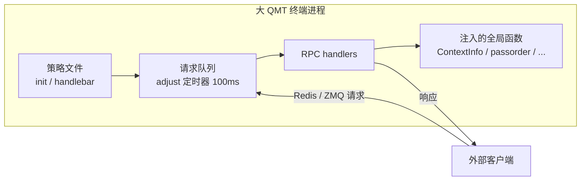
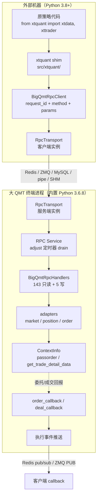
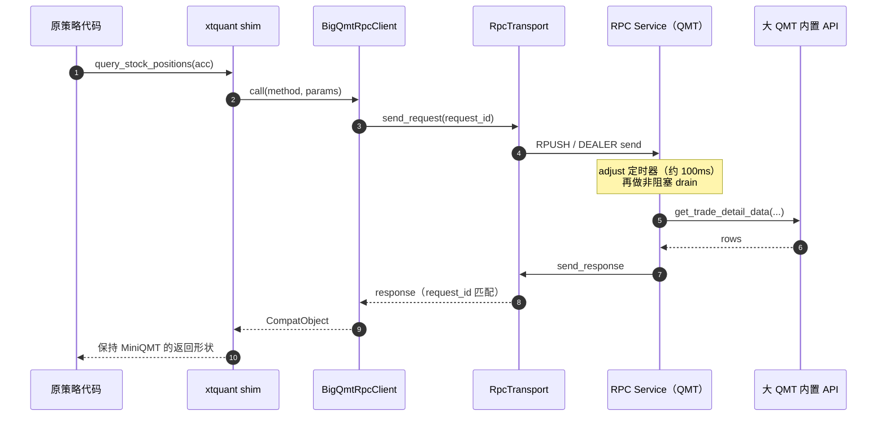

# xtquant_big_convert：把大 QMT 变成可远程调用的 RPC 服务

> 项目：[litaolemo/xtquant_big_convert](https://github.com/litaolemo/xtquant_big_convert)
> 基于 v0.3.71（commit `07642cd`，2026-10-20），MIT 协议。
> 本文只讨论架构与工程实现，不构成任何投资建议。

## 一句话定义

xtquant_big_convert 是一个跑在**大 QMT 内置 Python** 里的 RPC 桥接包：它把 QMT 策略进程里的行情、持仓、交易能力暴露成网络服务，同时提供一个 `xtquant` 兼容层，让外部程序继续用 MiniQMT 的写法调用大 QMT。

> **原理速记**：不是把 RPC "注入" QMT，而是在 QMT 进程里运行一个普通策略，由这个策略启动 RPC 服务；QMT 本体不修改。外部代码通过 Redis/ZMQ 调用，服务端在 QMT 主线程上执行 `passorder` / `ContextInfo`。

仓库里还有信号执行框架、回测模块和 `qmt-trader` AI skill；本文只拆 RPC 桥这条主线。

它解决的不是"怎么写策略"，而是一个更底层的问题：**当券商只给你一个封闭终端时，怎么把终端里的能力拿出来用。**

## 背景：两个 QMT，两套 API

迅投 QMT 常见两种形态：

| 形态 | 策略跑在哪 | 对外接口 | 限制 |
|------|-----------|---------|------|
| MiniQMT | 外部 Python 进程 | `xtquant` 包 + 本地 XtQuantServer | 通常需要券商开通相应权限 |
| 大 QMT | 终端内置 Python（文档记录为 3.6.8） | 策略文件里的 `ContextInfo`、`passorder`、`get_trade_detail_data` 等全局函数 | 通常没有对外的远程接口，策略跑在终端里 |

于是就出现了一个很别扭的局面：

- 用 MiniQMT 写好的代码，换到大 QMT 上跑不了——`xtquant` 连不上，大 QMT 也不认这套调用
- 大 QMT 里的策略能下单，但没法方便地接外部的数据、风控、监控和 AI 工具链
- 同一个账户的持仓、行情是同一份，代码却要维护两套

这个项目的思路是**反转方向**：既然大 QMT 的 API 只存在于它的进程里，那就把服务端放进大 QMT，让外部程序反过来调用它。

## 大 QMT 到底怎么运行

理解这个项目，先要理解大 QMT 的"宿主模型"。

大 QMT 是一个把 Python 解释器嵌进交易终端的宿主。你在策略编辑器里加载一个 `.py` 文件，终端会做三件事：

1. **在终端自己的进程里执行这个文件**，不是启动一个外部 Python
2. **向这个文件的命名空间注入全局函数**：`ContextInfo`、`passorder`、`cancel`、`get_trade_detail_data`、`download_history_data` 等
3. **按终端的事件节奏调用固定入口**：启动时调用一次 `init(ContextInfo)`；之后在 K 线/行情驱动时调用 `handlebar(ContextInfo)`

关键点是：**这些函数不是可以 `import` 的库，而是宿主注入到脚本里的全局名字。** 它们只在"终端进程 + 策略文件"的上下文里存在；外部进程拿不到，也没有一个默认的网络端口可以直接调。大 QMT 通常也不提供 MiniQMT 那样的 XtQuantServer 服务窗口。

这带来几个硬约束：

| 约束 | 后果 |
|------|------|
| 代码跑在终端进程里 | 不能 pip 装包，只能用终端自带的 Python（文档记录 3.6.8）和它允许的模块 |
| QMT API 绑定在策略线程/上下文 | 在自建后台线程里调 `get_trade_detail_data` 可能返回空；交易查询必须回到主线程 |
| 终端有 GIL，主线程被回调占着 | 后台线程想执行 Python 代码，往往要等主线程让出 GIL |
| 没有默认的远程入口 | 外部程序无法直接驱动终端，除非券商另外开了 MiniQMT/XtQuantServer 权限 |

所以这个项目不是"从外面调用 QMT"，而是**在 QMT 里面开一个服务窗口**：



`adjust` 在这里要特别说明：**它不是 QMT 内置的回调**。QMT 只自动调用 `init` 和 `handlebar`；项目在 `init` 里用 `ContextInfo.run_time("adjust", "100nMilliSecond", ...)` 注册了一个自己的定时器，`handlebar` 也会调用它。这样无论终端是按 K 线还是按 tick 驱动，请求队列都有机会被排空。

> 一句话：QMT 给你一个封闭的进程；项目在这个进程里注册了一个每 100ms 检查一次信箱的定时器。

## 架构总览



整条链路有三段：

1. **兼容层**：`src/xtquant/` 伪装成 MiniQMT 的包，业务代码的 import 不用改
2. **传输层**：请求和响应都是普通 dict，具体走 Redis、ZMQ、MySQL、命名管道还是共享内存，由配置决定
3. **服务端**：跑在 QMT 进程里，把 RPC 方法映射到 `ContextInfo`、`passorder` 等内置能力

一次查询请求的完整路径：



方法白名单定义在 `src/bigqmt_signal_trader/redis_rpc.py`：`READ_METHODS` 最终并入 `MARKET_DATA_METHODS` 和 `QUOTE_SUBSCRIPTION_METHODS`，按当前代码统计是 **143 个只读 + 5 个写方法**，另有 **15 个 MiniQMT 风格别名**。`docs/RPC_API_REFERENCE.md` 里还写着 119 / 12，那是较早的统计口径，已经和当前代码对不上——读这种快速演进的项目时，文档和代码要以代码为准。

## 设计一：把"换库"变成"改 PYTHONPATH"

兼容层最值得注意的是它有多薄。

`src/xtquant/xttrader.py` 只有 7 行：

```python
from bigqmt_signal_trader.xtquant_compat import (
    BigQmtXtTrader,
    XtQuantTrader,
    XtQuantTraderCallback,
)

__all__ = ["BigQmtXtTrader", "XtQuantTrader", "XtQuantTraderCallback"]
```

`src/xtquant/xtdata.py` 也是一层很薄的转发：

```python
import bigqmt_signal_trader.xtquant_compat as _compat


def __getattr__(name):
    return getattr(_compat.xtdata, name)


def get_full_tick(code_list, types=None):
    return _compat.xtdata.get_full_tick(code_list, types=types)
```

真正的实现在 `xtquant_compat.py`（约 7,200 行），shim 只负责名字对齐。这样切换成本就从"重写业务代码"降到了"把仓库的 `src` 放到 `PYTHONPATH` 最前面"。

### 一个循环依赖，和它的解法

`src/xtquant/__init__.py` 里有一段容易被忽略的设计（`src/xtquant/__init__.py:7-33`）：

```python
# xtdata and xttrader are NOT: both reach back into
# bigqmt_signal_trader.xtquant_compat, which itself does
# ``from xtquant.xtconstant import *``. Importing them here closes the loop --
# ``import bigqmt_signal_trader`` then fails with "partially initialized
# module", and only in that direction, so whether it breaks depends on which
# package the caller happens to import first.
#
# Resolved lazily through __getattr__ (PEP 562): ``xtquant.xtdata`` and
# ``from xtquant import xttrader`` both still work, but the import runs after
# xtquant_compat has finished initialising rather than in the middle of it.
from . import xtconstant, xttype

_LAZY_SUBMODULES = ("xtdata", "xttrader")


def __getattr__(name):
    if name in _LAZY_SUBMODULES:
        import importlib

        module = importlib.import_module("." + name, __name__)
        globals()[name] = module      # resolve once, then it is a plain attribute
        return module
    raise AttributeError("module %r has no attribute %r" % (__name__, name))
```

依赖关系是：

```text
xtquant.__init__  →  xtquant.xtdata  →  bigqmt_signal_trader.xtquant_compat
                                              ↓
                                    from xtquant.xtconstant import *
```

如果 `__init__` 一上来就 eager import `xtdata`，就会在 `xtquant_compat` 初始化到一半时绕回来，触发 "partially initialized module"。PEP 562 的模块级 `__getattr__` 把这两个子模块改成首次访问时才导入，循环就断了。

**这是一个值得记住的模式**：兼容层越薄，越容易在 import 图上踩到循环依赖；把"重"的那一侧延迟加载，比调整目录结构更直接。

### 代价与边界

这条路不是无损的：

- `src` 必须在 `PYTHONPATH` 最前面，否则会加载真实的 `xtquant`；两者同名，不会报错，只会"看起来连上了"
- 并非所有 MiniQMT 方法都等价。仓库自己的兼容表里，`query_ipo_data()`、`query_new_purchase_limit()` 仍是占位实现；部分方法依赖大 QMT 的 `ContextInfo` 是否暴露同名能力
- 回调推送在早期版本并不完整，后来才通过 Redis pub/sub、ZMQ PUB 和 `order_callback` / `deal_callback` 补齐

所以它更适合定位成"**让已有的查询/交易代码先跑起来**"的迁移层，而不是"MiniQMT 的完整替代品"。

## 设计二：传输层只认 dict，不认 Redis

传输抽象定义在 `src/bigqmt_signal_trader/transports/base.py`。接口只有四个动作：

| 动作 | 谁调用 | 作用 |
|------|--------|------|
| `send_request(request, timeout)` | 客户端 | 发请求，阻塞等匹配的响应 |
| `start_receiving(on_request)` | 服务端 | 注册收到请求时的回调 |
| `send_response(request, response)` | 服务端 | 按请求里的路由信息回包 |
| `stop()` | 两端 | 释放 socket / 线程 / 连接 |

请求信封是固定的（`transports/base.py:17-20`）：

> The request dict always carries the existing envelope (`schema_version`, `request_id`, `account_id`, `method`, `params`). It MAY carry reply routing hints (`reply_key`/`reply_channel`/`reply_list`/`ttl_seconds`); Redis uses them, other transports may ignore them and use native routing.

业务层只看到 dict，不关心底下是 Redis 还是 ZMQ。这带来一个很实际的好处：**新增一种传输，不需要改 handlers，也不需要改 `process_request`。**

当前支持五种（`transports/factory.py:14`）：

| 传输 | 依赖 | 适用场景 |
|------|------|---------|
| `redis` | redis-py | 默认；跨机器；回报可走 Redis Stream 回放 |
| `zmq` | pyzmq | 没有 Redis 时的同机/跨机方案；Windows 用 TCP 回环，Linux 可用 `ipc://` |
| `mysql` | pymysql + DBUtils | Redis/ZMQ 都不可用时的兜底；轮询延迟较高 |
| `pipe` | Python 标准库 + `ctypes` | 券商沙箱禁 socket、禁 pip 时的命名管道方案 |
| `shm` | — | 共享内存传输，当前为 stub（选中会报错） |

### 工厂里那句"问类，不要问名单"

`factory.py` 里有一个很小但很典型的决定（`transports/factory.py:17-26`）：

```python
def transport_supports_drain(name):
    """这个传输自己实现了 drain_request_queue 吗（不构造实例）。

    调用方要判断「能不能走 adjust 轮询」，而**构造实例是有副作用的** ——
    建 redis 连接、起线程。用它做探测污染过测试环境一次，所以这里只导入
    模块、比对类属性，不 build。

    工厂是「有哪些传输」的唯一来源，这个判断也该在这里，而不是让调用方
    各自维护一张名单（pipe 就是在别处的名单里漏掉，导致 drain 从未生效）。
    """
```

这段注释记录了一个真实 bug：某个传输没有被加进硬编码名单，于是配置写 `rpc_background_threads=False` 也没用，drain 从未生效，日志却显示 `background_threads=True`。

**能力判断应该问实现者本身，而不是在调用方维护第二份名单。** 这是"单一事实来源"在运行时的一个具体落点。

## 设计三：把执行钉在 QMT 主线程的 adjust 定时器

这是整个项目最"贴着宿主跑"的部分，也是延迟数字的关键。

QMT 只自动调用 `init` 和 `handlebar`；项目在 `init` 里通过 `ContextInfo.run_time("adjust", ...)` 注册了自己的定时器，`handlebar` 也会调用它。项目的 RPC 服务在支持 drain 的传输上默认不自己起接收线程，而是把这个 `adjust` 当成 drain 点：

```python
# src/bigqmt_signal_trader_strategy.py:646-651
# An explicit False opts into the adjust-driven drain instead: the transport
# is polled with a non-blocking recv from drain_request_queue on each adjust
# tick, and the reply is sent on the adjust thread too. That removes every
# cross-thread handoff from the round trip -- measured on the live terminal,
# each time a background thread acquires the GIL costs ~1 adjust tick
# (~100ms), which is where the round trip actually goes (#104).
```

为什么后台线程反而慢？因为 QMT 主线程在两次回调之间并不释放 GIL。后台接收线程每次从阻塞调用返回、想拿 GIL 处理请求，都要等一个 adjust tick（约 100ms）。一次 RPC 往返里，每条网络命令都可能触发一次这样的交接。

所以结论很反直觉：

> **决定延迟的是线程模型，不是传输协议。**

实测（`docs/LATENCY_REPORT.md`，2026-09-22，同一台实盘终端，`100nMilliSecond`）：

| 方法（median，ms） | redis + drain | zmq + drain | zmq + 后台线程 |
|---|---:|---:|---:|
| `ping` | 41 | 42 | 150 |
| `query_stock_positions` | 70 | 51 | 456 |
| `query_stock_orders` | 83 | 35 | 444 |
| `get_full_tick(["SH"], 2320 只)` | 203 | 231 | 713 |

drain 模式下，redis 和 zmq 的常规查询都落在几十毫秒这一档（全市场快照除外）；真正把交易查询从几十毫秒拉到几百毫秒的，是 `rpc_background_threads=True`。

### drain 也要保护宿主

把工作放到 adjust 回调里（也就是 QMT 主线程上），意味着**任何阻塞都可能毁掉整个策略的节奏**。所以 `drain_request_queue` 做了几层保护（`transports/redis_transport.py:460-505`）：

- 后台 BRPOP 线程还活着时，adjust 回调不做 LPOP，避免抢走读请求把主线程拖住
- LPOP 遇到 Redis 超时就进入 backoff，而不是每个 tick 再付一次超时
- 文档记录过一次事故：Redis 主机不可用了 3.5 小时，drain 每次 LPOP 都等满 socket 超时，策略的 100ms 节奏被拉成 1.5 秒，连策略自己的 `tick_app` 都被拖垮

**复用这个模式时，最重要的不是"把活放到主线程"，而是"主线程上的每一次等待都要有上限和退避"。**

## 设计四：重试可能下两次单，所以要有 at-most-once

这是我认为整个仓库最值得读的一段。

问题的前提很具体（`src/bigqmt_signal_trader/redis_rpc.py:4528-4541`）：

```python
# At-most-once for writes (#245). The client's redis-py connection
# retries transparently on ConnectionError/TimeoutError, and the retry
# re-sends the whole command -- conn.retry wraps send AND parse, so an
# RPUSH the server already accepted is sent again when the reply is
# lost. Nothing downstream deduped: order_stock / order_stock_async
# both alias to submit_order, and _handle_submit_order has no
# idempotency check (only submit_orders_batch does). So one
# client.call could dispatch two native passorders.
#
# The retry re-sends the identical payload, request_id included, which
# is what makes this fixable here: the second copy is recognisable.
```

拆开看：

1. Redis 的 `RPUSH` **不是幂等的**——同一条命令执行两次，队列里就有两条
2. redis-py 的 retry 包住的是"发送 + 读应答"，不是"只重连"
3. 服务端已经收下请求、只是应答丢了，客户端就会重发
4. 下游的 `submit_order` 没有幂等检查，于是一次调用可能变成两次 `passorder`

修复点在服务端边界：按 `(account_id, request_id)` 认领。

```python
# src/bigqmt_signal_trader/redis_rpc.py:4407-4428
def _claim_order_request(self, key):
    """Claim (account_id, request_id) for a write. None == first time.

    Returns the existing entry when this id has already been seen, so the
    caller can answer without dispatching a second native order.
    """
    store = getattr(self, "_order_requests", None)
    if store is None:
        store = self._order_requests = collections.OrderedDict()
    now = time.time()
    # Prune by age, then by size. Both are bounded on purpose: this runs
    # on the adjust thread and must not grow with uptime.
    for stale in [k for k, v in store.items()
                  if now - v.get("at", now) > self.ORDER_DEDUP_TTL_SECONDS]:
        store.pop(stale, None)
    while len(store) > self.ORDER_DEDUP_MAX:
        store.popitem(last=False)
    existing = store.get(key)
    if existing is not None:
        return existing
    store[key] = {"at": now, "response": None, "state": "dispatching"}
    return None
```

然后是请求处理里的分支：

```python
# src/bigqmt_signal_trader/redis_rpc.py:4542-4559
order_key = None
if request_id and self._canonical(method) in ORDER_METHODS:
    order_key = (account_id, request_id)
    seen = self._claim_order_request(order_key)
    if seen is not None:
        self._duplicate_order_requests += 1
        remembered = seen.get("response")
        print("%s duplicate order request suppressed method=%s request_id=%s"
              % (self.print_prefix, method, request_id))
        if remembered is None:
            # Still in flight: the first copy publishes to the same
            # reply key when it settles. Nothing to do but not dispatch.
            return None
        try:
            self._publish_response(request, remembered)
        except Exception:
            pass
        return remembered
```

这段代码有三个值得抄走的细节：

| 细节 | 为什么重要 |
|------|-----------|
| 只对 `ORDER_METHODS` 去重 | 读请求重放无害，反而能提高可用性；写请求重放会下单 |
| 记住的是**响应**，不只是"见过" | 重复请求要拿到和第一次相同的结果，而不是空响应 |
| 区分"已完成"和"还在飞" | 还在飞时直接返回 `None`，让第一次请求的回包落到同一个 reply key；不能伪造成功 |

去重表本身也是有界的：`ORDER_DEDUP_MAX = 512`，TTL 600 秒，按时间淘汰再按大小淘汰。因为它跑在 adjust 回调里（主线程），不能随 uptime 无限增长。

### 重启之后呢？

内存表在进程重启后会丢。没有 Redis 的部署里，项目用 `order_identity_journal.py` 做磁盘 journal：按账户、账户类型分目录，追加 JSONL，7 天 TTL，启动时回放。细节里甚至处理了"崩溃留下半行"——只有以换行结尾的记录才算提交。

同一类问题还出现在执行事件上：服务端曾同时暴露 `on_order` / `on_trade` 和 `order_callback` / `deal_callback` 两套入口，QMT 同时触发时，客户端会把同一笔委托回报收到两次。修复方式不是加去重，而是**删掉别名，只保留一套标准回调**（`docs/EXEC_EVENT_DUPLICATE_CALLBACK_FIX.md`）。

> 能靠"只有一个入口"消灭的重复，不要留给去重表。

## 设计五：危险的写操作默认关闭

`ORDER_METHODS` 和只读方法分开定义（`src/bigqmt_signal_trader/redis_rpc.py:118-127`）：

```python
ORDER_METHODS = {
    "submit_order",
    "submit_orders_batch",
    "cancel_order",
    "cancel_orders_batch",
    # Raw native-passorder passthrough (route 2). Gated behind
    # allow_order_methods like every other write, and deferred to the adjust
    # thread by virtue of not being in READ_METHODS.
    "passorder",
}
```

服务端在构造 handler 时，只把 `READ_METHODS` 放进允许集合；只有 `allow_order_methods=True` 时才并入 `ORDER_METHODS`。请求进来时还有第二道检查（`redis_rpc.py:780-783`）：

```python
if method not in self.allowed_methods:
    raise ValueError("rpc method is not allowed: %s" % requested_method)
if method in ORDER_METHODS and not self.allow_order_methods:
    raise PermissionError("order rpc methods are disabled")
```

默认值在示例配置里是 `False`，`bigqmt-init` 在询问时也会明确警告：

> 远程下单/撤单默认关闭。打开后，任何能连上这条通道的程序都可以下单。

这句话点出了真实的权限边界：**不是"谁能登录 QMT"，而是"谁能连上 Redis/ZMQ"**。如果 Redis 没有密码、又在内网中可被任意主机访问，任何能连上它的程序都能下单。要打开这个开关，至少应该做到：

- Redis 只监听内网/回环，配置密码，必要时用 ACL
- 客户端和服务端在同一可信网络，不把端口暴露到公网
- 策略侧仍有独立的风控（仓位上限、单笔上限、频率限制）

项目自带的 `risk_guard.py` 只做"信号 → 数量"的轻量检查（过期、可用持仓、最小手数、买卖数量取整），不是完整的交易风控。不要把"桥接层能阻止误单"当成安全假设。

## 部署：QMT 里没有 pip

部署最反直觉的一点：**客户端和服务端是两个不同的 Python 环境**。

- 客户端：普通 Python 3.8+，`pip install "xtquant-big-convert[redis]"` 即可
- 服务端：大 QMT 内置的 Python（文档记录为 3.6.8，不同券商可能不同），不能 pip，且券商可能加了 import 白名单

### 从零开始：按顺序做

| # | 在哪做 | 操作 | 成功标志 |
|---|--------|------|---------|
| 1 | 客户端机器 | `pip install "xtquant-big-convert[redis]"` | `python -c "import bigqmt_signal_trader; print('ok')"` 输出 `ok` |
| 2 | 能写 QMT 目录的机器 | 运行 `bigqmt-init`，回答账号、传输方式、QMT 的 `python` 目录、客户端配置目录 | 生成服务端和客户端两份 config |
| 3 | QMT 的 `python` 目录 | 拷贝包目录 + 3 个顶层 `.py`（package 模式） | 目录里能看到这 4 项 + `bigqmt_signal_trader_local_config.py` |
| 4 | QMT 策略编辑器 | 加载并运行 `BIGQMT_REDIS_DRYRUN.py`，按实盘策略运行 | 面板出现 `loaded from ...` 和 `started channel=...` |
| 5 | 客户端脚本目录 | 确认 `bigqmt_signal_trader_client_config.py` 在当前目录 | `get_deployment_info()` 返回服务端版本 |
| 6 | 客户端 | 拉一次 `get_full_tick(["000001.SZ"])` | 返回带 `lastPrice` / `bidPrice` 的 dict |
| 7 | QMT 端配置 | 需要下单时改 `rpc_allow_order_methods: True` 并重启策略 | 下单不再被 `rpc method is not allowed` 拒绝 |

下面按这张表展开。

所以服务端代码是"拷进去"的。标准包部署需要把 4 项复制到 QMT 的 `python` 目录：

```text
bigqmt_signal_trader/                   整个包目录
bigqmt_signal_trader_strategy.py       策略入口（QMT 自己 exec）
bigqmt_signal_trader_redis_rpc_runtime.py
BIGQMT_REDIS_DRYRUN.py                 编辑器里加载的入口
```

再放一份 `bigqmt_signal_trader_local_config.py`（账户、Redis、是否允许下单）。`bigqmt-init` 可以用同一组答案同时生成服务端和客户端配置，避免"一边 redis、一边 zmq"这种最常见的连不上。

`bigqmt-init` 找不到时的等价命令：

```powershell
python -m bigqmt_signal_trader.init_config
```

如果不知道 pip 把包装到了哪里：

```powershell
python -c "import bigqmt_signal_trader_strategy as m, os; print(os.path.dirname(m.__file__))"
```

把输出目录里的 4 项拷到 QMT 的 `python` 目录即可。

### `BIGQMT_REDIS_DRYRUN.py` 是什么

它是 QMT 侧的**启动器**，不是策略本身。QMT 只会把 `passorder`、`ContextInfo` 等全局注入到它挂载的那个文件，所以这个文件必须由 QMT 当策略执行。它负责：

1. 用自定义 loader 加载同目录的 `bigqmt_signal_trader` 包，绕开券商 QMT 的 import 白名单
2. 读取 `bigqmt_signal_trader_local_config.py`
3. 把 QMT 注入的 `passorder` / `cancel` / `get_trade_detail_data` 等绑定给 RPC 运行时
4. 启动 RPC 服务（默认 Redis；ZMQ 用 `BIGQMT_ZMQ_DRYRUN.py`）
5. 把 `init` / `handlebar` / `adjust` / `order_callback` / `deal_callback` 重新导出给 QMT

真正的业务逻辑在 `bigqmt_signal_trader_redis_rpc_runtime.py` 和 `bigqmt_signal_trader_strategy.py` 里。这里的 `DRYRUN` 指**默认只读**：`rpc_allow_order_methods=False` 时下单方法被拒绝；打开后才会真正下单。它不会自己产生交易信号，也不是行情模拟器。

两个容易误解的点：

- **不要用普通 Python 运行它**。它必须由 QMT 当策略加载；否则 QMT 不会注入全局，`init()` 不会被调用，RPC 服务也不会启动（面板会打印 `download globals bound=[]`）。
- **不要往这个文件里写中文**。它声明 `#coding:gbk`，但实际按 UTF-8 存放；只有全部是 ASCII 时才能稳定工作。要改逻辑，改包里的模块，不要改入口。

QMT 面板成功启动时，日志里应该能看到：

```text
[bigqmt_shell] bigqmt_signal_trader 0.3.71 loaded from <QMT>\python\bigqmt_signal_trader
[bigqmt_rpc] started channel=bigqmt:rpc:req:<account>
[bigqmt_signal_trader] init ok
```

第一行的版本号和目录是实际加载的；升级后先看这里。

### 最小验证

在客户端配置所在目录执行（客户端靠 import 找 `bigqmt_signal_trader_client_config.py`）：

```powershell
python -c "from bigqmt_signal_trader.xtquant_compat import configure, xtdata; configure(); print(xtdata.get_deployment_info())"
```

`get_deployment_info()` 回答的不是客户端版本，而是**服务端实际加载的版本和目录**。再拉一次行情：

```powershell
python -c "from bigqmt_signal_trader.xtquant_compat import configure, xtdata; configure(); print(xtdata.get_full_tick(['000001.SZ']))"
```

能打出五档盘口就说明链路通了。QMT 侧要把它当策略运行：在策略编辑器里直接执行、或勾选“独立 Python 进程”，都不会注入 `passorder` 等全局，`init()` 不会被调用，RPC 服务也不会启动。

### 常见问题

| 现象 | 原因与处理 |
|------|-----------|
| `ping` 超时 | 两端 `transport` 不一致；Redis 地址/端口/db/密码不一致；账号不一致 |
| 客户端配置找不到 | `bigqmt_signal_trader_client_config.py` 不在脚本目录，也不在 `PYTHONPATH`；找不到时会退回读服务端配置，表现为“只在 QMT 目录里能跑” |
| QMT 面板没有输出 | 4 项服务端文件没拷全，或加载的是 runtime 文件而不是 `BIGQMT_REDIS_DRYRUN.py` |
| `download globals bound=[]` | 在编辑器里直接运行，或勾了“独立 Python 进程”；QMT 没注入全局 |
| `import redis` 被拒 | 券商沙箱白名单拦截；改用 `single_file_no_redis` + ZMQ |
| 查询全空 / 全 0 | 资金账号没对上，或账号类型选错（信用账户应选 `CREDIT`），或 QMT 不在实盘模式 |
| `rpc method is not allowed` | 服务端没打开 `rpc_allow_order_methods`，或改完没有重启策略 |
| `passorder is not available` | 入口文件被当普通脚本执行，QMT 没注入交易全局 |

### 单文件模式

如果 QMT 目录不方便放多个文件，或者沙箱拒绝 `import redis`，可以用单文件构建。`tools/build_no_redis_single_file_flat.py` 的做法很巧：把每个模块的源码缩进到一个 `def _mod_N():` 函数体里，运行时取函数的 `__code__` 在全新的模块 dict 中执行：

```python
exec(func.__code__, module.__dict__)
```

这个 flat 版本生成的文件里是**真实、可读的 Python 代码**，不是 base64 或三引号字符串，出问题时可以直接在 QMT 里看、改、搜。

代价是升级只能整个文件替换并重启策略，`reload_deployment` 刷不动它。

### 为什么版本号要单独放在子模块

`src/bigqmt_signal_trader/version.py` 的开头解释了一个很实际的坑：

> QMT 沙箱加载器从不执行包根 `__init__.py`——它直接构造一个空模块返回，因为根包的 eager exports 会触发 QMT 的 import 白名单。
>
> 部署到 QMT 是文件拷贝，而 QMT 会在策略重跑之间保留 `sys.modules`。于是"拷贝没发生"和"拷贝了但没被加载"从外面看起来一模一样。

所以版本戳放在子模块里，`get_deployment_info()` 会回答"实际加载的是哪个版本、从哪个目录加载"。这类"部署状态可观测性"在封闭宿主里比在普通服务里更重要——你没有 shell，只能靠日志和自检接口。

## 客户端使用示例：行情与下单

> 下面的代码假设 `bigqmt_signal_trader_client_config.py` 和脚本在同一目录，服务端已经启动。
> 下单示例默认不会真正发单：`ALLOW_TRADING = False`。

### 初始化

```python
import time

from bigqmt_signal_trader.xtquant_compat import (
    StockAccount,
    XtQuantTraderCallback,
    RpcServerRepliedError,
    configure,
    xt_trader,
    xtdata,
    STOCK_BUY,
    STOCK_SELL,
    FIX_PRICE,
)

configure()  # 读客户端配置，建立 RPC 客户端
acc = StockAccount(xt_trader.client.account_id, "STOCK")  # 信用账户改成 "CREDIT"
```

`configure()` 会更新模块级的 `xt_trader` / `xtdata`，所以后面的调用都走同一条连接。如果使用 `src/xtquant` shim，这段可以换成 `from xtquant import xtdata` 和 `from xtquant.xttrader import XtQuantTrader`，其余不变。账号类型要和 `bigqmt-init` 里选的一致；选错时资产/持仓常常整行是 0。

### 读行情

```python
# 单只/多只快照：返回 {code: tick}
ticks = xtdata.get_full_tick(["000001.SZ", "600000.SH"])
for code, tick in ticks.items():
    print(code, tick["lastPrice"], tick["bidPrice"][0], tick["askPrice"][0])

# 全市场：默认只取股票（约 1s）；types=["all"] 才包含债券/回购等全部标的（约 7s）
sh_stocks = xtdata.get_full_tick(["SH"])
sh_all = xtdata.get_full_tick(["SH"], types=["all"])

# 日线：最近 5 根，前复权
bars = xtdata.get_market_data_ex(
    field_list=["open", "high", "low", "close", "volume"],
    stock_list=["000001.SZ"],
    period="1d",
    count=5,
    dividend_type="front",
)
df = bars["000001.SZ"]
print(df.tail())
```

几个容易踩的点：

- `get_full_tick` 返回的是 dict，不是 DataFrame；`bidPrice[0]` 是最优买价。
- `get_full_tick(["SH"])` 的默认 `types` 只包含股票；依赖债券/ETF 的代码要显式传 `types=["all"]` 或 `types=["stock","etf"]`。
- `get_market_data_ex` 明确写 `field_list` 才能走 FormulaServer 的快速路径；空 `field_list` 会退回 RPC。
- 批量历史回补建议先用 `download_history_data2(...)` 落盘，再传 `subscribe=False` 读取本地数据，避免大 QMT 的常驻订阅池随标的数量增长。
- 返回空值时先查服务端日志：终端不在实盘模式、代码/周期不支持、数据未下载，都会表现为空。

实时推送：

```python
def on_quote(data):
    for code, tick in data.items():
        print("push", code, tick.get("lastPrice"))

seq = xtdata.subscribe_whole_quote(["600000.SH", "000001.SZ"], callback=on_quote)
# 程序运行期间持续收到增量推送；首次会先补一份当前快照
xtdata.unsubscribe_quote(seq)
```

### 账户、持仓与委托

下单前先确认账户状态，尤其是卖出时的可用数量：

```python
asset = xt_trader.query_stock_asset(acc)
print("可用资金", asset.cash, "总资产", asset.total_asset, "持仓市值", asset.market_value)

for p in xt_trader.query_stock_positions(acc):
    print(p.stock_code, "持仓", p.volume, "可用", p.can_use_volume, "成本", p.avg_price)

orders = xt_trader.query_stock_orders(acc)
trades = xt_trader.query_stock_trades(acc)
print("当前委托", len(orders), "当前成交", len(trades))
```

资产返回单个对象，持仓/委托/成交返回对象列表；字段名对齐 MiniQMT（`cash` / `total_asset` / `stock_code` / `can_use_volume` / `avg_price` 等）。

### 下单前：注册回调

```python
class MyCallback(XtQuantTraderCallback):
    def on_stock_order(self, order):
        print("委托回报", order.order_sysid, order.order_status, order.traded_volume)

    def on_stock_trade(self, trade):
        print("成交回报", trade.order_sysid, trade.traded_volume, trade.traded_price)

    def on_order_error(self, err):
        print("委托失败", err.error_id, err.error_msg)

    def on_order_stock_async_response(self, resp):
        print("异步回执", resp.seq, resp.order_id, resp.error_msg)

xt_trader.register_callback(MyCallback())
xt_trader.start()
xt_trader.connect()
xt_trader.subscribe(acc)
```

`start()` 启动事件监听线程，`connect()` 做一次 ping 并确认账号，`subscribe(acc)` 确认账号类型并订阅回报。即使不注册回调，查询类调用也能用；但下单后想知道"成交了没有"，回调比轮询省事。

### 同步下单

> 服务端 `rpc_allow_order_methods` 必须是 `True`，并且**重启策略**才生效。默认 `False` 时服务端会拒绝，客户端收到 `RpcServerRepliedError`。

```python
ALLOW_TRADING = False   # 先保持 False，确认账号/价格/风控后再改

def buy_limit(code, volume, price, remark):
    if not ALLOW_TRADING:
        print("ALLOW_TRADING=False，跳过下单")
        return None
    return xt_trader.order_stock(
        acc,
        code,
        STOCK_BUY,
        volume,
        FIX_PRICE,
        price,
        "demo_strategy",   # 显示在 QMT 的“报单来源”列
        remark,            # 委托备注，也是回报关联/去重的键
    )

order_id = buy_limit("000001.SZ", 100, 10.00, "demo-%d" % int(time.time()))
if order_id is None:
    print("未发单（示例开关关闭）")
elif order_id == -1:
    print("下单失败")
else:
    print("int 编号", int(order_id), "柜台编号", str(order_id))
```

参数顺序和 MiniQMT 一致：

| 参数 | 含义 |
|------|------|
| `account` | `StockAccount` |
| `stock_code` | 带交易所后缀，如 `000001.SZ` |
| `order_type` | `STOCK_BUY` / `STOCK_SELL` |
| `order_volume` | 股数 |
| `price_type` | `FIX_PRICE`（限价）/ `LATEST_PRICE`（最新价） |
| `price` | 限价单填价格；市价单按 QMT 约定填 0 |
| `strategy_name` | 报单来源 |
| `order_remark` | 备注；异步下单靠它关联回报 |

返回值是 `int` 子类：成功为正数，失败为 `-1`；`str(order_id)` 是券商的柜台合同编号。把 `order_id` 存成普通 int 再拿来撤单也可以，客户端会记住最近 4096 个的映射。卖出把 `STOCK_BUY` 换成 `STOCK_SELL`，并先用 `can_use_volume` 检查可用数量。

> **`passorder` 是什么？** 它是大 QMT 注入的原生综合下单函数，股票、期货、期权、融资融券、打新都走它。签名是 11 个参数：
>
> `passorder(opType, orderType, accountid, orderCode, prType, price, volume, strategyName, quickTrade, userOrderId, ContextInfo)`
>
> `order_stock(...)` 只是 MiniQMT 风格的包装：桥把 `order_type` 翻译成 `opType`，把参数映射成这 11 个，再在 QMT 主线程调用 `passorder`。`passorder` 本身返回 `None`，是异步的；委托号要等 `order_callback` / `get_trade_detail_data` 回填。桥默认传 `quickTrade=2`，因为它在 `adjust` 定时器里调用，传 1 可能静默不发。

### 异步下单与撤单

```python
if not ALLOW_TRADING:
    raise SystemExit("ALLOW_TRADING=False，跳过异步下单")

seq = xt_trader.order_stock_async(
    acc, "000001.SZ", STOCK_BUY, 100, FIX_PRICE, 10.00,
    "demo_strategy", "demo-async-%d" % int(time.time()),
)
print("seq", seq)   # 结果走 on_order_stock_async_response / on_stock_order

# 测试或退出前可选：等队列里的提交和回调都完成
xt_trader.wait_async_orders(timeout=5.0)

# 撤单：0 成功，-1 失败（order_id 来自真实下单，不是上面的 None）
rc = xt_trader.cancel_order_stock(acc, order_id)
print("撤单结果", rc)
```

`order_stock_async` 只负责把请求放进工作队列，返回 `seq`；真正的提交结果和成交回报通过回调到达。`wait_async_orders()` 是作者加的扩展，不是 MiniQMT 原生方法。

### 错误处理

```python
if not ALLOW_TRADING:
    raise SystemExit("ALLOW_TRADING=False，跳过下单错误处理示例")

try:
    order_id = xt_trader.order_stock(
        acc, "000001.SZ", STOCK_BUY, 100, FIX_PRICE, 10.00,
        "demo_strategy", "demo-err-%d" % int(time.time()),
    )
except RpcServerRepliedError as exc:
    # 服务端明确拒绝：未开下单开关、参数不合法、QMT 端报错
    print("服务端拒绝:", exc)
except TimeoutError as exc:
    # 超时不等于没下单：客户端会自动问 get_request_outcome；
    # 仍不确定时先 query_stock_orders / query_stock_trades，不要直接重试
    print("超时，先查委托:", exc)
```

三个原则：

1. **不要把超时当失败重试**。写请求可能已经在 QMT 主线程执行了。
2. **下单前先查资产/持仓**，确认可用资金、可用数量，尤其是卖出。
3. **回调要保活**。异步回调需要进程活着；脚本下完单立刻退出，可能收不到回报。

> 这些示例只演示 API 形状，不是交易建议。真实下单前请在模拟/小额环境验证，并确认券商协议允许这种接入方式。

## 延迟：数字背后的测量陷阱

`docs/LATENCY_REPORT.md` 是我在这个仓库里最喜欢的一份文档。它不只给数字，还记录了自己**测错过的三次**。

### 陷阱一：探针和 tick 相位锁死

项目的 adjust 定时器每 100ms 一拍。如果探针每轮固定 `sleep(0.3)`，正好是 3 拍，那么每个方法的每一轮都落在拍内同一个相位上：

> 同一套代码，固定 0.3s 测出 ping 中位 11ms，换成随机抖动（0.21–0.40s）是 42ms。轮间隔必须带随机抖动，否则测出来的中位是第一次调用撞上什么相位的产物。

### 陷阱二：重启后的回放窗口

策略每次启动，QMT 会先用 `handlebar` 回放历史 K 线，adjust 跟着每根 K 线跑一次。文档记录的实测是每秒约 5000 拍，而不是稳态的 100 拍：

> "重启策略后立刻测"得到的数字不是稳态数——0.3.28 那张表（redis + 后台线程 3.4ms、交易查询 4ms、195 次/秒）就是这么来的。

### 陷阱三：把"线最快"当成"RPC 最快"

六渠道对比里，所有渠道的最快值都是 0.2–0.3ms；连命名管道的裸往返也只有 0.012ms。但一次 RPC 还要经过 QMT 的 Python 线程、GIL、adjust 节奏。于是：

> 所有渠道的"最快"都是 0.2~0.3ms——线本身都不是瓶颈，差距全在唤醒机制上。

这三条对任何"给封闭宿主做性能优化"的项目都适用。**先测宿主的节奏，再测你的协议。**

## 边界与风险

这个项目工程化程度不低——`tests/` 下有 207 个 Python 文件、2,587 个 `def test_`，五种传输（其中 `shm` 还是 stub），148 个 RPC 方法（143 只读 + 5 写），`docs/` 下十几份专项文档。但它仍然是一个个人项目，不是迅投官方产品。使用前要清楚几件事：

| 风险 | 说明 |
|------|------|
| 依赖未公开行为 | 它利用的是大 QMT 策略进程的注入全局和回调时序；券商升级终端可能直接失效 |
| 能力因券商而异 | 不同券商 QMT 暴露的全局函数、`ContextInfo` 方法不同；项目提供 `probe_capabilities` 做能力探测 |
| 兼容不是无损 | 打新、部分信用/期权接口仍是占位或依赖宿主；以 `docs/XTQUANT_COMPAT_REPLACEMENT.md` 的兼容表为准 |
| 远程下单的权限边界 | 通道即权限。打开 `rpc_allow_order_methods` 前必须做网络隔离、认证和独立风控 |
| 合规 | 是否允许这样接入，取决于券商客户协议、交易所规则和当地法律；项目 README 已明确"仅供学习与技术研究" |
| 版本耦合 | 服务端跑在 QMT 的 Python 3.6.8 里，而包声明 3.8+；升级前需要用它自带的 3.6 解释器编译检查 |

最后一条尤其容易踩：`pyproject.toml` 写的是 `requires-python = ">=3.8"`，但服务端实际运行环境更老。项目的部署文档专门给了用 `bin.x64\pythonw.exe` 做 `py_compile` 的步骤，因为这个解释器没有控制台，报错看不见。

## 这套设计能复用到哪

抛开 QMT 本身，这个项目里有五个模式可以直接搬到别的"封闭宿主"场景：

| 模式 | 适用问题 |
|------|---------|
| **Import shim + 路径优先级** | 旧代码依赖一个无法在新环境安装的库；用同名包接管 import，把兼容边界放在加载期 |
| **传输抽象 + 能力查询** | 同一份业务逻辑要跑在 Redis/ZMQ/管道/共享内存上；用统一信封隔离 wire，能力判断问实现类 |
| **Owner-thread drain** | 宿主只有一个主线程和一个定时器；把 RPC 工作排到定时器上，避免跨线程 GIL 交接 |
| **服务端幂等键** | 客户端会重试，而写操作不幂等；用 `request_id` 认领，记住响应，区分 in-flight |
| **危险能力默认拒绝** | 远程下单、删除、执行命令；白名单 + 显式开关 + 可审计的日志，而不是"默认开放再提醒" |

如果只记一句话：

> **当一个系统不给你 API 时，不要试图从外面撬开它；把服务放进它的进程里，再让外面用回熟悉的接口。**

这也解释了项目名里的 "convert"——它转换的不是数据格式，而是**调用的方向**。
