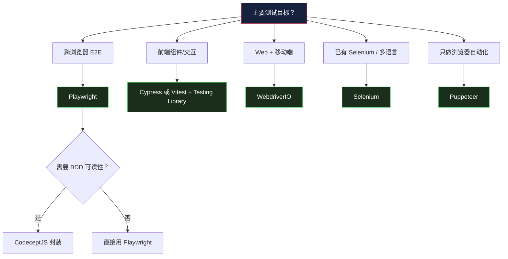

# Web UI 测试工具怎么选：Playwright、Cypress、Selenium 与它们的同伴

> 本文基于 Node.js 22.22.2、Playwright 1.65.1、Cypress 16.3.0、WebdriverIO 10.2.0；Playwright 示例在 macOS arm64 上实际运行。
> GitHub 数据截至 2026-11-20，星数是社区规模参考，不是选型评分。

## 目录

- [先给结论](#先给结论)
- [生活比喻：从零件质检到真实道路试驾](#生活比喻从零件质检到真实道路试驾)
- [先分清：Web UI 测试不只有 E2E](#先分清web-ui-测试不只有-e2e)
- [GitHub 数据对比](#github-数据对比)
- [Playwright：新项目最稳的默认选项](#playwright新项目最稳的默认选项)
- [Cypress：前端团队的调试台](#cypress前端团队的调试台)
- [Selenium：W3C 标准与多语言生态](#seleniumw3c-标准与多语言生态)
- [WebdriverIO：Web + 移动端一起测](#webdriverioweb-移动端一起测)
- [Puppeteer：浏览器自动化库，不是完整测试框架](#puppeteer浏览器自动化库不是完整测试框架)
- [CodeceptJS 与 Nightwatch：两个“另一种写法”](#codeceptjs-与-nightwatch两个另一种写法)
- [配套工具：组件、视觉与可访问性](#配套工具组件视觉与可访问性)
- [选择决策树](#选择决策树)
- [动手验证：一个最小 Playwright 项目](#动手验证一个最小-playwright-项目)
- [常见误区与反模式](#常见误区与反模式)
- [按场景选型速查](#按场景选型速查)
- [结语](#结语)
- [参考资料](#参考资料)

## 先给结论

不要按 GitHub 星数选测试工具。先回答三个问题：

1. **你要测什么层？** 组件、端到端、视觉、可访问性，工具不同。
2. **团队用什么语言？** Playwright 支持 TS/JS、Python、Java、.NET；Cypress 主要 JS/TS；Selenium 绑定最多。
3. **必须覆盖哪些浏览器/设备？** Chromium、Firefox、WebKit、移动端，差别很大。

一句话建议：

> **新项目、跨浏览器、要求稳定性和可调试性：优先 Playwright。**
> **前端团队、JS/TS、重视交互式调试和组件测试：Cypress。**
> **多语言、已有 Grid、企业遗留系统：Selenium。**
> **Web + 移动端统一：WebdriverIO。**
> **只做浏览器自动化/抓取，不是完整测试套件：Puppeteer。**

## 生活比喻：从零件质检到真实道路试驾

Web UI 测试像汽车出厂前的不同验收环节：

| 测试层 | 类比 | 测什么 |
|--------|------|--------|
| 单元测试 | 零件质检 | 函数、纯逻辑 |
| 组件测试 | 台架测试 | 一个组件在受控环境里的渲染和交互 |
| E2E 测试 | 真实道路试驾 | 用户从浏览器进入，走完整流程 |
| 视觉回归 | 外观验收 | 截图对比，防止 UI 视觉意外变化 |
| 可访问性测试 | 无障碍通道验收 | 键盘、屏幕阅读器、对比度 |

工具只是试车场：

- Playwright 是多车型试车场：Chromium、Firefox、WebKit 都能跑；
- Cypress 是带车内监控的调试台：前端开发者看得见每一步；
- Selenium 是历史最久的标准化驾校：语言多、Grid 成熟；
- WebdriverIO 是同时能开汽车和摩托车的场地：Web + 移动端；
- Puppeteer 是遥控车：能控制浏览器，但不负责完整验收流程；
- CodeceptJS 是统一遥控器：底层可以换 Playwright/Puppeteer/WebDriver；
- Nightwatch 是轻量试车场：够用，但要看维护节奏。

## 先分清：Web UI 测试不只有 E2E

很多“Web UI 测试工具推荐”把 E2E 工具当成全部。实际工程里至少分四层：

| 层级 | 典型工具 | 速度 | 适合发现 |
|------|----------|------|----------|
| 单元测试 | Vitest、Jest、pytest、JUnit | 毫秒级 | 逻辑错误 |
| 组件测试 | Vitest + Testing Library、Cypress Component Testing、Storybook | 秒级 | 渲染、交互、状态 |
| E2E 测试 | Playwright、Cypress、Selenium、WebdriverIO | 秒到分钟级 | 真实用户流程、集成问题 |
| 视觉/可访问性 | Playwright 截图、Chromatic、Percy、axe-core | 秒到分钟级 | 视觉回归、a11y 问题 |

**E2E 不是越多越好。** 一个业务分支如果能在组件测试里用 50ms 覆盖，就不要用 5 秒的 E2E 去测。E2E 应该覆盖“用户真正关心的关键路径”。

## GitHub 数据对比

数据来自 GitHub API，截至 **2026-11-20**。星数只代表社区规模，不代表质量或适配度。

| 工具 | Stars | 主语言 | 官方支持语言 | 浏览器/平台 | 定位 |
|------|-------|--------|--------------|-------------|------|
| [Playwright](https://github.com/microsoft/playwright) | 100,631 | TypeScript | TS/JS、Python、Java、.NET | Chromium、Firefox、WebKit | E2E + API 测试 |
| [Puppeteer](https://github.com/puppeteer/puppeteer) | 95,875 | TypeScript | JS/TS | Chrome/Chromium、Firefox | 浏览器自动化库 |
| [Cypress](https://github.com/cypress-io/cypress) | 51,038 | TypeScript | JS/TS | Chrome、Edge、Electron、Firefox | E2E + 组件测试 |
| [Selenium](https://github.com/SeleniumHQ/selenium) | 34,601 | Java | Java、Python、C#、Ruby、JS 等 | W3C WebDriver 浏览器 | 标准 + Grid + 多语言 |
| [Nightwatch](https://github.com/nightwatchjs/nightwatch) | 11,951 | JavaScript | JS/TS | WebDriver、Chrome DevTools | 轻量 E2E |
| [WebdriverIO](https://github.com/webdriverio/webdriverio) | 9,884 | TypeScript | JS/TS | WebDriver/CDP + Appium | Web + 移动端 |
| [CodeceptJS](https://github.com/codeceptjs/CodeceptJS) | 4,253 | JavaScript | JS/TS | Playwright/Puppeteer/WebDriver | BDD 风格封装 |

几个值得注意的点：

- **Puppeteer 星数很高，但它不是完整的测试框架。** 它是浏览器控制库，需要配 Jest/Mocha/node:test 等 runner；
- **Selenium 星数不是最高，但它是 W3C WebDriver 标准的核心实现**，在多语言和企业环境里仍然不可替代；
- **Cypress 星数约为 Playwright 的一半**，但它在 JS/TS 前端团队的开发体验上有独特优势；
- **Nightwatch 最近一次 push 是 2026-05-25**（其他几个在 2026-11 仍有更新），选之前要确认维护节奏是否满足你的版本要求。

## Playwright：新项目最稳的默认选项

Playwright 由 Microsoft 维护，Apache-2.0。它把“测试框架”和“浏览器自动化”做在了一起：

- **三大引擎**：Chromium、Firefox、WebKit；
- **自动等待**：元素可操作才执行，不需要手写 `sleep`；
- **Trace Viewer**：失败时回看每一步的截图、DOM、网络请求和控制台；
- **Codegen**：录制用户操作生成测试代码；
- **并行/分片**：本地 worker 并行，CI 分片；
- **多语言**：TS/JS、Python、Java、.NET；
- **网络拦截、设备模拟、API 测试**：同一个工具覆盖前后端边界。

一个最小测试：

```ts
import { expect, test } from "@playwright/test";

test("点击发布后状态更新", async ({ page }) => {
  await page.goto("/");
  await page.getByRole("button", { name: "Publish" }).click();
  await expect(page.getByTestId("status")).toHaveText("Published");
});
```

`getByRole` 和 `toHaveText` 是 Playwright 的推荐写法：前者按可访问性角色定位，后者会自动等待断言通过，避免固定 sleep。

**注意：** Playwright 的 WebKit 是 WebKit 引擎，不完全等同于品牌 Safari；Safari 特有的行为仍需要真机/真实 Safari 验证。

**适合：** 新项目、跨浏览器、多语言团队、要求 trace 和稳定 CI 的项目。

## Cypress：前端团队的调试台

Cypress 是 JS/TS 生态里最受欢迎的前端测试工具之一：

- 测试运行在浏览器里，提供时间旅行（Time Travel）和交互式 runner；
- 对 React/Vue/Angular 等现代前端框架友好；
- 支持 E2E 和 Component Testing；
- 调试体验非常直观：每一步的 DOM 快照、网络请求、控制台都能看。

典型代码：

```ts
describe("发布文章", () => {
  it("点击发布后显示成功", () => {
    cy.visit("/");
    cy.findByRole("button", { name: "Publish" }).click();
    cy.findByTestId("status").should("have.text", "Published");
  });
});
```

（`findBy*` 来自 Testing Library 的 Cypress 适配；原生 Cypress 用 `cy.get` 也可以。）

**边界：**

- 主要支持 JS/TS；Python、Java、.NET 团队不适用；
- 跨浏览器覆盖不如 Playwright/Selenium 广；
- 测试运行在浏览器内，复杂多页、多 origin、多标签场景需要先验证；
- 并行、录制、Dashboard 等高级能力与 Cypress Cloud 商业服务相关，自建要额外方案。

**适合：** 前端团队主导、JS/TS 技术栈、重视交互式调试和组件测试的项目。

## Selenium：W3C 标准与多语言生态

Selenium 是最老牌的浏览器自动化工具，也是 W3C WebDriver 标准的核心：

- 官方绑定覆盖 Java、Python、C#、Ruby、JavaScript 等；
- Selenium Grid 支持大规模分布式执行；
- 几乎所有浏览器和云测试平台都支持 WebDriver；
- 生态成熟，企业遗留系统、跨语言团队、测试平台集成经验丰富。

Python 示例：

```python
from selenium import webdriver
from selenium.webdriver.common.by import By

driver = webdriver.Chrome()
driver.get("http://localhost:3000")
driver.find_element(By.CSS_SELECTOR, "button[type='submit']").click()
assert "Published" in driver.find_element(By.CSS_SELECTOR, "[data-testid='status']").text
driver.quit()
```

Selenium 的“缺点”常常是它只提供标准能力，不提供 Playwright/Cypress 那样的开箱即用体验：等待、fixture、报告、并行、trace 需要自己组装或借助生态。

**适合：** 多语言团队、已有 Selenium/Grid 基础设施、需要标准 WebDriver 兼容性的企业项目。

## WebdriverIO：Web + 移动端一起测

WebdriverIO 是 Node.js 生态的测试框架：

- 支持 WebDriver 和 Chrome DevTools 协议；
- 通过 Appium 支持移动端原生/混合应用；
- 插件生态丰富，配置灵活；
- 适合 Web 和移动端共用一套测试组织的团队。

代价是配置项较多，团队需要理解 driver、capabilities、服务等概念。

**适合：** 同时测 Web 和 App、以 JS/TS 为主、需要统一测试框架的团队。

## Puppeteer：浏览器自动化库，不是完整测试框架

Puppeteer 是 Chrome 官方维护的浏览器自动化库：

- 直接控制 Chrome/Chromium（也支持 Firefox 的部分能力）；
- 适合截图、PDF、爬虫、性能采集、浏览器脚本；
- 可以配合 Jest/Mocha/node:test 做测试，但它本身不是完整 runner；
- 星数很高，但和 Playwright/Cypress 不是同一类产品。

**如果你要的是“可维护的 Web UI 测试套件”，优先 Playwright；如果你要的是“用代码控制浏览器做一件事”，Puppeteer 很合适。**

## CodeceptJS 与 Nightwatch：两个“另一种写法”

### CodeceptJS

CodeceptJS 提供 BDD 风格的高层 API，底层可以切换 Playwright、Puppeteer、WebDriver：

```js
Scenario("发布文章", ({ I }) => {
  I.amOnPage("/");
  I.click("Publish");
  I.see("Published");
});
```

优点是可读性强、切换 driver 方便；代价是抽象层增加，复杂场景需要理解底层行为。

### Nightwatch

Nightwatch 是较早的 Node.js E2E 框架，支持 WebDriver 和 Chrome DevTools。语法简单，适合已有 Nightwatch 项目或轻量场景。但它的维护节奏比前几个慢，新项目选之前建议确认目标浏览器和 Node 版本支持。

## 配套工具：组件、视觉与可访问性

| 需求 | 推荐 | 说明 |
|------|------|------|
| 组件测试 | Vitest + Testing Library | 快、贴近用户行为，不启动浏览器 |
| 组件状态/文档 | Storybook | 组件目录、交互示例；可接视觉测试 |
| 视觉回归 | Playwright 截图、Chromatic、Percy | 截图 diff；注意基线和环境稳定性 |
| 可访问性 | axe-core、@axe-core/playwright | 自动检查 ARIA、对比度、表单标签等 |
| API 测试 | Playwright request、Supertest、pytest | E2E 前先保证 API 契约 |

**组件测试和 E2E 不是替代关系。** 组件测试覆盖状态和渲染分支，E2E 覆盖真实集成路径；两者配合，才能既快又稳。

## 选择决策树



## 动手验证：一个最小 Playwright 项目

下面是我在本机实际跑通的 demo。

### 目录树

```text
playwright-demo/
├── package.json
├── playwright.config.ts
├── site/
│   └── index.html
└── tests/
    └── home.spec.ts
```

### 配置

`package.json`：

```json
{
  "name": "playwright-demo",
  "private": true,
  "type": "module",
  "scripts": {
    "test": "playwright test"
  },
  "devDependencies": {
    "@playwright/test": "1.65.1"
  }
}
```

`playwright.config.ts`：

```ts
// playwright.config.ts
import { defineConfig } from "@playwright/test";

export default defineConfig({
  testDir: "./tests",
  reporter: "line",
  use: {
    baseURL: "http://127.0.0.1:4173",
    channel: "chrome",
    headless: true,
  },
  webServer: {
    command: "python3 -m http.server 4173 --directory site",
    port: 4173,
    reuseExistingServer: false,
  },
});
```

这里用 `channel: "chrome"` 使用系统 Chrome，避免额外下载浏览器；CI 里通常用 `npx playwright install --with-deps` 安装 Playwright 管理的浏览器。

### 页面

```html
<!doctype html>
<html lang="en">
  <body>
    <h1>Welcome</h1>
    <button id="publish">Publish</button>
    <p data-testid="status">Draft</p>
    <script>
      document.querySelector("#publish").addEventListener("click", () => {
        document.querySelector('[data-testid="status"]').textContent = "Published";
      });
    </script>
  </body>
</html>
```

### 测试

```ts
// tests/home.spec.ts
import { expect, test } from "@playwright/test";

test("首页可以正常加载", async ({ page }) => {
  await page.goto("/");
  await expect(page.getByRole("heading", { name: "Welcome" })).toBeVisible();
});

test("点击发布后状态更新", async ({ page }) => {
  await page.goto("/");
  await page.getByRole("button", { name: "Publish" }).click();
  await expect(page.getByTestId("status")).toHaveText("Published");
});
```

### 运行结果

```bash
$ npm install
added 3 packages in 9s

$ npx playwright test
Running 2 tests using 1 worker

[1/2] tests/home.spec.ts:3:1 › 首页可以正常加载
[2/2] tests/home.spec.ts:8:1 › 点击发布后状态更新

2 passed (3.2s)
```

（输出有删节，省略了测试用 HTTP server 的访问日志。）

这个例子没有手写 `sleep`：`click()` 会等待元素可操作，`toHaveText()` 会轮询断言。**自动等待不是魔法，而是把“等待条件”交给框架，减少 flaky。**

## 常见误区与反模式

### 1. 按星数选工具

Puppeteer 星数比 Cypress 高，但它不是完整测试框架；Selenium 星数不是最高，但它是 WebDriver 标准。**选型看约束，不看排行榜。**

### 2. 所有东西都写 E2E

登录、下单、支付都写 E2E，测试会慢、脆、难定位。把逻辑和组件分支下沉到单元/组件测试，E2E 只保留关键用户路径。

### 3. CSS 选择器绑定实现

```ts
await page.click("div > div:nth-child(3) > button");
```

改一次布局就挂。优先用 `getByRole`、`getByLabel`、`getByTestId`。

### 4. 用固定 `sleep`

```ts
await page.waitForTimeout(3000);
```

网络慢一点就失败，快一点就浪费时间。用框架的自动等待和可断言条件。

### 5. 测试之间共享状态

测试 A 创建的数据影响测试 B，单独跑能过、并行跑就挂。每个测试自己准备数据，或通过 API 清理。

### 6. 忽略 flaky

用重试掩盖 flaky，等于把问题埋进 CI。先定位等待、数据、环境、并发问题，再考虑重试。

### 7. 把 Puppeteer 当测试框架

Puppeteer 是浏览器控制库，不是 runner；你需要自己组织测试、断言、报告和并行。

### 8. 以为 Playwright WebKit 就是 Safari

WebKit 是引擎，不等于品牌 Safari 的完整行为；Safari 特有问题仍需真机验证。

## 按场景选型速查

| 场景 | 推荐 |
|------|------|
| 新项目，跨 Chromium/Firefox/WebKit | Playwright |
| 前端团队，JS/TS，组件 + E2E | Cypress + Testing Library |
| 多语言团队，已有 Grid | Selenium |
| Web + 移动端统一 | WebdriverIO |
| 浏览器自动化/抓取/截图 | Puppeteer |
| 想要 BDD 可读性 | CodeceptJS |
| 已有 Nightwatch 项目 | Nightwatch（先确认维护节奏） |
| 组件测试为主 | Vitest + Testing Library |
| 可访问性自动检查 | axe-core |

## 结语

Web UI 测试工具没有“绝对最好”，只有“当前约束下最合适”：

- **Playwright** 是 2026 年新项目最稳的默认值：跨浏览器、多语言、trace、自动等待都到位；
- **Cypress** 仍然是 JS/TS 前端团队的最佳调试体验之一；
- **Selenium** 不是“过时”，而是标准、Grid 和多语言生态；
- **WebdriverIO** 解决 Web + 移动端的统一；
- **Puppeteer** 是自动化库，不是完整测试框架；
- **CodeceptJS / Nightwatch** 是特定风格和场景的补充。

先分层，再选工具；先写稳定的关键路径，再追求覆盖率。**测试工具的价值，不是让你写更多测试，而是让你更快知道哪里坏了。**

## 参考资料

- [Playwright GitHub](https://github.com/microsoft/playwright)
- [Playwright 文档（GitHub）](https://github.com/microsoft/playwright/tree/main/docs)
- [Cypress GitHub](https://github.com/cypress-io/cypress)
- [Cypress 文档](https://docs.cypress.io/)
- [Selenium GitHub](https://github.com/SeleniumHQ/selenium)
- [Selenium 源码](https://github.com/SeleniumHQ/selenium)
- [WebdriverIO GitHub](https://github.com/webdriverio/webdriverio)
- [WebdriverIO 源码](https://github.com/webdriverio/webdriverio)
- [Puppeteer GitHub](https://github.com/puppeteer/puppeteer)
- [CodeceptJS GitHub](https://github.com/codeceptjs/CodeceptJS)
- [Nightwatch GitHub](https://github.com/nightwatchjs/nightwatch)
- [Testing Library 源码](https://github.com/testing-library/react-testing-library)
- [Vitest 源码](https://github.com/vitest-dev/vitest)
- [axe-core](https://github.com/dequelabs/axe-core)
